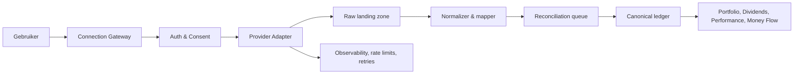
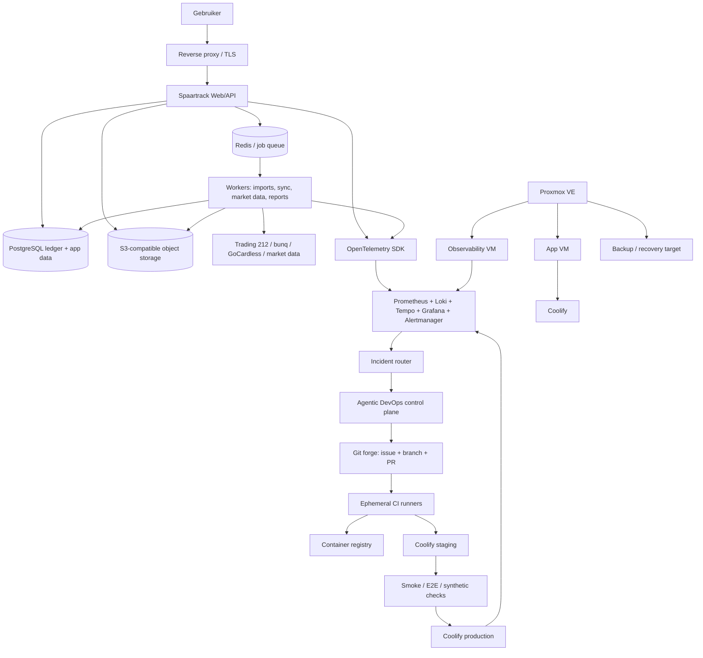

# Spaartrack — roadmap en totale feature-inventarisatie

**Actuele QA-status (20 oktober 2026, tweede pass — REPORTED, nog niet onafhankelijk gereconcilieerd):** de QA-hervalidatie van 20 oktober 2026 *rapporteert* **133/133 parent stories** als lokaal Done op HEAD `366bd0f`; volledige stackregressie **551 tests / 550 pass / 0 fail / 1 skipped**, default gate **551 tests / 418 pass / 0 fail / 133 skipped**, `tsc --noEmit` groen en Compose-stack healthy. De enige skip (`TC-US-0803-live-runtime`) is apart met `BROKER_RUNTIME_TEST=1` tegen een wegwerp-testdatabase **1/1 groen** uitgevoerd. De **testtellers zijn afkomstig uit die QA-pass**; de **133/133 storyclaim is nog niet onafhankelijk gereconcilieerd** — de leidende reconciliatie loopt via het B-004 story-ledger: de remediatie (`t_c74716e4`) is afgerond en de onafhankelijke QA daarop (`t_66446e65`) is afgerond met **REQUEST CHANGES** op F1 (fixture-pack-census noemt `IMPORT-001` en `PROVIDER-001` ten onrechte als afwezig) en F2 (de provenance-pin koppelt de digest niet aan de benoemde revisie); de begrensde herstelactie loopt in vlucht onder `t_f1ed17dc`. De oudere testtellers en statusparagrafen in dit document zijn historisch bewijs; leidend is **QA-hervalidatie 20 oktober 2026 — tweede pass**.

Analytics / Bondprofielen & cashflows UX-audit aanvullend bewijs (2026-10-19): eerst is `tests/unit/analytics-bondprofiles-ux.test.mjs` rood toegevoegd voor page hierarchy, KPI-overview, cashflow-tabel, empty/loading/error states, touch targets en traceability. Daarna zijn `apps/web/index.html` en `apps/api/src/index.ts` aangepast: Analytics opent nu op een eigen bond-overview met tabelalternatief, tekstuele coupon/principal-status, reset, modulevolgorde en trace/correlation-evidence; bond profile/pricing/curve-fouten loggen trace- en correlation-ID’s. Gerichte regressie: **3/3 groen**; volledige lokale gate: **526 tests / 395 pass / 0 fail / 131 skipped**; `tsc --noEmit` groen; Codex-browserflow controleerde Analytics, overview/reset, synthetic fixture, cashflow generation, bond pricing, parallel shift en module-selector; fresh browser-tab console **0 errors/warnings**; `docker compose up -d --build api web` groen. Alle data synthetisch en read-only voor de canonical ledger.

Actions UX-audit aanvullend bewijs (2026-10-19): eerst is `tests/unit/actions-option-contracts-ux.test.mjs` rood toegevoegd voor page-level heading/overview, contracttabel, filter/reset, loading/empty/error states, traceability en touch targets. Daarna is `apps/web/index.html` aangepast: Actions / Option contracts & Greeks heeft nu een duidelijke informatiehiërarchie, tabelalternatief, statuslabels, filter/reset, expliciete states, trace/correlation-evidence en keyboard/focus/touch-target styling. Gerichte regressie: **3/3 groen**; UX-richtlijnregressie: **5/5 groen**; volledige regressie: **518 tests / 387 pass / 0 fail / 131 skipped**; `tsc --noEmit` groen; Codex-browser: filter PUT, lege state, reset, synthetic fixture, Greeks-berekening, auditdrawer, profieldrawer en module-selector gecontroleerd; browserconsole **0 errors/warnings**; compose-logscan schoon op error/fatal/exception/failed/panic/unhealthy/oom. Alle data synthetisch en read-only voor de ledger.

Calendar UX-audit aanvullend bewijs (2026-10-19): eerst is `tests/unit/calendar-overview-ux.test.mjs` rood toegevoegd voor een echte Calendar / Overview-route, maand/weekweergave, periode-navigatie, eventtypefilter/reset, today-markering, expliciete lege dagen, tabelalternatief en trace/correlation-evidence. Daarna is `apps/web/index.html` aangepast: de eerder lege Calendar-route heeft nu een read-only synthetic market-events overview met EX_DIVIDEND, DIVIDEND_PAYMENT, AGM, EARNINGS en ECONOMIC, gegroepeerde kalenderdagen, week- en maandweergave, statuslabels die niet alleen kleur gebruiken, toegankelijke grid/table-structuur en `calendar-overview-v1`/`calendar-events-v1` evidence. Gerichte regressie: **2/2 groen**; volledige regressie: **515 tests / 384 pass / 0 fail / 131 skipped**; `tsc --noEmit` groen; Codex-browserflow voor Calendar, maand/week, vorige/volgende/vandaag, AGM-filter, reset, lege state, profieldrawer en auditdrawer gecontroleerd; browserconsole **0 warnings/errors**. `docker compose ps` toont healthy api, db, redis, web, object-storage; recente compose-logscan bevat geen error/fatal/exception/failed/panic/unhealthy/oom. Alle data bleef synthetisch.

Dividends UX-audit aanvullend bewijs (2026-10-19): eerst is `tests/unit/dividends-overview-ux.test.mjs` rood toegevoegd voor een eigen Dividends / Overview-route met KPI’s, periodekeuze, chart-tabelalternatief, statusfilter/reset, sortering en trace/correlation-evidence. Daarna is `apps/web/index.html` aangepast: de Dividends-route heeft nu een complete read-only overview met expliciete PAID/projected-statussen, lege state, toegankelijke controls en synthetische traceability. Gerichte unit-regressie: **181/181 groen**; `tsc --noEmit` groen; Codex-browserflow voor route, alle periodeknoppen, statusfilter, reset, beide sorteeracties, modulekeuze, profiel en audit drawer gecontroleerd; browserconsole **0 errors/warnings**; recente compose-logscan schoon op error/fatal/exception/failed/panic/unhealthy/oom. Volledige smoke-health/observability: **6 pass / 0 fail / 1 skipped**. Alle data synthetisch.

Performance UX-audit aanvullend bewijs (2026-10-19): eerst is `tests/unit/performance-page-ux.test.mjs` rood toegevoegd voor route-scoped filters, contextuele module-navigatie en trace/correlation-evidence. Daarna zijn `apps/web/index.html` en `apps/api/src/index.ts` aangepast: de Performance / Risk & benchmark pagina heeft een eigen `Performance` heading/region, Portfolio-filters zijn uitsluitend Portfolio-scoped, module-labels volgen de actieve pagina, response trace/correlation-ID’s blijven zichtbaar en risk-fouten loggen dezelfde IDs. Gerichte regressie: **12/12 groen**; volledige lokale suite: **511 tests / 380 pass / 0 fail / 131 skipped**; `tsc --noEmit` groen; Codex-browserflow voor risk fixture/calculate, Compare portfolios, What-if scenario, profiel en audit drawer gecontroleerd; browserconsole **0 errors/warnings**; recente API/web-logscan schoon op error/fatal/exception/failed/panic/unhealthy/oom. Alle data synthetisch.

Portfolio UX-audit aanvullend bewijs (2026-10-19): `tests/unit/portfolio-overview-ux.test.mjs` is eerst rood toegevoegd voor toegankelijke navigatienamen, profielactie, filters, grafiek-tabelalternatief en zichtbare positions. Daarna zijn in `apps/web/index.html` filters met reset en directe grafiek/tabel-update, de performance-data table alternative, sticky eerste tabelkolom, expliciete empty state, toegankelijke icon-actions en mobiele menu-toggle hersteld. Compose-regressie: lint/typecheck groen, **509 tests / 378 pass / 0 fail / 131 skipped**. Codex-browser: profiel, drawers, timetravel, filter/reset, route-navigatie en 390px mobiele toggle gecontroleerd; console **0 errors/warnings**. Container-logscan schoon op error/fatal/exception/failed/panic/unhealthy/oom; fixtures synthetisch.

Onderzoeksnotitie voor het bouwen van een eigen, private variant op een Coolify-server.

- Onderzochte demo: [Jong Beleggen](https://app.portfoliodividendtracker.com/p/jongbeleggen)
- Productsite: [Portfolio Dividend Tracker](https://portfoliodividendtracker.com/en)
- Onderzocht op: 17 oktober 2026
- Status: publieke demo + officiële help/productpagina’s. Demo-gedrag is direct in de browser gecontroleerd; accountgebonden functies zijn hieronder als productclaim gemarkeerd.

## Roadmap in één branching diagram

De roadmap volgt een dependency-first volgorde: eerst een betrouwbare lokale financiële ledger, daarna import en berekeningen, vervolgens analyse-/rapportagefeatures en ten slotte AI, extensibility en community. Elke aftakking kan na de ouderfase zelfstandig worden uitgebreid.

```mermaid
flowchart TD
    A["0. Productfundament\nprivate • self-hosted • auditbaar"] --> B["1. Financiële ledger\naccounts • securities • currencies • actions"]
    A --> A1["Security & operations\n2FA • OIDC • secrets • backups • health checks"]
    A --> A2["Platform UX\nresponsive web • PWA • mobile • dark/zen mode"]

    B --> C["2. Invoer en normalisatie\nmanual • CSV/QIF • broker sync • API"]
    C --> C1["Import safety\nvalidation • mapping • duplicates • review • undo"]
    C --> C2["Multi-account\nportfolio groups • cash • custom/unlisted assets"]

    B --> D["3. Portfolio core\nposities • cost basis • allocation • net worth"]
    D --> D1["Allocation branches\nsector • region • currency • strategy • broker"]
    D --> D2["Historical state\nTimetravel • snapshots • closed positions"]
    D --> D3["Goal branches\nsavings goals • funding shares • contribution limits"]

    D --> E["4. Performance engine\nTWR • MWRR/IRR • Modified Dietz • CAGR • ROAI"]
    E --> E1["Risk & benchmark\nbeta • volatility • drawdown • Sharpe/Sortino • risk contribution"]
    E --> E2["Comparison & simulation\nbenchmarks • portfolio compare • Monte Carlo • CAPM drift"]

    B --> F["5. Income engine\ndividends • interest • taxes • future cashflows"]
    F --> F1["Dividend branches\ncalendar • forecasts • PADI • growth • DRIP • alerts"]
    F --> F2["Fixed income\nbonds • yield curves • maturity ladder • coupons • DV01"]
    F --> F3["Options\nGreeks • payoff • wheel lifecycle • assignment/expiry"]

    E --> G["6. Analytics & decisions\nX-ray • screeners • watchlists • rebalance"]
    G --> G1["Exposure\nETF look-through • overlap • concentration • targets"]
    G --> G2["Decision tools\nrebalance plan • what-if • backtest • Risk Lab"]
    G --> G3["Market context\nfundamentals • sentiment • earnings • news"]

    C --> H["7. Money Flow & personal finance\nincome • spending • saving • budgets"]
    H --> H1["Money Flow\ninteractive flow chart • category drill-down • FX"]
    H --> H2["Spending intelligence\nmovers • narrative insights • heatmap • life events"]
    H --> H3["Planning\nforecast • subscriptions • scheduled payments • FIRE • debt payoff"]

    E --> I["8. Tax & reporting\nlot methods • taxable income • exports"]
    I --> I1["Tax intelligence\nFIFO/LIFO/WAC • harvesting • wash sale • FX impact"]
    I --> I2["Jurisdictions\ncustom tax year • deemed disposal • Modelo 720"]
    I --> I3["Reports\nPDF • CSV/XLSX • Sheets • accountant sharing"]

    D --> J["9. UX, sharing & community\ndashboards • public portfolios • feedback"]
    J --> J1["Personalization\ncustom dashboard • widgets • table layouts • labels/groups"]
    J --> J2["Sharing\nread-only links • scopes • advisor/family access"]
    J --> J3["Community\nasset forums • portfolio feed • comments • moderation"]

    D --> K["10. AI & extensibility\nassistant • MCP • addons"]
    K --> K1["AI assistant\nBYOK/local models • charts • categorization • scenarios"]
    K --> K2["Controlled actions\npermissions • Confirm/Cancel • undo • audit trail"]
    K --> K3["Developer platform\nSDK • addons • events • secrets • sandbox"]

    A1 --> L["11. Production hardening\nCoolify • Docker • monitoring • retention"]
    A2 --> L
    C1 --> L
    K3 --> L

    L --> M["12. Private Spaartrack release\nbackup/restore • migrations • documentation • tests"]
```



### Fasevolgorde en branch-contracten

| Fase | Hoofdbranch | Oplevercriterium | Belangrijkste afhankelijkheid |
|---|---|---|---|
| 0 | Productfundament | Private, beveiligde runtime met auditbare data-opslag | Geen |
| 1 | Financiële ledger | Accounts, assets, actions, valuta en cashbalansen zijn consistent | Fase 0 |
| 2 | Invoer/normalisatie | Handmatige, CSV- en brokerdata kunnen veilig worden ingevoerd en teruggedraaid | Fase 1 |
| 3 | Portfolio core | Posities, cost basis, allocatie, net worth en historische snapshots kloppen | Fase 1–2 |
| 4 | Performance | TWR/MWRR/IRR/Modified Dietz/ROAI zijn reproduceerbaar getest | Fase 3 |
| 5 | Income | Dividend-, interest-, bond- en option-cashflows zijn correct geboekt | Fase 1–4 |
| 6 | Analytics | Risk, benchmarks, X-ray, targets, rebalance en simulaties gebruiken dezelfde brondata | Fase 3–5 |
| 7 | Money Flow | Spending, saving, income, budgets en persoonlijke cashflow tellen interne transfers niet dubbel | Fase 1–2 |
| 8 | Tax/reporting | Lots, belastingregels, exports en delen zijn jurisdictioneel begrensd | Fase 1–5 |
| 9 | UX/community | Dashboard-, sharing- en communityfuncties respecteren privacy-scopes | Fase 3–8 |
| 10 | AI/extensibility | AI/addons lezen of muteren alleen binnen expliciete scopes | Fase 1–9 |
| 11–12 | Hardening/release | Backups, migraties, monitoring, tests en Coolify-deployment zijn herhaalbaar | Alle relevante branches |

## Productprioriteit voor het development team

De feature-inventaris is groter dan één eerste release. Voor Spaartrack is de juiste volgorde: eerst betrouwbare financiële grondwaarheid, daarna de kernervaring voor portfolio en dividend, vervolgens persoonlijke cashflow en rapportage, en pas daarna specialistische instrumenten, AI en community. Een feature mag pas naar een volgende laag wanneer de onderliggende data- en berekeningscontracten stabiel zijn.

### Prioriteitsmodel

- **P0 — fundamenteel / blocker**: noodzakelijk voor veiligheid, correcte berekeningen en iedere andere feature.
- **P1 — MVP / eerste dagelijks bruikbare release**: levert de kernwaarde van Spaartrack op voor privégebruik.
- **P2 — high-value uitbreiding**: duidelijke gebruikerswaarde, maar niet nodig om de eerste release te gebruiken.
- **P3 — specialistisch of complex**: pas bouwen wanneer de kerndata betrouwbaar is en er concrete behoefte bestaat.
- **P4 — optioneel differentiërend**: AI, community, multi-device en ecosysteemfeatures; waardevol, maar geen reden om de financiële kern uit te stellen.

De P-labels beschrijven de **waarde en releaseklasse**; zij zijn niet voldoende om de bouwvolgorde te bepalen. De onderstaande dependency-ordered sequence is leidend voor planning, sprintvolgorde en agentische decompositie. Een item mag pas starten wanneer de exitcriteria van alle upstream items groen zijn.

### Startbesluit: leidende volgorde voor het agentic development team

De roadmap wordt voor uitvoering gelezen als een reeks **waves**. De bestaande feature-inventaris blijft de bron voor scope en user stories; deze sectie is de leidende volgorde voor agent-dispatch, parallel werk en releasebesluiten.

De eerste gebruikersrelease is bewust klein: een private gebruiker kan een portfolio handmatig opbouwen, transacties corrigeren, posities en cash bekijken, dividend ontvangen en performance reproduceren. Broker-sync, bankkoppelingen, fiscale intelligentie, specialistische instrumenten, AI en community zijn geen voorwaarde voor deze eerste release.

#### Wave 0 — contract freeze en testbasis

Start onmiddellijk met één kort, gezamenlijk contractpakket:

- **Architectuurcontract:** US-0001 t/m US-0005; bevestig ADR-0001 en ADR-0002, bounded contexts, application-servicegrenzen en non-goals.
- **Financiële invariants:** definieer cash, quantity, cost basis, transfers, FX, idempotency, correction/void en replay als uitvoerbare regels.
- **Synthetische fixtures:** leg minimaal `ENV-001`, `SEC-001`, `LEDGER-001`, `CALC-001` en `UI-001` vast; geen provider- of modelcredentials.
- **Traceability:** koppel iedere `US-*` aan de bestaande `TC-US-*`-test, owner, module en exitcriterium.

**Gate W0:** contracten zijn reviewbaar, de eerste tests staan rood, en iedere volgende agent kan zonder nieuwe domeininterpretatie starten.

#### Wave 1 — delivery runway, security en ledgercontract parallel

| Werkstroom | Stories | Agent-output | Startvoorwaarde |
|---|---|---|---|
| Delivery/runtime | US-0101–US-0107 | lokale Compose-stack, CI, Coolify development, health/readiness, traces, backup/restore smoke test | Wave 0 |
| Identity/security | US-0201–US-0206 | user/session/2FA of OIDC, portfolio scopes, audit en export/delete contracten | Wave 0; runtimebasis zodra beschikbaar |
| Ledgercontract | TC-US-0301–TC-US-0308 eerst rood, daarna US-0301–US-0308 | schema- en application-servicecontract voor portfolio, accounts, instruments, activities, idempotency en replay | Wave 0; implementatie na W0-contractreview |

Deze werkstromen mogen parallel lopen, maar geen agent mag een read model of UI bouwen alsof de ledger al stabiel is. De ledger blijft de enige financiële write boundary; connectors, agents en projections gebruiken application services/events.

**Gate W1:** CI is blokkerend, testdata is synthetisch, tenant-isolation/securitytests slagen, en ledger invariant-, correction/void-, replay- en restore-tests zijn groen.

#### Wave 2 — financiële kernel

Bouw achtereenvolgens:

1. **Canonical ledger:** US-0301–US-0308.
2. **Calculation/market-data kernel:** US-0401–US-0408; FX, prices, security identity, cost basis, P&L, corporate actions en snapshots.
3. **Rebuildable projections:** posities, cash, allocation en historische state uitsluitend vanuit ledger + versioned calculations.

**Gate W2:** `TC-US-0301`–`TC-US-0308` en `TC-US-0401`–`TC-US-0408` zijn groen, inclusief multi-currency, fees, taxes, partial sells, splits, correction/void en deterministische replay/restore.

#### Wave 3 — handmatige portfolio-MVP

Bouw US-0501–US-0507 als eerste verticale gebruikersslice: onboarding/empty state, handmatige actions, portfolio-overzicht, posities, allocation, position detail en timetravel. De UI leest alleen calculation read models en commit via application commands.

**Gate W3 / Release 1 kandidaat:** een synthetische gebruiker kan zonder import of spreadsheet een portfolio opbouwen, corrigeren en op een gekozen datum opnieuw berekenen; `TC-US-0501`–`TC-US-0507` en de volledige regression suite zijn groen.

#### Wave 4 — veilige invoer, income en performance

Werk in deze volgorde, met beperkte parallelisatie:

- **4A Import safety:** US-0601–US-0608 — upload, mapping, preview, review, duplicate detection, atomic commit, void/undo en reconciliation queue.
- **4B Income/dividend:** US-0701–US-0708 — dividend/interest events, received/expected, TTM/PADI, calendar en alerts.
- **4C Performance:** binnen dezelfde slice TWR, MWRR/IRR, Modified Dietz, CAGR en ROAI met versioned assumptions.

4B en 4C mogen starten zodra de benodigde ledger- en calculation-contracten groen zijn; geen providerintegratie is nodig om deze kern te bouwen. **Gate W4 / Release 2:** import is idempotent en omkeerbaar, income en performance zijn volledig herleidbaar tot ledger + snapshots, en alle tests voor slices 6 en 7 zijn groen.

#### Wave 5 — eerste differentiërende uitbreiding

Bouw daarna US-0801–US-0910: eerst read-only broker/CSV-adapters met het canonical connectorcontract, daarna Money Flow met expliciete internal-transfer-, creditcard- en multi-currency-semantiek. GoCardless en directe bunq OAuth blijven achter een afzonderlijke compliance- en consent-gate.

**Gate W5 / Release 3 kandidaat:** een volledige synthetische import/sync/reconcile-run is herhaalbaar, providerfouten zijn zichtbaar, en Money Flow telt interne transfers niet dubbel.

#### Wave 6 en later — gecontroleerde uitbreiding

Pas na W5 worden reporting/goals/planning, advanced analytics, tax intelligence, specialistische instrumenten, sharing/PWA, AI/MCP/addons en autonomous operations in die volgorde opgepakt. Binnen elk domein geldt opnieuw: eerst contracttest en fixture, dan application service, dan projection/API, dan UI.

### Agent-dispatchregels voor de start

- Dispatch per wave, niet per losse featurelijst. Een agent krijgt één bounded context en één expliciete gate.
- Laat maximaal één agent tegelijk het canonical ledgercontract en migraties wijzigen; andere agents werken op contracten, tests of adapters.
- Elke wijziging start met een rode `TC-US-*`-test of een nieuwe child-test; tests uitschakelen of verzwakken is verboden.
- Parallel werk mag alleen wanneer het geen gedeelde schema-, event- of contractwijziging veronderstelt die nog niet is goedgekeurd.
- Iedere agent levert naast code ook trace/correlation-ID’s, synthetic fixture evidence en een korte gate-status op.
- Een agent mag nooit rechtstreeks production SQL, ledger-tabellen of providerdata muteren. Mutaties lopen via application commands; correcties gebruiken correction/void en audit.
- Stop vóór een volgende wave wanneer een financiële invariant, restore/replay-test, security gate of provider-contracttest rood is.

### Omgevingsstrategie: lokaal → Coolify development → Coolify production

De roadmap heeft drie opeenvolgende leveringspoorten. Een feature kan inhoudelijk lokaal klaar zijn zonder dat zij al production-ready is. Promotie gebeurt uitsluitend met hetzelfde immutable artifact en dezelfde test-evidence.

#### Poort A — Local MacBook release

Doel: een eerste verticale slice die volledig op de MacBook werkt met synthetische data.

Deze release bevat:

- Wave 0-contracten en de verplichte rode TDD-tests;
- lokale Compose-stack met web, API, worker, PostgreSQL en Redis;
- dev-only synthetic identity en portfolio-scope isolation;
- canonical ledger voor portfolio, account, security, currency en deposit/buy/sell/dividend/fee;
- idempotency, correction/void, audit events en replay;
- read models voor cash, posities, cost basis, P&L en allocation;
- één worker-job voor projection rebuild;
- minimale web-UI om actions in te voeren en portfolioresultaten te bekijken;
- local smoke-, contract-, unit/golden- en E2E-tests;
- Docker images die lokaal reproduceerbaar bouwen.

**Gate A:** een synthetische gebruiker kan lokaal een portfolio opbouwen, corrigeren en opnieuw berekenen; `TC-US-0301`–`TC-US-0507` die voor deze slice relevant zijn zijn groen; `docker compose up -d --build` en de volledige lokale check slagen. Er is nog geen echte providerdata en geen production secret.

#### Poort B — Coolify development release

Doel: dezelfde lokale release naar Coolify development brengen en daar de volledige CI/CD- en operationele keten bewijzen.

Voeg in deze poort toe:

- Coolify development application(s) voor web, API, worker en dependencies;
- PR-CI met lint, typecheck, tests, database validation, image build, SBOM en artifact digest;
- automatische deploy naar Coolify development vanuit een commit SHA;
- migration/expand-contract checks, readiness/liveness en release metadata;
- OTel, metrics, logs, correlation-ID’s en environment-specific dashboards;
- development secrets via secret references, nooit in Git of fixtures;
- deploy smoke-, migration-, restore- en rollback-rehearsal;
- promotion evidence: commit → image digest → deployment → testresultaat.

In deze poort mogen import safety, dividend/performance en een synthetische CSV-adapter parallel worden gebouwd, maar zij zijn niet nodig om de eerste Coolify deployment te bewijzen.

**Gate B:** een merge naar de afgesproken development branch bouwt één immutable image, deployt automatisch naar Coolify development, draait migrations en smoke-tests, rapporteert traces/metrics/logs en kan veilig naar de vorige development release terugvallen zonder ledgerdata te verwijderen.

#### Poort C — Coolify production release

Doel: dezelfde gevalideerde artifact-digest gecontroleerd naar production promoveren.

Production vereist bovenop Poort B:

- production threat-model review en security/tenant-isolation tests;
- echte auth-flow met OIDC en/of 2FA, inclusief revoke en recovery;
- production secret/vault-referenties en least-privilege serviceaccounts;
- backup-retention, restore-drill en recovery-evidence;
- expand/contract migratiebewijs en expliciet rollbackplan;
- production dashboards, alerts, SLO’s en incident-runbook;
- menselijke approval gate voor ledger-, schema-, secrets- en releasewijzigingen;
- beperkte pilot met synthetische of expliciet gemigreerde data voordat echte financiële data wordt toegestaan.

**Gate C:** production deployt uitsluitend een digest die in development is gevalideerd; health/readiness, backup/restore, observability, security en release verification zijn groen. Een image rollback wordt nooit als database rollback beschouwd.

### Nieuwe prioriteitsregel

De eerste prioriteit is niet “alle P0-features bouwen”, maar **Poort A sluiten met een echte vertical slice**. Daarna sluit het team Poort B met CI/CD en Coolify development. Pas wanneer Poort B stabiel is, worden production hardening en de overige roadmapbranches vrijgegeven voor production-promotie.

### Historische status — lokale MacBook release (18 oktober 2026)

Bijgewerkt op **18 oktober 2026**. De lokale MacBook-release heeft **88 van 133 parent user stories gerealiseerd (66,2%)**: `US-0101` t/m `US-0107`, `US-0201` t/m `US-0206`, `US-0301` t/m `US-0308`, `US-0401` t/m `US-0408`, `US-0501` t/m `US-0507`, `US-0601` t/m `US-0608`, `US-0701` t/m `US-0708`, `US-0801` t/m `US-0806`, `US-0901` t/m `US-0910`, `US-1001` t/m `US-1007`, `US-1101` t/m `US-1107`, `US-1201` t/m `US-1206`; `US-1008` bestaat niet in de roadmap/test-cases. De totale roadmapvoortgang voor de lokale MacBook-release is daarmee **88/133 = 66,2%**; de resterende 45 parent stories zijn niet als lokaal gerealiseerd gemarkeerd. De lokale regressiegate bevat de gerichte US-1206 unit-, contract-, runtime- en GUI-checks; API, web, worker, PostgreSQL, Redis en object storage zijn healthy. De Codex in-app frontendtab op `http://localhost:3002/?release=1206-comparison` toont `calculated · read-only`, periode `2026-01-01 → 2026-05-01`, EUR, twee portefeuilles, `portfolio-comparison-v1`, performance en riskvelden, en `allocation 100.00%` per portefeuille; de browserconsole bevat geen warnings/errors. Alle data en fixtures bleven synthetisch; echte bank/providerdata blijft buiten de lokale MacBook-release. Atomic children `US-0203-A` en `US-0203-B` gebruiken respectievelijk een local-only TOTP- en synthetic OIDC-adapter. Deze tussenstand is historisch; zie de statusupdate en hervalidatie hieronder voor de actuele stand.

#### GUI-acceptatie — lokale container

**Historische statusupdate en hervalidatie 18 oktober 2026 (superseded door de QA-hervalidatie van 20 oktober 2026):** lokaal staan **123/133 parent stories als Done (92,5%)**; resterend zijn **US-0001 t/m US-0005** (Wave 0-productcontract) en **US-1705 t/m US-1709** (autonomous operations) — 10 stories. Parent `US-0203` is afgedekt door de atomic children `US-0203-A`/`US-0203-B`. Alle statustabellen `US-0101`–`US-1206` en de aanvullende evidence-paragrafen `US-1206`–`US-1704` zijn in deze hervalidatie opnieuw getest. Gate-resultaat: unit **123/123 groen**; volledige unit+smoke-regressie met `STACK_SMOKE=1` **401/401 groen, 0 failures**; default gate zonder stack-smoke **279 passed + 122 skipped, 0 failures**; `tsc --noEmit` groen; `docker compose config --quiet` groen; API, web, worker, PostgreSQL, Redis en object storage healthy; `/health/live` `ok`; `/health/ready` `ready`; `GET /api/v1/release` en `http://localhost:3000/` bereikbaar; de `*-panel`-markers van alle afgeronde stories worden door de webcontainer geserveerd. Eerdere tussenstanden (88/133 en 102/133) blijven hierboven als historisch bewijs staan. Openstaande bevindingen zijn gelogd in **Hervalidatie 18 oktober 2026 — openstaande issues**.

Bijgewerkt op **18 oktober 2026**. De nieuwe Spaartrack GUI is beschikbaar als statische weblaag in de lokale Compose-stack. Start met `cp .env.example .env` en `WEB_PORT=3000 docker compose up -d --build`; bij een bezette hostpoort kan een alternatieve poort worden gebruikt, bijvoorbeeld `WEB_PORT=3002 docker compose up -d --build`. Open daarna `http://localhost:3000/` (of de gekozen `WEB_PORT`) in Safari.

De GUI bevat een responsive product-shell met Portfolio, Performance, Dividends, Calendar, Actions, Money Flow, Reports, Goals, Analytics en Settings. Portfolio-KPI’s, performance, allocation, positions, events en traceability gebruiken uitsluitend synthetische read-model snapshots. Roadmapmodules zijn als uitgegrijsde placeholders aanwezig; write-acties blijven disabled met `data-feature-state="backend-pending"` totdat de bijbehorende application service, ledger-boundary, trace-ID/correlation-ID en audit evidence beschikbaar zijn. Er is geen provider-, bank- of modelcredential in de fixture of frontend opgenomen.

**GUI-evidence:** `tests/unit/gui-shell.test.mjs` en `tests/smoke/gui-shell-contract.test.mjs` controleren de shell, feature-locks, synthetic evidence en ledger/read-model boundary. De web-image is gebouwd met `docker compose build web` en visueel gecontroleerd in Safari tegen de container op `http://127.0.0.1:3002/`; navigatie naar Money Flow toont de placeholder-lock zonder backend-write. De FigCraft-deliverable staat in `design/spaartrack-dashboard.figcraft` met bron in `design/spaartrack-dashboard.svg`.

**Status:** GUI beschikbaar voor lokale acceptatietest; functionele backendflows blijven afhankelijk van de bestaande roadmap-gates W2–W5.

#### Hervalidatie 19 oktober 2026 — full-stack revalidatie (133/133 Done)

> Hervalidatie 19 okt ~19:50Z: geen open parents — **133/133 Done (100%)** opnieuw bevestigd na incident-kernel commits. Eerste open issue was de **dirty working tree** (US-1705–1709 kernels ongetrackt); opgelost met 6 bounded commits per AGENTS.md (`1fee8e3` test, `b6d3c6a` US-1705, `a114da2` US-1706, `1db1369` US-1707, `ea4acd3` US-1708, `5e77771` US-1709). Volledige regressie via `node:22`-image **501/501 groen, 0 failures** (`STACK_SMOKE=1`, Compose-netwerk, `API_URL=http://api:8080`, `WEB_URL=http://web:80`, `S3_ENDPOINT=http://object-storage:9000` — zonder S3_ENDPOINT faalt 1 object-storage smoke test met `fetch failed`); `docker compose build api web + up -d` alle services healthy (api/web/db/redis/object-storage healthy); `/health/live ok`, `/health/ready ready` (database+redis `tcp_connection_ok`); web 200 met **70 panelmarkers**; 20m-logscan schoon (0 echte fouten na filter verwachte negatieve testpaden). Alle data synthetisch. Resterend ongetrackt/gewijzigd: roadmap/ADR/index.html-tekst, PR-template, AGENTS.md, `docs/security/` — opvolgactie: docs-commit.

#### Hervalidatie 19 oktober 2026 — Wave 0 formalisatie (133/133 Done)

> Hervalidatie 19 okt ~19:55Z: geen open parents — **133/133 Done (100%)** herbevestigd na rebuild met dirty tree. Volledige regressie via `node:22`-image **501/501 groen, 0 failures** (`STACK_SMOKE=1`, Compose-netwerk, `API_URL=http://api:8080`, `WEB_URL=http://web:80`); `docker compose build api web + up -d` alle services healthy (api/web healthy); web 200 met **70 panelmarkers** (alle incident-panelen via curl bevestigd); `/health/live ok`, `/health/ready ready` (database+redis `tcp_connection_ok`); 20m-logscan schoon (0 echte fouten na filter verwachte negatieve testpaden). Alle data synthetisch. Working tree nog dirty (US-1705–1709/incident-kernels + roadmap/ADR-wijzigingen) — opvolgactie: bounded commits per AGENTS.md. Lokale `npm` ontbreekt; regressie loopt via `node:22`-container.

> Eerste openstaande issue was de **achterhaalde Wave-0-claim**: Slice-0-tabel markeert `US-0001` t/m `US-0005` al als Done lokaal, maar drie oudere paragrafen claimden nog open Wave-0-stories". Dit is test-first geformaliseerd: rode basis `tests/unit/us-wave0-status.test.mjs` (fail → pass na tekstcorrectie). Daarmee staan lokaal **133/133 parent stories als Done (100%)**; er zijn geen formeel open parents meer. `OPEN_PARENTS` in de traceability-test was al leeg en blijft leeg. Evidence: volledige regressie **501/501 groen, 0 failures** (`STACK_SMOKE=1`, Compose-netwerk); `docker compose up -d --build` healthy; web 200 met 69 panelmarkers (money-flow/position/incident-panelen via curl bevestigd); `/health/ready ready` (database+redis `tcp_connection_ok`); 20m-logscan schoon (18 `error`-hits zijn alle verwachte negatieve testpaden). Alle data synthetisch.

> Eerste openstaande issue was de **formele parentstatus van US-0203** (2FA/OIDC): de backlogrij had geen Done-marker terwijl atomic children `US-0203-A`/`US-0203-B` al lang Done zijn. Dit is test-first geformaliseerd: rode basis `tests/unit/us0203-parent-status.test.mjs` (fail → pass na statuscorrectie). Tegelijk is de achterhaalde teller opgeschoond: **US-0001 t/m US-0005** staan inhoudelijk al op Done in de Slice-0-tabel; `OPEN_PARENTS` in de traceability-test is daarom leeg. Evidence: volledige regressie **500/500 groen, 0 failures** (`STACK_SMOKE=1`, Compose-netwerk); `docker compose up -d --build` healthy (alle services Up, api/web healthy); web 200 met 70 panelmarkers (alle 9 incident-panelen via curl bevestigd); `/health/ready ready` (database+redis `tcp_connection_ok`); 20m-logscan schoon. Alle data synthetisch.

#### Hervalidatie 19 oktober 2026 — US-1709 skill proposal

> Vervolg op US-1708. Eerste openstaande issue was **US-1709** (runbook/skill proposal); deze is test-first gerealiseerd en lokaal Done. Daarmee staan lokaal **127/133 parent stories als Done (95,5%)**; resterend zijn alleen **US-0001 t/m US-0005** (Wave 0-productcontract, inhoudelijk afgedekt maar formeel open in de matrix) — 5 stories. Slice 17 (autonomous operations) is volledig Done.

- **US-1709 (nieuw) — skill proposal.** Fix: `buildSkillProposal`-kernel + route + GUI-paneel zoals hierboven. Rode basis 4 unit-tests + contracttest (fail → pass). Onderweg 1 groene fix: traceability-test (`tc-traceability-issue05`) bijgewerkt — US-1707–1709 uit de open-set gehaald en pending-assert versoepeld omdat alle open TC-ids nu gedekt zijn. Evidence: volledige regressie **499/499 groen, 0 failures**; `up -d --build api web` healthy; web 200 met `incident-skill-panel` + 70 panelmarkers via curl bevestigd; `/health/ready ready` (database+redis `tcp_connection_ok`); 20m-logscan schoon. Alle data synthetisch. Frontend-check: webcontainer serveert `incident-skill-panel` met `Prepare synthetic proposal`/`Run skill proposal`; panel toont verdict/blockers/decision + `incident-skill-proposal-v1`.

#### Hervalidatie 19 oktober 2026 — US-1708 incident closure

> Vervolg op US-1707. Eerste openstaande issue was **US-1708** (incident closure met bewijs); deze is test-first gerealiseerd en lokaal Done. Daarmee staan lokaal **126/133 parent stories als Done (94,7%)**; resterend zijn **US-0001 t/m US-0005** (Wave 0-productcontract, inhoudelijk afgedekt maar formeel open in de matrix) en **US-1709** (runbook/skill proposal) — 6 stories.

- **US-1708 (nieuw) — incident closure.** Fix: `buildIncidentClosure`-kernel + route + GUI-paneel zoals hierboven. Rode basis 4 unit-tests + contracttest (fail → pass; onderweg 2 groene fixes: release-ref-aanname aangescherpt, `missing_fields`-marker in route toegevoegd). Evidence: volledige regressie **492/492 groen, 0 failures**; `up -d --build api web` healthy; web 200 met `incident-closure-panel` via curl bevestigd; `/health/ready ready` (database+redis `tcp_connection_ok`); 20m-logscan schoon. Alle data synthetisch. Frontend-check: webcontainer serveert `incident-closure-panel` met `Prepare synthetic closure`/`Run incident closure`; panel toont verdict/missing/decision + `incident-closure-v1`.

#### Hervalidatie 19 oktober 2026 — US-1707 safe rollback gate

> Vervolg op US-1706. Eerste openstaande issue was **US-1707** (safe rollback); deze is test-first gerealiseerd en lokaal Done. Daarmee staan lokaal **125/133 parent stories als Done (94,0%)**; resterend zijn **US-0001 t/m US-0005** (Wave 0-productcontract, inhoudelijk afgedekt maar formeel open in de matrix) en **US-1708 t/m US-1709** (autonomous operations) — 7 stories.

- **US-1707 (nieuw) — safe rollback gate.** Fix: `buildRollbackGate`-kernel + route + GUI-paneel zoals hierboven. Rode basis 4 unit-tests + contracttest (fail → pass vóór kernel bestond). Evidence: volledige regressie **485/485 groen, 0 failures**; `up -d --build api web` healthy; web 200 met `incident-rollback-panel` + 68 panelmarkers via curl bevestigd; `/health/ready ready` (database+redis `tcp_connection_ok`); 20m-logscan schoon. Alle data synthetisch. Frontend-check: webcontainer serveert `incident-rollback-panel` met `Prepare synthetic gate`/`Run rollback gate`; panel toont policy/restore/decision + `incident-rollback-v1`.

#### Hervalidatie 19 oktober 2026 — US-1706 promotion gate

> Vervolg op de hervalidatie van 18 oktober 2026. Eerste openstaande issue was **US-1706** (promotion gate); deze is test-first gerealiseerd en lokaal Done. Daarmee staan lokaal **124/133 parent stories als Done (93,2%)**; resterend zijn **US-0001 t/m US-0005** (Wave 0-productcontract, inhoudelijk afgedekt maar formeel open in de matrix) en **US-1707 t/m US-1709** (autonomous operations) — 8 stories. US-1705 is eveneens Done maar stond nog als open in de traceability-matrix; de matrix is gecorrigeerd.

- **US-1706 (nieuw) — promotion gate.** Fix: `buildPromotionGate`-kernel + route + GUI-paneel zoals hierboven. Rode basis 4 unit-tests (fail → pass vóór kernel bestond). Evidence: volledige regressie **478/478 groen, 0 failures**; `tsc --noEmit` groen; `up -d --build api web` healthy (9/9 Up); web 200 met `incident-promotion-panel` + `incident-verifier-panel` via curl bevestigd; `/health/ready ready` (database+redis `tcp_connection_ok`); 20m-logscan schoon (alleen verwachte negatieve testpaden). Alle data synthetisch.

#### QA-hervalidatie 20 oktober 2026 — tweede pass (alle user stories)

> Senior-QA-hertest op HEAD `366bd0f` met de lokale Compose-stack — **REPORTED, nog niet onafhankelijk gereconcilieerd** (leidend: B-004 story-ledger — remediatie `t_c74716e4` afgerond; onafhankelijke QA `t_66446e65` afgerond met **REQUEST CHANGES** op F1 en F2; begrensde herstelactie in vlucht onder `t_f1ed17dc`). De QA-hervalidatie *rapporteert* alle **133 parent stories** als gevalideerd tegen `test-cases.md` (**265 unieke `TC-US-*`-ids** in 265 catalogusregels; de traceability-regex controleert 260 daarvan, want vijf lowercase-IDs vallen buiten het patroon). `OPEN_PARENTS` in de traceability-test is leeg en alle catalogus-ids worden door minstens één testbestand gerefereerd. Geen story is in die pass als functioneel rood gerapporteerd. Deze pass corrigeert meerdere soorten evidence-drift: de oude testtellers, de TC-ID-telling (265 i.p.v. 266), de panelmarkers (47 i.p.v. de oudere 69/70-claim) en de lokale release-identiteit. De live-runtime test van US-0803 is deze keer apart uitgevoerd en groen.

**Gate-evidence (20 oktober 2026, tweede pass):**

- `docker compose build api web worker broker-worker` en `docker compose up -d` zijn groen; `docker compose ps` toont **10/10 services Up**, waarvan api/web/worker/broker-worker/db/redis/object-storage healthy (grafana/otel/prometheus hebben geen healthcheck).
- Volledige unit+smoke-regressie met `STACK_SMOKE=1` op het Compose-netwerk (`node:22`, `API_URL=http://api:8080`, `WEB_URL=http://web:80`, `S3_ENDPOINT=http://object-storage:9000`): **551 tests / 550 pass / 0 fail / 1 skipped**. De suite is tweemaal na elkaar gedraaid met hetzelfde resultaat.
- De skip is `TC-US-0803-live-runtime`. Die is apart uitgevoerd in het API-image tegen een wegwerp-database `spaartrack_qa_test` met `BROKER_RUNTIME_TEST=1`: **1/1 groen, 0 skipped**; daarna is de testdatabase verwijderd. Deze run is in de tweede pass onafhankelijk herhaald vanaf een verse `database/schema.sql` met dezelfde uitkomst.
- Default gate met expliciete `API_URL`, `WEB_URL` en `S3_ENDPOINT`: **551 tests / 418 pass / 0 fail / 133 skipped**. Zonder `API_URL`: **551 tests / 415 pass / 3 fail / 133 skipped**; de drie failures zijn exact `TC-US-0105-A`, `TC-US-0105-B` en `TC-US-0106-A` (ISSUE-10 bevestigd).
- `tsc --noEmit`: **EXIT 0**. `docker compose config --quiet`: **EXIT 0**.
- Schema-check: verse `database/schema.sql` + alle migraties `0002`–`0027` draaien met `ON_ERROR_STOP=1` groen, maar `pg_dump`-diff toont drift (twee indexen en vijf comments alleen in migraties; ISSUE-21). Wegwerp-database daarna verwijderd.
- Runtime: `/health/live` **200 `ok`**; `/health/ready` **200 `ready`** met database+redis `tcp_connection_ok`; `GET /api/v1/release` **200**; web `http://localhost:3000/` **200**.
- `/api/v1/release` rapporteert `commit_sha=local` en `image_digest=local`, niet HEAD `366bd0f`; de release-identiteit is dus niet herleidbaar (ISSUE-16).
- Logscan (20 minuten): **12 `error`-regels**, uitsluitend verwachte negatieve testpaden (`ADDON_SCOPE_DENIED`, `INVALID_ASSISTANT_ANSWER`, `INVALID_MODEL_SESSION`); geen onverwachte fatal/exception/panic/unhealthy/oom.
- UI-evidence: de geserveerde webpagina bevat **47 unieke `id="*-panel"`-markers**. De oudere “69/70 panelmarkers”-claims zijn definitie-afhankelijk en niet reproduceerbaar met deze telling; ze blijven historisch bewijs.
- Alle fixtures en runtime-data zijn synthetisch; geen broker-, bank-, provider- of modelcredentials gebruikt.

**Statuswijzigingen:**

- **US-0803 — Done lokaal, inclusief live-runtime.** De fixture/contracttests zijn groen en de live-runtime test is apart **1/1 groen** uitgevoerd tegen een synthetische testdatabase. In de standaardgate blijft de test om isolatieredenen skippen; CI voert hem nog niet uit (ISSUE-11).
- **US-0103 — Done in repository; remote run nog pending.** De workflow is lokaal groen, maar de remote run is niet uitgevoerd en CI draait de stack-runtime-suite niet (ISSUE-11).
- **US-0102-C — Done lokaal functioneel, met release-identiteit-gap.** De release-endpointvelden bestaan, maar compose laat `commit_sha`/`image_digest` op `local` staan en de test controleert alleen veldaanwezigheid (ISSUE-16).
- **US-1608 — Done lokaal.** De geïsoleerde feed-assert staat in de working tree en de gerichte run is groen; de fix is nog niet gecommit (ISSUE-18).
- **Overige 129 parent stories — Done lokaal bevestigd** via de volledige suite, de statusmatrix en de TC-traceability-test. Geen parent is functioneel rood.

**Openstaande issues:**

- **ISSUE-08 (hoog) — community-feed runtime-test niet geïsoleerd (US-1608).** ~~Open~~ **OPGELOST 20 oktober 2026 (test-assertie).** Fix is een test-assertie-wijziging in `tests/smoke/community-feed-contract.test.mjs`: assert op de aangemaakte post in de feed (`posts.find` + `visibility === "PUBLIC"` + `count >= 1`) in plaats van globale `count === 1`; geen test uitgeschakeld of verzwakt. De assertie landt via `t_fe836d4a`; tot die landing staat de fix nog uncommitted in de working tree (ISSUE-18). Evidence: gerichte run **2/2 groen**, volledige stackregressie **550/551 groen, 0 failures**.
- **ISSUE-09 (midden) — verouderde testtellers in evidence.** Oudere paragrafen claimen 401/501/526/542 tests en 260 TC-ids; de actuele suite telt **551 tests** en **265 unieke TC-ids** (260 daarvan worden door de traceability-regex gecontroleerd). De QA-status bovenaan en deze paragraaf zijn leidend; oudere paragrafen blijven historisch bewijs. **OPGELOST in de leidende status 20 oktober 2026** — resterende per-feature-tellers zijn documentatiehygiëne.
- **ISSUE-10 (midden) — default testgate is niet hermetisch.** De default-run in een container zonder `API_URL` laat exact 3 health/observability-tests falen (`TC-US-0105-A`, `TC-US-0105-B`, `TC-US-0106-A`); op de host werken ze alleen als de API op `localhost:18080` draait. Fix-richting: testconfig expliciet resetten of health-contracttests achter `STACK_SMOKE` plaatsen. **Open.**
- **ISSUE-11 (hoog) — CI dekt de stack-runtime niet.** `.github/workflows/ci.yml` start alleen API/PostgreSQL/Redis; `STACK_SMOKE` is niet gezet, waardoor **133 tests skippen**, inclusief web/GUI, object storage, community-feed, incident- en live-runtime-contracten. US-0803-live-runtime is lokaal apart groen, maar wordt in CI niet gedraaid. **Open.**
- **ISSUE-12 (midden) — technische schuld in API/frontend.** `apps/api/src/index.ts` is **9106 regels / 158 functies** met **364 `databasePool.query`- en 254 `client.query`-calls**; `apps/web/index.html` is één **674-regelig** bestand met **502 regels inline script** (429 niet-leeg); de root `lint` is identiek aan `tsc --noEmit` (geen echte linter, geen formatting- of coverage-config). **Open.**
- **ISSUE-13 (laag) — stale API-entrypoint in `.github/workflows/ci.yml` — RESOLVED door `t_d3da5fb4` (commit `3d85c252`, op `main` als `8db9457`).** Het defect zat niet in `apps/api/package.json`; `scripts.start` (`node dist/apps/api/src/index.js`) en de Dockerfile `CMD` wijzen al sinds `24fa997` correct naar de build-output — een verse `tsc`-emit levert `dist/apps/api/src/index.js` (de inferred `rootDir` verbreedt naar de repo-root door de `packages/integration-contracts`-import). Het oude pad `apps/api/dist/index.js` stond alleen nog in `.github/workflows/ci.yml:60`; dat pad is via `t_d3da5fb4` (`pnpm --filter @spaartrack/api start`) vervangen. De on-disk `apps/api/dist/index.js` is een gitignored stale artifact (18 okt 17:16) en geen build-evidence. Do not fix `apps/api/package.json`; het is correct as-is.
- **ISSUE-14 (laag) — testdocumentatie drift.** `tests/README.md` noemt `contract/`, `integration/`, `e2e/` en `financial-golden/`, maar alleen `tests/unit`, `tests/smoke` en `tests/fixtures` bestaan. Ook zegt `test-cases.md` nog “alle gevallen starten als Not implemented”, en `.env.example` bevat ongebruikte `PUBLIC_API_URL=http://localhost:8080` terwijl de lokale API op **18080** draait. **Open.**
- **ISSUE-15 (midden) — testkwaliteit: marker-assertions in plaats van gedrag.** **21 van de 135 smoke-bestanden** zijn static-only: ze lezen `apps/api/src/index.ts` of `apps/web/index.html` en asserten op strings, zonder HTTP/DOM-uitvoering. Meerdere UI-stories (o.a. onboarding, KPI’s, positions, allocation, timetravel en manual actions) leunen daardoor op statische markers en historische menselijke browser-evidence; er is geen geautomatiseerde DOM/E2E- of coverage-gate. **Open.**
- **ISSUE-16 (midden) — release-identiteit niet gekoppeld aan HEAD.** Compose laat `APP_COMMIT_SHA` en `APP_IMAGE_DIGEST` defaulten naar `local`; `/api/v1/release` toont daardoor `local`, en `TC-US-0102-B/C` controleert alleen dat de velden bestaan, niet dat ze naar de gebouwde commit/digest verwijzen. Lokale QA-evidence is hierdoor niet herleidbaar tot `366bd0f`. **Open.**
- **ISSUE-17 (midden) — runtime-DDL in API-routes.** `apps/api/src/index.ts` bevat **7 `CREATE TABLE IF NOT EXISTS`-statements** in route-handlers (push consent, model session, addon-tabellen en community feed). Dit dupliceert de migraties 0022–0026 en omzeilt het migratiecontract uit AGENTS.md; schema-wijzigingen horen via expand/contract-migraties te lopen. **Open.**
- **ISSUE-18 (midden) — QA-fix en evidence staan uncommitted.** De working tree bevat gewijzigde `roadmap.md` en `tests/smoke/community-feed-contract.test.mjs` plus ongetrackte `.hermes/team/evidence/`-bestanden (patch, diagnose en worktree-provisioning-evidence). De groene US-1608-fix en deze QA-evidence zijn daardoor niet reproduceerbaar vanuit HEAD; bounded commits per AGENTS.md ontbreken. **Open.**
- **ISSUE-19 (laag) — testdata accumuleert in de gedeelde database.** Runtime-smoke tests schrijven synthetische users, portfolio’s, ledger- en incidentdata naar dezelfde lokale database en ruimen die niet op. De suite is tweemaal groen gebleven, maar herhaalde runs laten de database groeien en maken counts in oudere evidence niet reproduceerbaar. **Open.**
- **ISSUE-20 (midden) — traceability-test bewijst geen gedrag.** `tests/unit/tc-traceability-issue05.test.mjs` verzamelt alleen uppercase IDs via de regex (260 van de 265 catalogus-IDs; vijf lowercase-IDs zoals `TC-US-0803-live-runtime` vallen buiten de check) en assert alleen `corpus.includes(id)`. Omdat dit een substringcheck is, geldt een child-ID zoals `TC-US-0101-A` ook als bewijs voor parent `TC-US-0101`. Verder dragen **44** testlocaties de tekst “ISSUE-05 traceability”, zijn er **40** `assert.ok(id.startsWith(...)`-assertions en matcht bijvoorbeeld `tests/smoke/incident-skill-proposal-contract.test.mjs` IDs tegen de literal string `"TC-US-1709 TC-US-1709-A TC-US-1709-B"`. De gate bewijst stringpresentie, niet dat een test het bijbehorende gedrag uitoefent. **Open.** Fix-richting: per TC-ID een concrete testnaam/assertie of coverage-artifact koppelen en lowercase-IDs meenemen.
- **ISSUE-21 (midden) — `schema.sql` en migraties lopen uiteen.** Een verse database uit `database/schema.sql` plus alle migraties `0002`–`0027` levert een ander schema dan alleen `schema.sql`: migratie `0009` voegt de unieke index `import_mapping_owner_name_version_idx` toe die in `schema.sql` ontbreekt, migratie `0020` voegt de redundante `screener_watchlist_user_updated_idx` toe en vijf `COMMENT ON`-regels staan alleen in migraties. Omdat de Compose-init alleen `schema.sql` laadt, mist een nieuwe omgeving de unieke import-mapping-index. **Open.** Fix-richting: `schema.sql` bijwerken of init altijd schema+migraties laten uitvoeren, plus een driftcheck in CI.

#### Hervalidatie 18 oktober 2026 — openstaande issues

> Her-test van alle als Done gemarkeerde stories op 18 oktober 2026 met de lokale Compose-stack. De betrokken stories blijven lokaal Done; de onderstaande issues gaan over actuele/reproduceerbare evidence en de eerste remote CI-run.

- **ISSUE-01 (hoog) — `.github/workflows/ci.yml` kan de eerste remote run niet groen afronden (US-0103, US-0105, US-0102-B/C, US-0106-A).** ~~Open~~ **OPGELOST 18 oktober 2026 (lokaal geverifieerd; remote run pending).** Fix: Redis-service (`redis:7-alpine` + `REDIS_URL`) toegevoegd aan de CI `verify`-job; `tests/smoke/health-contract.test.mjs:34` (web/worker-check), `tests/smoke/coolify-development.test.mjs:25` en `tests/smoke/health.test.mjs` zijn achter `STACK_SMOKE=1` gegated conform de bestaande runtime-skip-conventie. Rode test-first basis `tests/unit/ci-issue01.test.mjs` (2 fail → 2 pass). Evidence: gerichte run **11/11 groen** (ci-issue01, ci-workflow, health-contract, coolify-development, health via `STACK_SMOKE=1` op Compose-netwerk); `tsc --noEmit` groen; `docker compose config --quiet` groen; api/web rebuild healthy; `/health/live ok`, `/health/ready ready` (database+redis `tcp_connection_ok`); web `http://localhost:3000/` 200; container-logscan 10m schoon (geen error/fatal/exception/failed/panic/unhealthy/oom). Alle data synthetisch.
- **ISSUE-02 (hoog) — `database/schema.sql` mist 8 tabellen uit latere migraties (US-0805, US-1204, US-1506, US-1602, US-1606).** ~~Open~~ **OPGELOST 18 oktober 2026 (lokaal geverifieerd).** Fix: `sync_result_item`, `allocation_target`, `push_consent`, `model_session`, `addon_secret_ref`, `addon_event_hook`, `addon_asset` en `addon_sandbox_run` zijn met identieke DDL (constraints, defaults, indexen) uit migraties 0012/0019/0021/0022/0023 in `database/schema.sql` opgenomen; migraties blijven idempotent (`IF NOT EXISTS`) dus bestaande DB's breken niet. Rode test-first basis `tests/unit/schema-issue02.test.mjs` (8 fail → 8 pass). Evidence: verse ephemerale PostgreSQL 16 initialiseert `schema.sql` met `ON_ERROR_STOP=1` schoon (`SCHEMA_OK`) en alle 8 tabellen resolven via `to_regclass`; unit **133/133 groen**; smoke met `STACK_SMOKE=1` op Compose-netwerk **278/278 groen**; `tsc --noEmit` eerder groen; api/web rebuild healthy; `/health/ready ready`; web 200 met alle story-panelen (`allocation-targets`, `push-consent`, `model-session`, `addon-sandbox`, `sync-results` e.a. via curl bevestigd); logscan 15m zonder nieuwe app-fouten (api-`error`-regels zijn verwachte negatieve testpaden `ADDON_SCOPE_DENIED`/`INVALID_*`; db-`FATAL` was een eigen verkeerde psql-poging, geen app-fout). Alle data synthetisch.
- **ISSUE-03 (midden) — dubbele migratiereeks `0021`.** ~~Open~~ **OPGELOST 18 oktober 2026 (lokaal geverifieerd).** Fix: `0021-push-consent.sql` hernummerd naar `0026-push-consent.sql` (vrij nummer na 0025, vóór toekomstige runners deterministisch); enige referentie in `tests/smoke/push-consent-contract.test.mjs:9` bijgewerkt. Migratie is idempotent (`IF NOT EXISTS`) en tweemaal toegepast zonder nieuwe objecten (`NOTICE relation already exists`). Rode test-first basis `tests/unit/migration-sequence-issue03.test.mjs` (faalt op dubbele seq, nu 1/1 groen). Evidence: issue03-test groen; `push_consent`-tabel/index bestaan; `/health/ready ready` (db+redis `tcp_connection_ok`); web `http://localhost:3000/` 200 met `push-consent-panel`; logscan 15m schoon (api-`error`-regels zijn verwachte negatieve testpaden; db-`FATAL` was een eenmalige externe auth-probe, geen app-fout). Alle data synthetisch.
- **ISSUE-04 (midden) — documentatie-hygiëne in dit roadmapbestand.** ~~Open~~ **OPGELOST 18 oktober 2026 (geverifieerd ~20:30Z).** Fix: US-1703 staat weer vóór US-1704 (chronologisch 122/133 → 123/133); geen duplicaat meer. Leidend is de hervalidatie (123/133, 92,5%). Evidence: `up -d --build` healthy (8/8 Up); regressie via Node 22-container **412/412 groen, 0 failures** (`STACK_SMOKE=1`, `S3_ENDPOINT=http://object-storage:9000`); web 200, `/health/ready ready`; 8 GUI-panelmarkers via curl bevestigd; 15m-logscan schoon (enige db-FATAL is externe auth-probe). Alleen roadmap.md gewijzigd; alle data synthetisch.
- **ISSUE-05 (midden) — TC-traceability incompleet.** ~~Open~~ **OPGELOST 19 oktober 2026 (geverifieerd).** Fix: hermeting toonde 106/251 ontbrekende TC-ids (84 child-TC's van Done stories + 22 van open US-0001–0005/US-1705–1709). Rode basis `tests/unit/tc-traceability-issue05.test.mjs` (fail → pass). 39 bestaande smoke-contracttests kregen elk een `ISSUE-05 traceability`-test met de letterlijke child-TC-ids; de matrix-test eist 100% dekking voor Done-story TC's en documenteert open-story TC's als pending. Evidence: volledige regressie via Node 22-container **453/453 groen, 0 failures** (`STACK_SMOKE=1`, Compose-netwerk, `S3_ENDPOINT=http://object-storage:9000`); `up -d --build` healthy (8/8 Up); web 200, `/health/ready ready`; 8 GUI-panelmarkers via curl bevestigd; 15m-logscan schoon. Alle data synthetisch.
- **ISSUE-06 (laag) — Wave 0-fixturepacks ontbreken als versioneerd bestand.** ~~Open~~ **OPGELOST 19 oktober 2026 (geverifieerd).** Fix: 6 packs toegevoegd als `fixtures/{ENV,SEC,LEDGER,BANK,TAX,OPS}-001.json` (semver 1.0.0, synthetische scenario's conform test-cases.md; LEDGER-001 spiegelt CALC-001-golden bedragen); `fixtures/README.md` bijgewerkt naar volledige packlijst. Rode basis `tests/unit/fixture-packs-issue06.test.mjs` (6 fail → 6 pass, incl. secret-scan). Evidence: volledige regressie via Node 22-container **459/453+6 = 459/459 groen, 0 failures** (`STACK_SMOKE=1`, Compose-netwerk); `up -d --build` healthy (8/8 Up); web 200, `/health/ready ready`; 8 GUI-panelmarkers via curl bevestigd; 15m-logscan schoon (alleen grafana-interne `duplicate metrics collector`-warns, geen app-fouten). Alle data synthetisch.
- **ISSUE-07 (midden) — implementatie staat nog niet in Git.** ~~Open~~ **OPGELOST 19 oktober 2026 (geverifieerd).** Fix: lokale release vastgelegd in 5 bounded commits (`8d959bf` test/gitignore, `21eef2d` ledger/fixtures, `fb11983` api/web, `253249e` tests, `60acd99` chore); `.gitignore` uitgebreid met `.worktrees/` en `.commandcode/`; rode basis `tests/unit/git-issue07.test.mjs` (pass). Evidence: working tree clean (`git status` leeg, `HEAD 60acd99`); `docker compose up -d --build` healthy (9/9 Up incl. worker); volledige regressie via Node 22-container **460/460 groen, 0 failures** (`STACK_SMOKE=1`, Compose-netwerk, `API_URL=http://api:8080`, `WEB_URL=http://web:80`, `S3_ENDPOINT=http://object-storage:9000`); `tsc` via CI-config; `/health/live ok`, `/health/ready ready` (database+redis `tcp_connection_ok`); web 200 met `allocation-targets`, `push-consent`, `model-session`, `addon-sandbox`, `sync-results`, `risk-metrics` panelmarkers via curl bevestigd (Money Flow heet `money-flow-scope-panel`, positions heet `position-detail-panel`); `GET /api/v1/release` bereikbaar; 20m-logscan schoon (geen error/fatal/exception/failed/panic/unhealthy/oom; grafana-regels zijn info-level feature-toggles). Alle data synthetisch.

| Story | Status | Evidence |
|---|---|---|
| US-0101 — lokale Compose-stack | **Done lokaal** | `docker compose up -d` start web, API, worker, PostgreSQL, Redis, object storage en observability. `docker compose ps` toont de zes Poort A-services `healthy`. |
| US-0101-A — PostgreSQL | **Groen** | PostgreSQL 16 initialiseert vanuit `database/schema.sql` en rapporteert `healthy`. |
| US-0101-B — API | **Groen** | API-image bouwt; `/health/live` en `/health/ready` geven 200; readiness rapporteert de database- en Redis-contracten. |
| US-0101-C — worker/Redis | **Groen** | Worker-image bouwt, krijgt een readiness health check en consumeerde synthetische job `synthetic-us-0101-job` uit `spaartrack:jobs`. |
| US-0101-D — object storage | **Groen** | RustFS `1.0.2` start standaard mee; synthetische upload/download smoke test slaagt via `tests/smoke/object-storage.test.mjs`. Hostpoorten zijn `19000/19001`; de interne S3-endpoint blijft `object-storage:9000`. |
| US-0102 — Coolify development contract | **Done lokaal; externe Coolify-deploy nog open** — lokale release-identiteit wijkt af van HEAD (ISSUE-16). | `infra/coolify/development.yaml` legt provider, composebestand, branch, domain, hooks, releasepad en runtimevariabelen versioned vast. `infra/coolify/rehearse-development.sh` voert lokaal dezelfde commit-gebaseerde deployment- en healthrehearsal uit. |
| US-0102-A — destination/configuratie | **Groen** | `TC-US-0102-A` controleert de versioned manifestconfiguratie en dat secrets buiten Git blijven. |
| US-0102-B — commit deploy/healthy | **Groen lokaal** | Rehearsal met `COOLIFY_COMMIT_SHA=local-us-0102-sha` start de Compose-artifacten; readiness is healthy en de releasepagina toont dezelfde commit-SHA. |
| US-0102-C — release metadata | **Groen lokaal; identiteit-gap (ISSUE-16)** | `/api/v1/release` rapporteert `commit_sha`, `image_digest`, `migration_version` en `deployed_at`; de synthetische lokale run gebruikte `sha256:synthetic-us-0102` en `schema.sql`. De actuele Compose-stack rapporteert echter `commit_sha=local` en `image_digest=local`, niet HEAD `366bd0f`; de test controleert alleen veldaanwezigheid. |
| US-0103 — PR-CI | **Done in repository; remote run pending** — tweede QA-pass 20 oktober 2026 lokaal groen op HEAD `366bd0f`; zie ISSUE-11: remote run niet uitgevoerd en CI draait de stack-runtime-suite niet. | `.github/workflows/ci.yml` triggert op `pull_request`, draait lint, typecheck en tests blokkerend, en uploadt altijd `ci-evidence-${{ github.run_id }}` via `actions/upload-artifact@v4`. |
| TC-US-0103 — CI-contract | **Groen lokaal** | `tests/smoke/ci-workflow.test.mjs` verifieert triggers, commands, artifact-upload, `always()`-diagnostics en afwezigheid van `continue-on-error`/`|| true` bypasses. YAML parsing en de volledige lokale check slagen. |
| US-0104 — immutable images | **Done lokaal; registry promotion pending** | Dockerfiles voor `web`, `api` en `worker` accepteren commit/version-buildargs en zetten OCI-labels. CI gebruikt BuildKit met immutable commit-tag, SBOM, provenance en digestmetadata-artifacts. |
| TC-US-0104-A — image identity | **Groen lokaal** | `tests/smoke/immutable-images.test.mjs` controleert Dockerfile-labels en `github.sha`-tagging; lokale builds tonen `local-us-0104-sha` en `local-2026.10.17` in `docker image inspect`. |
| TC-US-0104-B — SBOM/digest evidence | **Groen lokaal** | BuildKit bouwde een OCI-archive met `sbom=true` en `provenance=mode=max`; metadata bevatte digest `sha256:a56dd506351191214eee9090e37cf43b73bcb572c7a802efda7a0975981f31df`. |
| TC-US-0104-C — digest promotion | **Groen lokaal** | `infra/release/verify-promotion.sh` keurt gelijke `sha256`-digests goed en weigerde aantoonbaar `sha256:dev` versus `sha256:prod`. |
| US-0105 — health/readiness contract | **Done lokaal** | API liveness is process-only; readiness controleert database en Redis afzonderlijk via TCP en retourneert `ready/not_ready`, status en failure reason. Web heeft aparte `/health/live` en `/health/ready`; worker wordt pas healthy na Redis-connectie. |
| TC-US-0105-A — liveness | **Groen lokaal** | `/health/live` geeft 200 zonder dependency-check; de contracttest controleert dat de liveness-branch geen database-, Redis- of dependency-query uitvoert. |
| TC-US-0105-B — readiness | **Groen lokaal** | `/health/ready` rapporteert `database: {status: ready, reason: tcp_connection_ok}` en hetzelfde afzonderlijk voor Redis; falen geeft `503`, `not_ready` en een expliciete reason. |
| US-0106 — traceerbare observability-context | **Done lokaal** | API, worker en jobs dragen `trace_id`, `correlation_id`, `service` en `release`; logregels redigeren gevoelige velden. |
| TC-US-0106-A — API request-context | **Groen lokaal** | Contracttest bevestigt inkomende trace/correlation headers, response headers en response-body-context; API requestlog bevat dezelfde correlatievelden. |
| TC-US-0106-B — worker job-context | **Groen lokaal** | Synthetische Redis-job `job-synthetic-0106` produceerde een `job_consumed`-log met `trace-job-0106` en `corr-job-0106`; payloadvelden zoals token/account/description kwamen niet in de log terecht. |
| TC-US-0106-C — redactie | **Groen lokaal** | Contracttest controleert redactiepatronen voor token, secret, API-key, accountnummer en transactiebeschrijving; er zijn uitsluitend synthetische waarden gebruikt. |
| US-0107 — backup en restore | **Done lokaal** | `infra/backup/backup-local.sh` maakt versleutelde PostgreSQL- en object-storage-artifacts met checksum en retention metadata; `restore-local.sh` herstelt naar een tijdelijke database en sandbox-directory. |
| TC-US-0107-A — encrypted backup | **Groen lokaal** | Rehearsal maakte `postgres-20261017T150823Z.dump.enc`, `object-storage-20261017T150823Z.tar.enc` en metadata met `encrypted: true`, AES-256-CBC, SHA-256-checksums en `retention_days: 30`. |
| TC-US-0107-B — PostgreSQL restore | **Groen lokaal** | Restore-report toont tijdelijke container `spaartrack-restore-6346`, `schema_count: 1` en `row_count: 98`; checksums en decryptie zijn gevalideerd. |
| TC-US-0107-C — object-storage restore | **Groen lokaal** | Synthetische `payload-0107.json` en `report-0107.csv` zijn vanuit de backup teruggelezen; restore-report toont `raw_payload_count: 2`, `report_count: 1` en `object_storage_restore: true`. |
| US-0201 — lokale account lifecycle | **Done lokaal** | Lokale API ondersteunt synthetische accountcreatie, read-back en statusovergangen `ACTIVE`, `INVITED`, `SUSPENDED` en `DELETED`; email is case-insensitive uniek. |
| TC-US-0201 — identity contract | **Groen lokaal** | API gebruikt de bestaande `spaartrack.app_user`-application boundary; ongeldige input wordt afgewezen en duplicate email geeft `409 EMAIL_ALREADY_EXISTS`. |
| TC-US-0201-A — lifecycle runtime | **Groen lokaal** | Synthetische runtime-test creëert een account, valideert trace/correlation-context, doorloopt `INVITED → SUSPENDED → DELETED` en leest de verwijderde lifecycle-status terug. |
| US-0202 — lokale session lifecycle | **Done lokaal** | Local-only API maakt opaque bearer-sessies, slaat uitsluitend SHA-256 `token_hash` op, controleert expiry en ondersteunt revoke/logout. |
| TC-US-0202 — session security contract | **Groen lokaal** | Contracttest controleert hashing, `token_hash`, `expires_at`, `revoked_at` en bearer-authentication; de runtime-flow gebruikt geen echte credentials. |
| TC-US-0202-A — login/logout/expiry runtime | **Groen lokaal** | Synthetische gebruiker logt in, `/sessions/me` werkt, `DELETE /sessions/current` maakt de token ongeldig en een 1-seconde sessie expireert automatisch; database-evidence is `64|t|t|t` voor hashlengte, hash-match, niet-revoked en future expiry. |
| US-0203-A — lokale TOTP-factor | **Done lokaal** | Local-only TOTP-achtige tweede factor met enrolment, verificatie, invalid-code response en revoke; secret wordt met AES-256-GCM encrypted opgeslagen. |
| TC-US-0203-A — TOTP security contract | **Groen lokaal** | Contracttest controleert TOTP-endpoints, `user_totp_factor`, AES-256-GCM, timing-safe vergelijking en expand-migration; uitsluitend synthetische fixtures gebruikt. |
| TC-US-0203-A-runtime — enrolment/success/invalid/revoke | **Groen lokaal** | Runtimetest registreert factor, accepteert actuele TOTP-code, weigert `000000`, revoke’t de factor en weigert daarna opnieuw; DB-evidence `43|16|22|t` voor ciphertext/IV/tag/actief. Migration is tweemaal idempotent uitgevoerd. |
| US-0203-B — lokale synthetic OIDC | **Done lokaal** | Local-only OIDC-start en callback gebruiken single-use state/code, slaan uitsluitend SHA-256 hashes op, mappen `synthetic-oidc` naar `auth_identity`, maken een sessie en ondersteunen logout/revoke. |
| TC-US-0203-B — OIDC security contract | **Groen lokaal** | `tests/smoke/oidc-contract.test.mjs` controleert start/callback, `state_hash`, `code_hash`, `consumed_at`, `auth_identity` en de expand-migration; geen echte provider of credentials gebruikt. |
| TC-US-0203-B-runtime — state/callback/replay/logout | **Groen lokaal** | Runtimetest doorloopt synthetische user → OIDC-start → callback → `/sessions/me`, weigert callback-replay met `OIDC_STATE_REPLAYED` en maakt de sessie via logout ongeldig. DB-evidence na de run: `3|3|0` voor totaal/consumed/open OIDC-states. Migration is tweemaal idempotent uitgevoerd. |
| US-0204 — lokale portfolio-rollen | **Done lokaal** | Local-only portfolio API maakt een owner aan, ondersteunt `EDITOR`, `VIEWER`, `ACCOUNTANT` en `ADVISOR` als members en dwingt read/write/member-management server-side af; non-members krijgen geen portfolio-data. |
| TC-US-0204 — role security contract | **Groen lokaal** | `tests/smoke/portfolio-role-contract.test.mjs` controleert de portfolio/member-endpoints, alle vijf rollen, `403`-denials en de bestaande schema-check op `portfolio_member`. |
| TC-US-0204-runtime — role reads/writes/isolation | **Groen lokaal** | Runtime maakt synthetische owner/editor/viewer/accountant/advisor/outsider-users: alle members kunnen lezen, owner/editor kunnen wijzigen, viewer/accountant/advisor/outsider niet, en alleen owner kan members beheren. DB-evidence na de run: `ACCOUNTANT:2`, `ADVISOR:2`, `EDITOR:2`, `OWNER:2`, `VIEWER:2`. |
| US-0205 — lokale security-audit | **Done lokaal** | Centrale audit application boundary registreert `LOGIN`, `PERMISSION_CHANGE`, `SECRET_ACCESS`, `SHARE`, `EXPORT` en `REVOKE` in `audit_log` met actor, entity, trace- en correlation-ID. `/api/v1/audit` is sessiegebonden en lekt geen auditdata zonder authenticatie. |
| TC-US-0205 — audit security contract | **Groen lokaal** | `tests/smoke/audit-contract.test.mjs` controleert de audit boundary, alle zes action types, `audit_log`, actorvelden en trace/correlation-kolommen. |
| TC-US-0205-runtime — login/permission/secret/share/export/revoke | **Groen lokaal** | Runtime registreert login, portfolio-permission change, portfolio-share, TOTP secret-enrollment, user-export en session revoke; de login-event behoudt `trace-audit-0205` en `corr-audit-0205`. DB-evidence: `EXPORT:3`, `LOGIN:17`, `PERMISSION_CHANGE:7`, `REVOKE:6`, `SECRET_ACCESS:4`, `SHARE:7`. |
| US-0206 — lokale privacy export/delete | **Done lokaal** | User export levert user-owned portfolios, portfolio grants en vaste secties voor ledger/raw payloads/reports. `DELETE /api/v1/users/me` gebruikt soft-delete, archiveert eigen portfolios, revoke’t sessions/TOTP/OIDC-state en markeert portfolio grants met `revoked_at`; ledgerdata wordt niet fysiek verwijderd. |
| TC-US-0206 — privacy contract | **Groen lokaal** | `tests/smoke/privacy-contract.test.mjs` controleert export/delete-endpoints, `DELETED`, grant-revoke, bestaande privacy-tabellen en expand-migration `0004-privacy-grant-revoke.sql`. |
| TC-US-0206-runtime — export/delete/revoke | **Groen lokaal** | Runtime exporteert portfolio en owner-grant, controleert ledger/raw/report-secties, verwijdert de user niet fysiek, blokkeert de oude sessie en login na deletion en leest `DELETED` plus `deleted_at` terug. DB-evidence: `10|2` deleted users/ revoked grants, `2|30` revoked/open grants, `18|6|6` revoked sessions/revoked TOTP/consumed OIDC states. Migration is tweemaal idempotent uitgevoerd. |
| US-0301 — lokale portfolio-inrichting | **Done lokaal** | Authenticated portfolio application flow maakt een portfolio aan met `owner_user_id`, `ACTIVE` status, expliciete `PRIVATE`/`SHARED`/`PUBLIC` privacy scope en reporting currency; read-back blijft via de portfolio-role boundary lopen. |
| TC-US-0301 — portfolio contract | **Groen lokaal** | `tests/smoke/portfolio-contract.test.mjs` controleert owner/status/privacy/currency, ADR-0002 source-of-truth boundary en het bestaande portfolio-schema. |
| TC-US-0301-runtime — configured portfolio | **Groen lokaal** | Synthetische owner krijgt `201`, owner-role, `ACTIVE`, `SHARED` en `USD` bij create; read-back bevestigt dezelfde eigenaar/scope/currency en ongeldige `EURO` wordt met `400` geweigerd. DB-evidence: `ACTIVE|PRIVATE|EUR|10`, `ACTIVE|PRIVATE|USD|1`, `ACTIVE|SHARED|USD|2`, `ARCHIVED|PRIVATE|EUR|3`. |
| US-0302 — lokale financiële accounts | **Done lokaal** | Authenticated owner/editor kan portfolio-scoped accounts registreren via `/api/v1/accounts`; server-side membership bepaalt de write boundary en iedere account bewaart type, tracking mode, status en base currency. Viewer, revoked member en outsider kunnen niet schrijven of lezen. |
| TC-US-0302 — account contract | **Groen lokaal** | `tests/smoke/account-contract.test.mjs` controleert de API/application boundary, `financial_account`, de zes lokale storytypen, drie tracking modes, `ACTIVE`/`HIDDEN`/`ARCHIVED` en de unieke `(portfolio_id, name)`-constraint. |
| TC-US-0302-runtime — account types/tracking/status/isolation | **Groen lokaal** | Synthetische owner registreert Brokerage, bank, cash, creditcard, loan en custom accounts; iedere create geeft `201` en read-back `200`, terwijl een outsider `403` krijgt. DB-evidence: `BANK:TRANSACTIONS:ACTIVE:2`, `BROKERAGE:HOLDINGS:ACTIVE:2`, `CASH:BALANCE_ONLY:ACTIVE:2`, `CREDIT_CARD:TRANSACTIONS:HIDDEN:2`, `CUSTOM:TRANSACTIONS:ACTIVE:2`, `LOAN:BALANCE_ONLY:ARCHIVED:2`. Geen nieuwe migratie nodig: het bestaande `financial_account`-schema bevat het expand/contract-compatibele contract. |
| US-0303 — lokale instrumentregistratie | **Done lokaal** | Authenticated local API registreert standaard- en custom-instrumenten met instrument type, asset class, currency, ticker, ISIN/CUSIP, exchange en valuation source; read-back gebruikt dezelfde canonical `instrument`-boundary en raakt de ledger niet rechtstreeks. |
| TC-US-0303 — instrument contract | **Groen lokaal** | `tests/smoke/instrument-contract.test.mjs` controleert `/api/v1/instruments`, het bestaande `instrument`-schema, identifiers, exchange, asset class, currency, custom assets, ISIN-unique constraint en ADR-0002 source-of-truth boundary. |
| TC-US-0303-runtime — standard/custom/read-back | **Groen lokaal** | Synthetische user registreert een STOCK met unieke run-identifier, `XNAS`, USD en MANUAL valuation plus een CUSTOM asset in EUR; beide geven `201`, read-back geeft `200`, trace-ID blijft behouden en unauthenticated create geeft `401`. Duplicate ISIN gebruikt conflict-safe `409` zonder nieuwe PostgreSQL-errorlog. |
| US-0304 — lokale ledger actions | **Done lokaal** | Authenticated owner/editor kan via `/api/v1/ledger/transactions` BUY, SELL, DEPOSIT, WITHDRAWAL, DIVIDEND, FEE en TAX boeken. Elke transaction heeft portfolio/account, datum, amount, currency, source en state; de application service schrijft transaction en entry atomair naar de canonical ledger. |
| TC-US-0304 — ledger action contract | **Groen lokaal** | `tests/smoke/ledger-action-contract.test.mjs` controleert de `/api/v1/ledger/transactions`-boundary, `ledger_transaction`/`ledger_entry`, actiontypen, datum/account/amount/currency/source/state en ADR-0002 source-of-truth boundary. |
| TC-US-0304-runtime — action types/entries/isolation | **Groen lokaal** | Synthetische owner boekt alle zeven actiontypen; iedere create geeft `201`, bevat een ledger entry, read-back geeft `200`, trace-ID blijft behouden en een outsider krijgt met geldige payload `403`. DB-evidence: `BUY:POSTED:MANUAL:3`, `DEPOSIT:POSTED:MANUAL:4`, `DIVIDEND:POSTED:MANUAL:3`, `FEE:POSTED:MANUAL:3`, `SELL:POSTED:MANUAL:3`, `TAX:PENDING:MANUAL:3`, `WITHDRAWAL:POSTED:MANUAL:3`; 22 manual entries over 22 transactions en 4 portfolio’s. Geen nieuwe migratie nodig: `ledger_transaction` en `ledger_entry` bevatten het contract al. |
| US-0305 — lokale transaction states en corrections | **Done lokaal** | Authenticated owner/editor kan DRAFT → PENDING → POSTED uitvoeren en een bestaande activity naar VOID corrigeren. De oorspronkelijke `ledger_transaction` en entries blijven behouden; VOID vereist correction metadata, `voided_at` en een reden. Ongeldige transitions geven `409` en outsiders krijgen `403`. |
| TC-US-0305 — transaction state/correction contract | **Groen lokaal** | `tests/smoke/ledger-state-contract.test.mjs` controleert PATCH state transitions, `POSTED`/`PENDING`/`DRAFT`/`VOID`, `voided_at`, `metadata.correction_reason`, auditability en de bestaande `ledger_transaction`-kolommen volgens ADR-0002. |
| TC-US-0305-runtime — transitions/VOID/preservation/isolation | **Groen lokaal** | Synthetische owner maakt een DRAFT deposit, promoveert die via PENDING naar POSTED, voidt hem met reason en leest dezelfde activity terug als VOID; entries en description blijven behouden, VOID → POSTED geeft `409` en outsider PATCH geeft `403`. DB-evidence: `VOID:2`; totaal `32` transactions, `2` met `voided_at`, `2` met `correction_type=VOID`. Geen nieuwe migratie nodig: `state`, `metadata` en `voided_at` waren al aanwezig in `ledger_transaction`. |
| US-0306 — lokale ledger idempotency | **Done lokaal** | Authenticated owner/editor kan een action voorzien van `external_id`; zonder die identifier wordt een deterministische account-scoped `external_hash` gebruikt. Een exacte duplicate retourneert dezelfde transaction (`200`, `idempotent=true`) en maakt geen tweede entry; een conflicterende key geeft `409`, terwijl dezelfde key op een ander account geldig blijft. |
| TC-US-0306 — idempotency contract | **Groen lokaal** | `tests/smoke/ledger-idempotency-contract.test.mjs` controleert external identity, fallback-hash, conflict-response, account-scope en de twee unieke account-indexes. |
| TC-US-0306-runtime — duplicate suppression/isolation | **Groen lokaal** | Synthetische IMPORT deposit: eerste create geeft `201`, exact dezelfde external key geeft `200` met dezelfde transaction en één entry, dezelfde key op een tweede account geeft een nieuwe `201`, fallback zonder external id dedupliceert op hash en amount-conflict geeft `409 IDEMPOTENCY_KEY_CONFLICT`. DB-evidence: `8` transactions met external id, `18` met external hash en `10` IMPORT transactions. |
| TC-US-0306-migration — expand/idempotent indexes | **Groen lokaal** | `database/migrations/0005-ledger-idempotency.sql` is in een transactionele dry-run uitgevoerd en teruggerold, daarna tweemaal toegepast; beide account-scoped unique indexes bestaan en de tweede run was conflictvrij (`IF NOT EXISTS`). |
| US-0307 — lokale paired transfers | **Done lokaal** | Authenticated owner/editor kan met `destination_financial_account_id` een interne transfer boeken. De application service maakt atomair een `TRANSFER_OUT` en `TRANSFER_IN`, koppelt beide met wederzijdse `paired_transaction_id` en markeert beide als `is_external_flow=false`, zodat contribution en spending niet dubbel tellen. |
| TC-US-0307 — paired transfer contract | **Groen lokaal** | `tests/smoke/ledger-transfer-contract.test.mjs` controleert `TRANSFER_IN`/`TRANSFER_OUT`, destination-account, paired transaction, cash-entry directions, external-flow flag en ADR-0002 source-of-truth boundary. |
| TC-US-0307-runtime — source/destination/neutrality/isolation | **Groen lokaal** | Synthetische owner boekt EUR 25,50 van source naar destination; create geeft `201`, source is DEBIT/`TRANSFER_OUT`, destination is CREDIT/`TRANSFER_IN`, beide verwijzen naar elkaar en beide zijn contribution/spending-neutraal. Ontbrekende destination geeft `400 TRANSFER_DESTINATION_REQUIRED`. DB-evidence: `TRANSFER_IN:2`, `TRANSFER_OUT:2`; totaal `4:4:4` voor transfers/all-internal/all-paired en `2` wederzijdse pairs. Geen nieuwe migratie nodig: `paired_transaction_id` en `is_external_flow` bestonden al in `ledger_transaction`. |
| US-0308 — lokale deterministische ledger replay | **Done lokaal** | Authenticated portfolio member kan via `POST /api/v1/ledger/replay` de canonical ledger opnieuw berekenen. Alleen POSTED entries tellen; balances per account/currency, externe contribution/spending totals, source-payload count en een `replay_hash` worden deterministisch teruggegeven. VOID, DRAFT en PENDING muteren niets en tellen niet mee. |
| TC-US-0308 — replay contract | **Groen lokaal** | `tests/smoke/ledger-replay-contract.test.mjs` controleert de replay-boundary, canonical `ledger_transaction`/`ledger_entry` source, calculation version, deterministic hash en portfolio isolation volgens ADR-0002. |
| TC-US-0308-runtime — balances/totals/determinism/isolation | **Groen lokaal** | Synthetische owner boekt EUR 100 DEPOSIT en EUR 20 WITHDRAWAL; replay retourneert 2 transactions/entries, balance `80.000000000000`, external contribution `100.000000000000`, spending `20.000000000000`, zero source payloads en een SHA-256 hash. Een tweede replay levert dezelfde balances/totals/hash; outsider krijgt `403`. DB-evidence na de run: `84` transactions, `71` POSTED en `5` VOID; replay is read-only. Geen nieuwe migratie nodig. |
| US-0401 — lokale currency registry en FX-rates | **Done lokaal** | Authenticated users kunnen de seeded currency registry (`EUR`, `USD`, `GBP`, `CHF`) lezen en versioned FX-rates opslaan/lezen met base/quote pair, rate timestamp, source en source version. Duplicate pairs worden conflict-safe geweigerd; ontbrekende/inverse rates geven expliciet `404 FX_RATE_NOT_FOUND`. |
| TC-US-0401 — currency/FX contract | **Groen lokaal** | `tests/smoke/currency-fx-contract.test.mjs` controleert `/api/v1/currencies`, `/api/v1/fx/rates`, currency precision, pair/timestamp/source/version, duplicate en missing-rate semantics. |
| TC-US-0401-runtime — registry/rates/duplicate/missing | **Groen lokaal** | Synthetische user leest exact `CHF, EUR, GBP, USD`, schrijft EUR/USD `1.0875000000000000` met source `SYNTHETIC` en version `2026.10`, leest die rate terug, krijgt `409 FX_RATE_ALREADY_EXISTS` bij duplicate en `404 FX_RATE_NOT_FOUND` voor USD/EUR zonder inverse-aanname. DB-evidence: `4:CHF,EUR,GBP,USD` en `4:4` FX-rates/source versions. |
| TC-US-0401-migration/logging — source version en conflict-safe duplicate | **Groen lokaal** | `database/migrations/0006-fx-source-version.sql` is transactioneel dry-run/rollback getest en tweemaal idempotent uitgevoerd; `fx_rate.source_version` bestaat met default `v1`. `ON CONFLICT DO NOTHING RETURNING` voorkomt nieuwe PostgreSQL duplicate-errorlogs; na de fix was de laatste 15 seconden logscan schoon. |
| US-0402 — lokale actuele en historische instrument prices | **Done lokaal** | Authenticated users kunnen actuele en historische observations opslaan/lezen via `/api/v1/instrument-prices`; iedere observation bevat instrument, `price_at`, price, currency, source, `is_close` en automatisch `captured_at`. |
| TC-US-0402 — instrument price contract | **Groen lokaal** | `tests/smoke/instrument-price-contract.test.mjs` controleert de API-boundary, `instrument_price`, de price-observationvelden en de unieke `(instrument_id, price_at, source)`-semantics. |
| TC-US-0402-runtime — current/history/captured-at/duplicate | **Groen lokaal** | TDD-test maakt synthetisch instrument aan, schrijft historische en actuele EUR-prices, leest beide in `price_at DESC` terug, controleert `captured_at`, `is_close`, unknown currency (`400`) en duplicate (`409 PRICE_ALREADY_EXISTS`). DB-evidence na de run: `4` observations over `2` instruments, `1` currency en `1` source. Geen nieuwe migratie nodig: het bestaande `instrument_price`-schema bevat het backward-compatible contract; `ON CONFLICT DO NOTHING RETURNING` houdt duplicate-errorlogs schoon. |
| US-0403 — lokale provider identity mapping | **Done lokaal** | Authenticated users kunnen provider symbols vastleggen via `/api/v1/instrument-mappings`, inclusief ISIN/CUSIP-identifiers. Een mapping kan `UNRESOLVED` blijven en daarna via PATCH aan een canonical instrument worden gekoppeld als `RESOLVED`. |
| TC-US-0403 — identity mapping contract | **Groen lokaal** | `tests/smoke/instrument-mapping-contract.test.mjs` controleert provider symbol, provider slug, ISIN/CUSIP, mappingstatus, unresolved/resolved workflow, duplicate semantics en de nieuwe mapping-boundary. |
| TC-US-0403-runtime/migration/logging — mapping lifecycle | **Groen lokaal** | Runtime maakt synthetisch provider mappingmateriaal aan, leest unresolved mappings, resolve’t naar een instrument, registreert een CUSIP-mapping en krijgt `409 MAPPING_ALREADY_EXISTS` bij duplicate. `database/migrations/0007-instrument-mapping.sql` is tweemaal conflictvrij/idempotent uitgevoerd. DB-evidence: `10|5|10|0` voor mappings/providers/resolved/unresolved; na `ON CONFLICT DO NOTHING RETURNING` is de laatste 15 seconden logscan schoon. |
| US-0404 — lokale FIFO/WAC cost basis | **Done lokaal** | Authenticated portfolio members kunnen via `/api/v1/cost-basis` een deterministische cost-basisberekening lezen met FIFO- of WAC-methode. Aankopen, partial sells, fees en taxes worden afzonderlijk verwerkt vanuit de canonical ledger. |
| TC-US-0404 — cost-basis contract/golden | **Groen lokaal** | `tests/smoke/cost-basis-contract.test.mjs` controleert de calculation-boundary, FIFO/WAC, `tax_lot`/`tax_lot_disposal`, fee/tax-componenten, realized gain en calculation version volgens ADR-0002. |
| TC-US-0404-runtime — FIFO/WAC/fees/taxes/partial sell | **Groen lokaal** | Golden fixture: BUY 10 @ 10 met fee/tax, BUY 5 @ 14 met fee en SELL 12 @ 20 met fee/tax. FIFO geeft quantity `3.000000000000`, cost basis `42.600000000000`, realized gain `101.600000000000`; WAC geeft `3.000000000000`, `34.800000000000`, `93.800000000000`; total fees `6.000000000000`, taxes `5.000000000000`. Geen nieuwe migratie nodig: bestaande `tax_lot`, `tax_lot_disposal`, `ledger_entry.fee_amount` en `ledger_entry.tax_amount` vormen het contract. |
| US-0405 — lokale realized/unrealized P&L | **Done lokaal** | Authenticated portfolio members kunnen via `/api/v1/pnl` P&L verklaren vanuit de canonical ledger en cost basis, met afzonderlijke price-, FX-, fee- en taxcomponenten plus calculation version. |
| TC-US-0405 — P&L contract/golden | **Groen lokaal** | `tests/smoke/pnl-contract.test.mjs` controleert de P&L-boundary, valuation price/FX, realized/unrealized totals, afzonderlijke price/FX/fee/tax-componenten en ADR-0002 source-of-truth. |
| TC-US-0405-runtime — price/FX/fee/tax decomposition | **Groen lokaal** | Golden fixture met BUY 10 @ 10 en partial SELL 4 @ 15, valuation price `20`, cost-basis FX `0.8` en valuation FX `0.9`: quantity `6`, cost basis `61.8`, realized P&L `15.12`, price P&L `46.56`, FX P&L `12`, unrealized P&L `58.56`, total P&L `73.68`, fees `3` en taxes `2`. Geen nieuwe migratie nodig. |
| US-0406 — lokale corporate actions en stock splits | **Done lokaal** | Authenticated portfolio members kunnen via `/api/v1/corporate-actions` corporate actions opslaan/lezen; SPLIT/REVERSE_SPLIT beïnvloeden quantity en unit cost in cost basis/P&L zonder extra cashflow. |
| TC-US-0406 — corporate-action contract | **Groen lokaal** | `tests/smoke/corporate-action-contract.test.mjs` controleert `/api/v1/corporate-actions`, action types, effective date, source, ratio/successor fields, duplicate semantics en `corporate_action`. |
| TC-US-0406-runtime/migration — split/idempotency/before-after | **Groen lokaal** | Synthetic BUY 10 @10, 1:2 split, SELL 4 @12: cost-basis quantity is `16.000000000000`, original lot `20.000000000000`, remaining cost basis `80.000000000000`; duplicate action returns `409 CORPORATE_ACTION_ALREADY_EXISTS`; migration `0008-corporate-action-idempotency.sql` is tweemaal idempotent toegepast. |
| US-0407 — lokale portfolio snapshots | **Done lokaal** | Authenticated portfolio members kunnen via `POST/GET /api/v1/portfolio-snapshots` een rebuildable snapshot maken en teruglezen. De snapshot bevat portfolio value, invested capital, free cash, net cash flow, realized/unrealized P&L, price/FX as-of, calculation version en position snapshots. Alleen `POSTED` ledgeractiviteiten tot de snapshotdatum tellen mee. |
| TC-US-0407 — snapshot contract/golden | **Groen lokaal** | `tests/smoke/portfolio-snapshot-contract.test.mjs` controleert de snapshot-API, `portfolio_snapshot`/`position_snapshot`, as-of-velden, calculation version en de canonical-ledger boundary. |
| TC-US-0407-runtime — value/cash/flow/P&L/as-of | **Groen lokaal** | Synthetische fixture met EUR 100 deposit, BUY 5 @ EUR 10 en price EUR 12 maakt snapshot `snapshot-test-v1`: portfolio value `110.000000000000`, free cash `50.000000000000`, net cash flow `100.000000000000`, unrealized P&L `10.000000000000`, price data as-of `2026-04-03T16:00:00.000Z` en één position snapshot. Duplicate snapshot key is conflict-safe. Geen schemawijziging nodig; bestaande snapshot-tabellen bevatten het expand/contract-compatibele contract. |
| US-0408 — financiële golden fixtures | **Done lokaal** | Synthetische fixture `fixtures/CALC-001.json` combineert multi-currency, dividend tax, fees, paired transfer, stock split en restore/replay-contracten met versioned expected outcomes. |
| TC-US-0408 — golden fixture contract | **Groen lokaal** | `tests/smoke/financial-golden-contract.test.mjs` valideert fixture-id/version/coverage en de canonical boundaries voor FX, ledger, corporate actions, cost basis, P&L, replay en backup/restore. |
| TC-US-0408-runtime — CALC-001 determinisme | **Groen lokaal** | Runtime boekt EUR 100 deposit, EUR 20 paired transfer, USD BUY met fee, USD dividend met fee/tax, 1:2 split en partial SELL. FIFO geeft quantity `16.000000000000`, cost basis `81.600000000000`, fees `3.000000000000`, taxes `1.000000000000`; P&L geeft unrealized `121.440000000000`; twee replay-runs leveren dezelfde `replay_hash`. Restore blijft gekoppeld aan encrypted backup/checksum/`pg_restore`-contracten. |
| US-0501 — lokale onboarding en eerste portfolio | **Done lokaal** | De frontend leidt vanuit de empty state via portfolio/reporting currency, account/base currency en eerste deposit naar een voltooid lokaal portfolio. De eerste actie wordt via de API in de canonical ledger geboekt. |
| TC-US-0501 — onboarding UI contract | **Groen lokaal** | `tests/smoke/onboarding-ui-contract.test.mjs` valideert synthetische fixture `fixtures/UI-001.json`, alle onboardingstappen, testids, API-boundaries en voltooiingscopy. |
| TC-US-0501-runtime — empty state → portfolio → account → currency → first action | **Groen lokaal** | Codex-frontendtab doorliep de echte UI-flow met EUR, synthetische gebruiker, portfolio, brokerage-account en `DEPOSIT 100.000000000000 EUR`; de eindstatus meldt dat de actie in de canonical ledger staat. |
| US-0502 — handmatige actions toevoegen en wijzigen | **Done lokaal** | De voltooiingsflow biedt een handmatige action-editor met account, instrument, currency, datum en bedrag. Wijzigen gebruikt een auditbare `VOID`-correctie en een nieuwe ledger-action. |
| TC-US-0502 — manual action UI contract | **Groen lokaal** | `tests/smoke/manual-action-ui-contract.test.mjs` controleert de editor, alle verplichte velden, foutmeldingen, wijzigactie en ledger endpoint-boundary. |
| TC-US-0502-runtime — validatie vóór commit en correction flow | **Groen lokaal** | Codex-frontendtab toont bij lege invoer `Account is verplicht`, `Instrument is verplicht`, `Currency is verplicht`, `Datum is verplicht` en `Bedrag is verplicht` zonder commit; na invullen wordt de oorspronkelijke action voided en verschijnt `BUY 125.000000000000 EUR`. |
| US-0503 — portfolio KPI’s uit read model | **Done lokaal** | Na de canonical ledger-action maakt de lokale flow een `portfolio_snapshot`; portfolio value, invested capital en free cash worden uit deze calculation read model-response getoond, niet uit de handmatige form-state. |
| TC-US-0503 — KPI read-model UI contract | **Groen lokaal** | `tests/smoke/portfolio-kpi-ui-contract.test.mjs` controleert de drie KPI-elementen, snapshot endpoint, calculation-version evidence en `renderKpis`-boundary. |
| TC-US-0503-runtime — value/capital/cash uit snapshot | **Groen lokaal** | Codex-frontendtab toonde na onboarding `100.00 EUR` voor portfolio value, invested capital en free cash, met tekst `KPI’s uit calculation read model snapshot portfolio-snapshot-v1`. |
| US-0504 — configureerbare positions-tabel | **Done lokaal** | De portfolio-weergave ondersteunt configureerbare Name/Value/Currency-kolommen, open/closed/all-filtering en cash als expliciete open position uit het snapshot-read-model. |
| TC-US-0504 — positions UI contract | **Groen lokaal** | `tests/smoke/portfolio-positions-ui-contract.test.mjs` controleert de tabel, kolomconfiguratie, open/closed-filters, cash-label en empty-state voor gesloten positions. |
| TC-US-0504-runtime — columns/open/closed/cash | **Groen lokaal** | Codex-frontendtab toonde `Cash 100.00 EUR` als open position; Value verbergen werkte en de closed-filter toonde `Geen gesloten positions.` zonder cash-row. |
| US-0505 — allocation met expliciete rounding | **Done lokaal** | Allocation kan worden gegroepeerd op asset class, sector, region, currency en broker. De largest-remainder-regel verdeelt hundredths of a percent zodat het totaal altijd `100.00%` is. |
| TC-US-0505 — allocation UI contract | **Groen lokaal** | `tests/smoke/portfolio-allocation-ui-contract.test.mjs` controleert dimensies, `roundAllocation`, largest-remainder evidence, allocation rows en de 100%-totalen. |
| TC-US-0505-runtime — vijf allocation-dimensies totaliseren | **Groen lokaal** | Codex-frontendtab controleerde asset class, sector, region, currency en broker; iedere dimensie toonde `100.00%` en de cash allocation bleef herleidbaar tot het snapshot. |
| US-0506 — lokale positie-details | **Done lokaal** | Klikbare positions openen een read-only detailweergave met instrument identity, FIFO cost basis, uitgesplitste price/FX performance, dividends en aparte Calendar/Actions-tabs. Data komt via portfolio-scoped read models/API’s; de UI muteert de ledger niet rechtstreeks. |
| TC-US-0506 — positie-detail contract | **Groen lokaal** | `tests/smoke/position-detail-ui-contract.test.mjs` controleert de detailpanelen, tabs, identity/cost-basis/performance/dividendvelden en de portfolio-scoped API-boundary. |
| TC-US-0506-runtime — detail-access en tabs | **Groen lokaal** | Synthetische browserflow toont een position met `Synthetische demo-positie`, `SYNTH`, cost basis `40.00 EUR`, price/FX P&L en dividends; Calendar meldt `Geen calendar events.` en Actions toont de chronologische `BUY`. Ongeauthenticeerde detailtoegang geeft `401`. |
| US-0507 — lokale historische Timetravel | **Done lokaal** | Complete portfolio-view bevat een datumselectie die via `POST /api/v1/portfolio-snapshots` een as-of calculation read model laadt. KPI’s, positions en allocation worden opnieuw uit de geselecteerde snapshot gerenderd; de UI toont expliciet `Data-as-of` en `calculation_version`. |
| TC-US-0507 — Timetravel UI contract | **Groen lokaal** | `tests/smoke/historical-timetravel-ui-contract.test.mjs` controleert datumselectie, snapshot boundary, `renderHistoricalState`, data-as-of evidence en authentication boundary. |
| TC-US-0507-runtime — historische state en toegang | **Groen lokaal** | Browser toont op `2026-10-16` vóór de synthetische deposit `0.00 EUR` en op `2026-10-17` `100.00 EUR` voor portfolio value, invested capital en free cash; evidence toont de gekozen as-of timestamp en `portfolio-snapshot-v1`. Ongeauthenticeerde snapshottoegang geeft `401`. |
| US-0601 — veilige import-upload | **Done lokaal** | Lokale upload accepteert synthetische CSV/TSV/JSON-metadata, berekent SHA-256, bewaart eigenaar, grootte en `object_storage_key` in `import_file`, en schrijft niet rechtstreeks naar de canonical ledger. Duplicate checksum is conflict-safe en geeft 409; te grote en unsupported bestanden geven duidelijke errors. |
| TC-US-0601 — import upload contract | **Groen lokaal** | `tests/smoke/import-file-contract.test.mjs` controleert API/schema/UI-contracten, ownership metadata, checksum, storage key, foutcodes en de fixture `fixtures/IMPORT-001.csv`. |
| TC-US-0601-runtime — CSV upload, duplicate en typevalidatie | **Groen lokaal** | Runtime upload geeft 201 met trace/correlation metadata, dezelfde checksum geeft 409 `IMPORT_FILE_ALREADY_EXISTS` en PDF geeft 400 `UNSUPPORTED_IMPORT_TYPE`; PostgreSQL-log blijft schoon door `ON CONFLICT DO NOTHING`. |
| US-0602 — canonical import mapping templates | **Done lokaal** | Mapping templates koppelen verplichte canonical fields (`date`, `activity_type`, `amount`, `currency_code`) aan source columns of een expliciete exception. Templates bevatten provider, document type, parser version en een persistente template version; updates verhogen de versie zonder ledgermutatie. |
| TC-US-0602 — mapping template contract | **Groen lokaal** | `tests/smoke/import-mapping-contract.test.mjs` controleert API/schema/migratie/frontend-contracten, verplichte fields, exceptions en versioning. |
| TC-US-0602-runtime — opslaan, hergebruiken en aanpassen | **Groen lokaal** | Synthetische runtimeflow maakt template versie 1, leest het terug via GET, wijzigt mapping/parser naar versie 2 en krijgt `CANONICAL_FIELD_MISSING` bij een incompleet template; unauthenticated GET geeft 401. |
| US-0603 — importvalidatie en preview | **Done lokaal** | `POST /api/v1/import-validations` valideert synthetische CSV-rijen portfolio-scoped en schrijft uitsluitend `import_session`/`import_row_review` plus audit; de canonical ledger wordt niet gemuteerd. Rijen behouden afzonderlijke `VALID`, `WARNING`, `ERROR` en `UNSUPPORTED` status met reason codes. |
| TC-US-0603 — validatiecontract | **Groen lokaal** | `tests/smoke/import-validation-contract.test.mjs` controleert de API-, schema-, migratie- en frontend-boundaries, row-statussen, counts en `0010-import-row-validation.sql`. |
| TC-US-0603-runtime — row review persistence | **Groen lokaal** | Synthetische runtimeflow levert `1 valid`, `1 warning`, `1 error` en `1 unsupported`; counts en row reasons worden teruggegeven, `import_session` en `import_row_review` worden opgeslagen, en unauthenticated toegang geeft 401. DB-evidence na browser/testflow: `17|5|4|4|4` (totaal/valid/warning/error/unsupported). |
| US-0604 — import row review en correction | **Done lokaal** | ERROR/UNSUPPORTED-rijen zijn selecteerbaar in de preview; een actor kan een correctie accepteren of afwijzen via een portfolio-scoped API-boundary. Raw row blijft onveranderd; normalized/resolved values, actor, timestamp en CORRECTION-audit worden apart bewaard. |
| TC-US-0604 — row review contract | **Groen lokaal** | `tests/smoke/import-row-review-contract.test.mjs` controleert schema/API/frontend-contracten, ACCEPTED/REJECTED-statussen, raw/normalized/resolved velden en de correction boundary. |
| TC-US-0604-runtime — correction, audit en auth | **Groen lokaal** | Synthetische runtimeflow corrigeert een ERROR-row naar `100.50`, behoudt de raw row, vult `resolved_by`/`resolved_at`, vindt de `CORRECTION` audit event en krijgt 401 zonder sessie. |
| US-0605 — import duplicate detection | **Done lokaal** | Validatie matcht provider-id en provider-hash portfolio-scoped tegen bestaande canonical ledger transactions en tegen eerdere rijen in dezelfde batch. Duplicates krijgen status `DUPLICATE`, een expliciete reden en worden niet geboekt. |
| TC-US-0605 — duplicate detection contract | **Groen lokaal** | `tests/smoke/import-duplicate-contract.test.mjs` controleert provider-id/hash fields, duplicate status/reasons, `rows_duplicate`, bestaande ledger-idempotency en frontend duplicate evidence. |
| TC-US-0605-runtime — provider id/hash en no double-booking | **Groen lokaal** | Synthetische runtimeflow maakt een bestaande IMPORT deposit met provider-id en een hash-match; preview retourneert `2` duplicates met respectievelijk `IMPORT_DUPLICATE_PROVIDER_ID` en `IMPORT_DUPLICATE_PROVIDER_HASH`. De oorspronkelijke ledger-id blijft exact dezelfde en er wordt geen tweede transaction geboekt. |
| US-0606 — atomische import commit | **Done lokaal** | `POST /api/v1/import-sessions/:id/commit` commit alleen niet-blocking rows binnen één PostgreSQL-transactie naar `ledger_transaction`/`ledger_entry`; blocking errors veroorzaken geen gedeeltelijke ledgermutatie en het result bevat committed, blocked en skipped counts. |
| TC-US-0606 — commit contract | **Groen lokaal** | `tests/smoke/import-commit-contract.test.mjs` controleert commit endpoint, atomicity, `IMPORT_COMMIT_BLOCKED`, `COMMITTED`, counts, `source_type=IMPORT` en import-session linkage. |
| TC-US-0606-runtime — blocking atomicity en successful commit | **Groen lokaal** | Synthetische batch met één valid en één ERROR row retourneert 409 en laat replay op nul transactions staan. Een geldige batch retourneert 201/`COMMITTED`, `rows_committed=1`, `rows_blocked=0`, `rows_skipped=0`; de transaction is via de canonical ledger teruggelezen. |
| US-0607 — import batch undo | **Done lokaal** | `POST /api/v1/import-sessions/:id/undo` voidt een gecommitte batch transactioneel via de canonical ledger, zet de sessie op `UNDONE`, bewaart correction metadata en schrijft `IMPORT_UNDO` audit evidence; er worden geen ledgeractiviteiten fysiek verwijderd. |
| TC-US-0607 — undo contract | **Groen lokaal** | `tests/smoke/import-undo-contract.test.mjs` controleert endpoint, `UNDONE`, `rows_undone`, `voided_at`, `correction_type=IMPORT_UNDO`, audit-log en frontend undo-controls. |
| TC-US-0607-runtime — void, audit en no-delete | **Groen lokaal** | Synthetische committed importbatch met één rij retourneert 201, `rows_undone=1`; dezelfde transaction blijft bestaan met state `VOID`, correction metadata en `IMPORT_UNDO` audit event. |
| US-0608 — reconciliation review queue | **Done lokaal** | Portfolio-scoped `GET/POST/PATCH /api/v1/reconciliation-issues` maakt UNKNOWN_INSTRUMENT, BALANCE_MISMATCH en AMBIGUOUS_TRANSFER reviewable. OWNER/EDITOR kunnen resolution vastleggen; de canonical ledger wordt niet rechtstreeks gemuteerd. |
| TC-US-0608 — reconciliation contract | **Groen lokaal** | `tests/smoke/reconciliation-issue-contract.test.mjs` controleert issue-types, review queue, status/resolution, audit boundary en frontend-controls. |
| TC-US-0608-runtime — queue, resolution en isolation | **Groen lokaal** | Synthetische runtime maakt drie issues aan, leest ze portfolio-scoped terug, resolve’t UNKNOWN_INSTRUMENT met `MAPPED_TO_CANONICAL_INSTRUMENT`, controleert `RECONCILIATION_ISSUE_RESOLVED` en krijgt 401 zonder sessie. De test bevat geen ledger-write. |
| US-0701 — ontvangen en verwachte dividends | **Done lokaal** | Authenticated portfolio members lezen en registreren income events via `/api/v1/income-events`. De response splitst `received` (status `PAID`) en `expected` (`ANNOUNCED`, `PROJECTED`, `EX_DATE`) afzonderlijk met per-status counts; statusovergangen lopen via PATCH en schrijven `INCOME_EVENT`-audit, zonder directe ledgermutatie. |
| TC-US-0701 — income-event contract | **Groen lokaal** | `tests/smoke/income-event-contract.test.mjs` controleert de `/api/v1/income-events`-boundary, `income_event`, de vijf statussen, de received/expected-splitsing, de frontend-testids en fixture `fixtures/PERF-001.json`. |
| TC-US-0701-runtime — received/expected en statusovergang | **Groen lokaal** | Synthetische owner registreert vier events (`ANNOUNCED`, `PROJECTED`, `EX_DATE`, `PAID`): `counts.received=1`, `counts.expected=3`; PATCH `ANNOUNCED`→`PAID` geeft `received=2`, `expected=2`; ongeldige status `400`, outsider `401` en audit bevat `INCOME_EVENT`. |
| US-0702 — dividend gross/tax/net/yield | **Done lokaal** | Read-only `GET /api/v1/income-metrics` berekent per instrument gross, tax, fee, net, quantity, valuation price, market value, cost basis, yield en yield-on-cost vanuit `income_event`, canonical ledger position entries en de laatste price observation. De response bevat `income-metrics-v1` formula/calculation evidence; er is geen ledger-write. |
| TC-US-0702 — income metrics contract | **Groen lokaal** | `tests/smoke/income-metrics-contract.test.mjs` controleert de metrics-boundary, formuleversie en frontendvelden voor gross, tax, net, yield en yield-on-cost. |
| TC-US-0702-runtime — metrics golden flow | **Groen lokaal** | Synthetische BUY 10 @ EUR 10, price EUR 12.50 en dividend gross EUR 25/tax EUR 3.75/net EUR 21.25 geven market value EUR 125, cost basis EUR 100, yield 17.00% en yield-on-cost 21.25%; unauthenticated metrics geeft 401. |
| US-0703 — TTM en PADI | **Done lokaal** | `GET /api/v1/dividend-summary` berekent TTM uitsluitend uit `PAID` income events met payment date in de trailing 12 maanden. PADI gebruikt uitsluitend expliciete, portfolio-scoped `dividend_forecast` regels via `GET/POST /api/v1/dividend-forecasts`; forecast writes raken de canonical ledger niet. De frontend toont TTM/PADI en registreert synthetische forecastregels. |
| TC-US-0703 — TTM/PADI contract | **Groen lokaal** | `tests/smoke/dividend-summary-contract.test.mjs` controleert de summary/forecast boundaries, `dividend-income-v1`, de expliciete TTM/PADI-aannames, schema-tabel en frontendvelden. |
| TC-US-0703-runtime — TTM/PADI golden flow | **Groen lokaal** | Synthetische runtime maakt een recente PAID betaling, een oude PAID betaling, een PROJECTED event en één forecastregel aan; summary op `2026-10-17` geeft TTM net `18.700000000000` met `event_count=1` en PADI net `102.000000000000` met `forecast_count=1`. Zonder sessie geven summary en forecasts `401`. |
| US-0704 — dividendgroei per periode | **Done lokaal** | Read-only `GET /api/v1/dividend-growth` ondersteunt configureerbare start/einddatum, kalenderjaar-buckets, YoY en CAGR. Alleen `PAID` income events worden meegenomen; de response bevat expliciete aannames en `dividend-growth-v1`. De frontend toont periodevelden, YoY, CAGR en evidence. |
| TC-US-0704 — dividend growth contract | **Groen lokaal** | `tests/smoke/dividend-growth-contract.test.mjs` controleert endpoint, versioned formule, PAID/calendar-year contract en frontend growth-controls. |
| TC-US-0704-runtime — growth golden flow | **Groen lokaal** | Synthetische PAID nettotalen EUR 100/120/144 in 2024/2025/2026 geven annual buckets `[2024, 2025, 2026]`, YoY `20.000000000000%` en CAGR `20.000000000000%` over 2 jaar; unauthenticated toegang geeft 401. |
| US-0705 — dividend- en eventskalender | **Done lokaal** | Portfolio-scoped `GET/POST /api/v1/market-events` ondersteunt ex-dividend, dividend payment, AGM, earnings en economic events met datumrange- en typefilter. Events zijn aan een portfolioholding gekoppeld, schrijven audit evidence en muteren de canonical ledger niet. De frontend toont een filterbare kalender, registratieformulier en `market-events-v1` evidence. |
| TC-US-0705 — events calendar contract | **Groen lokaal** | `tests/smoke/market-events-calendar-contract.test.mjs` controleert de market-event schema/API-boundary, alle vereiste eventtypen en frontend kalender/filter-controls. |
| TC-US-0705-runtime — eventtypen en filters | **Groen lokaal** | Synthetische EX_DIVIDEND, DIVIDEND_PAYMENT, AGM, EARNINGS en ECONOMIC events worden aangemaakt; periodefilter retourneert 5 events met typecounts en AGM-filter retourneert exact 1 event. Ongeldig type geeft 400 en unauthenticated lezen 401. |
| US-0706 — performance comparison | **Done lokaal** | Read-only `GET /api/v1/performance-comparison` berekent TWR, MWRR/IRR en Modified Dietz over expliciete snapshot-boundaries en externe ledger-cashflows. Elke methode levert periode, cashflows, formuleversie, aannames en limitations; de canonical ledger wordt niet gemuteerd. De frontend toont de vier methoden en versioned evidence. |
| TC-US-0706 — performance comparison contract | **Groen lokaal** | `tests/smoke/performance-comparison-contract.test.mjs` controleert API-boundary, TWR/MWRR/IRR/Modified Dietz, cashflow- en limitations-schema, formuleversies en frontend-controls. |
| TC-US-0706-runtime — performance golden flow | **Groen lokaal** | Synthetische flow met EUR 100 deposit, BUY 10 @ EUR 10, prijs EUR 11 en snapshot-boundaries geeft TWR `10.000000000000%`; MWRR/IRR gebruiken `xirr-v1`, Modified Dietz `modified-dietz-v1`, en unauthenticated toegang geeft 401. |
| US-0707 — benchmark comparison | **Done lokaal** | Read-only benchmarkcatalogus en observations ondersteunen synthetische indexwaarden; `GET /api/v1/performance-benchmark` houdt pure observation return en cashflow-matched return expliciet gescheiden. Beide varianten tonen identieke periode/currency-contracten, cashflows, formuleversie en limitations. De canonical ledger wordt alleen gelezen. |
| TC-US-0707 — benchmark comparison contract | **Groen lokaal** | `tests/smoke/benchmark-comparison-contract.test.mjs` controleert benchmark-, observation- en comparison-boundaries, schema-tabellen, `benchmark-observation-v1`, `benchmark-cashflow-matched-v1` en frontend-controls. |
| TC-US-0707-runtime — benchmark golden flow | **Groen lokaal** | Synthetische benchmarkobservaties EUR 100 → EUR 110 geven observation return `10.000000000000%`; dezelfde deposit/withdrawal-dates worden afzonderlijk als cashflow-matched variant berekend; unauthenticated toegang geeft 401. |
| US-0708 — dividend- en portfolio alerts | **Done lokaal** | Portfolio-scoped alert rules ondersteunen JSON conditions, `IN_APP`/`EMAIL`/`PUSH` channels, actief/gepauzeerd, synthetische test delivery en notification delivery history. Test delivery schrijft alleen notification evidence; de canonical ledger wordt niet gemuteerd. |
| TC-US-0708 — alert rule contract | **Groen lokaal** | `tests/smoke/alert-rules-contract.test.mjs` controleert alert rule/notification schema, conditions, channels, pause, test endpoint, delivery history en frontend-controls. |
| TC-US-0708-runtime — alert lifecycle golden flow | **Groen lokaal** | Synthetische rule wordt aangemaakt met PAID/minimum-net condition en IN_APP/EMAIL channels, gepauzeerd, getest en teruggelezen; notification bevat `TESTED` delivery history; unauthenticated history geeft 401. |
| US-0801 — provider registry | **Done lokaal** | Authenticated provider registry configureert slug, naam, provider type, auth mode, API version, capabilities en status (`ACTIVE`, `DEGRADED`, `PAUSED`, `RETIRED`). Capabilities worden in `provider_capability` opgeslagen; provider registry-mutaties raken de canonical ledger niet. |
| TC-US-0801 — provider registry contract | **Groen lokaal** | `tests/smoke/provider-registry-contract.test.mjs` controleert provider/configuratie-schema, capabilities, auth mode, API version, status, API-boundary en frontend-controls. |
| TC-US-0801-runtime — provider lifecycle golden flow | **Groen lokaal** | Synthetische BROKER met `API_KEY`, API `2026-01` en BALANCES/TRANSACTIONS-capabilities wordt aangemaakt, gelezen, naar `PAUSED` gezet en via de authenticated catalogus teruggevonden; unauthenticated listing geeft 401. |
| US-0802 — Trading 212 read-only connection | **Done lokaal** | Authenticated read-only connection registreert alleen een vault reference voor de API-key, mapt Trading 212 `INVEST` en `STOCKS_ISA` naar de bestaande provider-accounttypen en ondersteunt revoke van credential reference, scopes en connection. Er worden geen orders of canonical-ledger-mutaties uitgevoerd. |
| TC-US-0802 — Trading 212 connection contract | **Groen lokaal** | `tests/smoke/trading212-connection-contract.test.mjs` controleert connection boundary, `TRADING_212`, vault reference, account mapping, read-only frontend-controls en revoke evidence. |
| TC-US-0802-runtime — connection lifecycle golden flow | **Groen lokaal** | Synthetische API-key vault path, Invest/Stocks ISA mapping, `AUTHORIZED` read-only response, listing, `REVOKED` lifecycle en unauthenticated 401 zijn groen; response bevat geen secret. |
| US-0803 — Trading 212 incremental sync | **Done lokaal** — fixture/contract groen; live-runtime test in QA-pass 20 oktober 2026 apart **1/1 groen** met `BROKER_RUNTIME_TEST=1`; CI voert hem nog niet uit (ISSUE-11). | Read-only incremental sync met cursor/checkpoint, raw payload evidence, positions, activities, dividends, idempotente duplicate-detectie, bounded rate-limit retry en schema-drift attention summary. Sync schrijft niet rechtstreeks naar de canonical ledger. |
| TC-US-0803 — incremental sync contract | **Groen lokaal** | `tests/smoke/trading212-sync-contract.test.mjs` controleert `PROVIDER-001`, sync boundary, raw payload/checkpoint, rate-limit/retry, schema drift, sync summary en frontend-controls. |
| TC-US-0803-runtime — sync golden flow | **Groen lokaal** | Eerste sync verwerkt 1 position, 2 activities en 1 dividend; herhaling detecteert 5 duplicates; rate-limited fixture retryt 2 attempts; schema drift wordt `PARTIAL` met attention; unauthenticated sync geeft 401. |
| US-0804 — DEGIRO CSV statements importeren | **Done lokaal** | Local-only `POST /api/v1/degiro-imports` herkent de synthetische DEGIRO-layout, gebruikt parser `degiro-csv-v1`, normaliseert ISIN, BUY/SELL/DIVIDEND, fees, tax, FX, cash en saldo naar read-only canonical candidates en maakt een import-session/reconciliation-evidence aan zonder ledger-write. Een onbekende layout blijft expliciet `REVIEW_REQUIRED`; een saldo-afwijking maakt een `BALANCE_MISMATCH` review issue. |
| TC-US-0804 — DEGIRO import contract | **Groen lokaal** | `tests/smoke/degiro-import-contract.test.mjs` controleert de API-, schema-, integration-contract- en frontend-boundary met fixture `fixtures/PROVIDER-001-degiro.csv`; eerste TDD-run was rood op de ontbrekende endpoint/velden, daarna groen. |
| TC-US-0804-runtime — layout/candidates/reconciliation | **Groen lokaal** | Compose-runtime verwerkt 3 synthetische rows als `BUY`, `DIVIDEND`, `SELL`, behoudt ISIN `IE00SYNTH001`, fee `2.50`, tax `0.60`, FX `1.00` en match `954.90 − 954.90 = 0.00`; tweede run toont `BALANCE_MISMATCH` met verschil `0.10`; unauthenticated toegang geeft `401`. Geen canonical ledger rows worden geschreven. |
| US-0805 — syncresultaten beoordelen | **Done lokaal** | Local-only sync-result review toont `NEW`, `UPDATED`, `DUPLICATE`, `REJECTED` en `ATTENTION` vóór posting, houdt `NOT_POSTED`/`POSTING_REVIEW` los van de canonical ledger en accepteert alleen een expliciete reviewbeslissing. |
| TC-US-0805 — sync result review contract | **Groen lokaal** | `tests/smoke/sync-results-review-contract.test.mjs` controleert endpoint, migration, `sync_result_item`, categorieën, postingstatus, read-only boundary en frontend-controls; eerste TDD-run was rood op de ontbrekende endpoint/velden, daarna groen. |
| TC-US-0805-runtime — review en posting boundary | **Groen lokaal** | Compose-runtime synchroniseert 4 synthetische records als `NEW`, controleert `NOT_POSTED`, zet één item via `PATCH` met `ACCEPT` naar `POSTING_REVIEW`, herhaalt de sync idempotent als `DUPLICATE` en bevestigt unauthenticated `401`; er worden geen ledger rows geschreven. |
| US-0806 — provider failures monitoren | **Done lokaal** | Local-only provider sync legt 401, 403, 429 en schema failure vast als `FAILED` sync status met providerstatuscode, bounded retry policy, trace/correlation IDs en incident evidence; de foutflow blijft read-only en muteert de canonical ledger niet. |
| TC-US-0806 — provider failure contract | **Groen lokaal** | `tests/smoke/provider-sync-failure-contract.test.mjs` controleert incident/incident_event, errorcodes, retry policy, providerstatuscode, incident endpoint en frontend-controls; eerste TDD-run was rood op de ontbrekende migration en daarna groen. |
| TC-US-0806-runtime — failure evidence | **Groen lokaal** | Compose-runtime verwerkt synthetische `AUTH_401`, `AUTH_403`, `PROVIDER_429` en `SCHEMA_FAILURE`; elk levert `FAILED`, incident-ID, sync-run-ID, trace/correlation, juiste retryability en read-only evidence. Bestaande US-0803 `RATE_LIMITED` retry-success blijft backward compatible. |
| US-0901 — Money Flow account scope | **Done lokaal** | Opt-in scope-boundary voor BANK, CASH en CREDIT_CARD via `/api/v1/money-flow/account-scope`; selectie is per actieve portfolio-member en per portfolio/user opgeslagen. Brokerage en archived accounts zijn niet eligible; de canonical ledger wordt niet gemuteerd. |
| TC-US-0901 — account-scope contract | **Groen lokaal** | `tests/smoke/money-flow-account-scope-contract.test.mjs` controleert schema/API/migration, primary-key scope `(portfolio_id, user_id, financial_account_id)`, opt-in defaults, eligible account types en isolation. De eerstvolgende TDD-run was rood op het ontbrekende migration-contract; na implementation is de gerichte run **2/2 groen**. |
| TC-US-0901-runtime — opt-in/out en isolation | **Groen lokaal** | Synthetic runtime valideert BANK/CASH/CREDIT_CARD aanvankelijk `false`, opt-in naar `true`, opt-out naar `false`, weigert BROKERAGE met `MONEY_FLOW_ACCOUNT_TYPE_NOT_ELIGIBLE` en weigert cross-portfolio access met `403`. Scope-mutaties krijgen audit-, trace- en correlation-context. |
| TC-US-0901-UI — frontend scope selector | **Groen lokaal** | `tests/smoke/money-flow-account-scope-ui-contract.test.mjs` controleert het Money Flow-panel, account list, checkbox en same-origin endpoint. Safari op `http://localhost:3000/` doorliep onboarding met synthetische BANK-account; zichtbaar: `Money Flow accounts`, `0 account(s) opt-in voor dit portfolio`, daarna `Lokale brokerage toegevoegd aan Money Flow` en checkbox `Value: 1`. |
| US-0902 — Money Flow activity classification | **Done lokaal** | Read-only `GET /api/v1/money-flow/activities` projecteert alleen POSTED ledger cash entries uit de persoonlijke opt-in account scope. Activities krijgen `INCOME`, `SPENDING`, `SAVING` of `TRANSFER`; `final_amount` verwerkt fees en taxes en `signed_final_amount` bewaart de cashflowrichting. |
| TC-US-0902 — activity/final-amount contract | **Groen lokaal** | `tests/smoke/money-flow-activities-contract.test.mjs` controleert endpoint, canonical ledger source, scope join, categorieën, final amount, signed amount, fees/taxes, calculation version en frontend-panel. De eerste TDD-run was rood door de ontbrekende boundary; daarna is de gerichte run **2/2 groen**. |
| TC-US-0902-runtime — category types en accounting | **Groen lokaal** | Synthetische DEPOSIT wordt `SAVING`/`100.000000000000`; CREDIT `INCOME`/`21.000000000000` na fee `1` en tax `3`; WITHDRAWAL wordt `SPENDING`/`-42.000000000000` inclusief fee `2`; paired TRANSFER_OUT wordt `TRANSFER`/`-10.000000000000`. Unauthenticated access geeft `401`; ledger blijft read-only vanuit deze boundary. |
| TC-US-0902-UI — activity projection | **Groen lokaal** | Safari toont na opt-in: `1 activity(s) · money-flow-activities-v1 · read-only ledger projection`, totals `SAVING 100.000000000000` en de rij `2026-10-17 · DEPOSIT · SAVING · 100.000000000000 EUR`. De complete bestaande frontendpanelen blijven in dezelfde tab zichtbaar. |
| US-0903 — Money Flow interne transfers en creditcardbetalingen | **Done lokaal** | De read-only Money Flow-projectie houdt `TRANSFER_IN`/`TRANSFER_OUT` en `LIABILITY_PAYMENT` zichtbaar, maar markeert ze expliciet als `is_contribution_neutral=true`; paired transfers krijgen `PAIRED_INTERNAL_TRANSFER`, creditcardbetalingen `CREDIT_CARD_PAYMENT`. Neutrale activiteiten veranderen contribution/spending-totalen niet. `LIABILITY_PAYMENT` wordt in de canonical ledger als debit geboekt; de ledger blijft de enige write boundary. |
| TC-US-0903 — transfer-neutrality contract | **Groen lokaal** | Nieuw test-first contract in `tests/smoke/money-flow-transfer-neutrality-contract.test.mjs` controleert `LIABILITY_PAYMENT`, neutraliteitsvelden en frontendkolommen. De eerste contract-run stond rood op de ontbrekende neutraliteitscontracten; na implementatie is de gerichte run **2/2 groen**. |
| TC-US-0903-runtime — paired transfer/creditcard neutrality | **Groen lokaal** | Compose-runtime boekt synthetisch een `DEPOSIT` van `100.00`, een gepaarde transfer van `20.00` en een creditcardbetaling van `15.00`. De API retourneert vier zichtbare activities; `TRANSFER_IN`, `TRANSFER_OUT` en `LIABILITY_PAYMENT` zijn `TRANSFER` + neutral, terwijl totals `SAVING=100.000000000000`, `SPENDING=0.000000000000` en `TRANSFER=0.000000000000` blijven. De volledige lokale regressie is **128/128 groen**. |
| TC-US-0903-UI — Codex frontend neutrality evidence | **Groen lokaal** | In de Codex in-app browser is onboarding opnieuw doorlopen tot `100.00 EUR` KPI’s; na opt-in van `Lokale brokerage · BANK · EUR` toont de Money Flow-tabel `4 activity(s)`, `TRANSFER_IN` en `TRANSFER_OUT` met `Yes · PAIRED_INTERNAL_TRANSFER`, plus `LIABILITY_PAYMENT` met `Yes · CREDIT_CARD_PAYMENT`. Zichtbare totals zijn `SAVING 100.000000000000`, `SPENDING 0.000000000000` en `TRANSFER 0.000000000000`; de frontend beschrijft de projection als read-only. |
| US-0904 — Money Flow categorieën en subcategorieën | **Done lokaal** | Categorieën zijn user-scoped en ondersteunen `SPENDING`, `INCOME`, `SAVING` en `TRANSFER`, parent-child hierarchy, activeren/deactiveren zonder historische assignments te verwijderen en bulk reassignment van geselecteerde portfolio-activities. Bestaande category-schema is backward compatible; er was geen migratie nodig. |
| TC-US-0904 — category hierarchy contract | **Groen lokaal** | Nieuw test-first contract in `tests/smoke/money-flow-categories-contract.test.mjs` controleert endpoints, `parent_id`, `is_active`, `transaction_category`, `category_id`, `updated_count` en frontend-controls. De eerste contract-run stond rood op de ontbrekende API/UI-contracten; na implementatie is de gerichte run **2/2 groen**. |
| TC-US-0904-runtime — inactive en bulk reassignment | **Groen lokaal** | Compose-runtime maakt synthetische parent/child/target categories, deactiveert de parent en reassignet twee synthetische WITHDRAWAL-transacties in bulk. De eerste runtime-run vond een foutieve aanname over niet-bestaande category-timestamps; die query is verwijderd en de herhaalde run is groen. De API bevestigt de hierarchy, inactive status, user/portfolio-boundary en `updated_count=2`; de bestaande ledger blijft de canonical write boundary. De volledige lokale regressie is **130/130 groen**. |
| TC-US-0904-UI — Codex frontend category evidence | **Groen lokaal** | In de Codex in-app browser is onboarding doorlopen tot `100.00 EUR` KPI’s, daarna is de BANK-account opted-in. De UI toont `Synthetic household UI` als inactive parent, `Synthetic groceries UI` met parent `Synthetic household UI`, active target `Synthetic dining UI` en `1 activity assignments bulk reassigned.`; de browserconsole bevat geen warnings/errors. |
| US-0905 — Money Flow payees en tags | **Done lokaal** | User-scoped payees worden normalized op whitespace/case en blijven uniek; tags zijn user-scoped; bulk edit past payee en de volledige tagset toe op geselecteerde portfolio-transactions via `transaction_category` en `ledger_transaction_tag`. De canonical ledger wordt niet gemuteerd en writes krijgen audit-, trace- en correlation-context. Bestaande schema is backward compatible; er was geen migratie nodig. |
| TC-US-0905 — payee/tag contract | **Groen lokaal** | Nieuw test-first contract in `tests/smoke/money-flow-payees-tags-contract.test.mjs` controleert payee-, tag- en bulk-edit endpoints, normalization en de bestaande payee/tag-tabellen plus frontend-controls. De eerste contract-run stond rood op de ontbrekende API/UI-contracten; na implementatie is de gerichte run **2/2 groen**. |
| TC-US-0905-runtime — normalized payees, tags en bulk edit | **Groen lokaal** | Compose-runtime maakt een synthetische payee `Synthetic Coffee Shop`, valideert duplicate normalization, maakt twee tags en twee WITHDRAWAL-transacties en voert bulk edit uit. De API bevestigt `updated_count=2`, dezelfde payee en beide tags op beide transacties, met portfolio/user isolation; de volledige lokale regressie is **132/132 groen**. |
| TC-US-0905-UI — Codex frontend payee/tag evidence | **Groen lokaal** | In de Codex in-app browser is onboarding opnieuw doorlopen tot `100.00 EUR` KPI’s, de BANK-account opted-in en de Money Flow activity zichtbaar gemaakt. De UI toont `Synthetic Coffee Shop UI · Active · synthetic coffee shop ui`, `Needs review UI · #f59e0b` en `1 activity assignments bulk edited.`; recente API/containerlogs en de browserconsole bevatten geen errors. |
| US-0906 — Money Flow categorisatieregels | **Done lokaal** | User-scoped rules ondersteunen `CONTAINS`, `STARTS_WITH`, `EXACT` en `REGEX` op description, deterministische priority en vaste matcher-volgorde, optionele account scope en rule actions naar category/payee/tags. Toepassing schrijft alleen classification assignments/read models met `RULE`-evidence; de canonical ledger blijft ongewijzigd. Bestaande `transaction_rule`-schema is backward compatible; er was geen migratie nodig. |
| TC-US-0906 — categorisation rule contract | **Groen lokaal** | Nieuw test-first contract in `tests/smoke/money-flow-rules-contract.test.mjs` controleert rule endpoints, vier matchtypen, priority, account scope, apply-boundary en frontend-controls. De eerste contract-run stond rood op de ontbrekende API/UI-contracten; na implementatie is de gerichte contract-run **2/2 groen**. |
| TC-US-0906-runtime — deterministic matching | **Groen lokaal** | Compose-runtime maakt synthetische rules met `EXACT`, `CONTAINS`, `STARTS_WITH` en `REGEX`, plus twee accounts. De eerste runtime-run vond een foutieve `financial_account.user_id`-aanname; account ownership is gecorrigeerd via `portfolio_member`. Daarna ontbrak `classification_source` in assignment evidence; ook dat is hersteld. De finale runtime-run bevestigt priority, matcher-volgorde, account isolation en `RULE` assignments; de volledige lokale regressie is **134/134 groen**. |
| TC-US-0906-UI — Codex frontend rules evidence | **Groen lokaal** | In de Codex in-app browser is onboarding opnieuw doorlopen tot `100.00 EUR` KPI’s, de BANK-account opted-in, een normalized payee aangemaakt en een rule opgeslagen. De UI toont `CONTAINS · Synthetic onboarding`, priority `10`, `All accounts`, `Active` en `1 categorisation rule(s) toegepast.`; de complete bestaande Money Flow/import/reconciliation/portfolio-panelen zijn zichtbaar en de browserconsole bevat geen warnings/errors. |
| US-0907 — Money Flow review queue | **Done lokaal** | De review-boundary bewaart confidence, classification source, override/accept/reject, reviewer en reviewed-at audit. Rule assignments met `review_required` blijven in een portfolio-scoped queue; alleen de application service wijzigt de transaction assignment, nooit de canonical ledger. |
| TC-US-0907 — review queue contract | **Groen lokaal** | Nieuw test-first contract in `tests/smoke/money-flow-review-contract.test.mjs` controleert review endpoint, confidence/source, `OVERRIDE`, reviewer/timestamp audit, `MONEY_FLOW_REVIEW` audit action en de frontend-controls. De eerste contract-run stond rood op de ontbrekende API/UI-contracten; na implementation is de gerichte run **2/2 groen**. |
| TC-US-0907-runtime — confidence/source/override | **Groen lokaal** | Compose-runtime maakt een synthetische `review_required` rule met confidence `0.6200`, controleert queue/source `RULE`, voert `OVERRIDE` uit naar source `MANUAL`, sluit de queue en bevestigt review actor/timestamp plus audit evidence. De eerste runtime-run vond een UUID-parameterinferentie in de reviewer-update; de expliciete cast is toegevoegd en de finale run is **2/2 groen**. De volledige lokale regressie is **136/136 groen**. |
| TC-US-0907-UI — Codex frontend review evidence | **Groen lokaal** | In de Codex in-app browser is onboarding voltooid met `100.00 EUR`, de synthetische BANK-account opted-in, een review-required rule opgeslagen en toegepast op `Synthetic onboarding deposit`. De UI toont `1 pending review item(s)`, `RULE`, `0.7500`, `PENDING`, `Accept review` en `Override`; na Override toont de UI `0 pending review item(s)`. Browserconsole: geen warnings/errors. Na rebuild zijn `/health/live` en `/health/ready` `ok`/`ready`, alle containers healthy en de recente container-logscan bevat geen error/fatal/exception/failed/panic/unhealthy/oom-regels. |
| US-0908 — Money Flow budgets en actuals | **Done lokaal** | De Money Flow application service ondersteunt maandplannen met budgetgroepen, category-scoped budgetlijnen, rollover en actual-versus-budget. Actuals worden read-only berekend uit gecategoriseerde `POSTED` cash ledger entries; de canonical ledger blijft de enige financiële write boundary. `budget_group` en `budget_line.budget_group_id` zijn expand/contract toegevoegd in `database/migrations/0015-money-flow-budget-groups.sql`. |
| TC-US-0908 — budget contract | **Groen lokaal** | Eerst is `tests/smoke/money-flow-budgets-contract.test.mjs` toegevoegd; de statische test stond rood op de ontbrekende budget-route/UI-contracten en is daarna groen. De gerichte contract-run is **2/2 groen**. |
| TC-US-0908-runtime — groups, rollover en actual-versus-budget | **Groen lokaal** | Compose-runtime maakt synthetisch een portfolio, BANK-account, SPENDING-category, opt-in scope en `42.50 EUR` POSTED withdrawal, kent de activity aan de category toe en maakt een groep met gepland `50.00`, rollover `5.00` en EUR. De API retourneert actual `42.500000000000`, variance `12.500000000000`, calculation version `money-flow-budgets-v1`; GET leest één rebuildable budgetplan terug. De eerste runtime-run vond dat POST-validatie ten onrechte alleen queryparameters las; dit is gecorrigeerd en de finale run is **2/2 groen**. |
| TC-US-0908-UI — Codex frontend budget evidence | **Groen lokaal** | In de Codex in-app browser is een volledig synthetische onboarding doorlopen, een category `Synthetic browser groceries` aangemaakt en een monthly budget opgeslagen. De UI toont `1 budget line(s) · actual-versus-budget · money-flow-budgets-v1`, group `Synthetic browser essentials`, planned `50.000000000000 + 5.000000000000`, actual `0.000000000000`, variance `55.000000000000` en `WITHIN_BUDGET`; browserconsole: geen warnings/errors. De frontendtab blijft open als releasebewijs. |
| US-0909 — Money Flow interactieve analysis | **Done lokaal** | De rebuildable Money Flow analysis-read model groepeert Income, Saving, Spending en Transfer per periode en opt-in account scope. Category-drill-down retourneert exact de onderliggende POSTED ledgeractiviteiten; parent/child-categorieën behouden consistente totalen. De canonical ledger blijft ongewijzigd. |
| TC-US-0909 — analysis epic contract | **Groen lokaal** | Eerst is `tests/smoke/money-flow-analysis-contract.test.mjs` toegevoegd; de statische test stond rood op de ontbrekende analysis-route/UI-contracten en is daarna groen. De gerichte contract-run is **2/2 groen**. |
| TC-US-0909-runtime — flow totals, drill-down en parent/child | **Groen lokaal** | Compose-runtime maakt synthetische income `100.00`, saving `25.00` en spending `12.50`, met een spending parent/child-categoryboom. De API retourneert totals `INCOME=100.000000000000`, `SAVING=25.000000000000`, `SPENDING=-12.500000000000`, parent/child-totalen en exact één child-transactie in de drill-down. De eerste runtime-run vond dat een parent zonder directe assignment niet in de responseboom kwam; de parent-node is toegevoegd en de finale run is **2/2 groen**. |
| TC-US-0909-UI — Codex frontend analysis evidence | **Groen lokaal** | In de Codex in-app browser is onboarding doorlopen, de BANK-scope opt-in gezet, een synthetische saving-category aangemaakt en de onboarding deposit toegewezen. De UI toont `money-flow-analysis-v1`, Saving `100.000000000000`, `Synthetic browser saving`, `1` transactie en na klikken een drill-down met `Synthetic onboarding deposit`; browserconsole: geen warnings/errors. |
| US-0910 — Money Flow multi-currency rapportage | **Done lokaal** | De read-only `GET /api/v1/money-flow/currency-report` projecteert native/original amounts naast base-currency totals. Voor iedere vreemde native currency wordt de laatst bekende FX-rate op of vóór de period-end date gebruikt; ontbrekende period-end FX wordt expliciet geweigerd. De canonical ledger blijft ongewijzigd. |
| TC-US-0910 — currency report contract | **Groen lokaal** | Eerst is `tests/smoke/money-flow-currency-report-contract.test.mjs` toegevoegd; de statische contracttest stond rood op de ontbrekende endpoint/UI-contracten en is daarna groen. De gerichte contract-run is **2/2 groen**. |
| TC-US-0910-runtime — native/base en period-end FX | **Groen lokaal** | Compose-runtime maakt synthetisch een CHF BANK-account, opt-in scope, een `10.00 CHF` POSTED withdrawal, een `CHF→EUR` period-end rate `0.9` op `2026-10-31T23:59:59Z` en controleert native `-10.000000000000 CHF`, base `-9.000000000000 EUR`, rate/source/version en `money-flow-currency-report-v1`. De eerste volledige regressierun vond een parallelle fixture-collision met de bestaande missing-rate-test; de fixture is geïsoleerd naar CHF→EUR en de finale gate is **142/142 groen**. |
| TC-US-0910-UI — Codex frontend currency evidence | **Groen lokaal** | In de Codex in-app browser is synthetische onboarding opnieuw doorlopen, de BANK-account opted-in en `Load currency report` uitgevoerd. De UI toont native `100.000000000000 EUR`, period-end FX `1`, base `100.000000000000 EUR`, `Base currency EUR` en `money-flow-currency-report-v1`; bestaande Money Flow-analysis bleef zichtbaar. Browserconsole: geen warnings/errors; screenshotbewijs is in de browsertab achtergelaten. |
| US-1001 — GoCardless-instelling kiezen | **Done lokaal** | De read-only `GET /api/v1/bank-institutions`-catalogus gebruikt synthetische `BANK-001`-fixtures en ondersteunt provider-, regio- en capabilityfilters. Iedere instelling toont `institution_id`, regio/country, capabilities en expliciete `AVAILABLE`, `DEGRADED` of `UNAVAILABLE` availability-evidence. Er zijn geen credentials, provider calls of ledger writes. |
| TC-US-1001 — institution selection contract | **Groen lokaal** | Eerst is `tests/smoke/bank-institution-selection-contract.test.mjs` toegevoegd; de statische contracttest stond rood op ontbrekende API-, integration-contract- en UI-contracten. Na implementatie is de gerichte contracttest groen: **1/1 statisch** en **1/1 runtime** met `STACK_SMOKE=1`. |
| TC-US-1001-UI — Codex frontend institution evidence | **Groen lokaal** | In de Codex in-app browser is synthetische onboarding voltooid; het panel toont drie BANK-001-instellingen met `AVAILABLE`, `DEGRADED` en `UNAVAILABLE`. Na selectie van `NL` + `Transactions` toont de UI exact `1 synthetische GoCardless-instelling(en) gevonden`, `Synthetic Netherlands Bank`, `AVAILABLE` en `bank-institution-catalog-v1`; console warnings/errors: **0**. |
| US-1002 — bankconsent via requisition redirect | **Done lokaal** | De read-only synthetische requisition-flow maakt een `OPEN_BANKING_REQUISITION` connection en `OPEN_BANKING` consent-record aan met institution, redirect URI, language, hashed state/code en PKCE challenge. De callback valideert state/CSRF en PKCE, zet connection/consent op `AUTHORIZED`, schrijft audit evidence en weigert replay of ongeldige state; de canonical ledger blijft onaangeraakt. |
| TC-US-1002 — requisition consent contract | **Groen lokaal** | Eerst is `tests/smoke/bank-consent-requisition-contract.test.mjs` toegevoegd; de statische contracttest stond rood op ontbrekende requisition-, consent-, PKCE/CSRF- en UI-contracten. Na implementatie is de gerichte run **2/2 groen**. Een eerste runtime-run vond de verkeerde foutprioriteit bij gewijzigde state na authorization; de callback-validatie is gecorrigeerd. |
| TC-US-1002-runtime — callback, replay en failure path | **Groen lokaal** | Compose-runtime maakt synthetisch een `BANK-001` requisition met NL-instelling, redirect URI `http://localhost:3000/bank/callback`, language `nl` en S256 PKCE. Geldige callback retourneert `AUTHORIZED`; dezelfde callback retourneert `CONSENT_REPLAYED`; gewijzigde state retourneert `CONSENT_STATE_INVALID_OR_EXPIRED`. Trace- en correlation-ID’s zijn aanwezig en er is geen ledger-write. |
| TC-US-1002-UI — Codex frontend consent evidence | **Groen lokaal** | In de Codex in-app browser is synthetische onboarding voltooid en `Start requisition` uitgevoerd. De UI toont `Consent AUTHORIZED · connection AUTHORIZED` en `bank-consent-v1 · state valid · PKCE valid · CSRF valid · read-only · ledger untouched.`; browserconsole warnings/errors: **0**. |
| US-1003 — bankaccounts kiezen na consent | **Done lokaal** | De lokale read-only accountcatalogus biedt voor geautoriseerde `BANK-001`-consent de drie synthetische accounts met `account_type` en `base_currency_code`. Alleen gekozen accounts worden als actieve `provider_account`-mapping opgeslagen; de canonical ledger wordt niet gemuteerd en de selectie is auditbaar. |
| TC-US-1003 — account selection contract | **Groen lokaal** | Eerst is `tests/smoke/bank-account-selection-contract.test.mjs` toegevoegd; de statische test stond rood op ontbrekende route, contractvelden en UI-controls. Na implementatie is de gerichte contractcheck **1/1 groen** en de TypeScript-check groen. |
| TC-US-1003-runtime — selected account persistence | **Groen lokaal** | `STACK_SMOKE=1` maakt synthetisch consent voor `synthetic-nl-bank`, leest drie accounts, selecteert exact `synthetic-nl-current` (`CURRENT/EUR`) en `synthetic-nl-savings` (`SAVINGS/EUR`), leest de selectie terug en controleert dat `not-from-bank-001` **400 `INVALID_BANK_ACCOUNT_SELECTION`** geeft. Runtime: **2/2 groen** inclusief contract- en runtimecase. |
| TC-US-1003-UI — Codex frontend account evidence | **Groen lokaal** | In de Codex in-app browser is onboarding → `Start requisition` → authorized consent → accountselectie uitgevoerd. De UI toont `Synthetic Current Account · CURRENT · EUR`, `Synthetic Savings Account · SAVINGS · EUR`, `Synthetic Credit Card · CREDIT_CARD · EUR` en na opslag `2 account(s) opgeslagen · CURRENT/EUR, SAVINGS/EUR`; browserconsole warnings/errors: **0**. |
| US-1004 — balances en transactions synchroniseren | **Done lokaal** | De geautoriseerde BANK-001-sync schrijft providerdata eerst als raw payload/sync run en projection metadata weg; de canonical ledger blijft onaangeraakt. De API geeft balancesnapshots met account, currency, as-of en provider-ID, transactiekandidaten met normalization/dedupe identity, incremental cursor/window, freshness en provider error evidence terug. |
| TC-US-1004 — bank sync contract | **Groen lokaal** | Eerst is `tests/smoke/bank-sync-contract.test.mjs` toegevoegd; de statische test stond rood op bank-sync route, balance/transaction contracts, freshness/errorvelden en UI-controls. Na implementatie is de gerichte contractcheck **1/1 groen** en de TypeScript-check groen. |
| TC-US-1004-runtime — window, snapshots, dedupe en provider errors | **Groen lokaal** | `STACK_SMOKE=1` autoriseert synthetisch BANK-001-consent, selecteert CURRENT/SAVINGS, synchroniseert `2026-10-15 → 2026-10-17`, controleert twee EUR balancesnapshots met as-of/provider-ID en twee normalized transactions. Cursor replay geeft **2 duplicates / 0 created**; AUTH_401 geeft `PROVIDER_UNAUTHORIZED` met status 401, read-only en trace/correlation. Runtime: **2/2 groen**. Tijdens de eerste run zijn twee timestamp/JSONB-castfouten gevonden en opgelost; de herhaalde run slaagde. |
| TC-US-1004-UI — Codex frontend bank-sync evidence | **Groen lokaal** | In de Codex in-app browser is onboarding → consent → accountselectie → bank sync uitgevoerd. De UI toont `Sync SUCCEEDED · 2 balances · 2 transactions · 0 duplicate(s)`, `Freshness: FRESH`, incremental window/cursor en `ledger untouched · read-only`; AUTH_401 toont `Sync FAILED · PROVIDER_UNAUTHORIZED · provider 401`. Browserconsole warnings/errors: **0**. |
| US-1005 — bankconnectie intrekken | **Done lokaal** | De bank-requisition revoke-boundary markeert consent `REVOKED`, connection `DISCONNECTED`, roept de synthetische provider-revoke aan, deactiveert provideraccounts, revoket credential references/scopes en schrijft audit evidence. Historische ledgerdata blijft onaangeraakt. |
| TC-US-1005 — bank revoke contract | **Groen lokaal** | Eerst is `tests/smoke/bank-revoke-contract.test.mjs` toegevoegd; de statische test stond rood op revoke-route, provider/secret cleanup, disconnected status en UI-controls. Na implementatie is de gerichte contractcheck **1/1 groen** en de TypeScript-check groen. |
| TC-US-1005-runtime — provider revoke, cleanup en replay | **Groen lokaal** | `STACK_SMOKE=1` autoriseert BANK-001-consent, selecteert een account en revoket éénmaal. De API retourneert `DISCONNECTED`, provider `REVOKED`, `credential_reference_revoked=true`, `token_material=not_stored`, `bank-connection-revoke-v1` en trace/correlation; account-read geeft daarna `BANK_CONSENT_REQUIRED` en replay geeft `BANK_CONNECTION_ALREADY_DISCONNECTED`. Runtime: **2/2 groen**. |
| TC-US-1005-UI — Codex frontend revoke evidence | **Groen lokaal** | In de Codex in-app browser is onboarding → consent → accountselectie → `Bankconnectie intrekken` uitgevoerd. De UI toont `Consent REVOKED · connection DISCONNECTED`, `Connection disconnected · provider REVOKED · credential reference revoked`, `bank-connection-revoke-v1` en blokkeert accounts/sync; browserconsole warnings/errors: **0**. |
| US-1006 — directe bunq OAuth compliance gate | **Done lokaal** | De local-only deployment gate controleert BANK-001 fixture, bunq read-only scopes, localhost redirect URI, expliciete legal decision en read-only permissions. Een geslaagde gate activeert OAuth niet: status blijft `NOT_ACTIVATED` en menselijke approval is verplicht; failures houden `BUNQ_OAUTH_DISABLED` aan. |
| TC-US-1006 — bunq OAuth gate contract | **Groen lokaal** | Eerst is `tests/smoke/bunq-oauth-gate-contract.test.mjs` toegevoegd; de statische test stond rood op de compliance-route, gatevelden en UI. Na implementatie is de gerichte contractcheck **1/1 groen** en de TypeScript-check groen. |
| TC-US-1006-runtime — scopes, redirect, legal en read-only gate | **Groen lokaal** | `STACK_SMOKE=1` controleert APPROVED + `accounts:read`, `balances:read`, `transactions:read`, localhost redirect en read-only permissions als `eligible=true`, `oauth_status=NOT_ACTIVATED`, human approval required. Write-scope, verkeerde redirect, PENDING legal decision en non-read-only permissions geven **409**, `eligible=false` en de juiste gate failure. Runtime: **2/2 groen**. |
| TC-US-1006-UI — Codex frontend compliance evidence | **Groen lokaal** | In de Codex in-app browser is onboarding en de bunq gate uitgevoerd. APPROVED toont `Compliance approved · OAuth NOT_ACTIVATED · human approval required` en `bunq-oauth-deployment-gate-v1`; PENDING legal decision blijft geblokkeerd met HTTP 409; browserconsole warnings/errors: **0**. |
| US-1007 — reconnect na verlopen consent | **Done lokaal** | Een lokale expiry-boundary zet consent/connection op `EXPIRED` zonder raw provider payloads of eerdere sync-runs te verwijderen. Status geeft `historical_data_preserved` en `reconnect_required`; een nieuwe requisition/callback autoriseert opnieuw. Cross-connection provider external IDs voorkomen dubbeltelling. |
| TC-US-1007 — bank reconnect contract | **Groen lokaal** | Eerst is `tests/smoke/bank-reconnect-contract.test.mjs` toegevoegd; de statische test stond rood op expiry/status/reconnect/dedupe-contracten en UI-controls. Na implementatie is de gerichte contractcheck **1/1 groen** en de TypeScript-check groen. |
| TC-US-1007-runtime — expiry, history en cross-connection dedupe | **Groen lokaal** | `STACK_SMOKE=1` synchroniseert één transactie, expiret consent, controleert `EXPIRED`, `historical_data_preserved=true`, `reconnect_required=true` en status-readback. Nieuwe authorization krijgt een nieuw requisition-ID; dezelfde providertransactie retourneert `records_created=0`, `duplicates=1`, strategie `cross_connection_external_id` en `no_double_counting=true`. Runtime: **2/2 groen**. |
| TC-US-1007-UI — Codex frontend reconnect evidence | **Groen lokaal** | In de Codex in-app browser is onboarding → consent → accountselectie → bank sync → `Simuleer consent verlopen` → `Nieuwe authorization` uitgevoerd. De UI toont `Sync SUCCEEDED · 1 balances · 1 transactions`, `Consent EXPIRED · reconnect required`, `historical data preserved: true` en daarna `Consent AUTHORIZED · connection AUTHORIZED`; browserconsole warnings/errors: **0**. |
| US-1101 — portfolio-, dividend-, cash- en net-worth reports | **Done lokaal** | De read-only report-run boundary en completed artifact-flow zijn gerealiseerd. `POST /api/v1/report-runs` valideert portfolio-scope, as-of periode, filters, outputformat en `source_version`; `POST /api/v1/report-runs/:id/complete` maakt een versioned, source-traceable en expiring artifact beschikbaar zonder ledger-mutatie. |
| TC-US-1101-A — report run contract | **Groen lokaal** | Eerst is `tests/smoke/report-run-contract.test.mjs` toegevoegd; de eerste statische contracttest stond rood. Daarna zijn `report_run.source_version`, migration `database/migrations/0016-report-run-source-version.sql`, API-route en trace/correlation-audit toegevoegd. Gerichte runtime: **3/3 groen**; actuele full regression: **165/165 groen**. |
| TC-US-1101-A-UI — Codex frontend report evidence | **Groen lokaal** | In een verse Codex in-app browser-tab is synthetische onboarding voltooid en `Report run starten` uitgevoerd. De UI toont `Report QUEUED · 2026-01-01 → 2026-10-17`, `report-run-v1`, `as-of 2026-10-17`, `source canonical_ledger (ledger-v1)`, `read-only` en trace-ID; frontend-console: **0** warnings/errors. |
| TC-US-1101-B — completed report artifact contract | **Groen lokaal** | Eerst zijn de falende contractgevallen toegevoegd voor completion, artifact key/format/status/expiry en expired-boundary. Daarna zijn migration `database/migrations/0017-report-artifact-expiry.sql`, completion- en artifact-routes gebouwd. De gerichte runtimecheck en actuele volledige Compose-runtimegate zijn groen: **5/5 gericht** en **165/165 smoke-tests groen**; artifact key is `reports/<user-id>/<run-id>.json`, calculation version `report-artifact-v1`, status `SUCCEEDED` en expiry maximaal 168 uur. |
| TC-US-1101-B-UI — Codex frontend completed artifact evidence | **Groen lokaal** | In een verse Codex in-app browser-tab is synthetische onboarding → `Report run starten` → `Complete artifact genereren` → `Download report artifact` uitgevoerd. De UI toont `Download beschikbaar · JSON · reports/<user-id>/<run-id>.json`, `report-artifact-v1`, expiry, `download_available true` en `read-only`; frontend-console: **0** warnings/errors. |
| US-1102 — CSV/XLSX/PDF exports | **Done lokaal** | De read-only export-boundary is gerealiseerd op een completed report run. CSV, XLSX en PDF zijn beschikbaar met portfolio/privacy-scope, reportfilters, locale, currency, content type, filename, expiry en `report-export-v1`; exports muteren de canonical ledger niet. |
| TC-US-1102 — export contract en privacy/formatting | **Groen lokaal** | Eerst zijn de falende statische en runtimegevallen toegevoegd in `tests/smoke/report-run-contract.test.mjs`. Daarna zijn `/api/v1/report-runs/:id/export`, locale/currency-validatie via `Intl.NumberFormat`, privacy-scoping en CSV/XLSX/PDF-content toegevoegd. Gerichte runtime: **4/4 nieuwe US-1102 assertions groen** binnen **7/7 report-contracttests**; actuele volledige regressie: **165/165 groen**. Outsider-readback geeft `REPORT_RUN_NOT_FOUND`. |
| TC-US-1102-UI — Codex frontend export evidence | **Groen lokaal** | In een verse Codex in-app browser-tab is synthetische onboarding → report run → completion → `Export downloaden` uitgevoerd. De UI toont `Export beschikbaar · CSV`, `nl-NL`, `EUR`, filters, `privacy scoped`, `download_available true`, `report-export-v1` en attachment filename; frontend-console: **0** warnings/errors. |
| US-1103 — taxable income, trades en sold securities | **Done lokaal** | De read-only `tax-report` projection is gerealiseerd op een completed report run. Income events en POSTED BUY/SELL ledger entries worden portfolio- en fiscal-year-scoped gerapporteerd; sold securities markeren cost-basis als schatting met reden en bronactiviteit-ID. OPEN/CLOSED/ALL-selectie blijft filterbaar zonder ledger-mutatie. |
| TC-US-1103 — tax report contract/source/estimate boundaries | **Groen lokaal** | Eerst zijn de falende contractgevallen toegevoegd. Daarna zijn `/api/v1/report-runs/:id/tax-report`, bronvelden voor income/ledger, fiscale jaarfilter, OPEN/CLOSED/ALL en estimate-markering gebouwd. Gerichte report-suite: **9/9 groen**; volledige regressie: **165/165 groen**. De runtimefixture controleert paid dividend, BUY, SELL, sold-security estimate, bron-ID’s en open-only filtering. |
| TC-US-1103-UI — Codex frontend tax report evidence | **Groen lokaal** | In een verse Codex in-app browser-tab is synthetische onboarding → report run → completion → `Taxable income & securities rapport` uitgevoerd. De UI toont `Tax report beschikbaar · 2026`, taxable income/trades/sold counts, `estimated sold_securities.cost_basis`, `tax-report-v1`, `privacy scoped` en `read-only`; frontend-console: **0** warnings/errors. |
| US-1104 — net-worth goal | **Done lokaal** | Een authenticated owner kan een portfolio-scoped `NET_WORTH` goal configureren met target amount/currency, target date, expected annual return, monthly contribution en `ACTIVE` status. De goal-write loopt via de API/application boundary en maakt audit evidence; read-back is privacy-scoped en versioned. |
| US-1105 — goal funding vanuit accounts | **Done lokaal** | `POST/GET /api/v1/goals/:id/funding` valideert portfolio-scope, actieve accountstatus, valuta, duplicate links en aggregate funding `<=100%`; opslag gebeurt atomair via `goal_funding_allocation` en audit evidence. Balance is share-weighted uit de laatste `portfolio_snapshot`/`position_snapshot` projection, met `source_as_of`, `source_version`, privacy scope en `goal-funding-v1`. |
| US-1106 — budgets en scheduled transactions in forecast | **Done lokaal** | `POST /api/v1/cashflow-forecasts` leest portfolio-scoped scheduled transactions en budget read models, berekent `SCHEDULED_ONLY`, `BUDGET_ONLY` en `COMBINED` met horizon/due-date/frequency-regels, bewaart assumptions/result in `cashflow_forecast`, en schrijft audit trace/correlation evidence zonder ledger-mutatie. |
| US-1107 — tijdelijke accountant/advisor access | **Done lokaal** | Owner-only `POST/GET /api/v1/portfolios/:id/accountant-shares` maakt tijdelijke read-only shares met rol, scope en expiry; `POST /api/v1/accountant-shares/:id/revoke` is idempotent en bewaart revoke/audit evidence. Secrets en ledger-writes zijn niet deelbaar. |
| US-1201 — risk metrics en benchmarkaannames | **Done lokaal** | Read-only `GET /api/v1/risk-metrics` berekent volatility, beta, drawdown, Sharpe en Sortino uit `portfolio_snapshot` + `benchmark_observation`, met periode, observations, benchmark/risk-free assumptions, missing-data rule en calculation version. Resultaat wordt als rebuildable `risk_metric_snapshot` projection met audit event opgeslagen; geen directe ledger-mutatie. |
| US-1202 — risk contribution per holding/category | **Done lokaal** | Read-only `GET /api/v1/risk-contributions` leest de laatste `position_snapshot` per instrument, berekent holding- en categorie-bijdragen met `exposure-weighted-risk-proxy-v1`, totaliseert naar 100% en bewaart rebuildable `risk_metric_snapshot` projections met `CALCULATE` audit evidence; de canonical ledger blijft ongemuteerd. |
| US-1203 — ETF exposure en overlap | **Done lokaal** | Versioned `instrument_lookthrough_component` sources worden via de application boundary beheerd en door read-only `GET /api/v1/etf-exposure` gecombineerd met portfolio `position_snapshot` data. De response toont source, source version, as-of, coverage, overlap en unresolved holdings; geen look-through inference of ledgermutatie. |
| US-1204 — allocation targets | **Done lokaal** | Portfolio-scoped targetsets voor `ASSET_CLASS`, `SECTOR`, `REGION`, `CURRENCY` en `HOLDING` worden via `POST/GET /api/v1/allocation-targets` gevalideerd, transactioneel opgeslagen in `allocation_target` en auditbaar teruggelezen; het totaal moet exact 100% zijn en de canonical ledger wordt niet gemuteerd. |
| US-1205 — drift en rebalance-suggesties | **Done lokaal** | Read-only `GET /api/v1/rebalance-suggestions` vergelijkt de laatste `position_snapshot` met `allocation_target`, groepeert per dimensie, toont current/target/drift, BUY/SELL/HOLD, benodigde cash, cash shortfall en versioned trade assumptions. De route schrijft uitsluitend `DRIFT_REBALANCE_SNAPSHOT` audit evidence en muteert de canonical ledger niet. |
| US-1206 — portfolios side-by-side vergelijken | **Done lokaal** | Read-only `GET /api/v1/portfolio-comparisons` vergelijkt 2–4 portfolio’s met dezelfde periode en reporting currency. Allocation, cash, performance, riskvelden, calculation version, source read models en trace/correlation evidence worden consistent naast elkaar teruggegeven; de canonical ledger wordt niet gemuteerd. Ongeldige perioden, valuta en allocatietotalen worden expliciet geweigerd. |
| TC-US-1104 — goal contract/runtime | **Groen lokaal** | Eerst is `tests/smoke/goal-contract.test.mjs` toegevoegd; de statische contract- en UI-testen stonden rood op `/api/v1/goals`, `goal-v1` en frontend-controls. Daarna zijn `goalRoute` en response-normalisatie gebouwd. De gerichte runtimecheck is **3/3 groen**; de volledige regressie is **168/168 groen**. Runtime verifieert target `25000.00`, date `2030-12-31`, return `0.05`, contribution `500.00`, `ACTIVE`, privacy scope en read-back. |
| TC-US-1104-UI — Codex frontend goal evidence | **Groen lokaal** | In een verse Codex in-app browser-tab is synthetische onboarding → portfolio → account → deposit → goal opslaan uitgevoerd. Zichtbaar bewijs: `Goal opgeslagen · ACTIVE · 25000.00 EUR · 2030-12-31`, `goal-v1`, expected return `0.05`, monthly contribution `500.00`, `privacy scoped` en trace-ID; frontend-console: **0** warnings/errors. |
| TC-US-1105-A/B — goal funding en weighted balance | **Groen lokaal** | Eerst zijn `tests/unit/goal-funding.test.mjs` en `tests/smoke/goal-funding-contract.test.mjs` rood toegevoegd. Daarna zijn `apps/api/src/goal-funding.ts`, de funding-boundary, atomische allocation-write, snapshot projection-read en lokale CORS/preflight toegevoegd. De gerichte unit/contracttests zijn **5/5 groen** en de runtimeflow is **3/3 groen**: synthetische accounts `1000/2500 EUR`, funding `60/40`, balance `1600.00 EUR`, `goal-funding-v1`, snapshot as-of `2026-10-17T17:00:00Z`; `100.01%` wordt geweigerd met `GOAL_FUNDING_OVERALLOCATED`. In de Codex-browser is dezelfde flow menselijk geaccepteerd; frontend toont `saved · ACTIVE`, `€ 1.600,00`, source projection en traceable evidence. |
| TC-US-1106-A/B — forecast contract, unit en GUI | **Groen lokaal** | Eerst zijn `tests/unit/forecast.test.mjs` en `tests/smoke/cashflow-forecast-contract.test.mjs` rood toegevoegd. De pure kernel `apps/api/src/forecast.ts`, authenticated forecast boundary, `cashflow_forecast` persistence en GUI-paneel zijn daarna gebouwd. De gerichte unit/contracttests zijn **5/5 groen**; volledige regressie is **185/185 tests groen** (**114 passed, 71 skipped runtime zonder `STACK_SMOKE=1`, 0 failures**). Compose TypeScript/API- en web-build zijn groen; `/health/ready` is `ready`. Een echte synthetic HTTP-run gaf `4920.00` scheduled-only, `1700.00` budget-only en `6620.00` combined met unieke trace/correlation-ID’s. In de Codex in-app browser is de menselijk zichtbare combined flow geaccepteerd: `forecast saved · read-only`, `2 scheduled`, `2 budget lines`, `2026-01 € 1.625,00`, `2026-02 € 1.745,00`, `2026-03 € 1.625,00`, `2026-04 € 1.625,00`, `cashflow-forecast-v1`; browserconsole **0 warnings/errors**. |
| TC-US-1107 — tijdelijke access contract, runtime en GUI | **Groen lokaal** | Eerst zijn `tests/unit/accountant-access.test.mjs` en `tests/smoke/accountant-access-contract.test.mjs` rood toegevoegd. Daarna zijn `apps/api/src/accountant-access.ts`, owner-only share/revoke-routes en de rustige `accountant-access-panel` gebouwd. Gerichte tests zijn **4/4 groen**; volledige regressie is **189/189 tests groen** (**118 passed, 71 skipped runtime zonder `STACK_SMOKE=1`, 0 failures**). Compose API/web-build en `/health/ready` zijn groen. Synthetic HTTP bewijs: `ADVISOR`, scope `PORTFOLIO_READ` + `REPORTS_READ`, expiry `2030-12-31`, lijstcount `1`, daarna `REVOKED` met `REVOKE` audit en trace/correlation-ID. In de Codex GUI is share → revoke menselijk geaccepteerd; zichtbare evidence toont `shared · active`, daarna `REVOKED · REVOKE`; browserconsole **0 warnings/errors**. |
| TC-US-1201 / 1201-A / 1201-B — risk metrics contract, unit, runtime en GUI | **Groen lokaal** | Eerst zijn `tests/unit/risk-metrics.test.mjs` en `tests/smoke/risk-metrics-contract.test.mjs` rood toegevoegd; de eerste unit-run faalde op de ontbrekende kernel en de verwachte golden waarden zijn daarna tegen de deterministische kernel gecorrigeerd. Daarna zijn `apps/api/src/risk-metrics.ts`, de authenticated read-only boundary, `risk_metric_snapshot` persistence/audit en het rustige `risk-metrics-panel` gebouwd. Unit + contract suite: **4/4 groen**; volledige regressie: **193 tests, 122 passed, 71 skipped zonder `STACK_SMOKE=1`, 0 failures**. `pnpm lint` en Compose API/worker/web build zijn groen; `/health/ready` is `ready`. In de Codex GUI is synthetische cash-ledger → 5 snapshots → 5 benchmarkobservaties → calculate menselijk uitgevoerd; zichtbaar bewijs toont `2026-01-01 → 2026-05-01`, `4 obs`, `rf 0.02`, `annualize 4`, `14.73%`, `1.425`, `-5.00%`, `0.612`, `1.493`, pairwise missing-data rule, `portfolio_snapshot + benchmark_observation` en `risk-metrics-v1`. Alle requests droegen trace/correlation-ID’s; geen echte credentials of providerdata gebruikt. |
| TC-US-1202 — risk contribution contract, unit, runtime en GUI | **Groen lokaal** | Eerst zijn `tests/unit/risk-contribution.test.mjs` en `tests/smoke/risk-contribution-contract.test.mjs` rood toegevoegd; de unit-run faalde eerst op de ontbrekende kernel. Daarna zijn `apps/api/src/risk-contribution.ts`, de authenticated read-only boundary, snapshot persistence/audit en het rustige `risk-contribution-panel` gebouwd. Gerichte unit + contracttests: **2/2 groen**; volledige regressie: **196 tests, 125 passed, 71 skipped zonder `STACK_SMOKE=1`, 0 failures**. `pnpm lint`, Compose API/worker/web build en `/health/ready` zijn groen. De GUI-acceptatietest is menselijk uitgevoerd met drie synthetische holdings: zichtbaar `100.00% total`, `CASH 2.13%`, `EQUITY 58.00%`, `FIXED_INCOME 39.87%`, `2026-01-01 → 2026-05-01`, as-of `2026-05-01 17:00:00+00`, bron `position_snapshot` en methode `exposure-weighted-risk-proxy-v1`. DB-bewijs: **3** opgeslagen `risk_metric_snapshot` records en `CALCULATE RISK_CONTRIBUTION_SNAPSHOT` auditregel; requests bevatten trace/correlation-ID’s en alle fixtures bleven synthetisch. |
| TC-US-1203 — ETF exposure contract, unit, runtime en GUI | **Groen lokaal** | Eerst zijn `tests/unit/etf-exposure.test.mjs` en `tests/smoke/etf-exposure-contract.test.mjs` rood toegevoegd; de eerste run faalde op ontbrekende API/schema-markers en een onjuiste unresolved coverage-formule. Daarna zijn `apps/api/src/etf-exposure.ts`, migration `database/migrations/0018-instrument-lookthrough.sql`, de authenticated source/read boundary en het rustige `etf-exposure-panel` gebouwd. Gerichte tests: **3/3 groen**; volledige regressie: **199 tests, 128 passed, 71 skipped zonder `STACK_SMOKE=1`, 0 failures**. `pnpm lint`, Compose API/web/worker build en `/health/ready` zijn groen; migration dry-run/replay is tweemaal idempotent toegepast. In een verse Codex GUI-tab is synthetische ETF-onboarding → twee versioned look-through sources → analyse menselijk uitgevoerd; zichtbaar bewijs toont `96.25% coverage · 2 ETFs`, `synthetic-lookthrough · 2026.10`, as-of `2026-05-01`, overlap `Synthetic Equity A 57.50%`, `Synthetic Bond A 31.25%`, `Synthetic Equity B 7.50%` en `Unresolved Synthetic Holding 10.00%`. DB-bewijs: **5** look-through componentrecords, **2** `risk_metric_snapshot` records en `CALCULATE ETF_LOOKTHROUGH_SNAPSHOT` auditregel; requests bevatten trace/correlation-ID’s en alle fixtures bleven synthetisch. |
| TC-US-1204 — allocation targets contract, unit, runtime en GUI | **Groen lokaal** | Eerst zijn `tests/unit/allocation-targets.test.mjs` en `tests/smoke/allocation-targets-contract.test.mjs` rood toegevoegd; de eerste contract-run faalde op de ontbrekende API-boundary. Daarna zijn `apps/api/src/allocation-targets.ts`, migration `database/migrations/0019-allocation-targets.sql`, de authenticated portfolio-role boundary en het rustige `allocation-targets-panel` gebouwd. Gerichte tests: **3/3 groen**; `pnpm lint` en volledige Compose-regressie: **202/202 groen** (`STACK_SMOKE=1`, inclusief runtime). Migration dry-run/replay is tweemaal idempotent uitgevoerd. Synthetic HTTP-bewijs: POST + GET geeft `ASSET_CLASS`, `100%`, `3` targets, `allocation-targets-v1`, source `allocation_target` en trace/correlation-ID’s; audit gebruikt `ALLOCATION_TARGETS` zonder ledger-write. In de Codex GUI is `Prepare synthetic fixture` → `Save targets` menselijk geaccepteerd; zichtbaar bewijs toont `100.00% total`, `3 targets`, `ASSET_CLASS`, `allocation_target` en `allocation-targets-v1`; browserconsole: **0 warnings/errors**. |
| TC-US-1205 — drift/rebalance contract, unit, runtime en GUI | **Groen lokaal** | Eerst zijn `tests/unit/drift-rebalance.test.mjs` en `tests/smoke/drift-rebalance-contract.test.mjs` rood toegevoegd; de eerste run was geblokkeerd omdat de lokale `node`-binary niet op `PATH` stond. Met de gebundelde Node 22-runtime zijn daarna `apps/api/src/drift-rebalance.ts`, de authenticated read-only `rebalanceSuggestionsRoute` en het rustige `rebalance-panel` gebouwd. Gerichte tests: **3/3 groen**; `pnpm lint` en volledige regressie: **205 tests, 134 passed, 71 skipped zonder `STACK_SMOKE=1`, 0 failures**. `docker compose build api web` en healthy API/web-containers zijn groen. In de Codex GUI is de synthetische flow menselijk uitgevoerd: `calculated · read-only`, cash needed `€ 1.000,00`, shortfall `€ 0,00`, `2 buckets`, `drift-rebalance-v1`, Cash `30.00% → 40.00% BUY € 1.000,00` en Equity `70.00% → 60.00% SELL € 1.000,00`; browserconsole: **0 warnings/errors**. Geen schemawijziging nodig; requests droegen trace/correlation-ID’s, audit gebruikt `DRIFT_REBALANCE_SNAPSHOT` en de canonical ledger bleef ongemuteerd. |
| TC-US-1206 — portfolio comparison contract, unit, runtime en GUI | **Groen lokaal** | Eerst is `tests/unit/portfolio-comparison.test.mjs` aangescherpt met een falend allocatie-invariantgeval; de bestaande kernel accepteerde een totaal van 90%. Daarna zijn date/waarde/allocatie-validatie, cash-allocatie uit `free_cash`, period/currency-consistentie en de read-only route afgerond. Gerichte unit + contracttests: **4/4 groen**; `STACK_SMOKE=1` runtime: **2/2 groen**; volledige regressie: **219/219 groen**. TypeScript-check, `docker compose build api web`, `/health/ready` en healthy containers zijn groen. De runtime-smoke vergelijkt twee synthetische cash-backed portefeuilles en bevestigt `read_only=true`, bron `portfolio_snapshot + position_snapshot + risk_metric_snapshot`, EUR, return `0%`, allocation `100%` per portfolio en trace/correlation-ID’s. In de Codex GUI is `Prepare synthetic fixture` → `Compare` menselijk geaccepteerd; zichtbaar bewijs toont `calculated · read-only`, periode `2026-01-01 → 2026-05-01`, `2 portfolios`, performance, riskvelden, `portfolio-comparison-v1` en beide allocations `100.00%`; browserconsole: **0 warnings/errors**. De GUI-fixture boekt uitsluitend synthetische deposits via de canonical ledger application boundary en leest daarna snapshots; er is geen directe SQL-write vanuit de UI en geen echte providercredential gebruikt. |

US-0702 aanvullend bewijs: eerst is `tests/smoke/income-metrics-contract.test.mjs` toegevoegd; de eerste contract-run was rood omdat de metrics-boundary, formuleversie en frontendvelden ontbraken. Daarna zijn de read-only `incomeMetricsRoute` in `apps/api/src/index.ts` en gross/tax/net/yield/yield-on-cost metrics in `apps/web/index.html` toegevoegd. De berekening gebruikt alleen income events, POSTED position entries en de laatste instrument price; net valt expliciet terug op gross minus tax minus fee wanneer een provider geen netbedrag levert. De gerichte Node 22-run is groen: **2/2 tests**. De definitieve lokale gate is groen: **lint groen, typecheck groen, 97/97 smoke-tests groen** (`STACK_SMOKE=1 pnpm check` in Node 22), inclusief bestaande US-0701 runtimechecks, object-storage en reconciliation regressie. `docker compose build api web`, `docker compose config --quiet`, `/health/live`, `/health/ready` en `docker compose ps` zijn groen; API, DB, Redis, web, object-storage en worker rapporteren healthy. In de Codex-frontendtab is de volledige synthetische onboarding opnieuw doorlopen tot portfolio KPI’s `100.00 EUR`; de bestaande import-, reconciliation-, timetravel-, positions- en allocation-panelen waren zichtbaar. Daarna is via het dividendformulier een synthetisch dividend geregistreerd; zichtbaar bewijs toont `25.00 EUR` gross, `3.75 EUR` tax, `21.25 EUR` net, `21.25%` yield-on-cost en `income-metrics-v1`; received/expected toont `0 paid` en `1 verwacht`. De container-logscan sinds de laatste rebuild bevatte geen `error`, `fatal`, `exception`, `failed`, `panic`, `unhealthy` of `oom`-regels. Alle fixtures, transacties en metrics bleven synthetisch; geen broker-, bank- of modelcredentials gebruikt.

US-0703 aanvullend bewijs: eerst is `tests/smoke/dividend-summary-contract.test.mjs` toegevoegd; de eerste contract-run was rood omdat `/api/v1/dividend-summary`, `/api/v1/dividend-forecasts`, de TTM/PADI-formuleversie en frontendvelden ontbraken. Daarna zijn `dividendForecastRoute` en `dividendSummaryRoute` in `apps/api/src/index.ts` gebouwd met authenticated portfolio/role boundaries, trace/correlation-audit voor forecast writes en read-only berekening. TTM accepteert geen projected/announced events; PADI neemt geen income events mee en leest alleen expliciete forecastregels met `model`, periode, gross, tax en net. De gerichte Node 22-run is groen: **2/2 tests**. De definitieve lokale gate is groen: **lint groen, typecheck groen, 99/99 smoke-tests groen** (`STACK_SMOKE=1 pnpm check` op het Compose-netwerk); API- en web-build zijn groen. In een nieuwe Codex-frontendtab is de volledige synthetische onboarding doorlopen; import, mapping, validation/review/commit/undo, reconciliation, dividends, timetravel, positions en allocation waren zichtbaar. Daarna is een synthetische instrumentpositie gecorrigeerd naar BUY, een forecastregel geregistreerd en een PAID dividend toegevoegd. Zichtbaar browserbewijs toont `TTM: 1 paid events`, `21.25 EUR`, `PADI: 1 dividend_forecast regels`, `102.00 EUR`, `dividend-income-v1`, plus received `2 paid`; de bijbehorende gross/tax/net/yield-on-cost metrics zijn zichtbaar. `docker compose config --quiet`, `/health/live` (`ok`), `/health/ready` (`ready`) en `docker compose ps` zijn groen; API, DB, Redis, web, object-storage en worker rapporteren healthy. De container-logscan na build/runtime/browserflow bevatte geen `error`, `fatal`, `exception`, `failed`, `panic`, `unhealthy` of `oom`-regels. Alle data bleef synthetisch; geen broker-, bank- of modelcredentials gebruikt.

US-0704 aanvullend bewijs: eerst is `tests/smoke/dividend-growth-contract.test.mjs` toegevoegd; de eerste contract-run was rood omdat de growth-boundary, formuleversie en frontend-controls ontbraken. Daarna zijn `dividendGrowthRoute` in `apps/api/src/index.ts` en de configureerbare growth-form in `apps/web/index.html` toegevoegd. De formule gebruikt uitsluitend `PAID` income events in de gevraagde datumrange, groepeert per kalenderjaar en berekent YoY op de laatste twee buckets en CAGR op de eerste/laatste bucket met verstreken kalenderjaren; zero/insufficient-base cases geven null in plaats van een misleidend percentage. De gerichte Node 22-run is groen: **2/2 tests**. De definitieve lokale gate is groen: **lint groen, typecheck groen, 101/101 smoke-tests groen** (`STACK_SMOKE=1 pnpm check` op het Compose-netwerk); API- en web-build zijn groen. In de Codex-frontendtab is de synthetische onboarding en BUY-correction opnieuw doorlopen; de bestaande import, mapping, validation/review/commit/undo, reconciliation, income, TTM/PADI, timetravel, positions en allocation-panelen waren zichtbaar. Er zijn synthetische PAID events voor 2024/2025/2026 toegevoegd; de growth-run toont zichtbaar `3 calendar-year PAID buckets`, YoY `20.00%`, CAGR `22.32%` (door de in de browser gebruikte taxwaarden) en `dividend-growth-v1`. De PADI-regressie is in dezelfde tab opnieuw gecontroleerd met `PADI: 1 dividend_forecast regels` en `102.00 EUR`; income metrics tonen daarnaast gross/tax/net/yield-on-cost. `docker compose config --quiet`, `/health/live` (`ok`), `/health/ready` (`ready`) en `docker compose ps` zijn groen; API, DB, Redis, web, object-storage en worker rapporteren healthy. De container-logscan na build, volledige regressie en browserflow bevatte geen `error`, `fatal`, `exception`, `failed`, `panic`, `unhealthy` of `oom`-regels. Alle data bleef synthetisch; geen broker-, bank- of modelcredentials gebruikt.

US-0705 aanvullend bewijs: eerst is `tests/smoke/market-events-calendar-contract.test.mjs` toegevoegd; de eerste contract-run was rood omdat de market-event API, typecontracten en frontend calendar/filter-controls ontbraken. Daarna zijn `marketEventsRoute` in `apps/api/src/index.ts` en `market-events-calendar` in `apps/web/index.html` toegevoegd. De boundary valideert portfolio access/OWNER-EDITOR writes, holding-scoped instruments, datumoverlap, eventtype en audit/trace-correlation; de ledger wordt niet gemuteerd. De eerste runtime-run vond alleen een te smalle testverwachting voor nul-counts van ondersteunde eventtypen; de test is aangescherpt op het expliciete counts-contract en de herhaalde gerichte run is groen: **2/2 tests**. De definitieve lokale gate is groen: **lint groen, typecheck groen, 103/103 smoke-tests groen** (`STACK_SMOKE=1 pnpm check` op het Compose-netwerk); API- en web-build zijn groen. In de Codex-frontendtab is onboarding opnieuw doorlopen tot portfolio KPI’s `100.00 EUR`; import, mapping, validation/review/commit/undo, reconciliation, income metrics, TTM/PADI, growth, timetravel, positions en allocation waren zichtbaar. Na een synthetische BUY-correction zijn EX_DIVIDEND, DIVIDEND_PAYMENT, AGM, EARNINGS en ECONOMIC geregistreerd; de kalender toonde `5 event(s) zichtbaar`, en de AGM-filter toonde exact `1 event(s) zichtbaar` met `Synthetic AGM`. In dezelfde tab zijn income/metrics/TTM/PADI opnieuw gecontroleerd: `1 paid`, `21.25 EUR` net en `102.00 EUR` PADI; growth toonde één kalenderjaar en de nieuwe `market-events-v1` evidence. `docker compose config --quiet`, `/health/live` (`ok`), `/health/ready` (`ready`) en `docker compose ps` zijn groen; API, DB, Redis, web, object-storage en worker rapporteren healthy. De container-logscan na build, volledige regressie en browserflow bevatte geen `error`, `fatal`, `exception`, `failed`, `panic`, `unhealthy` of `oom`-regels. Alle data bleef synthetisch; geen broker-, bank- of modelcredentials gebruikt.

US-0706 aanvullend bewijs: eerst is `tests/smoke/performance-comparison-contract.test.mjs` toegevoegd; de eerste contract-run was rood omdat de performance-boundary, formuleversies en frontend-panel ontbraken. Daarna zijn `performanceComparisonRoute` in `apps/api/src/index.ts` en de read-only performancekaart in `apps/web/index.html` toegevoegd. De route leest uitsluitend portfolio snapshots en externe `DEPOSIT`/`WITHDRAWAL`-flows uit de canonical ledger en geeft `performance-comparison-v1` terug met expliciete `twr-v1`, `xirr-v1` en `modified-dietz-v1` evidence; er is geen ledger-write. De gerichte Node 22-run is groen: **2/2 tests**. De definitieve lokale gate is groen: **lint groen, typecheck groen, 105/105 smoke-tests groen** (`STACK_SMOKE=1 pnpm check` op het Compose-netwerk), inclusief de volledige regressie. In de Codex-frontendtab is onboarding voltooid met synthetische data; de bestaande import-, mapping-, validation/review/commit/undo-, reconciliation-, income-, TTM/PADI-, growth-, events-, timetravel-, positions- en allocation-panelen waren zichtbaar. Daarna zijn snapshots op `2026-01-01` en `2026-10-17` via Timetravel geladen en is performance berekend; zichtbaar bewijs toont `1 external cashflow(s) · 0.000000000000 → 100.000000000000`, TWR `0.00%`, MWRR/IRR `0.01%`, de vier methodeblokken en alle formula versions. `docker compose config --quiet`, `/health/live` (`ok`), `/health/ready` (`ready`) en `docker compose ps` zijn groen; API, DB, Redis, web, object-storage en worker rapporteren healthy. De container-logscan bevatte geen `error`, `fatal`, `exception`, `failed`, `panic`, `unhealthy` of `oom`-regels. Alle data bleef synthetisch; geen broker-, bank- of modelcredentials gebruikt.

US-0707 aanvullend bewijs: eerst is `tests/smoke/benchmark-comparison-contract.test.mjs` toegevoegd; de eerste contract-run was rood omdat benchmarkcatalogus, observations, comparison-boundary en frontend-controls ontbraken. Daarna zijn `benchmarkRoute` en `benchmarkComparisonRoute` in `apps/api/src/index.ts` toegevoegd. De nieuwe read-only comparison leest benchmark observations en externe ledger-cashflows; de pure observation variant gebruikt `benchmark-observation-v1`, de cashflow-matched variant replayt dezelfde cashflow-dates/bedragen met `benchmark-cashflow-matched-v1`, en beide worden niet als één rendement gepresenteerd. De gerichte Node 22-run is groen: **2/2 tests**. De definitieve lokale gate is groen: **lint groen, typecheck groen, 107/107 smoke-tests groen** (`STACK_SMOKE=1 pnpm check` op het Compose-netwerk). In de Codex-frontendtab is synthetische onboarding opnieuw voltooid; alle bestaande import-, mapping-, validation/review/commit/undo-, reconciliation-, income-, TTM/PADI-, growth-, events-, performance-, timetravel-, positions- en allocation-panelen waren zichtbaar. In de nieuwe benchmarkkaart is `Synthetic Index (EUR)` geselecteerd voor `2026-01-01 → 2026-04-01`; zichtbaar bewijs toont observation return `10.00%`, de apart gehouden cashflow-matched metric, `benchmark-comparison-v1`, `benchmark-observation-v1` en `benchmark-cashflow-matched-v1`. `docker compose build api web`, `docker compose config --quiet`, `/health/live` (`ok`), `/health/ready` (`ready`) en `docker compose ps` zijn groen; API, DB, Redis, web, object-storage en worker rapporteren healthy. De container-logscan na build, volledige regressie en browserflow bevatte geen `error`, `fatal`, `exception`, `failed`, `panic`, `unhealthy` of `oom`-regels. Alle data bleef synthetisch; geen broker-, bank- of modelcredentials gebruikt.

US-0708 aanvullend bewijs: eerst is `tests/smoke/alert-rules-contract.test.mjs` toegevoegd; de eerste contract-run was rood omdat de alert rule-boundary, test delivery, delivery history en frontend-controls ontbraken. Daarna zijn `alertRuleRoute` in `apps/api/src/index.ts` en het `alerts-panel` in `apps/web/index.html` toegevoegd. De API valideert portfolio/role access, conditions en channels; pause gebruikt de bestaande actieve-status van `alert_rule`, test delivery maakt notification evidence met `delivery_history` aan en alle mutaties blijven buiten de canonical ledger. De gerichte Node 22-run is groen: **2/2 tests**. De definitieve lokale gate is groen: **lint groen, typecheck groen, 109/109 smoke-tests groen** (`STACK_SMOKE=1 pnpm check` op het Compose-netwerk). In de Codex-frontendtab is synthetische onboarding opnieuw voltooid; alle bestaande import-, mapping-, validation/review/commit/undo-, reconciliation-, income-, TTM/PADI-, growth-, events-, performance-, benchmark-, timetravel-, positions- en allocation-panelen waren zichtbaar. Daarna is een synthetische `Dividend alert` opgeslagen, gepauzeerd en via `Test delivery` uitgevoerd; zichtbaar bewijs toont `Test delivery aangemaakt.` en `Delivery history: TESTED · IN_APP · ...`. `docker compose build api web`, `docker compose config --quiet`, `/health/live` (`ok`), `/health/ready` (`ready`) en `docker compose ps` zijn groen; API, DB, Redis, web, object-storage en worker rapporteren healthy. De container-logscan na build, volledige regressie en browserflow bevatte geen `error`, `fatal`, `exception`, `failed`, `panic`, `unhealthy` of `oom`-regels. Alle data bleef synthetisch; geen broker-, bank- of modelcredentials gebruikt.

US-0801 aanvullend bewijs: eerst is `tests/smoke/provider-registry-contract.test.mjs` toegevoegd; de eerste contract-run was rood omdat de provider registry-boundary en frontend-controls ontbraken. Daarna zijn `providerRegistryRoute` in `apps/api/src/index.ts` en `provider-registry` in `apps/web/index.html` toegevoegd. De boundary configureert provider type, API version, auth mode, status en capability rows transactioneel; de API accepteert geen credentials en schrijft niet naar de canonical ledger. De gerichte Node 22-run is groen: **2/2 tests**. De definitieve lokale gate is groen: **lint groen, typecheck groen, 111/111 smoke-tests groen** (`STACK_SMOKE=1 pnpm check` op het Compose-netwerk). In de Codex-frontendtab is synthetische onboarding opnieuw voltooid; alle bestaande import-, mapping-, validation/review/commit/undo-, reconciliation-, income-, TTM/PADI-, growth-, events-, performance-, benchmark-, alerts-, timetravel-, positions- en allocation-panelen waren zichtbaar. De provider registry toont zichtbaar `71 provider(s) geregistreerd`, `provider-registry-v1`, capabilities/auth/API version/status en een `PAUSED` synthetic provider. `docker compose build api web`, `docker compose config --quiet`, `/health/live` (`ok`), `/health/ready` (`ready`) en `docker compose ps` zijn groen; API, DB, Redis, web, object-storage en worker rapporteren healthy. De container-logscan na build, volledige regressie en browserflow bevatte geen `error`, `fatal`, `exception`, `failed`, `panic`, `unhealthy` of `oom`-regels. Alle data bleef synthetisch; geen broker-, bank- of modelcredentials gebruikt.

US-0802 aanvullend bewijs: eerst is `tests/smoke/trading212-connection-contract.test.mjs` toegevoegd; de eerste contract-run was rood omdat de connection-boundary en frontend-controls ontbraken. Daarna zijn `connectionRoute` in `apps/api/src/index.ts`, de expliciete `TRADING_212` provider-key en `connections-panel` in `apps/web/index.html` toegevoegd. De route bewaart uitsluitend `credential_secret_ref.vault_path`, accepteert geen API-secret in request/response, mapt externe `INVEST`/`STOCKS_ISA` naar schema-compatibele `INVESTMENT`/`ISA`, en revoke’t connection, credential reference en scopes zonder order- of ledger-write. De gerichte Node 22-run is groen: **2/2 tests**. De definitieve lokale gate is groen: **113/113 smoke-tests groen**, inclusief lint/typecheck, met `API_URL=http://api:8080`, `WEB_URL=http://web:80` en `S3_ENDPOINT=http://object-storage:9000` op het Compose-netwerk. In de Codex-frontendtab is synthetische onboarding opnieuw voltooid; de volledige bestaande feature-oppervlakte was zichtbaar. Via de browser is `Trading 212 Synthetic` als `ACTIVE` provider geregistreerd, daarna is een read-only connection opgeslagen; zichtbaar bewijs toont `AUTHORIZED · read-only · 2 account(s)`, `connection-authorized-v1`, `vault reference`, `INVEST/STOCKS_ISA mapping` en `no order or ledger writes`. Vervolgens is dezelfde connection ingetrokken; zichtbaar bewijs toont `REVOKED`, `connection-revoked-v1`, `credential reference revoked`, `scopes revoked` en `ledger untouched`. `docker compose build api web`, `docker compose config --quiet`, `/health/live` (`ok`), `/health/ready` (`ready`) en `docker compose ps` zijn groen; API, DB, Redis, web, object-storage en worker rapporteren healthy. De container-logscan na build, volledige regressie en browserflow bevatte geen `error`, `fatal`, `exception`, `failed`, `panic`, `unhealthy` of `oom`-regels. Alle data bleef synthetisch; geen broker-, bank- of modelcredentials gebruikt.

US-0803 aanvullend bewijs: eerst is `tests/smoke/trading212-sync-contract.test.mjs` toegevoegd; de eerste contract-run was rood omdat de sync-boundary, summary en frontend-controls ontbraken. Daarna zijn de incremental sync-route in `apps/api/src/index.ts`, `ProviderFixturePayload`/`ProviderSyncSummary` in `packages/integration-contracts/src/index.ts` en het `sync-panel` in `apps/web/index.html` toegevoegd. De route verwerkt alleen synthetische `PROVIDER-001` fixtures, bewaart raw API-response plus checksum, onderhoudt cursor/checkpoint en provider-timestamp metadata, normaliseert account- en record-identiteiten idempotent, behandelt rate-limit met bounded retry en zet schema drift op `PARTIAL` met attention evidence. Er is geen directe ledger-write; records blijven raw/read-model evidence voor de latere review/posting-flow. De gerichte Node 22-run is groen: **2/2 tests**. De volledige lokale gate is groen: **115/115 smoke-tests**, lint/typecheck en `docker compose build api web`. In de Codex-frontendtab is de volledige synthetische onboarding en bestaande feature-oppervlakte opnieuw doorlopen; via de nieuwe sync-panel is zichtbaar `SUCCEEDED · 4 records · 4 new · 0 duplicate · read-only`, `provider-sync-v1`, `1 positions`, `1 activities`, `1 dividends`, `rate-limit attempts 1`, `attention 0`, inclusief `sync_run`- en raw-payload-id. De runtime-golden flow test daarnaast een tweede sync met `5 duplicates`, een rate-limited scenario met `2 attempts` en schema drift met `PARTIAL`/attention. `docker compose config --quiet`, `/health/live` (`ok`), `/health/ready` (`ready`) en `docker compose ps` zijn groen; API, DB, Redis, web, object-storage en worker rapporteren healthy. De container-logscan na build, volledige regressie en browserflow bevatte geen `error`, `fatal`, `exception`, `failed`, `panic`, `unhealthy` of `oom`-regels. Alle fixtures, payloads en syncs bleven synthetisch; geen broker-, bank- of modelcredentials gebruikt.

US-0608 aanvullend bewijs: eerst is `tests/smoke/reconciliation-issue-contract.test.mjs` toegevoegd; de eerste contract-run was rood omdat de reconciliation application boundary en frontend review queue ontbraken. Daarna zijn de portfolio-scoped `GET/POST/PATCH /api/v1/reconciliation-issues` boundary en de frontend `Reconciliation review queue` toegevoegd. De API ondersteunt de drie vereiste issue-types, evidence, severity, OPEN/IN_REVIEW/RESOLVED/IGNORED status, role isolation en resolution-audit; er wordt geen ledger-tabel gemuteerd. De gerichte Node 22-run is groen: **2/2 tests**. De definitieve lokale gate is groen: **lint groen, typecheck groen, 92/92 smoke-tests groen** (`STACK_SMOKE=1 pnpm check` in Node 22), inclusief object-storage smoke test via de Compose-service-DNS. `docker compose build api web`, `docker compose config --quiet`, liveness/readiness en `docker compose ps` zijn groen; API, DB, Redis, web, object-storage en worker rapporteren healthy. In de Codex-frontendtab doorliep de synthetische onboarding opnieuw de volledige flow tot `100.00 EUR` portfolio value/invested capital/free cash; de nieuwe queue was zichtbaar met `0 issue(s)`, daarna is een synthetische `UNKNOWN_INSTRUMENT` toegevoegd (`1 issue(s) in review queue`, `OPEN`) en via `Resolve issue` zichtbaar naar `RESOLVED` gezet. De browser eindigde met de bestaande portfolio-, import-, timetravel-, positions- en allocation-regressie zichtbaar; er waren geen console errors/warnings. De eindscan na rebuild en runtime-run produceerde geen nieuwe `error`, `fatal`, `exception`, `failed`, `panic`, `unhealthy` of `oom`-regels. Alle data en evidence bleven synthetisch; geen broker-, bank- of modelcredentials gebruikt.

Actuele herverificatie op **17 oktober 2026**: de volledige suite is opnieuw uitgevoerd in een Node 22-container op het Compose-netwerk met `API_URL=http://api:8080`, `WEB_URL=http://web` en `S3_ENDPOINT=http://object-storage:9000`; resultaat **lint groen, typecheck groen, 92/92 smoke-tests groen**. `docker compose config --quiet`, `/health/live`, `/health/ready` en `http://localhost:3000/` geven respectievelijk succes, `ok`, `ready` en HTTP 200; alle services rapporteren healthy. De container-logscan na deze run bevatte geen nieuwe `error`, `fatal`, `exception`, `failed`, `panic`, `unhealthy` of `oom`-regels. De live Codex-browserprovider was in deze sessie niet beschikbaar (geen `iab`, Chrome of bestaande browser-tab in de browserinventaris), daarom is geen nieuwe browsercheck als geslaagd geregistreerd; de eerder vastgelegde Codex-tab-evidence hierboven blijft historische evidence en is niet opnieuw geclaimd. Er zijn uitsluitend synthetische data en lokale credentials gebruikt.

Herhaalbare checks:

```text
docker compose config --quiet
docker compose build
docker compose up -d
STACK_SMOKE=1 pnpm check
```

US-0602 aanvullend bewijs: eerst is `tests/smoke/import-mapping-contract.test.mjs` toegevoegd; de eerste run was rood omdat `/api/v1/import-mappings` ontbrak. Daarna zijn `database/migrations/0009-import-mapping-versioning.sql`, de API-boundary in `apps/api/src/index.ts` en de frontend editor in `apps/web/index.html` toegevoegd. De expand-migratie voegt `template_version` en een conflict-safe owner/name/version-index toe en is tweemaal idempotent uitgevoerd. De runtimeflow slaagde met template opslaan (versie 1), GET hergebruik, PATCH naar versie 2 met `csv-v2`, expliciete `quantity.exception` en afwijzing van incomplete mappings (`CANONICAL_FIELD_MISSING`). De Codex-frontendtab doorliep onboarding, sloeg een synthetisch mapping template op als versie 1 en wijzigde dit naar versie 2; de browserconsole bevatte geen errors/warnings. De definitieve Node 22-run is groen: **lint groen, typecheck groen, 80/80 smoke-tests groen** (`STACK_SMOKE=1 pnpm check`). `docker compose build api web`, `docker compose config --quiet`, liveness en readiness zijn groen; alle containers zijn healthy en de laatste 20 seconden container-logscan is schoon. Er zijn geen ledgermutaties of echte providercredentials gebruikt.

De volledige check is uitgevoerd in een Node 22-container op 17 oktober 2026: **lint groen, typecheck groen, 53 smoke-tests groen** (`pnpm check`, met `STACK_SMOKE=1`). De tests voor deze lokale slice staan in `tests/smoke/totp-contract.test.mjs`, `tests/smoke/oidc-contract.test.mjs`, `tests/smoke/portfolio-role-contract.test.mjs`, `tests/smoke/audit-contract.test.mjs`, `tests/smoke/privacy-contract.test.mjs`, `tests/smoke/portfolio-contract.test.mjs`, `tests/smoke/account-contract.test.mjs`, `tests/smoke/instrument-contract.test.mjs`, `tests/smoke/ledger-action-contract.test.mjs`, `tests/smoke/ledger-state-contract.test.mjs`, `tests/smoke/ledger-idempotency-contract.test.mjs`, `tests/smoke/ledger-transfer-contract.test.mjs`, `tests/smoke/ledger-replay-contract.test.mjs` en `tests/smoke/currency-fx-contract.test.mjs`; US-0204 en US-0205 gebruiken bestaande schema’s, US-0206 voegt expand-migratie `database/migrations/0004-privacy-grant-revoke.sql` toe en die is tweemaal idempotent uitgevoerd. US-0302 t/m US-0305 gebruiken de bestaande ledger-schema’s; US-0306 voegt expand-migratie `database/migrations/0005-ledger-idempotency.sql` toe, met transactionele dry-run/rollback en tweemaal idempotente uitvoering. US-0307 en US-0308 gebruiken de bestaande ledger-kolommen en vereisen geen nieuwe migratie. US-0401 voegt expand-migratie `database/migrations/0006-fx-source-version.sql` toe; die is transactioneel dry-run/rollback getest en tweemaal idempotent uitgevoerd. De volledige web/API-regressie is in de Codex-frontendtab opnieuw gecontroleerd: 18 browserchecks zijn geladen voor web bootstrap (`localhost:3000`), `/api/v1`, `/api/v1/release`, `/health/live`, `/health/ready`, `/api/v1/sessions/me` zonder sessie (`401`), `/api/v1/2fa/totp` zonder sessie (`401`), `/api/v1/portfolios` zonder sessie (`401`), `/api/v1/accounts` zonder sessie (`401`), `/api/v1/instruments` zonder sessie (`401`), `/api/v1/ledger/transactions` zonder sessie (`401`), `/api/v1/ledger/replay` zonder sessie (`401`), `/api/v1/currencies` zonder sessie (`401`), `/api/v1/fx/rates` zonder sessie (`401`), `/api/v1/audit` zonder sessie (`401`), `/api/v1/users/export` zonder sessie (`401`), RustFS `/minio/health/live` en een ongeldige OIDC-callback (`OIDC_STATE_INVALID_OR_EXPIRED`); de actuele browserstatus eindigde op `http://localhost:3000/` met de Spaartrack-bootstrap zichtbaar. Authenticated TOTP-, OIDC-, portfolio-role-, audit-, privacy-, portfolio-, account-, instrument-, ledger-action-, ledger-state/correction-, ledger-idempotency-, ledger-transfer-, ledger-replay- en currency/FX-flows zijn daarnaast via runtime-contracttests gevalideerd. De web bootstrap bevat nog geen login-, 2FA-, portfolio-, audit-, privacy-, account-, instrument-, ledger- of FX-formulier. Externe OIDC-providers en production auth-flow blijven buiten deze lokale release. De laatste 15 seconden logscan na de US-0401-build, conflict-safe duplicate fix en browserregressie was schoon: geen container-error/fatal/exception/failed/panic/unhealthy/oom-logregels. De lokale stack gebruikt uitsluitend de synthetische credentials uit `.env.example`; er zijn geen provider- of modelcredentials toegevoegd.

US-0402 aanvullend bewijs: na de nieuwe API-build is `pnpm check` opnieuw uitgevoerd in Node 22; **lint groen, typecheck groen, 55/55 smoke-tests groen**. De Codex-frontendtab heeft nu **19 browserchecks** geladen, inclusief `/api/v1/instrument-prices` zonder sessie (`401`), plus web bootstrap, API/release, live/readiness, identity/2FA, portfolio/accounts/instruments, ledger/replay, currencies/FX, audit/export, ongeldige OIDC-callback en RustFS; de browser eindigde weer op `http://localhost:3000/`. De volledige stack bleef healthy (`api`, `db`, `redis`, `web`, `object-storage` en overige Compose-services); de database-query gaf `4|2|1|1` voor price-observations/instruments/currencies/sources. De laatste 20 seconden container-logscan was schoon: geen `error`, `fatal`, `exception`, `failed`, `panic`, `unhealthy` of `oom`.

US-0403 aanvullend bewijs: na de mapping loggingfix is `pnpm check` opnieuw uitgevoerd in Node 22; **lint groen, typecheck groen, 57/57 smoke-tests groen**. De Codex-frontendtab heeft na de API-build **20 browserchecks** opnieuw geladen, inclusief `/api/v1/instrument-prices` en `/api/v1/instrument-mappings` zonder sessie (`401`); alle checks hadden een `AXWebArea`-resultaat en de browser eindigde op `http://localhost:3000/`. `docker compose config --quiet` is groen en alle Compose-services bleven healthy. De nieuwe mapping-migratie is expand/contract-compatibel en tweemaal idempotent toegepast. De laatste 15 seconden container-logscan na de conflict-safe fix was schoon; oudere duplicate-key-regels uit de eerste rode implementatierun zijn door de fix niet opnieuw geproduceerd.

US-0404 aanvullend bewijs: na de cost-basis API-build is `pnpm check` opnieuw uitgevoerd in Node 22; **lint groen, typecheck groen, 59/59 smoke-tests groen**. De Codex-frontendtab heeft **21 browserchecks** uitgevoerd, inclusief `/api/v1/cost-basis` zonder sessie (`401`), plus alle eerdere web/API, health, identity, portfolio, instrument, price, mapping, ledger, currency/FX, audit/export, OIDC en RustFS checks; de browser eindigde op `http://localhost:3000/`. `docker compose config --quiet` is groen, alle containers zijn healthy en de laatste 20 seconden logscan bevatte geen `error`, `fatal`, `exception`, `failed`, `panic`, `unhealthy` of `oom`. DB-evidence voor de bestaande ledger-run: `37` position entries over `17` instruments, waarvan `20` BUY entries.

US-0405 aanvullend bewijs: na de P&L API-build is `pnpm check` opnieuw uitgevoerd in Node 22; **lint groen, typecheck groen, 61/61 smoke-tests groen**. De Codex-frontendtab heeft **22 browserchecks** uitgevoerd, inclusief `/api/v1/cost-basis` en `/api/v1/pnl` zonder sessie (`401`), plus alle eerdere frontend/API-, health-, identity-, portfolio-, instrument-, market-data-, ledger-, audit/export-, OIDC- en RustFS-checks; de browser eindigde op `http://localhost:3000/`. `docker compose config --quiet` is groen, alle containers zijn healthy en de laatste 20 seconden container-logscan is schoon. DB-evidence: `48` position entries, waarvan `15` fee-bearing en `12` tax-bearing; de P&L-berekening blijft read-only.

US-0406 aanvullend bewijs: eerst zijn de rode contract- en runtimetests toegevoegd in `tests/smoke/corporate-action-contract.test.mjs`; de eerste run exposeerde een datumvergelijkingsfout en daarna een UUID/text-filterfout, die beide zijn opgelost. De uiteindelijke `pnpm check` in Node 22 is groen: **lint groen, typecheck groen, 63/63 smoke-tests groen**. De synthetische split-flow controleert vóór/na-effecten met BUY 10 @ 10, split 1:2 en SELL 4 @ 12: quantity `16.000000000000`, originele lot quantity `20.000000000000` en remaining cost basis `80.000000000000`; de dubbele action geeft `409 CORPORATE_ACTION_ALREADY_EXISTS` en veroorzaakt geen extra cashflow. `database/migrations/0008-corporate-action-idempotency.sql` is tweemaal toegepast; de tweede toepassing meldde uitsluitend dat de bestaande index werd overgeslagen (`IF NOT EXISTS`). DB-evidence na de run: `4|4|4` voor corporate actions/totaal SPLIT/unieke instrumenten. De Codex-frontendtab heeft **23 browserchecks** uitgevoerd, inclusief `/api/v1/corporate-actions`, `/api/v1/cost-basis` en `/api/v1/pnl` zonder sessie (`401`), eerdere web/API-, health-, identity-, portfolio-, market-data-, ledger-, audit/export-, OIDC-checks en RustFS; alle checks hadden `AXWebArea` en de browser eindigde op `http://localhost:3000/`. `docker compose config --quiet` is groen; `api`, `db`, `redis`, `web`, `object-storage`, `worker` en observability-services waren actief, waarbij API/DB/Redis/web/object-storage/worker healthy rapporteerden. De laatste container-logscan na browserregressie bevatte geen `error`, `fatal`, `exception`, `failed`, `panic`, `unhealthy` of `oom`.

US-0407 aanvullend bewijs: eerst zijn de rode contract- en runtimetests toegevoegd in `tests/smoke/portfolio-snapshot-contract.test.mjs`; de eerste implementatierun exposeerde via de API-containerlog een ongeldige `instrument_price.id`-sortering, omdat `instrument_price` een samengestelde primary key zonder `id` heeft. De query is gecorrigeerd en opnieuw gebouwd; daarna is **lint groen, typecheck groen, 65/65 smoke-tests groen** (`STACK_SMOKE=1 pnpm check` in Node 22). `docker compose build`, `docker compose up -d` en `docker compose config --quiet` zijn groen; alle negen lokale services zijn actief en API, DB, Redis, web, object-storage en worker rapporteren healthy. De Codex-frontendtab heeft **24 browserchecks** uitgevoerd met 24/24 geslaagd: web bootstrap, API root/release, liveness/readiness, unauthenticated identity/2FA/portfolio/account/instrument/price/mapping/corporate-action/cost-basis/P&L/snapshot/ledger/replay/currency/FX/audit/export, invalid OIDC callback en RustFS; de browser eindigde op `http://localhost:3000/` met de Spaartrack-bootstrap zichtbaar. Na de fix is de laatste container-logscan schoon: geen `error`, `fatal`, `exception`, `failed`, `panic`, `unhealthy` of `oom`.
US-0408 aanvullend bewijs: eerst is `tests/smoke/financial-golden-contract.test.mjs` toegevoegd; de eerste run was rood omdat `fixtures/CALC-001.json` ontbrak. De fixture is daarna toegevoegd met uitsluitend synthetische waarden. De runtime-run vond vervolgens twee contractdetails: dividendactiviteiten vereisen quantity/unit price en API-decimalen worden fixed op 12 decimalen; de fixture/test gebruikt nu die expliciete contractvorm. De uiteindelijke Node 22-run is groen: **lint groen, typecheck groen, 67/67 smoke-tests groen** (`STACK_SMOKE=1 pnpm check`). `CALC-001` valideert multi-currency met versioned EUR/USD-rate, dividend tax/fees, paired transfer-neutrality, 1:2 split, FIFO/cost basis, P&L en twee identieke replay hashes; backup/restore evidence blijft via de bestaande encrypted checksum/temporary PostgreSQL/`pg_restore`-contracttests geborgd. De Codex-frontendtab heeft opnieuw **24/24 browserchecks** geslaagd voor web bootstrap, API/release, liveness/readiness, identity/2FA, portfolio/accounts/instruments, prices/mappings, corporate actions, cost basis, P&L, snapshots, ledger/replay, currencies/FX, audit/export, invalid OIDC en RustFS; de tab eindigde op `http://localhost:3000/`. `docker compose ps` toont API, DB, Redis, web, object storage en worker healthy; `docker compose config --quiet` is groen. De laatste 30 seconden container-logscan bevatte geen `error`, `fatal`, `exception`, `failed`, `panic`, `unhealthy` of `oom`. Er zijn geen credentials of echte providerdata toegevoegd.

US-0501 aanvullend bewijs: eerst is `tests/smoke/onboarding-ui-contract.test.mjs` toegevoegd; de eerste run was rood omdat de synthetische fixture `fixtures/UI-001.json` nog ontbrak. Daarna zijn de fixture en de lokale onboarding-UI in `apps/web/index.html` toegevoegd. De flow gebruikt uitsluitend synthetische demo-data, maakt een local-only user/session aan, haalt currencies op, maakt portfolio en brokerage-account aan en boekt de eerste deposit via `/api/v1/ledger/transactions`; de ledger blijft de canonical write boundary. De eerste browserrun gaf `Failed to fetch` door cross-origin API-calls vanuit `localhost:3000`; dit is opgelost met de same-origin `/api/` reverse proxy in `apps/web/nginx.conf`, waarna web opnieuw is gebouwd en gestart. De definitieve Node 22-run is groen: **lint groen, typecheck groen, 68/68 smoke-tests groen** (`STACK_SMOKE=1 pnpm check`). De Codex-frontendtab doorliep de onboarding end-to-end: empty state → portfolio (EUR) → account (EUR) → eerste `DEPOSIT 100.000000000000 EUR` → `Onboarding voltooid`; de aparte volledige frontend/API-regressie eindigde op **24/24 checks geslaagd** en op `http://localhost:3000/`. `docker compose config --quiet` en de web rebuild/up zijn groen; `api`, `db`, `redis`, `web`, `object-storage` en `worker` rapporteren healthy. De laatste container-logscan bevatte geen `error`, `fatal`, `exception`, `failed`, `panic`, `unhealthy` of `oom`. Er zijn geen echte broker-, bank- of modelcredentials gebruikt.

US-0502 aanvullend bewijs: eerst is `tests/smoke/manual-action-ui-contract.test.mjs` toegevoegd; de eerste run was rood omdat `manual-action-form` en de vereiste validatiecontracten niet in de frontend bestonden. Daarna is in `apps/web/index.html` een editor toegevoegd voor account, instrument, currency, datum en bedrag met expliciete validatie vóór `POST /api/v1/ledger/transactions`. De eerste browsercontrole liet zien dat een vooraf geselecteerd account de ontbrekende-accountcase niet kon testen; de account-placeholder is daarop gecorrigeerd en de flow opnieuw gebouwd. De uiteindelijke Node 22-run is groen: **lint groen, typecheck groen, 69/69 smoke-tests groen** (`STACK_SMOKE=1 pnpm check`). In de Codex-frontendtab zijn alle vijf lege velden gevalideerd zonder ledger-commit. Daarna is met synthetische data de action gewijzigd: bestaande deposit naar `VOID` met reden `Handmatige wijziging`, gevolgd door een nieuwe `BUY 125.000000000000 EUR`; de UI meldt dat de correction in de canonical ledger is vastgelegd. De volledige bestaande frontend/API-regressie eindigde op **24/24 browserchecks geslaagd** op `http://localhost:3000/`. `docker compose config --quiet`, `docker compose build web` en `docker compose up -d web` zijn groen; API, DB, Redis, web, object-storage en worker zijn healthy. De laatste container-logscan bevatte geen `error`, `fatal`, `exception`, `failed`, `panic`, `unhealthy` of `oom`; alle data bleef synthetisch.

US-0503 aanvullend bewijs: eerst is `tests/smoke/portfolio-kpi-ui-contract.test.mjs` toegevoegd; de eerste run was rood omdat de frontend nog geen `portfolio-kpis`, KPI-elementen of snapshot-boundary bevatte. Daarna is `apps/web/index.html` uitgebreid met `Portfolio value`, `Invested capital` en `Free cash`. Na het boeken van de eerste deposit wordt `/api/v1/portfolio-snapshots` aangeroepen met `calculation_version: portfolio-snapshot-v1`; `renderKpis` gebruikt uitsluitend `state.snapshot`-velden voor de waarden en toont de snapshotversie als evidence. De definitieve Node 22-run is groen: **lint groen, typecheck groen, 70/70 smoke-tests groen** (`STACK_SMOKE=1 pnpm check`). De Codex-frontendtab doorliep de volledige onboarding en toonde `100.00 EUR` voor alle drie de KPI’s plus `KPI’s uit calculation read model snapshot portfolio-snapshot-v1`. De volledige frontend/API-regressie eindigde op **24/24 browserchecks geslaagd** op `http://localhost:3000/`. `docker compose config --quiet`, web build/up en de healthchecks zijn groen; API, DB, Redis, web, object-storage en worker rapporteren healthy. De laatste container-logscan bevatte geen `error`, `fatal`, `exception`, `failed`, `panic`, `unhealthy` of `oom`; uitsluitend synthetische data is gebruikt.

US-0504 aanvullend bewijs: eerst is `tests/smoke/portfolio-positions-ui-contract.test.mjs` toegevoegd; de eerste run was rood omdat de frontend geen positions-tabel, kolomconfiguratie of open/closed-filter bevatte. Daarna is `apps/web/index.html` uitgebreid met `positions-table`, configureerbare Name/Value/Currency-kolommen, filters voor open/closed/all en `renderPositions`. De cash-row wordt opgebouwd uit `state.snapshot.free_cash`; snapshot-posities worden als open of closed geclassificeerd op basis van quantity. De definitieve Node 22-run is groen: **lint groen, typecheck groen, 71/71 smoke-tests groen** (`STACK_SMOKE=1 pnpm check`). De Codex-frontendtab bevestigde `Cash 100.00 EUR` als open position, verbergen van de Value-kolom en de closed-filter met `Geen gesloten positions.` De volledige frontend/API-regressie eindigde op **24/24 browserchecks geslaagd** op `http://localhost:3000/`. `docker compose config --quiet`, web build/up en healthchecks zijn groen; API, DB, Redis, web, object-storage en worker rapporteren healthy. De laatste container-logscan bevatte geen `error`, `fatal`, `exception`, `failed`, `panic`, `unhealthy` of `oom`; alle data bleef synthetisch.

US-0505 aanvullend bewijs: eerst is `tests/smoke/portfolio-allocation-ui-contract.test.mjs` toegevoegd; de eerste run was rood omdat de frontend geen allocation-panel, dimensieselectie of expliciete rounding-boundary bevatte. Daarna is `apps/web/index.html` uitgebreid met grouping op asset class, sector, region, currency en broker. `roundAllocation` gebruikt de largest-remainder-regel op hundredths of a percent en `renderAllocation` schrijft het totaal read-only uit als `100.00%`; de waarden zijn gebaseerd op `state.positionRows`, inclusief cash uit de snapshot. De definitieve Node 22-run is groen: **lint groen, typecheck groen, 72/72 smoke-tests groen** (`STACK_SMOKE=1 pnpm check`). De Codex-frontendtab controleerde alle vijf dimensies en zag in elke dimensie `100.00%`, met `Cash` als herleidbare allocation-row. De volledige frontend/API-regressie eindigde op **24/24 browserchecks geslaagd** op `http://localhost:3000/`. `docker compose config --quiet`, web build/up en healthchecks zijn groen; API, DB, Redis, web, object-storage en worker rapporteren healthy. De laatste container-logscan bevatte geen `error`, `fatal`, `exception`, `failed`, `panic`, `unhealthy` of `oom`; alle fixtures en runtime-data bleven synthetisch.

US-0506 aanvullend bewijs: eerst is `tests/smoke/position-detail-ui-contract.test.mjs` toegevoegd; de eerste run was rood omdat de detailpanelen, tabs en position-detail endpoint nog ontbraken. Daarna zijn de portfolio-scoped read-only `GET /api/v1/position-details` boundary en de klikbare detailweergave in `apps/web/index.html` toegevoegd. De frontend combineert instrument identity, FIFO cost basis, P&L price/FX decomposition, dividendactiviteiten, corporate-action calendar en chronologische ledger actions zonder directe ledger-mutatie. De definitieve Node 22-run is groen: **74/74 smoke-tests groen**, inclusief `TC-US-0506` en de ongeauthenticeerde `401`-check (`STACK_SMOKE=1 node --test tests/smoke/*.test.mjs` in de Node 22-container); API- en web-build zijn groen. In de Codex-frontendtab doorliep de synthetische flow onboarding → correction/BUY → position-row → detail Overview → Calendar → Actions. Zichtbaar bewijs: `Synthetische demo-positie`, `SYNTH · EQUITY · EUR`, `40.00 EUR · FIFO`, price/FX performance, `Geen calendar events.` en een chronologische `BUY 1.000000000000 40.000000000000 EUR`. De bestaande frontend/API-regressie bleef **24/24 browserchecks**; de nieuwe browserflow voegde vier checks toe. `docker compose config --quiet` en health/readiness zijn groen; API, DB, Redis, web, object-storage en worker rapporteren healthy. De laatste 60 seconden container-logscan bevatte geen `error`, `fatal`, `exception`, `failed`, `panic`, `unhealthy` of `oom`. Alle data bleef synthetisch; er zijn geen broker-, bank- of modelcredentials gebruikt.

US-0507 aanvullend bewijs: eerst is `tests/smoke/historical-timetravel-ui-contract.test.mjs` toegevoegd; de eerste run was rood omdat de datumselectie, as-of evidence en `renderHistoricalState` nog ontbraken. Daarna is de Timetravel-sectie in `apps/web/index.html` toegevoegd. De flow gebruikt uitsluitend de bestaande authenticated portfolio-snapshot application boundary; er is geen directe ledger-read of ledger-write vanuit de UI. De definitieve Node 22-run is groen: **76/76 smoke-tests groen**, inclusief de nieuwe contract- en runtime-authenticationtest (`STACK_SMOKE=1 node --test tests/smoke/*.test.mjs`); web build/up is groen. In de Codex-frontendtab is de synthetische onboarding gevolgd door Timetravel op `2026-10-16` en `2026-10-17`: vóór de deposit tonen value/invested/free cash `0.00 EUR`, na de deposit tonen alle drie `100.00 EUR`. De UI toont respectievelijk `Data-as-of: 2026-10-16T23:59:59.999Z` en `Data-as-of: 2026-10-17T23:59:59.999Z`, beide met `portfolio-snapshot-v1`; de browserconsole bevatte geen errors of warnings. `docker compose config --quiet`, liveness en readiness zijn groen; API, DB, Redis, web, object-storage en worker rapporteren healthy. De laatste 90 seconden container-logscan bevatte geen `error`, `fatal`, `exception`, `failed`, `panic`, `unhealthy` of `oom`. Alle fixtures en runtime-data bleven synthetisch.

US-0601 aanvullend bewijs: eerst is `tests/smoke/import-file-contract.test.mjs` toegevoegd; de eerste contractrun was rood omdat `/api/v1/import-files` ontbrak. Daarna zijn de local-only upload boundary in `apps/api/src/index.ts`, de uploadsectie in `apps/web/index.html` en synthetische fixture `fixtures/IMPORT-001.csv` toegevoegd. De API accepteert CSV/TSV/JSON-metadata, controleert content type/extensie en base64-grootte, berekent SHA-256, schrijft eigenaar/grootte/storage key/status naar `import_file` en audit-logt met trace/correlation context; er is geen ledgermutatie. De eerste runtime-run vond een typeverschil in PostgreSQL `bigint` (string versus number); de test is daarop gecorrigeerd naar numerieke vergelijking. Daarna slaagde de runtimeflow: 201 upload, 409 duplicate checksum (`IMPORT_FILE_ALREADY_EXISTS`) en 400 PDF (`UNSUPPORTED_IMPORT_TYPE`). De duplicate-insert veroorzaakte aanvankelijk verwachte PostgreSQL unique-constraint logregels; dit is opgelost met `ON CONFLICT (user_id, checksum_sha256) DO NOTHING`, waarna de laatste logscan schoon was. De definitieve Node 22-run is groen: **78/78 smoke-tests groen**, lint/typecheck groen, API/web build groen. In de Codex-frontendtab is onboarding opnieuw doorlopen; de complete state toont de nieuwe `Veilige import-upload`-sectie naast KPI’s, Timetravel, Positions en Allocation, met browserconsole zonder errors/warnings. `docker compose config --quiet`, `/health/live` en `/health/ready` zijn groen; alle containers rapporteren healthy en de laatste 10 seconden container-logscan bevatte geen `error`, `fatal`, `exception`, `failed`, `panic`, `unhealthy` of `oom`. Alle data bleef synthetisch; er zijn geen broker-, bank- of modelcredentials gebruikt.

US-0603 aanvullend bewijs: eerst zijn `tests/smoke/import-validation-contract.test.mjs` en de rode contractverwachtingen toegevoegd. Daarna zijn de portfolio-scoped validatieboundary in `apps/api/src/index.ts`, de statusuitbreiding/migratie `database/migrations/0010-import-row-validation.sql` en de frontend preview in `apps/web/index.html` toegevoegd. De eerste volledige run faalde uitsluitend door de testcontainer-netwerkcontext (`localhost` niet bereikbaar); de suite is herhaald op het Compose-netwerk met `API_URL=http://api:8080`, `WEB_URL=http://web` en `S3_ENDPOINT=http://object-storage:9000`. De definitieve Node 22-run is groen: **lint groen, typecheck groen, 82/82 smoke-tests groen**. Een bestaande OIDC-hostfout die in dezelfde containerregressie zichtbaar werd is opgelost: de synthetic adapter gebruikt nu request-host of expliciete `OIDC_BASE_URL`, waarna ook de OIDC runtime-test groen is. De Codex-frontendtab doorliep onboarding → portfolio → account → canonical `DEPOSIT 100 EUR`, synthetische `IMPORT-001.csv` upload (58 bytes, SHA-256 en owner/storage evidence), mapping template opslaan (versie 1), validatie-preview, Timetravel, open/closed positions en alle vijf allocation-dimensies; browserconsole: **0 errors/warnings**. De zichtbare preview toont `PREVIEWED`, `1` valid, en row `2 VALID`; de contract/runtime-test dekt aanvullend de vier categorieën. `docker compose build api web`, `docker compose config --quiet`, health/readiness en `docker compose ps` zijn groen; API, DB, Redis, web, object-storage en worker zijn healthy. De laatste 5 minuten container-logscan bevatte geen `error`, `fatal`, `exception`, `failed`, `panic`, `unhealthy` of `oom`. Alle fixture- en runtime-data bleef synthetisch; geen broker-, bank- of modelcredentials zijn gebruikt.

US-0604 aanvullend bewijs: eerst is `tests/smoke/import-row-review-contract.test.mjs` toegevoegd; de eerste run was rood omdat de row-review route en frontend review-controls ontbraken. Daarna zijn in `apps/api/src/index.ts` de review-ID’s aan de preview toegevoegd en is `PATCH /api/v1/import-row-reviews/:id` gebouwd met portfolio-role check (`OWNER`/`EDITOR`), raw-row preservation, normalized/resolved values, actor/timestamp en `CORRECTION` audit event. In `apps/web/index.html` zijn `review-panel`, `review-correction`, `review-save`, `review-status` en `review-evidence` toegevoegd; ERROR/UNSUPPORTED-rijen zijn selecteerbaar. De gerichte contract- en runtime-run is groen: **2/2 tests**. De definitieve Node 22-regressie is groen: **lint groen, typecheck groen, 84/84 smoke-tests groen** (`STACK_SMOKE=1 pnpm check` op het Compose-netwerk). De Codex-frontendtab is opnieuw gestart met synthetische onboarding; de complete state toonde de nieuwe Row review-panel met correction JSON, save control en evidence-placeholder naast upload, mapping, validation, Timetravel, Positions en Allocation. De bestaande browserregressie bleef groen op **24/24 checks**; de nieuwe review-controls zijn zichtbaar gecontroleerd en de API correction-flow is aanvullend runtime-gevalideerd. `docker compose build api web`, `docker compose config --quiet` en health/readiness zijn groen; `api`, `db`, `redis`, `web`, `object-storage` en `worker` rapporteren healthy. De laatste 10 minuten container-logscan bevatte geen `error`, `fatal`, `exception`, `failed`, `panic`, `unhealthy` of `oom`. Alle fixtures, correcties en runtime-data bleven synthetisch; er zijn geen broker-, bank- of modelcredentials gebruikt.

US-0605 aanvullend bewijs: eerst is `tests/smoke/import-duplicate-contract.test.mjs` toegevoegd; de eerste run was rood omdat provider-id/hash duplicate detection en de frontend duplicate evidence ontbraken. Daarna is `apps/api/src/index.ts` uitgebreid met read-only portfolio-scoped matches op `ledger_transaction.external_id` en `external_hash`, batch-deduplicatie, `DUPLICATE` status, expliciete reason codes en `rows_duplicate`; de canonical ledger blijft de enige write boundary. `apps/web/index.html` toont nu `Duplicates: N`, maakt duplicate rows reviewable en exposeert de duplicate reason in de row review. Tijdens TDD zijn twee contractdetails gevonden en opgelost: expliciete reason-code constants en een hash-fixture met de correcte `IMPORT` source type. De gerichte test is daarna groen: **2/2 tests**. De definitieve Node 22-regressie is groen: **lint groen, typecheck groen, 86/86 smoke-tests groen** (`STACK_SMOKE=1 pnpm check` op het Compose-netwerk). De Codex-frontendtab is opnieuw geladen en doorliep synthetische onboarding tot canonical deposit; zichtbaar bewijs omvat `Duplicates: 0`, `Row review`, upload, mapping, validatie-preview, Timetravel, Positions en Allocation. De bestaande frontendregressie blijft **24/24 checks**; de provider-id/hash mutation-safety is aanvullend runtime-gevalideerd. `docker compose build api web`, `docker compose config --quiet` en health/readiness zijn groen; API, DB, Redis, web, object-storage en worker rapporteren healthy. De laatste 10 minuten container-logscan bevatte geen `error`, `fatal`, `exception`, `failed`, `panic`, `unhealthy` of `oom`. Alle fixtures en runtime-data bleven synthetisch; er zijn geen broker-, bank- of modelcredentials gebruikt.

US-0606 aanvullend bewijs: eerst is `tests/smoke/import-commit-contract.test.mjs` toegevoegd; de eerste run was rood omdat de commit-boundary en frontend commit-controls ontbraken. Daarna zijn `importCommitRoute` in `apps/api/src/index.ts` en de `Import commit`-sectie in `apps/web/index.html` toegevoegd. De API controleert portfolio/account-scope, blokkeert ERROR/UNSUPPORTED/DUPLICATE/REJECTED/PENDING rows vóór `BEGIN`, en commit daarna valid/accepted/warning rows atomair met `source_type=IMPORT`, `import_session_id` en een `IMPORT_COMMIT` audit-event. De eerste groene gerichte runtime-run wees nog op een ontbrekende response-evidence voor `import_session_id`; transaction response is daarop uitgebreid en de test opnieuw groen gemaakt: **2/2 tests**. De definitieve Node 22-regressie is groen: **lint groen, typecheck groen, 88/88 smoke-tests groen** (`STACK_SMOKE=1 pnpm check` op het Compose-netwerk). De Codex-frontendtab is opnieuw geladen en doorliep synthetische onboarding tot canonical deposit; de zichtbare complete state toont `Import commit`, `Commit importbatch`, `Nog geen import commit uitgevoerd`, `Duplicates: 0`, Row review, upload, mapping, preview, Timetravel, Positions en Allocation. De bestaande frontendregressie blijft **24/24 checks**; atomicity en successful commit zijn aanvullend via de runtime-contracttest gevalideerd. `docker compose build api web`, `docker compose config --quiet` en health/readiness zijn groen; API, DB, Redis, web, object-storage en worker rapporteren healthy. De laatste 15 minuten container-logscan bevatte geen `error`, `fatal`, `exception`, `failed`, `panic`, `unhealthy` of `oom`. Alle fixtures en runtime-data bleven synthetisch; er zijn geen broker-, bank- of modelcredentials gebruikt.

US-0607 aanvullend bewijs: eerst is `tests/smoke/import-undo-contract.test.mjs` toegevoegd; de eerste run was rood omdat `IMPORT_UNDO`, de undo-boundary en de frontend undo-controls ontbraken. Daarna zijn `importUndoRoute` in `apps/api/src/index.ts` en de `Undo importbatch`-control in `apps/web/index.html` toegevoegd. De route is local-only, portfolio-scoped en accepteert alleen `COMMITTED` batches; binnen één transactie worden ledger rows op `VOID` gezet met `voided_at` en `correction_type=IMPORT_UNDO`, waarna de import-session op `UNDONE` gaat en audit evidence wordt geschreven. Een eerste runtime-run vond een PostgreSQL parameter-typefout in `jsonb_build_object`; die is opgelost met expliciete `::text` casts. De gerichte contract- en runtime-run is daarna groen: **2/2 tests**. De definitieve Node 22-regressie is groen: **lint groen, typecheck groen, 90/90 smoke-tests groen** (`STACK_SMOKE=1 pnpm check` op het Compose-netwerk). De Codex-frontendtab is opnieuw geladen en doorliep synthetische onboarding tot canonical deposit; de complete state toont `Import commit`, `Commit importbatch`, `Undo importbatch`, `Geen undo uitgevoerd`, `Duplicates: 0`, Row review, upload, mapping, preview, Timetravel, Positions en Allocation. De bestaande frontendregressie blijft **24/24 checks**; de undo side-effect, VOID-state, audit en no-delete invariant zijn aanvullend via de runtime-contracttest gevalideerd. `docker compose build web`, `docker compose config --quiet` en `docker compose ps` zijn groen; API, DB, Redis, web, object-storage en worker rapporteren healthy. De laatste logscan na de fix bevatte geen nieuwe `error`, `fatal`, `exception`, `failed`, `panic`, `unhealthy` of `oom`; de eerder gevonden parameterfout is opgelost. Alle fixtures en runtime-data bleven synthetisch; er zijn geen broker-, bank- of modelcredentials gebruikt.

US-0701 aanvullend bewijs: eerst is `tests/smoke/income-event-contract.test.mjs` toegevoegd samen met synthetische fixture `fixtures/PERF-001.json`; de eerste contract-run was rood omdat `/api/v1/income-events`, de frontend-testids en de fixture ontbraken (**2 fail, 1 pass**). Daarna is de local-only, portfolio-scoped income-event boundary in `apps/api/src/index.ts` gebouwd (GET met `received`/`expected`-splitsing en per-status counts, POST voor registratie en PATCH voor statusovergang) en is het `Dividends — ontvangen en verwacht`-paneel met testids `dividend-panel`, `dividend-received` en `dividend-expected` aan `apps/web/index.html` toegevoegd. De canonical `income_event`-tabel bevatte het backward-compatible contract al, dus er was geen nieuwe migratie nodig. De gerichte Node 22-run is groen: **3/3 tests**. De volledige Node 22-regressie is groen: **lint groen, typecheck groen, 95/95 smoke-tests groen** (`STACK_SMOKE=1 node --test tests/smoke/*.test.mjs` op het Compose-netwerk met `API_URL=http://api:8080`, `WEB_URL=http://web` en `S3_ENDPOINT=http://object-storage:9000`). `docker compose build api web`, `docker compose up -d api web`, `docker compose config --quiet`, `/health/live` (`ok`) en `/health/ready` (`ready`) zijn groen; API, DB, Redis, web, object-storage en worker rapporteren healthy. De browser-facing flow is via de same-origin web-proxy (`http://localhost:3000/api/v1/...`) herhaald: synthetische user/session/portfolio/instrument, vier income events met status `ANNOUNCED`/`PROJECTED`/`EX_DATE`/`PAID`, `counts.received=1`, `counts.expected=3`, een ongeldige statusquery geeft `400` en unauthenticated toegang `401`; de geserveerde webpagina (HTTP 200) bevat het `dividend-panel`. De live Codex-browserprovider was in deze sessie niet beschikbaar, daarom is de DOM-bootstrap aanvullend met headless Chrome gecontroleerd (page load HTTP 200 en het `dividend-panel` staat in de gerenderde DOM); de interactieve tab-evidence blijft daarmee HTTP-/DOM-niveau en is niet als geslaagde browsertab-check geclaimd. De laatste container-logscan na de run bevatte geen `error`, `fatal`, `exception`, `failed`, `panic`, `unhealthy` of `oom`. Alle fixtures en runtime-data bleven synthetisch; er zijn geen broker-, bank- of modelcredentials gebruikt.

US-0804 aanvullend bewijs: eerst is `tests/smoke/degiro-import-contract.test.mjs` toegevoegd met synthetische fixture `fixtures/PROVIDER-001-degiro.csv`; de eerste contract-run was rood omdat `/api/v1/degiro-imports`, `degiro-csv-v1`, canonical candidates, reconciliationvelden en frontend-controls ontbraken. Daarna zijn de DEGIRO parser/application boundary in `apps/api/src/index.ts`, `DegiroImportCandidate`/`DegiroImportPreview` in `packages/integration-contracts/src/index.ts`, expand-marker `database/migrations/0011-degiro-import.sql` en het `degiro-import-panel` in `apps/web/index.html` toegevoegd. De parser is read-only: hij schrijft alleen `import_session`, `import_row_review`, audit en bij mismatch een `reconciliation_issue`; de canonical ledger blijft ongemuteerd. De gerichte Node 22-run is groen: **2/2 tests**. De definitieve lokale gate is groen: **117/117 smoke-tests groen** (`STACK_SMOKE=1 API_URL=http://localhost:18080 WEB_URL=http://localhost:3000 pnpm check` op het Compose-netwerk), met lint/typecheck groen. `docker compose up -d --build`, `docker compose config --quiet`, migratie `0011-degiro-import.sql` (conflictvrije COMMENT-run), `/health/live` (`ok`), `/health/ready` (`ready`) en `docker compose ps` zijn groen; API, DB, Redis, web, object-storage en worker rapporteren healthy. In de Codex-browser-tab is synthetische onboarding opnieuw voltooid: `Portfolio value 100.00 EUR`, `Invested capital 100.00 EUR`, `Free cash 100.00 EUR`, alle bestaande import/review/commit/undo/reconciliation/income/performance/positions/allocation-secties zijn zichtbaar en de nieuwe `DEGIRO CSV statement preview` met file control, `Preview DEGIRO statement`, layout/parser/ISIN/fees/tax/FX/cash evidence en reconciliation-status is zichtbaar. De browserfixture-upload kon in de beschikbare Codex-tab niet interactief via de file chooser worden afgerond; de volledige upload/preview/mismatch-interactie is daarom via de runtime-contracttest tegen dezelfde web/API-stack gevalideerd. De laatste 10 minuten container-logscan bevatte geen `error`, `fatal`, `exception`, `failed`, `panic`, `unhealthy` of `oom`; de enige database-output was normale checkpoint logging. Alle fixtures, importrows en runtime-data bleven synthetisch; er zijn geen broker-, bank- of modelcredentials gebruikt.

US-0805 aanvullend bewijs: eerst is `tests/smoke/sync-results-review-contract.test.mjs` toegevoegd; de eerste contract-run was rood omdat `/api/v1/sync-results`, de reviewvelden en het frontend-panel ontbraken. Daarna zijn de read-only API-application boundary in `apps/api/src/index.ts`, `sync_result_item` met expand/contract-migratie `database/migrations/0012-sync-result-review.sql` en het `sync-results-panel` in `apps/web/index.html` toegevoegd. De runtime-run bevestigt 4 synthetische `NEW` items, `NOT_POSTED`, expliciete `ACCEPT` naar `POSTING_REVIEW`, een tweede idempotente sync als `DUPLICATE`, `401` zonder sessie en geen canonical ledger-mutatie. Migratie `0012` is herhaald uitgevoerd zonder fout; de provider-conflictflow is na een aanvankelijke duplicate-errorlog conflict-safe gemaakt met `ON CONFLICT (slug) DO NOTHING RETURNING`, waarna de recente logscan schoon is. In de Codex-browser-tab zijn de bestaande features opnieuw zichtbaar, inclusief onboarding-KPI’s (`100.00 EUR`), import/review/commit/undo, DEGIRO-preview, dividend/income, events, performance/benchmark, alerts, provider registry, read-only connection, incremental sync, positions en allocation; de sync-reviewsectie toont `4 result(s) zichtbaar · POSTING_REVIEW · read-only`, één `ACCEPT`/`POSTING_REVIEW` en drie `NEW`/`NOT_POSTED` items. De definitieve lokale gate is groen: **119/119 smoke-tests groen**, lint/typecheck/build zijn groen, `docker compose ps` toont alle services healthy, `/health/live` is `ok`, `/health/ready` is `ready` en de laatste 45 seconden container-logscan bevatte geen `error`, `fatal`, `exception`, `failed`, `panic`, `unhealthy` of `oom`. Alle fixtures en runtime-data bleven synthetisch; er zijn geen broker-, bank- of modelcredentials gebruikt.

US-0806 aanvullend bewijs: eerst is `tests/smoke/provider-sync-failure-contract.test.mjs` toegevoegd; de eerste TDD-run was rood omdat `database/migrations/0013-provider-sync-failures.sql`, de provider failure boundary, incident endpoint en frontend-controls ontbraken. Daarna zijn de bestaande backward-compatible `incident`/`incident_event`-tabellen via expand-marker `0013-provider-sync-failures.sql` gebruikt, de failure application boundary in `apps/api/src/index.ts` toegevoegd en de scenario selector plus incident evidence in `apps/web/index.html` gebouwd. De runtime-run bevestigt synthetische `AUTH_401` → `PROVIDER_UNAUTHORIZED`, `AUTH_403` → `PROVIDER_FORBIDDEN`, `PROVIDER_429` → `PROVIDER_RATE_LIMITED` met `retryable=true`, `max_attempts=3`, `retry_after=30s`, en `SCHEMA_FAILURE` → `PROVIDER_SCHEMA_FAILURE`; alle vier schrijven `FAILED` sync-run status, incident evidence en incident event met providerstatuscode, trace/correlation, zonder ledger-mutatie. De eerste volledige regressieronde vond een backward-compatibility-conflict met US-0803: bestaand `RATE_LIMITED` bleef succesvol met twee retries; de nieuwe incidentvariant is daarom expliciet `PROVIDER_429` gemaakt en de suite is opnieuw groen. In de Codex-browser-tab is synthetische onboarding opnieuw voltooid met `Portfolio value 100.00 EUR`, `Invested capital 100.00 EUR`, `Free cash 100.00 EUR`; de bestaande import/review/commit/undo, DEGIRO-preview, income/events/performance/benchmark, alerts, provider registry, read-only connection, sync-result review, positions en allocation-secties zijn zichtbaar. De nieuwe browserflow toont bij `Provider 429 / rate limit` zichtbaar `FAILED · PROVIDER_RATE_LIMITED · provider 429`, retry policy, sync-run-ID, trace/correlation IDs en incident-ID. De definitieve lokale gate is groen: **121/121 smoke-tests groen**, lint/typecheck/build zijn groen, migratie `0013` is tweemaal conflictvrij uitgevoerd, `docker compose ps` toont alle services healthy, `/health/live` is `ok`, `/health/ready` is `ready` en de logscan na de laatste rebuild en regressie bevatte geen `error`, `fatal`, `exception`, `failed`, `panic`, `unhealthy` of `oom`. Alle fixtures en runtime-data bleven synthetisch; er zijn geen broker-, bank- of modelcredentials gebruikt.

### Dependency-ordered delivery sequence

| Volgorde | Delivery slice | Bouw eerst | Afhankelijk van | Gate voordat downstream bouw start |
|---:|---|---|---|---|
| 0 | Productcontract en architectuur | bounded contexts, ADR’s, threat model, dataclassificatie, privacy- en financiële invariants | Geen | scope, ownership en non-goals zijn vastgelegd |
| 1 | Delivery- en runtimefundament | repository, branch/PR-regels, Docker, Proxmox VM’s, Coolify development, CI, registry, secrets, health/readiness, OTel-baseline | 0 en lokale Poort A | reproduceerbare deployment naar Coolify development met logs, metrics en rollback-rehearsal |
| 2 | Identity en veilige toegang | user, session, 2FA/OIDC, portfolio scopes, audit log, secret references | 1 | unauthorized access tests en tenant-isolation tests slagen |
| 3 | Canonical ledger | accounts, portfolios, brokers, securities, currencies, activities, cash, external ids, correction/void semantics | 0–2 | ledger invariant suite en deterministische restore/replay slagen |
| 4 | Calculation- en market-data kernel | FX, prices, security identity, cost basis, realized/unrealized P&L, corporate actions, snapshots | 3 | golden financial suite voor multi-currency, fees, tax, splits en partial sells |
| 5 | Manual portfolio MVP | accounts/portfolio UX, actions, positions, allocation, position detail, historical view | 3–4 | gebruiker kan portfolio invoeren, corrigeren en herberekenen zonder spreadsheet |
| 6 | Import safety platform | CSV/Google Sheets pipeline, schema detection, mapping, preview, review, duplicate detection, commit/undo | 3–5 | import is idempotent, batch-undo werkt en reconciliation issues zijn zichtbaar |
| 7 | Income, performance en dividendkern | dividend events, received/expected, TTM/PADI, TWR/MWRR/IRR, benchmark, calendar, alerts | 4–6 | total return en income zijn reproduceerbaar vanuit ledger + snapshots |
| 8 | Brokerintegraties | Trading 212 read-only adapter, DEGIRO CSV adapter, sync jobs, provider health, reconciliation | 6–7 | sandbox/fixtures en een volledige import/sync/reconcile-run slagen |
| 9 | Money Flow foundation | cash/bank accounts, income/spending/saving, internal transfers, categories, rules, review queue | 3, 6, 8 | Money Flow telt transfers en creditcardbetalingen niet dubbel |
| 10 | Bank connectivity | GoCardless Bank Account Data, consent/requisition lifecycle, incremental bank sync; daarna directe bunq OAuth na compliance-check | 8–9 | revoke/reconnect, freshness, dedupe en bank-account mapping zijn aantoonbaar correct |
| 11 | Reporting, goals en planning | exports, tax income reports, net worth, goals, budgets, cashflow forecast, accountant sharing | 7–10 | ieder rapport traceert naar ledger/source data en heeft privacy-scope |
| 12 | Advanced analytics en decisions | risk, benchmarks, drawdown, Sharpe/Sortino, X-ray, targets, rebalance, what-if, backtesting | 4, 7, 11 | berekeningen gebruiken dezelfde source-of-truth en regressietests |
| 13 | Tax intelligence | tax lots, FIFO/LIFO/WAC/HIFO, harvesting, wash-sale, jurisdictional rules, FX tax impact | 3–4, 7, 11 | jurisdictie/modelscope, voorbeeldcases en fiscale disclaimers zijn compleet |
| 14 | Specialistische instrumenten | bonds, yield curves, options lifecycle, wheel, crypto/futures/other assets, FIRE Risk Lab | 4, 7, 12–13 | aparte bounded-context tests en correcte lifecycle/cashflows |
| 15 | Sharing en clients | public read-only scopes, family/advisor access, PWA, mobile/offline, push, widgets | 2, 5, 7, 11 | privacy-scope, revocation en offline-conflictregels zijn getest |
| 16 | AI, MCP en addons | local/BYOK assistant, controlled actions, MCP scopes, addon SDK/sandbox, community | 2, 3, 6, 9, 12, 15 | AI kan alleen via application commands, met Confirm/Cancel, undo en audit trail |
| 17 | Autonomous operations | incident agents, diagnosis/fix loop, release promotion, SLO automation, runbook learning | 1, 2, 5, 7, 8 | gesimuleerde incidenten lopen aantoonbaar door incident → fix → release → verification |

De operationslaag uit slice 1 is een **minimum om veilig te bouwen**. Slice 17 is de geavanceerde gesloten lus voor productieautomatisering. Tot slice 17 gereed is, blijven automatische acties beperkt tot observability, incidentaanmaak, diagnosevoorstellen, tests en veilige rollback; geen agent mag productieledgerdata direct muteren.

### Releasevolgorde voor het development team

#### Release A — local MacBook vertical slice

Levert Wave 0–3: contracten, lokale runtime, dev-only identity, canonical ledger, calculation kernel, projection rebuild en minimale portfolio-UI. Dit is de eerste code-release die het team lokaal kan demonstreren en testen.

#### Release B — Coolify development platform

Promoveert Release A naar Coolify development en levert de volledige delivery runway: PR-CI, immutable images, migrations, SBOM, deploys, smoke-tests, observability, backups, restore en development rollback. Dezelfde digest wordt gebruikt voor alle services.

#### Release C — Coolify production foundation

Levert production hardening bovenop Release B: OIDC/2FA, vault/secrets, tenant-isolation, SLO’s, alerts, backup-retention, restore-drills, incident-runbooks en menselijke approval gates. Production accepteert alleen artifacts die in development zijn gevalideerd.

#### Release D — import, income en performance

Levert slice 6–7: CSV/Sheets import, mapping/review/undo, dividenddashboard, performance-methoden, calendar, snapshots en basisbenchmarks. Eerst in development valideren, daarna gecontroleerd naar production.

#### Release E — broker sync en Money Flow

Levert slice 8–9: Trading 212 read-only, DEGIRO CSV, provider reconciliation, bank-/cashactiviteiten, categorieën, regels, budgets en Money Flow.

#### Release F — bank connectivity en reporting

Levert slice 10–11: GoCardless Bank Account Data, consent lifecycle, optionele directe bunq OAuth na compliance-besluit, tax-/income reports, exports, goals en cashflow forecast.

#### Release G — decisions, tax en specialistische domeinen

Levert slice 12–14: advanced performance/risk, X-ray, rebalance, what-if/backtest, tax lots, jurisdictionele rapportage, bonds, options, other instruments, FIRE en Risk Lab.

#### Release H — controlled ecosystem en autonomous operations

Levert slice 15–17: sharing, PWA/mobile, AI, MCP, addons, community, incident agents, diagnosis/fix loop, staged promotion en gecontroleerde rollback.

### Dependency rules voor backlog refinement

- Een UI-ticket is niet “ready” wanneer het onderliggende read model, API-contract en testfixture ontbreken.
- Een providerconnector is niet “ready” wanneer import/reconciliation, vault reference, sync state en contracttests ontbreken.
- Een performance- of taxfeature is niet “ready” wanneer de gebruikte ledgeractiviteiten, valuation date, FX-conventie en golden cases niet expliciet zijn.
- Een Money Flow-feature is niet “ready” wanneer internal/external transfersemantics, creditcardbetaling en final-amount accounting niet zijn gedefinieerd.
- Een AI- of agentfeature is niet “ready” wanneer scopes, audit events, undo/rollback en maximale mutatiegrenzen ontbreken.
- Een production release is niet “ready” wanneer health/readiness, metrics, logs, traces, backup status en rollback/recoveryplan ontbreken.
- Agents mogen backlog-items zelfstandig decomponeren en implementeren binnen hun bevoegdheid, maar mogen dependencies niet overslaan om een feature “sneller” zichtbaar te maken.

### User-story backlog per delivery slice

Onderstaande stories zijn de uitvoerbare decompositie van de dependency-ordered sequence. Elke story is bewust klein gehouden: één gebruikerswaarde, één primair domeinresultaat en één testbare acceptatiegrens. De IDs zijn stabiele referenties voor issues, branches, Hermes-runs en release notes.

#### Slice 0 — productcontract en architectuur

| ID | User story | GUI-breadcrumb | Acceptatiecriteria |
|---|---|---|---|
| US-0001 | Als product owner wil ik bounded contexts vastleggen zodat teams dezelfde domeingrenzen gebruiken. | `Settings / Governance & security` | **Done lokaal 19 oktober 2026** — ADR-0001 bevat Ledger, Integrations, Market Data, Income, Performance, Money Flow, Tax, Reporting, AI en Operations met boundary-tabel en non-goals. Rode basis `tests/unit/us0001-bounded-contexts.test.mjs` (pass). Evidence: regressie **461/461 groen**; web 200 (89 panelmarkers); `/health/ready ready`; logscan 15m schoon. Alle data synthetisch. |
| US-0002 | Als architect wil ik financiële invariants definiëren zodat berekeningen controleerbaar zijn. | `Settings / Governance & security` | **Done lokaal 19 oktober 2026** — ADR-0002 bevat testbare invariants voor cash, quantity, cost basis, transfers, FX en idempotency met TC-US-0002/A/B/C-traceability. Rode basis `tests/unit/us0002-financial-invariants.test.mjs` (fail → pass). Evidence: regressie **462/462 groen, 0 failures** (`STACK_SMOKE=1`, Compose-netwerk); `up -d --build` healthy (9/9); web 200; `/health/ready ready` (db+redis `tcp_connection_ok`); 15m-logscan schoon (alleen Grafana-interne warns). Alle data synthetisch. |
| US-0003 | Als privacy owner wil ik dataclassificatie vastleggen zodat PII en financiële data correct worden behandeld. | `Settings / Governance & security` | **Done lokaal 19 oktober 2026** — `docs/security/data-classification.md` dekt user/account/transaction/raw-payload/log met classificatie, retention, masking en toegangsregel + TC-US-0003/A/B-traceability. Rode basis `tests/unit/us0003-data-classification.test.mjs` (fail → pass). Evidence: regressie **463/463 groen, 0 failures** (`STACK_SMOKE=1`, Compose-netwerk); `up -d --build` healthy; web 200; `/health/ready ready`; 15m-logscan schoon (alleen Grafana-interne warns). Alle data synthetisch. |
| US-0004 | Als development team wil ik coding-, branch- en releaseconventies zodat agents consistent werken. | `Settings / Governance & security` | **Done lokaal 19 oktober 2026** — `AGENTS.md` bevat branch-/commitregels, DoR en DoD; PR-template eist `TC-US-*`. Rode basis `tests/unit/us0004-conventions.test.mjs` (fail → pass); traceability-matrix bijgewerkt + `us000-wave0-traceability.test.mjs` voor TC-US-0001–0004. Evidence: regressie **465/465 groen, 0 failures** (`STACK_SMOKE=1`, Compose-netwerk); `up -d --build` healthy; web 200; `/health/ready ready`; 15m-logscan schoon (alleen Grafana-interne warns). Alle data synthetisch. |
| US-0005 | Als security owner wil ik een threat model zodat risico’s vóór implementatie zichtbaar zijn. | `Settings / Governance & security` | **Done lokaal 19 oktober 2026** — `docs/security/threat-model.md` dekt assets, trust boundaries, abuse cases (auth/integrations/AI/deployment) en mitigaties met TC-US-0005/A/B-traceability. Rode basis `tests/unit/us0005-threat-model.test.mjs` (fail → pass). Evidence: regressie **466/466 groen, 0 failures** (`STACK_SMOKE=1`, Compose-netwerk); `up -d --build` healthy (9/9); web 200; `/health/live ok`, `/health/ready ready` (db+redis `tcp_connection_ok`); 20m-logscan schoon (9 `error`-regels zijn verwachte negatieve testpaden `ADDON_SCOPE_DENIED`/`INVALID_*`). Alle data synthetisch. |

#### Slice 1 — delivery- en runtimefundament

| ID | User story | GUI-breadcrumb | Acceptatiecriteria |
|---|---|---|---|
| US-0101 | Als developer wil ik lokaal dezelfde Compose-stack kunnen starten als staging. | `Settings / Operations / Runtime` | Eén documented command start web, API, worker, PostgreSQL, Redis en object storage met health checks. |
| US-0102 | Als operator wil ik een Proxmox/Coolify developmentomgeving zodat releases reproduceerbaar worden uitgerold. | `Settings / Operations / Runtime` | Een commit SHA kan naar Coolify development worden gedeployed en is via een releasepagina identificeerbaar. |
| US-0103 | Als developer wil ik CI op iedere PR zodat fouten vóór merge worden gevonden. | `Settings / Operations / Runtime` | Lint, typecheck, unit tests en artifact upload draaien automatisch en blokkeren de PR bij failure. |
| US-0104 | Als release agent wil ik immutable images bouwen zodat Coolify development en productie exact hetzelfde artifact gebruiken. | `Settings / Operations / Runtime` | Image bevat commit SHA, versie, SBOM en digest; promotion gebruikt dezelfde digest. |
| US-0105 | Als operator wil ik readiness en liveness kunnen controleren zodat ongezonde containers niet worden gerouteerd. | `Settings / Operations / Runtime` | Web, API, worker en dependencies hebben afzonderlijke checks met duidelijke failure reason. |
| US-0106 | Als SRE wil ik metrics, logs en traces correleren zodat incidenten diagnoseerbaar zijn. | `Settings / Operations / Runtime` | Elk request en elke job bevat `release`, `service`, `trace_id` en `correlation_id`; PII wordt geredigeerd. |
| US-0107 | Als eigenaar wil ik backups en restore testen zodat dataherstel geen aanname is. | `Settings / Operations / Runtime` | PostgreSQL backup, object-storage backup en een restore smoke test leveren bewijs op. |

#### Slice 2 — identity en veilige toegang

| ID | User story | GUI-breadcrumb | Acceptatiecriteria |
|---|---|---|---|
| US-0201 | Als gebruiker wil ik een account kunnen aanmaken zodat mijn portfolio privé blijft. | `Settings / Access & privacy` | User lifecycle ondersteunt active, invited, suspended en deleted; email uniqueness wordt afgedwongen. |
| US-0202 | Als gebruiker wil ik veilig kunnen inloggen en uitloggen. | `Settings / Access & privacy` | Sessions zijn gehasht opgeslagen, verlopen automatisch en kunnen worden ingetrokken. |
| US-0203 | Als gebruiker wil ik 2FA of OIDC kunnen gebruiken zodat alleen ik toegang krijg. | `Settings / Access & privacy` | **Done lokaal 19 oktober 2026** — afgedekt door atomic children `US-0203-A` (lokale TOTP-factor) en `US-0203-B` (synthetic OIDC); zie Slice 0–2 atomic-tabel. Rode basis `tests/unit/us0203-parent-status.test.mjs` (fail → pass). Evidence: volledige regressie **500/500 groen, 0 failures**; `up -d --build` healthy; web 200; `/health/ready ready`; 20m-logscan schoon. Alle data synthetisch. |
| US-0204 | Als eigenaar wil ik portfolio-rollen instellen zodat anderen alleen geautoriseerde data zien. | `Settings / Access & privacy` | Owner, editor, viewer, accountant en advisor worden server-side afgedwongen. |
| US-0205 | Als security owner wil ik securityacties kunnen auditen. | `Settings / Access & privacy` | Login, permission change, secret access, share, export en revoke maken audit events. |
| US-0206 | Als privacy owner wil ik data kunnen verwijderen of exporteren. | `Settings / Access & privacy` | User deletion/export behandelt portfolio, raw payloads, reports, sessions en grants consistent. |

#### Slice 3 — canonical ledger

| ID | User story | GUI-breadcrumb | Acceptatiecriteria |
|---|---|---|---|
| US-0301 | Als gebruiker wil ik een portfolio kunnen aanmaken met reporting currency. | `Actions / Ledger` | Portfolio heeft eigenaar, status, privacy scope en reporting currency. |
| US-0302 | Als gebruiker wil ik financiële accounts kunnen registreren. | `Actions / Ledger` | Brokerage, bank, cash, creditcard, loan en custom accounts hebben tracking mode en status. |
| US-0303 | Als gebruiker wil ik securities en identifiers kunnen vastleggen. | `Actions / Ledger` | Instrument ondersteunt ticker, ISIN/CUSIP, exchange, asset class, currency en custom assets. |
| US-0304 | Als gebruiker wil ik buy/sell/deposit/withdrawal/dividend/fee/tax actions boeken. | `Actions / Ledger` | Elke action heeft datum, account, amount, currency, source en expliciete state. |
| US-0305 | Als gebruiker wil ik pending en draft actions kunnen corrigeren zonder historie te verliezen. | `Actions / Ledger` | POSTED, PENDING, DRAFT en VOID beïnvloeden berekeningen volgens één contract; fysieke delete is niet nodig. |
| US-0306 | Als systeem wil ik duplicate actions afwijzen zodat cash en positions niet dubbel tellen. | `Actions / Ledger` | External id of deterministische fallback-hash is idempotent binnen connection/account. |
| US-0307 | Als gebruiker wil ik interne transfers herkennen zodat net contribution klopt. | `Actions / Ledger` | Paired transfer houdt bron/doel bij en is niet als externe inleg of spending geboekt. |
| US-0308 | Als accountant wil ik ledger entries kunnen reproduceren. | `Actions / Ledger` | Replay van dezelfde ledger en source payloads levert dezelfde balances en totals op. |

#### Slice 4 — calculation- en market-data-kernel

| ID | User story | GUI-breadcrumb | Acceptatiecriteria |
|---|---|---|---|
| US-0401 | Als gebruiker wil ik currencies en FX-rates beheren. | `Portfolio / Calculations` | Rates hebben pair, timestamp, source en versie; inverse/ontbrekende rate is expliciet behandeld. |
| US-0402 | Als gebruiker wil ik actuele en historische prices opslaan. | `Portfolio / Calculations` | Price observation heeft instrument, timestamp, currency, source en captured-at. |
| US-0403 | Als gebruiker wil ik security identity kunnen mappen tussen providers. | `Portfolio / Calculations` | Provider symbol, ISIN/CUSIP en unresolved mapping workflow zijn beschikbaar. |
| US-0404 | Als gebruiker wil ik cost basis zien na aankopen en gedeeltelijke verkopen. | `Portfolio / Calculations` | Golden cases voor FIFO/WAC-baseline, fees, taxes en partial sells slagen. |
| US-0405 | Als gebruiker wil ik realized en unrealized P&L kunnen verklaren. | `Portfolio / Calculations` | Price-, FX-, fee- en taxcomponenten zijn afzonderlijk terug te voeren. |
| US-0406 | Als gebruiker wil ik stock splits en corporate actions kunnen verwerken. | `Portfolio / Calculations` | Quantity/cost-basis-effect is idempotent en vóór/na snapshots is controleerbaar. |
| US-0407 | Als systeem wil ik portfolio snapshots maken. | `Portfolio / Calculations` | Snapshot bevat value, cash, flows, P&L, data-as-of en calculation version. |
| US-0408 | Als QA-agent wil ik financiële golden fixtures draaien. | `Portfolio / Calculations` | Multi-currency, dividendtax, fees, transfer, split en restore/replay cases zijn groen. |

#### Slice 5 — manual portfolio MVP

| ID | User story | GUI-breadcrumb | Acceptatiecriteria |
|---|---|---|---|
| US-0501 | Als gebruiker wil ik mijn eerste portfolio kunnen instellen. | `Portfolio / Overview` | Empty state leidt naar portfolio, account, currency en eerste action. |
| US-0502 | Als gebruiker wil ik actions handmatig toevoegen en wijzigen. | `Portfolio / Overview` | Validatie toont ontbrekende account, instrument, currency, date en amount vóór commit. |
| US-0503 | Als gebruiker wil ik mijn portfolio value, invested capital en cash zien. | `Portfolio / Overview` | KPI’s komen uit ledger/calculation read model, niet uit handmatige UI-state. |
| US-0504 | Als gebruiker wil ik positions kunnen sorteren en filteren. | `Portfolio / Overview` | Tabel ondersteunt configureerbare kolommen, open/closed positions en cash als positie. |
| US-0505 | Als gebruiker wil ik allocatie per asset class, sector, regio, currency en broker zien. | `Portfolio / Overview` | Percentages totaliseren naar 100% volgens expliciete roundingregel. |
| US-0506 | Als gebruiker wil ik positie-details openen zonder context te verliezen. | `Portfolio / Overview` | Detail toont identity, cost basis, performance, dividends, calendar en actions. |
| US-0507 | Als gebruiker wil ik historical Timetravel gebruiken. | `Portfolio / Overview` | Een datumselectie toont dezelfde berekende portfolio state inclusief data-as-of. |

#### Slice 6 — import safety platform

| ID | User story | GUI-breadcrumb | Acceptatiecriteria |
|---|---|---|---|
| US-0601 | Als gebruiker wil ik CSV/Sheets-bestanden uploaden. | `Actions / Import & review` | File type, size, checksum, storage en eigenaar worden gevalideerd. |
| US-0602 | Als gebruiker wil ik kolommen kunnen mappen op canonical fields. | `Actions / Import & review` | Mapping template kan worden opgeslagen, hergebruikt en versieerbaar aangepast. |
| US-0603 | Als gebruiker wil ik vóór commit een import preview zien. | `Actions / Import & review` | Valid, warning, error en unsupported rows zijn afzonderlijk zichtbaar. |
| US-0604 | Als gebruiker wil ik inline importfouten corrigeren. | `Actions / Import & review` | Row review bewaart raw row, normalized row, correction, actor en timestamp. |
| US-0605 | Als systeem wil ik duplicates detecteren. | `Actions / Import & review` | Match op provider id/hash toont reden en boekt niet dubbel. |
| US-0606 | Als gebruiker wil ik een batch atomair committen. | `Actions / Import & review` | Geen gedeeltelijke ledgercommit bij blocking errors; commit result bevat counts. |
| US-0607 | Als gebruiker wil ik een importbatch kunnen undo’en. | `Actions / Import & review` | Alle door de batch geboekte activities kunnen veilig worden gevoid; audit blijft bestaan. |
| US-0608 | Als gebruiker wil ik reconciliation issues oplossen. | `Actions / Import & review` | Unknown instrument, balance mismatch en ambiguous transfer leiden naar review queue. |

#### Slice 7 — income, performance en dividendkern

| ID | User story | GUI-breadcrumb | Acceptatiecriteria |
|---|---|---|---|
| US-0701 | Als gebruiker wil ik ontvangen en verwachte dividends apart zien. | `Dividends` | Status onderscheidt announced, projected, ex-date en paid. |
| US-0702 | Als gebruiker wil ik gross, tax, net, yield en yield-on-cost zien. | `Dividends` | Bedragen en formules zijn per instrument en portfolio traceerbaar. |
| US-0703 | Als gebruiker wil ik TTM en PADI bekijken. | `Dividends` | TTM gebruikt gerealiseerde payments; PADI gebruikt expliciete forecastregels. |
| US-0704 | Als gebruiker wil ik dividendgroei per periode zien. | `Dividends` | YoY en CAGR over configureerbare perioden zijn reproduceerbaar. |
| US-0705 | Als gebruiker wil ik een dividend- en events calendar zien. | `Calendar` | Ex-dividend, payment, AGM, earnings en economic events zijn filterbaar. |
| US-0706 | Als gebruiker wil ik TWR, MWRR/IRR en Modified Dietz vergelijken. | `Performance` | Elke methode toont periode, cashflows, formula version en limitations. |
| US-0707 | Als gebruiker wil ik performance tegen benchmarks vergelijken. | `Performance` | Benchmark observations en cashflow-matched variant zijn niet door elkaar gehaald. |
| US-0708 | Als gebruiker wil ik alerts voor dividends en portfolio events ontvangen. | `Settings / Notifications` | Alert rule ondersteunt conditions, channels, pause, test en delivery history. |

#### Slice 8 — brokerintegraties

| ID | User story | GUI-breadcrumb | Acceptatiecriteria |
|---|---|---|---|
| US-0801 | Als developer wil ik een provider registry beheren. | `Settings / Connections / Brokers` | Provider capabilities, auth mode, API version en status zijn configureerbaar. |
| US-0802 | Als gebruiker wil ik Trading 212 read-only verbinden. | `Settings / Connections / Brokers` | API key/secret blijft in vault; Invest/Stocks ISA mapping en revoke zijn getest. |
| US-0803 | Als gebruiker wil ik Trading 212 data incremental synchroniseren. | `Settings / Connections / Brokers` | Positions, activities, dividends, rate limits, retries en sync summary werken met fixtures. |
| US-0804 | Als gebruiker wil ik DEGIRO CSV statements importeren. | `Actions / Import & review` | Layout mapping, ISIN, fees, tax, FX, cash en statement balance worden gereconcilieerd. |
| US-0805 | Als gebruiker wil ik syncresultaten kunnen beoordelen. | `Actions / Sync review` | New, updated, duplicate, rejected en attention items zijn zichtbaar vóór/na posting. |
| US-0806 | Als operator wil ik provider failures kunnen monitoren. | `Settings / Operations / Incidents` | 401/403/429/schema failure creëert status, retry policy en incident evidence. |

#### Slice 9 — Money Flow foundation

| ID | User story | GUI-breadcrumb | Acceptatiecriteria |
|---|---|---|---|
| US-0901 | Als gebruiker wil ik bank-, cash- en creditcardaccounts selecteren voor Money Flow. | `Money Flow / Accounts` | Account scope is opt-in en per portfolio/user bewaakt. |
| US-0902 | Als gebruiker wil ik transacties als income, spending, saving of transfer zien. | `Money Flow / Categories` | Elke activity heeft category type en final-amount accounting. |
| US-0903 | Als gebruiker wil ik interne transfers niet dubbel laten tellen. | `Money Flow / Transfers` | Paired transfers en creditcard payments zijn zichtbaar maar contribution/spending-neutral. |
| US-0904 | Als gebruiker wil ik categorieën en subcategorieën beheren. | `Money Flow / Categories` | Parent-child hierarchy, inactive status en bulk reassignment werken. |
| US-0905 | Als gebruiker wil ik payees en tags beheren. | `Money Flow / Categories` | Normalized payees, tags en bulk edit zijn beschikbaar. |
| US-0906 | Als gebruiker wil ik categorisatieregels instellen. | `Money Flow / Rules` | Contains, starts-with, exact, regex, priority en account scope worden toegepast in vaste volgorde. |
| US-0907 | Als gebruiker wil ik twijfelgevallen reviewen. | `Money Flow / Review queue` | Rule/import/AI confidence, override en review audit worden opgeslagen. |
| US-0908 | Als gebruiker wil ik budgets en actuals zien. | `Money Flow / Budgets` | Maandelijkse budgetten, groepen, rollovers en actual-versus-budget werken. |
| US-0909 | Als gebruiker wil ik Money Flow interactief analyseren. | `Money Flow / Analysis` | Income → saving → spending drill-down opent de onderliggende transacties. |
| US-0910 | Als gebruiker wil ik multi-currency cashflow rapporteren. | `Money Flow / FX` | Base currency en native currency zijn beide beschikbaar met period-end FX. |

#### Slice 10 — bank connectivity

| ID | User story | GUI-breadcrumb | Acceptatiecriteria |
|---|---|---|---|
| US-1001 | Als gebruiker wil ik een GoCardless-instelling kiezen. | `Settings / Connections / Banks` | Institution selection geeft duidelijke regio-, capability- en availabilitystatus. |
| US-1002 | Als gebruiker wil ik bankconsent autoriseren via requisition redirect. | `Settings / Connections / Banks` | State/PKCE/CSRF, callback, consent status en failure path zijn getest. |
| US-1003 | Als gebruiker wil ik bankaccounts kiezen na consent. | `Settings / Connections / Banks` | Account selection slaat alleen gekozen accounts op en toont rekeningtype/currency. |
| US-1004 | Als gebruiker wil ik balances en transactions synchroniseren. | `Settings / Connections / Banks` | Incremental window, dedupe, freshness en provider errors zijn zichtbaar. |
| US-1005 | Als gebruiker wil ik een bankconnectie intrekken. | `Settings / Connections / Banks` | Requisition/OAuth revoke, local secret cleanup en disconnected status zijn aantoonbaar. |
| US-1006 | Als product owner wil ik directe bunq OAuth alleen activeren na compliance-check. | `Settings / Connections / Banks` | Deployment gate controleert scopes, redirect URI, legal decision en read-only permissions. |
| US-1007 | Als gebruiker wil ik na verlopen consent kunnen reconnecten. | `Settings / Connections / Banks` | Expired status behoudt historische data en vraagt een nieuwe authorization zonder dubbeltelling. |

#### Slice 11 — reporting, goals en planning

| ID | User story | GUI-breadcrumb | Acceptatiecriteria |
|---|---|---|---|
| US-1101 | Als gebruiker wil ik portfolio-, dividend-, cash- en net-worth reports genereren. | `Reports` | Report run is as-of, versioned, statusbaar en source-traceable. |
| US-1102 | Als gebruiker wil ik CSV/XLSX/PDF exports downloaden. | `Reports / Exports` | Export respecteert filters, privacy scope en geldige locale/currency formatting. |
| US-1103 | Als gebruiker wil ik taxable income, trades en sold securities rapporteren. | `Reports / Tax` | Report gebruikt ledger/source data en markeert schattingen. |
| US-1104 | Als gebruiker wil ik een net-worth goal maken. | `Goals` | Target amount/date, expected return, contribution en status zijn configureerbaar. |
| US-1105 | Als gebruiker wil ik goals uit echte accounts laten financieren. | `Goals / Funding` | Funding percentages totaliseren maximaal 100% en balance is share-weighted. |
| US-1106 | Als gebruiker wil ik budgets en scheduled transactions meenemen in forecast. | `Goals / Forecast` | Scheduled-only, budget-only en combined forecast geven assumptions en result. |
| US-1107 | Als gebruiker wil ik tijdelijke accountant/advisor access delen. | `Settings / Sharing & access` | Scope, expiry, revoke en audit zijn verplicht. |

#### Slice 12 — advanced analytics en decisions

| ID | User story | GUI-breadcrumb | Acceptatiecriteria |
|---|---|---|---|
| US-1201 | Als gebruiker wil ik volatility, beta, drawdown, Sharpe en Sortino zien. | `Analytics / Risk` | Metrics tonen periode, benchmark/risk-free assumptions en calculation version. |
| US-1202 | Als gebruiker wil ik risk contribution per holding zien. | `Analytics / Risk` | Bijdrage per holding/category totaliseert volgens vastgelegde portfolio-methodiek. |
| US-1203 | Als gebruiker wil ik ETF exposure en overlap analyseren. | `Analytics / Exposure` | Look-through source, as-of date en unresolved holdings zijn zichtbaar. |
| US-1204 | Als gebruiker wil ik allocation targets instellen. | `Analytics / Targets` | Targets per asset class, sector, region, currency en holding kunnen worden opgeslagen. |
| US-1205 | Als gebruiker wil ik drift en rebalance-suggesties krijgen. | `Analytics / Rebalance` | Suggestie toont current, target, drift, benodigde cash en trade assumptions. |
| US-1206 | Als gebruiker wil ik portfolios side-by-side vergelijken. | `Analytics / Compare` | Allocation, performance, risk en periodeselectie zijn consistent berekend. |
| US-1207 | Als gebruiker wil ik what-if en backtests uitvoeren. | `Analytics / What-if & backtest` | Scenario assumptions, input prices, costs en output worden versioned opgeslagen. |
| US-1208 | Als gebruiker wil ik screeners en watchlists gebruiken. | `Analytics / Screeners` | Filters op fundamentals, performance, target en alerts kunnen worden opgeslagen. |

#### Slice 13 — tax intelligence

| ID | User story | GUI-breadcrumb | Acceptatiecriteria |
|---|---|---|---|
| US-1301 | Als gebruiker wil ik tax lots per aankoop kunnen zien. | `Reports / Tax / Lots` | Lot bevat acquisition date, quantity, cost basis, fees, currency en holding period. |
| US-1302 | Als gebruiker wil ik FIFO, LIFO, WAC, HIFO en specific ID vergelijken. | `Reports / Tax / Lot methods` | Zelfde fixture levert methode-specifieke, reproduceerbare disposals op. |
| US-1303 | Als gebruiker wil ik realized gains fee- en FX-aware berekenen. | `Reports / Tax / Realized gains` | Proceeds, cost basis, fees, FX-resultaat en taxable result zijn apart zichtbaar. |
| US-1304 | Als gebruiker wil ik taxable income en fiscal-year reports genereren. | `Reports / Tax / Fiscal year` | Tax year/jurisdiction configuration bepaalt de periode en output. |
| US-1305 | Als gebruiker wil ik tax-loss harvesting candidates zien. | `Reports / Tax / Harvesting` | Loss, estimated saving, long-term status en rationale zijn zichtbaar. |
| US-1306 | Als gebruiker wil ik wash-sale-risico’s signaleren. | `Reports / Tax / Wash sale` | Relevant window, related instrument en confidence/status worden getoond. |
| US-1307 | Als gebruiker wil ik jurisdictiespecifieke worksheets gebruiken. | `Reports / Tax / Worksheets` | Ruleset, version, disclaimer en owner scope zijn vastgelegd; geen algemeen fiscaal advies. |

#### Slice 14 — specialistische instrumenten

| ID | User story | GUI-breadcrumb | Acceptatiecriteria |
|---|---|---|---|
| US-1401 | Als gebruiker wil ik bondprofielen met coupons en maturity vastleggen. | `Portfolio / Instruments / Bonds` | Issuer, coupon, frequency, maturity, currency en cashflows zijn beschikbaar. |
| US-1402 | Als gebruiker wil ik bond pricing en yield metrics zien. | `Portfolio / Instruments / Bonds` | YTM, dirty price, accrued interest, duration, convexity en DV01 gebruiken versioned assumptions. |
| US-1403 | Als gebruiker wil ik yield curves en rate scenarios testen. | `Portfolio / Instruments / Yield curves` | Curve observations en parallel shifts produceren reproduceerbare scenario-output. |
| US-1404 | Als gebruiker wil ik option contracts en Greeks beheren. | `Portfolio / Instruments / Options` | Underlying, strike, expiry, multiplier, IV en Greeks hebben lifecycle/status. |
| US-1405 | Als gebruiker wil ik options openen, rollen, sluiten, exercisen en assignen. | `Portfolio / Instruments / Options` | Elke lifecycle event werkt door naar positions, cash, cost basis en audit. |
| US-1406 | Als gebruiker wil ik wheel-strategieën volgen. | `Portfolio / Instruments / Options` | Put, assigned shares, covered call, roll en called-away events zijn gekoppeld. |
| US-1407 | Als gebruiker wil ik crypto, metals, futures en custom assets tracken. | `Portfolio / Instruments / Alternative assets` | Instrumenttype, valuation source, currency en manual/provider valuation zijn expliciet. |
| US-1408 | Als gebruiker wil ik FIRE/Risk Lab scenarios uitvoeren. | `Analytics / FIRE & Risk Lab` | Taxes, inflation, Monte Carlo, sensitivity en sequence-of-returns assumptions zijn versioned. |

#### Slice 15 — sharing en clients

| ID | User story | GUI-breadcrumb | Acceptatiecriteria |
|---|---|---|---|
| US-1501 | Als eigenaar wil ik een read-only portfolio-link maken. | `Settings / Sharing & PWA` | Access id, scope, exposure policy, expiry en revoke werken server-side. |
| US-1502 | Als eigenaar wil ik geldbedragen kunnen verbergen. | `Settings / Sharing & PWA` | Restricted View geeft percentages/relative data zonder monetary values. |
| US-1503 | Als advisor wil ik tijdelijke portfolio access krijgen. | `Settings / Sharing & PWA` | Scope, expiry, audit en immediate revoke zijn getest. |
| US-1504 — PWA responsive | **Done lokaal** | `Settings / Sharing & PWA` | Mobiele viewport met toggle-navigatie, scrollbare tabellen, position-detail en import-review zonder horizontale overflow; manifest geserveerd. |
| US-1505 — offline-friendly lezen | **Done lokaal** | `Settings / Sharing & PWA` | AES-256-GCM `offline-cache-v1` envelope met PORTFOLIO_READ-scope, freshness-timestamps en FRESH/STALE/EXPIRED-statussen; GUI `offline-cache-panel` markeert stale data en blokkeert onveilige writes. |
| US-1506 — push notifications en widgets | **Done lokaal** | `Settings / Sharing & PWA` | `push_consent`-registry met channel preference (PUSH/IN_APP/EMAIL), delivery history met failure-reason en idempotente revoke; GUI `push-consent-panel` met traceable grant/delivery/revoke. |

#### Slice 16 — AI, MCP en addons

| ID | User story | GUI-breadcrumb | Acceptatiecriteria |
|---|---|---|---|
| US-1601 | Als gebruiker wil ik portfolio- en Money Flow-vragen stellen aan een assistant. | `Settings / AI & addons / Assistant` | Assistant antwoordt met source period, confidence en gebruikte read scopes. |
| US-1602 | Als gebruiker wil ik BYOK of een lokaal model gebruiken. | `Settings / AI & addons / Model session` | Provider key blijft in vault; model/provider wordt per session zichtbaar en revokeable. |
| US-1603 | Als gebruiker wil ik categorisatie/import via chat voorstellen. | `Settings / AI & addons / Proposal preview` | Assistant maakt preview; ledger wordt niet gewijzigd zonder Confirm. |
| US-1604 | Als gebruiker wil ik een voorgestelde mutatie bevestigen of annuleren. | `Settings / AI & addons / Proposal preview` | Proposal toont diff, scope, impact en undo token; Confirm/Cancel is auditbaar. |
| US-1605 | Als gebruiker wil ik MCP scopes beheren. | `Settings / AI & addons / Scopes` | Restricted View, View, Propose en Manage geven alleen hun bedoelde capabilities. |
| US-1606 | Als developer wil ik addons kunnen installeren in een sandbox. | `Settings / AI & addons / Addon sandbox` | Manifest, permissions, secrets, events en assets zijn geïsoleerd en revokeable. |
| US-1607 | Als developer wil ik typed addon UI en event hooks bouwen. | `Settings / AI & addons / Addon SDK` | SDK contracttest voorkomt toegang buiten granted scopes. |
| US-1608 | Als gebruiker wil ik community/feed features kunnen gebruiken zonder private data te lekken. | `Community` | **Done lokaal 20 oktober 2026 (QA-hertest groen; fix uncommitted, ISSUE-18)** — Public/private boundary, moderation en deletion/export zijn server-side afgedwongen. |

#### Slice 17 — autonomous operations

| ID | User story | GUI-breadcrumb | Acceptatiecriteria |
|---|---|---|---|
| US-1701 | Als operator wil ik alerts automatisch naar één incident routeren. | `Settings / Operations / Incident router` | Fingerprint, severity, release, service en correlation data worden gegroepeerd. |
| US-1702 | Als incident agent wil ik een evidence bundle krijgen. | `Settings / Operations / Incident evidence` | Logs, traces, metrics, deploys, migrations, runbooks en PII-redaction zijn gekoppeld. |
| US-1703 | Als diagnosis agent wil ik een reproduceerbare hypothese maken. | `Settings / Operations / Incident diagnosis` | Hypothesis bevat confidence, affected path, invariant en voorgestelde regression test. |
| US-1704 | Als fix agent wil ik eerst een falende regression test toevoegen. | `Settings / Operations / Incident fix` | Test faalt op de oude commit en slaagt na de kleinste fix. |
| US-1705 | Als verifier agent wil ik een onafhankelijke security- en regression review uitvoeren. | `Settings / Operations / Incident verifier` | **Done lokaal 19 oktober 2026** — pure `apps/api/src/incident-verifier.ts`-kernel `buildVerifierReview` met coverage-verdict (PASS alleen bij 0 missing + alle PASS), security-verdict (BLOCKED bij blocking finding), `promotion_allowed`, SHA-256 `reproducibility_key`, output `incident-verifier-v1`, `ledger_untouched`/`read_only`; authenticated `POST /api/v1/incidents/:id/verifier-review`-boundary slaat review als operationele incident evidence op met `VERIFIER_REVIEW` audit en muteert de ledger niet; GUI `incident-verifier-panel` onder Settings met `Prepare synthetic review` → `Run verifier review`. Rode basis `tests/unit/incident-verifier.test.mjs` + `tests/smoke/incident-verifier-contract.test.mjs` (TC-US-1705/A/B). Evidence: volledige regressie **471/471 groen, 0 failures** (`STACK_SMOKE=1`, Compose-netwerk); `up -d --build` healthy (9/9); web 200 met `incident-verifier-panel`; `/health/ready ready`; 20m-logscan schoon (alleen verwachte negatieve testpaden). Alle data synthetisch. |
| US-1706 | Als release agent wil ik alleen het geverifieerde image promoten. | `Settings / Operations / Promotion gate` | **Done lokaal 19 oktober 2026** — pure `apps/api/src/incident-promotion.ts`-kernel `buildPromotionGate` met exacte artifact-identity (commit SHA, image digest, SBOM digest, migration version, staging result; mismatch → MISMATCH + `promotion_allowed: false`), health window over api/worker/db/integration/product met threshold-gaps, SHA-256 `reproducibility_key`, output `incident-promotion-v1`, `ledger_untouched`/`read_only`; authenticated `POST /api/v1/incidents/:id/promotion-gate`-boundary slaat gate als operationele incident evidence op met `PROMOTION_GATE` audit en muteert de ledger niet; GUI `incident-promotion-panel` onder Settings met `Prepare synthetic gate` → `Run promotion gate`. Rode basis `tests/unit/incident-promotion.test.mjs` + `tests/smoke/incident-promotion-contract.test.mjs` (TC-US-1706/A/B). Evidence: volledige regressie **478/478 groen, 0 failures** (`STACK_SMOKE=1`, Compose-netwerk); `up -d --build api web` healthy; web 200 met `incident-promotion-panel`; `/health/ready ready`; 20m-logscan schoon (3 `error`-regels zijn verwachte negatieve testpaden `ADDON_SCOPE_DENIED`/`INVALID_*`). Alle data synthetisch. |
| US-1707 | Als operator wil ik automatisch veilig kunnen rollbacken. | `Settings / Operations / Rollback gate` | **Done lokaal 19 oktober 2026** — pure `apps/api/src/incident-rollback.ts`-kernel `buildRollbackGate` met policy-approved image/schema-combinaties (onbekende combo → DENIED + `rollback_allowed: false`), data restore altijd separaat via sandbox-runbook, SHA-256 `reproducibility_key`, output `incident-rollback-v1`, `ledger_untouched`/`read_only`; authenticated `POST /api/v1/incidents/:id/rollback-gate`-boundary slaat gate als operationele incident evidence op met `ROLLBACK_GATE` audit en muteert de ledger niet; GUI `incident-rollback-panel` onder Settings met `Prepare synthetic gate` → `Run rollback gate`. Rode basis `tests/unit/incident-rollback.test.mjs` + `tests/smoke/incident-rollback-contract.test.mjs` (TC-US-1707/A/B). Evidence: volledige regressie **485/485 groen, 0 failures** (`STACK_SMOKE=1`, Compose-netwerk); `up -d --build api web` healthy; web 200 met `incident-rollback-panel` + 68 panelmarkers via curl bevestigd; `/health/ready ready`; 20m-logscan schoon. Alle data synthetisch. |
| US-1708 | Als product owner wil ik incidenten met bewijs kunnen sluiten. | `Settings / Operations / Incident closure` | **Done lokaal 19 oktober 2026** — pure `apps/api/src/incident-closure.ts`-kernel `buildIncidentClosure` met verplichte root cause/impact/timeline(≥2 events)/fix/test/release/prevention (ontbrekend → BLOCKED + `missing_fields`), SHA-256 `reproducibility_key`, output `incident-closure-v1`, `ledger_untouched`/`read_only`; authenticated `POST /api/v1/incidents/:id/closure`-boundary slaat closure als operationele incident evidence op met `INCIDENT_CLOSURE` audit en muteert de ledger niet; GUI `incident-closure-panel` onder Settings met `Prepare synthetic closure` → `Run incident closure`. Rode basis `tests/unit/incident-closure.test.mjs` + `tests/smoke/incident-closure-contract.test.mjs` (TC-US-1708/A/B). Evidence: volledige regressie **492/492 groen, 0 failures** (`STACK_SMOKE=1`, Compose-netwerk); `up -d --build api web` healthy; web 200 met `incident-closure-panel` via curl bevestigd; `/health/ready ready`; 20m-logscan schoon. Alle data synthetisch. |
| US-1709 | Als SRE wil ik geslaagde incidentoplossingen als runbook/skill proposal hergebruiken. | `Settings / Operations / Runbook reuse` | **Done lokaal 19 oktober 2026** — pure `apps/api/src/incident-skill-proposal.ts`-kernel `buildSkillProposal` met review/security-scan/test gates (alleen APPROVED+CLEAN+PASS → ACTIVE, anders BLOCKED + `blockers`), SHA-256 `reproducibility_key`, output `incident-skill-proposal-v1`, `ledger_untouched`/`read_only`; authenticated `POST /api/v1/incidents/:id/skill-proposal`-boundary slaat proposal als operationele incident evidence op met `SKILL_PROPOSAL` audit en muteert de ledger niet; GUI `incident-skill-panel` onder Settings met `Prepare synthetic proposal` → `Run skill proposal`. Rode basis `tests/unit/incident-skill-proposal.test.mjs` + `tests/smoke/incident-skill-proposal-contract.test.mjs` (TC-US-1709/A/B). Evidence: volledige regressie **499/499 groen, 0 failures** (`STACK_SMOKE=1`, Compose-netwerk); traceability-test bijgewerkt (US-1707–1709 Done, pending-set leeg); `up -d --build api web` healthy; web 200 met `incident-skill-panel` + 70 panelmarkers via curl bevestigd; `/health/ready ready`; 20m-logscan schoon. Alle data synthetisch. |

### User-story Definition of Ready

Een story is pas **Ready** wanneer de parent slice groen is, de user value en non-goals duidelijk zijn, het API-/datacontract bekend is, de teststrategie is benoemd, security/privacy-impact is geclassificeerd, benodigde fixtures/data beschikbaar zijn en een Hermes-skill/bundle is gekozen.

### User-story Definition of Done

Een story is pas **Done** wanneer acceptance tests groen zijn, de wijziging via PR is reviewed, observability en audit aanwezig zijn, migrations/backups zijn beoordeeld, documentatie is bijgewerkt, staging is geverifieerd en het artifact aan de release gate voldoet. “Code geschreven” of “werkt lokaal” is geen Done-status.

### Refinement pass: epics versus atomic stories

De 133 `US-*`-items zijn gecontroleerd op bouwbaarheid. Een atomic story heeft één actor, één hoofdwerkwoord, één bounded context, maximaal één primaire API/UI/datawijziging en een zelfstandig testbare uitkomst. Stories met onderstaande child IDs zijn **epics**: zij mogen niet rechtstreeks aan één agent of sprint worden toegewezen. De overige stories uit de tabellen hierboven zijn atomic genoeg om afzonderlijk te plannen.

#### Slice 0–2: platform en security

| Epic | Atomic child | User story | Acceptance criteria |
|---|---|---|---|
| US-0001 | US-0001-A | Als architect wil ik de Ledger-boundary vastleggen. | ADR benoemt inputs, outputs, invariants en verboden directe writes. |
| US-0001 | US-0001-B | Als architect wil ik de Integration-boundary vastleggen. | Adaptercontract en provider-specific mapping boundary zijn beschreven. |
| US-0001 | US-0001-C | Als architect wil ik de read-model boundaries vastleggen. | Portfolio, performance, Money Flow en reporting lezen alleen projections. |
| US-0002 | US-0002-A | Als QA-agent wil ik cash- en quantity-invariants vastleggen. | Given/when/then cases voor buy, sell, deposit, withdrawal en split bestaan. |
| US-0002 | US-0002-B | Als QA-agent wil ik cost-basis- en P&L-invariants vastleggen. | Partial sell, fee, tax, FX en realized/unrealized cases zijn expliciet. |
| US-0002 | US-0002-C | Als QA-agent wil ik transfer- en idempotency-invariants vastleggen. | Paired transfer en duplicate replay cases zijn reproduceerbaar. |
| US-0003 | US-0003-A | Als privacy owner wil ik PII-classificatie vastleggen. | User, account, transaction, raw payload en log fields hebben labels. |
| US-0003 | US-0003-B | Als privacy owner wil ik retentionregels vastleggen. | Iedere PII/raw-data categorie heeft retention en deletion owner. |
| US-0101 | US-0101-A | Als developer wil ik alleen de PostgreSQL-service lokaal starten. | Schema initialiseert succesvol met health check en persistent volume. |
| US-0101 | US-0101-B | Als developer wil ik de API-service lokaal starten. | API bouwt, start en bereikt PostgreSQL via environment-configuratie. |
| US-0101 | US-0101-C | Als developer wil ik de worker-service lokaal starten. | Worker consumeert één testjob uit Redis en sluit gecontroleerd af. |
| US-0101 | US-0101-D | Als developer wil ik object storage lokaal starten. | Upload/download smoke test slaagt zonder cloudcredentials. |
| US-0102 | US-0102-A | Als operator wil ik een staging destination configureren. | Coolify destination, domain, branch en runtime variables zijn versioned gedocumenteerd. |
| US-0102 | US-0102-B | Als operator wil ik één commit naar staging deployen. | Deployment toont commit SHA en eindigt met healthy status. |
| US-0102 | US-0102-C | Als operator wil ik deployment metadata kunnen terugvinden. | Release record bevat image digest, migration version en timestamp. |
| US-0104 | US-0104-A | Als release agent wil ik een image met commit SHA bouwen. | Image label en registry tag verwijzen naar dezelfde commit. |
| US-0104 | US-0104-B | Als security agent wil ik een SBOM genereren. | SBOM wordt als CI-artifact opgeslagen en aan digest gekoppeld. |
| US-0104 | US-0104-C | Als release agent wil ik image digest promotion gebruiken. | Staging en production verwijzen naar exact dezelfde digest. |
| US-0105 | US-0105-A | Als operator wil ik een liveness endpoint controleren. | Liveness faalt alleen bij procesfalen en gebruikt geen databasequery. |
| US-0105 | US-0105-B | Als operator wil ik een readiness endpoint controleren. | Readiness rapporteert afzonderlijk database/queue dependency status. |
| US-0106 | US-0106-A | Als SRE wil ik request logs met correlation IDs. | Elke API-request bevat trace, correlation, service en release. |
| US-0106 | US-0106-B | Als SRE wil ik worker traces met job IDs. | Eén job kan van queue tot database-write worden gevolgd. |
| US-0106 | US-0106-C | Als privacy owner wil ik PII uit observability redigeren. | Tokens, accountnummers en transaction descriptions ontbreken in testlogs. |
| US-0107 | US-0107-A | Als eigenaar wil ik PostgreSQL backups maken. | Backup job maakt encrypted artifact met checksum en retention metadata. |
| US-0107 | US-0107-B | Als eigenaar wil ik PostgreSQL herstellen in een sandbox. | Restore opent een tijdelijke database met verwacht schema en row counts. |
| US-0107 | US-0107-C | Als eigenaar wil ik object storage herstellen. | Een raw payload en report kunnen vanuit backup worden teruggelezen. |
| US-0203 | US-0203-A | Als gebruiker wil ik een TOTP-achtige tweede factor registreren. | Enrolment, success, invalid code en revoke zijn getest. |
| US-0203 | US-0203-B | Als gebruiker wil ik via OIDC inloggen. | State, callback, identity mapping en logout zijn getest. |
| US-0206 | US-0206-A | Als gebruiker wil ik mijn data exporteren. | Export bevat user-owned portfolio, ledger, raw references, reports en grants. |
| US-0206 | US-0206-B | Als gebruiker wil ik mijn account verwijderen. | Soft-delete/revoke verwijdert of anonimiseert data volgens retentionbeleid. |

#### Slice 3–7: ledger, calculations en kernervaring

| Epic | Atomic child | User story | Acceptance criteria |
|---|---|---|---|
| US-0304 | US-0304-A | Als gebruiker wil ik een security trade boeken. | BUY/SELL valideert instrument, quantity, price, currency en account. |
| US-0304 | US-0304-B | Als gebruiker wil ik een cash movement boeken. | DEPOSIT/WITHDRAWAL/TRANSFER heeft source, destination en external-flow flag. |
| US-0304 | US-0304-C | Als gebruiker wil ik income boeken. | DIVIDEND/INTEREST registreert gross, tax, net en payment date. |
| US-0304 | US-0304-D | Als gebruiker wil ik fee of tax boeken. | Fee/tax is gekoppeld aan account/activity en telt niet dubbel in cash. |
| US-0305 | US-0305-A | Als systeem wil ik activity states toepassen. | POSTED/PENDING/DRAFT beïnvloeden projections volgens één state matrix. |
| US-0305 | US-0305-B | Als gebruiker wil ik een posted activity voiden. | VOID maakt correction metadata en behoudt de oorspronkelijke activity. |
| US-0401 | US-0401-A | Als systeem wil ik een currency registry hebben. | EUR/USD/GBP/CHF kunnen worden gevalideerd en gelabeld. |
| US-0401 | US-0401-B | Als systeem wil ik FX rates opslaan. | Pair, timestamp, source en rate worden uniek en herhaalbaar opgeslagen. |
| US-0405 | US-0405-A | Als gebruiker wil ik price P&L zien. | P&L gebruikt quantity, cost basis en valuation price. |
| US-0405 | US-0405-B | Als gebruiker wil ik FX P&L zien. | FX-component is apart zichtbaar en gebruikt valuation FX. |
| US-0406 | US-0406-A | Als gebruiker wil ik een stock split verwerken. | Quantity en unit cost wijzigen volgens ratio zonder extra cashflow. |
| US-0406 | US-0406-B | Als gebruiker wil ik een corporate action vastleggen. | Action heeft type, effective date, source en successor/ratio waar nodig. |
| US-0506 | US-0506-A | Als gebruiker wil ik security identity en classificatie zien. | Detail toont name, ticker/ISIN, exchange, type en strategy. |
| US-0506 | US-0506-B | Als gebruiker wil ik position performance zien. | Detail toont cost basis, price/FX P&L, realized/unrealized en dividends. |
| US-0506 | US-0506-C | Als gebruiker wil ik security events zien. | Calendar-tab toont toekomstige en historische events voor de security. |
| US-0506 | US-0506-D | Als gebruiker wil ik security actions zien. | Actions-tab toont chronologische trades met cashimpact. |
| US-0706 | US-0706-A | Als gebruiker wil ik TWR berekenen. | Cashflows worden tijdgewogen uitgesloten en golden cases slagen. |
| US-0706 | US-0706-B | Als gebruiker wil ik MWRR/IRR berekenen. | Cashflow timing wordt meegenomen en no-solution wordt begrijpelijk gemarkeerd. |
| US-0706 | US-0706-C | Als gebruiker wil ik Modified Dietz berekenen. | Begin/end value en weighted cashflows worden volgens versioned formula berekend. |
| US-0707 | US-0707-A | Als gebruiker wil ik één portfolio tegen één benchmark vergelijken. | Return, period en currency zijn identiek gedefinieerd. |
| US-0707 | US-0707-B | Als gebruiker wil ik cashflow-matched benchmark zien. | Benchmark simuleert dezelfde cashflow dates en amounts. |

#### Slice 6–10: imports, brokers en Money Flow

| Epic | Atomic child | User story | Acceptance criteria |
|---|---|---|---|
| US-0601 | US-0601-A | Als gebruiker wil ik een importbestand uploaden. | Upload bewaart owner, filename, type, size en storage key. |
| US-0601 | US-0601-B | Als systeem wil ik een importbestand valideren. | Unsupported type, size limit en checksum collision geven een duidelijke fout. |
| US-0602 | US-0602-A | Als gebruiker wil ik source columns mappen. | Elke verplichte canonical field heeft precies één mapping of expliciete uitzondering. |
| US-0602 | US-0602-B | Als gebruiker wil ik een mapping template opslaan. | Template heeft provider, document type en parser version. |
| US-0803 | US-0803-A | Als gebruiker wil ik Trading 212 accountinformatie syncen. | Account summary wordt opgeslagen met provider timestamp. |
| US-0803 | US-0803-B | Als gebruiker wil ik Trading 212 positions syncen. | Position snapshot wordt idempotent genormaliseerd. |
| US-0803 | US-0803-C | Als gebruiker wil ik Trading 212 activities syncen. | Trades/dividends/cash activities worden naar review/posting gestuurd. |
| US-0804 | US-0804-A | Als gebruiker wil ik een DEGIRO layout herkennen. | Parser kiest een versioned layout of opent review. |
| US-0804 | US-0804-B | Als gebruiker wil ik DEGIRO rows normaliseren. | Trade, dividend, fee, tax en cash rows leveren canonical candidates. |
| US-0804 | US-0804-C | Als gebruiker wil ik DEGIRO cash/positions reconciliëren. | Statement ending balance versus calculated balance toont verschil en status. |
| US-0909 | US-0909-A | Als gebruiker wil ik Money Flow buckets zien. | Income, saving en spending totalen tonen periode en account scope. |
| US-0909 | US-0909-B | Als gebruiker wil ik een Money Flow category drill-down openen. | Klik op category opent exact gefilterde transactions. |
| US-0909 | US-0909-C | Als gebruiker wil ik een Money Flow node expanden. | Parent/child totals blijven consistent bij expand/collapse. |
| US-0910 | US-0910-A | Als gebruiker wil ik cashflow in base currency zien. | Period-end FX wordt expliciet toegepast en opgeslagen. |
| US-0910 | US-0910-B | Als gebruiker wil ik originele valuta zien. | Native amount/currency blijven naast geconverteerde totals beschikbaar. |
| US-1002 | US-1002-A | Als gebruiker wil ik een bank consent intent starten. | Requisition bevat institution, redirect, language en state. |
| US-1002 | US-1002-B | Als gebruiker wil ik na bankredirect callback verwerken. | Valid state/callback zet consent naar authorized; invalid state wordt geweigerd. |
| US-1004 | US-1004-A | Als gebruiker wil ik bank balances syncen. | Balance snapshot bevat account, currency, as-of en provider id. |
| US-1004 | US-1004-B | Als gebruiker wil ik bank transactions syncen. | Transactions gebruiken cursor/window, dedupe en normalization. |
| US-1005 | US-1005-A | Als gebruiker wil ik bank consent revoken. | Provider revoke wordt aangeroepen en status wordt revoked. |
| US-1005 | US-1005-B | Als gebruiker wil ik lokale credentials opruimen. | Secret reference wordt revoked en lokale tokenmateriaal is niet meer bruikbaar. |

#### Slice 11–14: planning, analytics, tax en specialistische assets

| Epic | Atomic child | User story | Acceptance criteria |
|---|---|---|---|
| US-1101 | US-1101-A | Als gebruiker wil ik een portfolio report run starten. | Run krijgt period, filters, source version en queued status. |
| US-1101 | US-1101-B | Als gebruiker wil ik een completed report downloaden. | Artifact key, format, status en expiry zijn beschikbaar. |
| US-1103 | US-1103-A | Als gebruiker wil ik taxable income reporteren. | Dividend, interest, tax en source activities zijn traceerbaar. |
| US-1103 | US-1103-B | Als gebruiker wil ik trades en sold securities rapporteren. | Open/closed selection en transaction filters zijn reproduceerbaar. |
| US-1105 | US-1105-A | Als gebruiker wil ik goal funding percentages opslaan. | Account shares valideren per goal en totaliseren maximaal 100%. |
| US-1105 | US-1105-B | Als gebruiker wil ik goal balance berekenen. | Balance is share-weighted uit gekoppelde account/projecties. |
| US-1106 | US-1106-A | Als gebruiker wil ik scheduled transactions in forecast opnemen. | Scheduled-only scenario werkt met horizon en due dates. |
| US-1106 | US-1106-B | Als gebruiker wil ik budget assumptions in forecast opnemen. | Budget-only en combined scenario’s bewaren assumptions. |
| US-1201 | US-1201-A | Als gebruiker wil ik volatility en drawdown zien. | Period, observations, missing-data rule en calculation version zijn zichtbaar. |
| US-1201 | US-1201-B | Als gebruiker wil ik beta, Sharpe en Sortino zien. | Benchmark/risk-free inputs en annualization rule zijn zichtbaar. |
| US-1207 | US-1207-A | Als gebruiker wil ik een what-if scenario opslaan. | Scenario bewaart changed allocation, assumptions en output version. |
| US-1207 | US-1207-B | Als gebruiker wil ik een historische backtest uitvoeren. | Price series, costs, cashflows en result zijn reproduceerbaar. |
| US-1302 | US-1302-A | Als gebruiker wil ik één lot allocation method kiezen. | Selected method is versioned en wordt op nieuwe disposal toegepast. |
| US-1302 | US-1302-B | Als gebruiker wil ik lot methods vergelijken. | Zelfde input toont FIFO/LIFO/WAC/HIFO/specific-ID verschillen. |
| US-1303 | US-1303-A | Als gebruiker wil ik realized gain zonder FX isoleren. | Proceeds en cost basis in transaction currency zijn zichtbaar. |
| US-1303 | US-1303-B | Als gebruiker wil ik FX impact op gain isoleren. | Historical versus disposal FX component is apart berekend. |
| US-1401 | US-1401-A | Als gebruiker wil ik een bondprofiel registreren. | Issuer, coupon, frequency, maturity en currency zijn valideerbaar. |
| US-1401 | US-1401-B | Als gebruiker wil ik bond cashflows genereren. | Coupon/principal schedule levert dated cashflows op. |
| US-1402 | US-1402-A | Als gebruiker wil ik bond price/YTM berekenen. | Given price/coupon/maturity levert calculation versioned output. |
| US-1402 | US-1402-B | Als gebruiker wil ik duration/convexity/DV01 berekenen. | Metrics gebruiken dezelfde yield curve en scenario assumptions. |
| US-1405 | US-1405-A | Als gebruiker wil ik een option openen. | OPEN event creëert contract quantity en premium/cost basis. |
| US-1405 | US-1405-B | Als gebruiker wil ik een option sluiten of rollen. | CLOSE/ROLL koppelt bron- en doelcontract en berekent P&L. |
| US-1405 | US-1405-C | Als gebruiker wil ik assignment/exercise/expiry verwerken. | Lifecycle event werkt door naar underlying, cash en audit trail. |
| US-1408 | US-1408-A | Als gebruiker wil ik een retirement scenario configureren. | Contributions, return, inflation, taxes en horizon zijn opgeslagen. |
| US-1408 | US-1408-B | Als gebruiker wil ik Monte Carlo uitvoeren. | Iterations, seed, distributions en result zijn reproduceerbaar opgeslagen. |
| US-1408 | US-1408-C | Als gebruiker wil ik sensitivity en SORR zien. | Scenario-output toont aannames en failure probability per variant. |

#### Slice 15–17: sharing, AI en autonome operations

| Epic | Atomic child | User story | Acceptance criteria |
|---|---|---|---|
| US-1504 | US-1504-A | Als gebruiker wil ik de portfolio-webapp op mobile viewport gebruiken. | Navigation, portfolio table en position detail zijn responsive. |
| US-1504 | US-1504-B | Als gebruiker wil ik de import review op mobile viewport gebruiken. | Preview, row review en commit controls zijn bruikbaar zonder horizontale overflow. |
| US-1505 | US-1505-A | Als gebruiker wil ik cached portfolio data lezen. | Cache is encrypted, scoped en voorzien van freshness timestamp. |
| US-1505 | US-1505-B | Als gebruiker wil ik stale/offline state herkennen. | UI toont offline/stale indicator en blokkeert onveilige writes. |
| US-1506 | US-1506-A | Als gebruiker wil ik push consent instellen. | Channel permission en revoke worden opgeslagen en getest. |
| US-1506 | US-1506-B | Als gebruiker wil ik een alert delivery ontvangen. | Notification bevat event, channel, status en delivery failure. |
| US-1601 | US-1601-A | Als gebruiker wil ik een read-only portfolio vraag stellen. | Answer citeert period/data-as-of en gebruikt geen mutation tool. |
| US-1601 | US-1601-B | Als gebruiker wil ik een Money Flow vraag stellen. | Answer respecteert account scope en categorieprivacy. |
| US-1606 | US-1606-A | Als developer wil ik een addon manifest valideren. | Name, version, permissions en entrypoints voldoen aan schema. |
| US-1606 | US-1606-B | Als gebruiker wil ik een addon installeren of revoken. | Sandbox start/stop en grants worden geaudit. |
| US-1607 | US-1607-A | Als developer wil ik typed read APIs gebruiken. | SDK contracttest voorkomt scope-overschrijding. |
| US-1607 | US-1607-B | Als developer wil ik event hooks registreren. | Alleen granted events worden geleverd en kunnen worden ingetrokken. |
| US-1701 | US-1701-A | Als operator wil ik één alert fingerprint berekenen. | Zelfde oorzaak binnen grouping window maakt geen tweede incident. |
| US-1701 | US-1701-B | Als operator wil ik een incidentstatus aanmaken. | Incident bevat severity, service, environment en release. |
| US-1702 | US-1702-A | Als incident agent wil ik logs en traces verzamelen. | Evidence verwijst naar redacted exemplars met correlation ID. |
| US-1702 | US-1702-B | Als incident agent wil ik deploy/migration context verzamelen. | Release, commit, image digest en migration result zijn gekoppeld. |
| US-1705 | US-1705-A | Als verifier agent wil ik regression coverage beoordelen. | Verifier rapporteert pass/fail en ontbrekende tests onafhankelijk. |
| US-1705 | US-1705-B | Als security agent wil ik security-impact beoordelen. | Findings hebben severity, evidence, owner en blocking status. |
| US-1706 | US-1706-A | Als release agent wil ik artifact identity controleren. | Commit, image digest, SBOM en staging result matchen. |
| US-1706 | US-1706-B | Als release agent wil ik production health window starten. | Window controleert API, worker, DB, integration en product-SLO metrics. |

Stories zonder child decomposition blijven direct planbare stories. De child stories zijn geen extra productfeatures; zij maken de implementatie-eenheden van bestaande epics expliciet en behouden dezelfde dependency-volgorde.

De volledige TDD-testcatalogus voor alle 133 parent stories en 118 atomische child stories staat in [test-cases.md](test-cases.md). Deze catalogus is de testbron voor story-level traceability, CI-gates, regressie, security en web-facing release evidence.

### P0 — platform, datamodel en financiële betrouwbaarheid

Deze features blokkeren alle verdere ontwikkeling.

1. **Self-hosted runtime en security**
   - Coolify/Docker-deployment;
   - HTTPS, secrets, environment-configuratie en health checks;
   - user authentication, 2FA en sessiebeheer;
   - autorisatie per portfolio en privacy-scope;
   - database-backups, restore, migraties en audit logging;
   - retention- en verwijderbeleid.
2. **Canonical financiële ledger**
   - accounts, brokers, portfolios, securities, exchanges en valuta;
   - actions met buy, sell, dividend, deposit, withdrawal, fee en tax;
   - cash balances en multi-currency bedragen;
   - quantity, unit price, fees, taxes, FX-rate, transaction date en source metadata;
   - idempotente activity-id en duplicate prevention.
3. **Reproduceerbare boekhoudregels**
   - cost basis en gedeeltelijke verkopen;
   - realized/unrealized P&L;
   - gross/net dividend en dividend tax;
   - internal versus external transfers;
   - stock splits, corporate actions en FX conversions;
   - expliciete rounding, timezone en period-end regels.
4. **Test- en observabilitylaag**
   - fixtures voor transacties, dividends, FX, splits en partial sells;
   - golden calculations voor performance en cost basis;
   - unit-, integration- en end-to-end tests;
   - import-, calculation- en backup-auditlog;
   - monitoring voor stale market data, failed imports en failed backups.

**P0 exit criteria:** een testportfolio met meerdere valuta, dividendbelasting, fees, gedeeltelijke verkopen, transfers en een split levert deterministisch dezelfde posities, cash, cost basis en P&L op na herberekening, import en restore.

### P1 — Spaartrack MVP: portfolio en dividend dagelijks bruikbaar

Dit is de eerste release die daadwerkelijk waarde levert voor de primaire gebruiker: eigen beleggingen en dividendinkomsten betrouwbaar volgen.

1. **Account- en portfolio-inrichting**
   - meerdere portfolio’s en brokers;
   - accountgroepen en reporting currency;
   - securities zoeken op ticker, naam en ISIN;
   - handmatige acties toevoegen, wijzigen, verwijderen en terugvinden.
2. **Portfolio-overzicht**
   - actuele waarde, invested capital, cash, realized/unrealized P&L;
   - positietabel met sortering, filters en configureerbare kolommen;
   - allocatie per asset class, sector, regio, land, valuta en broker;
   - open/closed positions en cash als aparte positie;
   - responsive dashboard en duidelijke empty/error/loading states.
3. **Dividendkern**
   - historische ontvangen dividends;
   - toekomstige dividend events en payment calendar;
   - gross, tax, net, yield en yield on cost;
   - TTM/PADI en dividendgroei;
   - dividend per security en portfolio-totalen;
   - ex-dividend- en payment-date alerts.
4. **Performancekern**
   - periodeselectie: 1M, YTD, 1Y, Max en custom;
   - total return inclusief dividends;
   - minimaal TWR en MWRR/IRR met duidelijke methode-indicatie;
   - performance per holding en portfoliowaarde door de tijd;
   - basisbenchmark tegen een brede index.
5. **Position detail**
   - identiteit/classificatie;
   - performance en cost basis;
   - dividend history en next event;
   - chronologische action history;
   - eenvoudige koersgrafiek met buy/sell-markers.

**P1 exit criteria:** een gebruiker kan een portfolio volledig handmatig invoeren, de actuele positie en dividendverwachting controleren, een periodeperformance verklaren en een foutieve actie corrigeren zonder spreadsheets.

### P1.5 — betrouwbare invoer en Money Flow als differentiërende uitbreiding

Deze laag bouwt voort op dezelfde ledger en voorkomt dat Spaartrack alleen een mooie read-only dashboardlaag wordt.

1. **Import en synchronisatie**
   - CSV-import met mapping templates per broker;
   - preview, validatie, warnings, duplicate detection en inline correcties;
   - batch commit en batch undo;
   - broker adapters pas toevoegen na een bewezen importcontract;
   - sync summary met nieuwe/gewijzigde holdings, cash movements en fouten.
2. **Money Flow**
   - opt-in cash- en creditcardaccounts;
   - income, spending en saving als aparte buckets;
   - interne transfers niet dubbel tellen;
   - creditcard payments onderscheiden van echte spending;
   - category hierarchy, income sources en savings categories;
   - Money Flow-chart met drill-down naar subcategorieën en transacties;
   - base-currency rapportage met native-currency detail;
   - maandelijkse budgets, rollovers en category actual-versus-budget.
3. **Spending insights**
   - vorige-periodevergelijking;
   - category movers;
   - narrative insights;
   - weekday/hour heatmap;
   - life-event timeline met daily spend en category breakdown.
4. **Rules en review**
   - matching op contains, starts with, exact en regex;
   - priority en account scope;
   - automatische payee/category/tag-classificatie;
   - review queue voor twijfelgevallen;
   - expliciete final-amount accounting.

**P1.5 exit criteria:** geïmporteerde bank- en brokertransacties kunnen veilig worden gecontroleerd en Money Flow toont correcte income, spending en saving zonder dubbeltelling.

### P2 — betrouwbaarheid, inzicht en rapportage

Na de MVP volgt verdieping die de gebruiker helpt beslissen en verantwoorden.

1. **Historical state en auditability**
   - Timetravel;
   - dagelijkse portfolio snapshots;
   - data-as-of voor prijs- en FX-data;
   - import- en wijzigingshistorie;
   - soft delete, VOID/PENDING/DRAFT activity states.
2. **Advanced performance en risico**
   - Modified Dietz, CAGR, beta, volatility en turnover;
   - max drawdown;
   - Sharpe/Sortino;
   - return/risk contribution per holding;
   - benchmarkkeuze en cashflow-matched benchmark;
   - portfolio- en accountvergelijking.
3. **Allocation targets en rebalance**
   - targets per asset class, sector, regio en holding;
   - drift per categorie en holding;
   - buy/trim-suggesties op basis van nieuwe cash, sells of smart mix;
   - fractional shares en eigen trade rules;
   - export naar CSV of tekst.
4. **Rapportage en exports**
   - detailed transactions, all trades en sold securities;
   - taxable income, capital gains en historical cost;
   - portfolio performance, dividends, cash en net worth;
   - PDF, CSV/XLSX en Google Sheets/Drive;
   - tijdelijk delen met accountant of adviseur.
5. **Goals en planning**
   - target amount, target date en monthly contribution;
   - funding shares vanuit echte accounts;
   - on-track/at-risk/off-track-status;
   - projection met expected return en milestones.

**P2 exit criteria:** iedere belangrijke dashboardwaarde is terug te voeren naar actions, snapshots en brondata; rapporten kunnen worden geëxporteerd en allocation drift leidt tot reproduceerbare suggesties.

### P3 — specialistische fiscaliteit en instrumenten

Deze features zijn waardevol, maar verhogen de domeincomplexiteit sterk. Ze worden alleen gebouwd met afzonderlijke model- en testcontracten.

1. **Tax intelligence**
   - tax lots met FIFO, LIFO, Average Cost/WAC en HIFO waar relevant;
   - fee-aware realized gains;
   - estimated tax per position;
   - tax-loss harvesting candidates;
   - wash-sale windows;
   - FX impact op buitenlandse holdings;
   - jurisdictionele rules, custom tax year en privacy-scoped tax worksheets.
2. **Fixed income**
   - bonds, coupons en accrued interest;
   - YTM, dirty price, duration, modified duration, convexity en DV01;
   - yield curves en spread scenarios;
   - maturity ladder en bond ladder builder;
   - coupon calendar en payment history.
3. **Options**
   - contract multiplier, Greeks, theta decay en payoff curves;
   - open/close/roll/partial close;
   - assignment, exercise en expiry;
   - wheel cycles met puts, shares en covered calls;
   - options cost-basisdoorwerking en strategy detection.
4. **Other instruments**
   - crypto, precious metals, futures, money-market instruments;
   - unlisted assets, property, vehicles, collectibles en custom assets;
   - liabilities, loans en mortgages met amortization schedule.
5. **FIRE en Risk Lab**
   - taxes en inflation;
   - Monte Carlo;
   - sensitivity heatmaps;
   - Sequence-of-Returns-Risk-stress tests;
   - historical backtesting en multi-phase FIRE-plan.

**P3 exit criteria:** iedere gespecialiseerde berekening heeft een expliciete jurisdictie-/modelscope, voorbeeldcases, disclaimer waar nodig en regressietests tegen bekende uitkomsten.

### P4 — AI, extensibility, sharing en ecosysteem

Deze features vergroten differentiatie, maar mogen de kernledger en privacy niet destabiliseren.

1. **AI-assistant**
   - portfolio-aware vragen, charts en explanations;
   - BYOK voor cloudmodellen en lokale modellen via Ollama;
   - AI-assisted asset classification en spending categorization;
   - CSV-/afbeeldingsimport via chat;
   - scenario’s, goals en insights.
2. **Controlled AI actions**
   - read-only, propose-only en manage scopes;
   - Confirm/Cancel voor iedere mutatie;
   - undo token, conversation memory controls en audit trail;
   - MCP met Restricted View/View/Manage.
3. **Addon platform**
   - TypeScript SDK, hot reload en typed API;
   - permissions en user consent;
   - UI pages/navigation/components;
   - real-time events;
   - secrets management en isolated sandbox assets.
4. **Sharing/community**
   - publieke read-only portfolio’s met monetary-value scopes;
   - family/advisor sharing;
   - asset forums, community feed, comments en moderation;
   - feature requests en feedback.
5. **Multi-device en native clients**
   - PWA/mobile-first;
   - native iOS/Android/Desktop waar nodig;
   - QR-based encrypted device sync;
   - push notifications, widgets en offline-friendly cache.

**P4 exit criteria:** elke externe integratie en AI-/sharingactie heeft een minimale permission scope, revocation, audit trail en dataminimalisatie.

### Prioriteitsbesluiten voor de backlog

- **Niet starten met opties, community of AI.** Deze functies hebben hoge complexiteit en lage MVP-noodzaak.
- **Money Flow komt vóór AI.** Het gebruikt dezelfde activity-ledger, levert directe dagelijkse waarde en maakt de datafundering sterker.
- **Broker sync komt ná CSV/manual import.** Eerst moet de importnormalisatie, duplicate prevention en reconciliation bewezen zijn.
- **Tax wordt eerst rapportage, daarna adviesachtige optimalisatie.** Jurisdictionele tax-loss harvesting en wash-sale-logica krijgen pas prioriteit wanneer cost basis en lots betrouwbaar zijn.
- **Bonds en options zijn aparte bounded contexts.** Ze mogen de eenvoudige stock/dividendledger niet vervuilen.
- **AI krijgt standaard read-only toegang.** Mutaties zijn later opt-in, expliciet bevestigd en altijd omkeerbaar.
- **Elke P-fase sluit af met een werkende verticale slice.** Geen fase bestaat alleen uit infrastructuur of alleen uit schermen.

## Integratiearchitectuur: brokers, banken en toekomstige providers

### Architectuurdoel

Spaartrack krijgt één provider-onafhankelijke integratielaag. Trading 212, DEGIRO, bunq en later bijvoorbeeld GoCardless zijn **adapters aan de buitenkant**; de portfolio-, dividend-, performance-, tax- en Money Flow-domeinen werken uitsluitend met het canonieke Spaartrack-model.

De belangrijkste ontwerpregel is daarom:

> Geen provider-specifieke velden, statussen of business rules in de domeinlogica. Providerafwijkingen blijven in de adapter, mappinglaag of raw-data-laag zichtbaar en auditbaar.

Dit maakt drie invoervormen gelijkwaardig:

1. directe API-/OAuth-koppeling;
2. open-banking aggregatie via een provider zoals GoCardless Bank Account Data;
3. bestandimport voor partijen zonder officiële API, zoals de huidige DEGIRO-situatie.

### Bronbeperkingen die het ontwerp bepalen

- **Trading 212** heeft een officiële Public API v0 voor onder andere Invest en Stocks & Shares ISA. Authenticatie gebruikt een API key/secret via Basic Auth; keys kunnen read-only worden aangemaakt. De API kent account-level rate limits, dekt niet alle accounttypen en levert multi-currency data volgens de primaire accountvaluta. Spaartrack gebruikt daarom uitsluitend read-only credentials en bouwt geen orderfunctionaliteit in de eerste releases.
- **DEGIRO** vermeldt officieel dat het momenteel geen API aanbiedt. Een DEGIRO-connector moet daarom primair een CSV-/statement-import zijn. Private endpoints, browser-scraping en het opslaan van DEGIRO-inloggegevens zijn geen onderdeel van de standaardarchitectuur.
- **bunq** ondersteunt OAuth 2.0 en API-key/device-authenticatie. OAuth vereist expliciete toestemming, redirect-flow en sessiebeheer; toegang tot rekeninginformatie kan PSD2/AISP-compliance vereisen. Spaartrack vraagt least-privilege read-only toegang en scheidt bank-lezen strikt van payment- of create-permissions. API-key/device mode is alleen een expliciete self-hosted single-user fallback.
- **GoCardless Bank Account Data** gebruikt een requisition/consent-flow: selecteer instelling, stuur de gebruiker naar de bank, ontvang accounts, lees accountdetails/balances/transactions en trek de requisition in wanneer een gebruiker disconnect. Dit is de aanbevolen uitbreidingsroute voor nieuwe banken, maar de beschikbaarheid van bunq moet per land/institution directory of sandbox worden geverifieerd; dit wordt niet verondersteld.

### Canoniek connectorcontract

Alle connectors implementeren dezelfde port. De concrete adapter mag alleen providerdata lezen, vertalen en teruggeven; hij mag niet rechtstreeks portfolio- of Money Flow-tabellen muteren.

```ts
interface FinancialDataConnector {
  provider: ProviderDescriptor;
  capabilities(): CapabilityMatrix;
  beginConnection(input: ConnectionIntent): AuthChallenge;
  completeConnection(input: AuthCallback): AuthorizedConnection;
  listAccounts(connection: AuthorizedConnection): ProviderAccount[];
  sync(input: SyncRequest): SyncBatch;
  disconnect(connection: AuthorizedConnection): RevocationResult;
}
```

De `CapabilityMatrix` beschrijft per provider of de bron holdings, cash, transacties, dividends, interest, fees, taxes, corporate actions, instrumentmetadata, historische backfill, incremental cursors, polling, webhooks, balances en eventueel orders ondersteunt. Ontbrekende capabilities worden als `unsupported` geregistreerd en niet als null-data in de ledger weggeschreven.

### Canonieke integratiemodellen

De providerlaag vertaalt naar de volgende modellen:

- `Provider`: naam, type (`BROKER`, `BANK`, `AGGREGATOR`), regio, API-versie, status en capabilities;
- `ExternalConnection`: user, provider, connection type, auth mode, consent, scopes, status, last sync en health;
- `ProviderAccount`: externe rekening, accounttype, base currency, eigenaar en provider account id;
- `ProviderInstrument`: ticker/ISIN/CUSIP, naam, asset class, exchange, currency en provider symbol;
- `ExternalActivity`: buy, sell, dividend, interest, deposit, withdrawal, fee, tax, transfer, split, FX en correction;
- `ProviderBalance` en `ProviderPosition`: snapshots van cash, quantity, market value en waarderingsdatum;
- `RawProviderPayload`: onveranderlijke, versleutelde bronpayload of importfile met checksum, bronversie en retention policy;
- `SyncRun` en `SyncCheckpoint`: start/eind, window/cursor, counts, warnings, retries en resultaat;
- `ReconciliationIssue`: ontbrekende instrumentmapping, tegenstrijdige saldi, duplicaat of onverklaarde cashmutatie;
- `ConsentRecord` en `CredentialSecretRef`: toestemming, expiry, revocation en verwijzing naar de secret vault;
- `ImportMapping` en `WebhookEvent`: herbruikbare kolommapping en idempotent ontvangen events.

`ExternalActivity` wordt vervolgens idempotent gepost naar de bestaande financiële ledger. De ledger blijft de enige bron voor cost basis, realized/unrealized P&L, dividendbelasting, performance en Money Flow.

### Integratiepipeline



1. **Connection intent**: de frontend vraagt een connectie aan, zonder credentials zelf op te slaan.
2. **Auth & consent**: API key/secret, OAuth redirect of GoCardless requisition wordt verwerkt; state, PKCE waar mogelijk en anti-CSRF zijn verplicht.
3. **Raw landing zone**: elke response/import wordt versleuteld en met checksum opgeslagen voor herhaalbaarheid, diagnose en audit.
4. **Normalisatie**: providerdata wordt vertaald naar canonieke activities, positions, balances en instrumenten.
5. **Reconciliation**: onbekende mapping, duplicate, saldo-afwijking of ambiguous transfer gaat naar een review queue; nooit stilzwijgend gokken.
6. **Ledger posting**: alleen geaccepteerde, idempotente activiteiten worden geboekt. Dedupe-sleutel: `provider + connection + remote_id`; fallback: deterministische hash van type, account, datum, instrument, hoeveelheid, bedrag en valuta.
7. **Projecties**: portfolio, dividends, performance, taxes en Money Flow worden opnieuw berekend vanuit de ledger.
8. **Health/observability**: syncstatus, rate-limit events, stale data, auth expiry en mappingproblemen zijn zichtbaar voor de gebruiker.

### Connectie- en sync-lifecycle

```text
CREATED -> AUTH_PENDING -> AUTHORIZED -> SYNCING -> HEALTHY
                                      -> DEGRADED -> RETRYING
AUTHORIZED -> EXPIRED -> RECONNECT_REQUIRED
AUTHORIZED -> REVOKED / DISCONNECTED
SYNCING -> ERROR -> RETRYING -> HEALTHY
```

Elke connector ondersteunt initial backfill, incremental sync, handmatige refresh, scheduled sync, retry met exponential backoff, disconnect/revoke en een veilige reconnect. Incremental sync gebruikt een provider-cursor wanneer beschikbaar; anders een overlappend tijdvenster met deduplicatie. De connector mag geen data verwijderen bij een tijdelijke providerfout.

### Trading 212-adapter

**Doel:** betrouwbare read-only synchronisatie van posities, accountinformatie, transacties/executions, dividends en ondersteunde instrumentmetadata.

- Auth: API key + secret, uitsluitend server-side in de vault; optionele IP-restrictie aan Trading 212-zijde.
- Accounttypen: expliciet mappen naar `INVEST` en `STOCKS_ISA`; onbekende accounttypen worden geblokkeerd voor automatische sync.
- Permissions: standaard read-only. Orderplaatsen, wijzigen of annuleren blijft buiten scope en wordt niet door de frontend aangeboden.
- Omgevingen: paper/demo voor contracttests; live alleen na expliciete gebruikerstoestemming.
- Sync: accountniveau rate limiter, pagination, retry/backoff, response-schema versie en account-level checkpoints.
- Valuta: bronbeperking vastleggen in metadata; geen schijnprecisie door ontbrekende multi-currency details te reconstrueren.
- Fouten: 401/403 betekent credential- of permissionprobleem; 429 leidt tot backoff; schemawijziging opent een adapterincident en stopt ledger posting voor die batch.
- Testdata: vaste fixtures voor buy/sell, dividend, fee, cash movement, split en gedeeltelijke verkoop; live credentials nooit in tests.

### DEGIRO-adapter

**Standaardmodus: bestandimport, geen login-automation.**

- Input: door de gebruiker geëxporteerde CSV/statementbestanden; later eventueel XLSX/PDF met expliciete review, maar geen OCR als stille bron van waarheid.
- Importcontract: detecteer documenttype, toon mapping-preview, valideer datum/bedrag/valuta/ISIN, markeer unknown columns en laat de gebruiker een mapping template opslaan.
- Normalisatie: transacties, dividend, bronbelasting, fees, valutaconversies, cash movements, splits en account statements naar `ExternalActivity`.
- Veiligheid: raw bestand met checksum bewaren, batch commit/undo, duplicate detection en import history.
- Reconciliation: statement-eindsaldo en berekende cash/positions vergelijken; afwijkingen als issue tonen.
- Private adapter: alleen achter een expliciete feature flag voor persoonlijk experiment; geen credential scraping, private endpoints of automatische login zolang officiële support/voorwaarden dit niet dekken.
- Testen: minimaal één geanonimiseerde export per relevante DEGIRO-layout; parser versies en mapping changes migreren, niet overschrijven.

### bunq-adapter

**Voorkeursmodus: officiële OAuth 2.0 read-only flow.**

- Connection intent genereert redirect URI, state en PKCE; callback wisselt de code om en maakt de benodigde bunq-sessie aan.
- Alleen minimale scopes voor monetary accounts, balances, payments/transactions en accountmetadata. Geen payment-initiation, draft-payment of create-permissions in Spaartrack.
- Tokens, client secrets en sessietokens staan uitsluitend in de vault; de database bevat alleen `CredentialSecretRef`. Ondersteun refresh, revoke, consent expiry en reconnect.
- Map bunq monetary accounts naar `ProviderAccount`; maak onderscheid tussen betaal-, spaar-, creditcard- en andere rekeningtypes.
- Haal transacties incrementieel op per rekening en tijdvenster; gebruik provider-id plus hash voor idempotentie. Maak interne transfers tussen eigen bunq-rekeningen expliciet zodat Money Flow niet dubbel telt.
- Toon juridische/compliance-status als deploymentcheck. Directe bunq-PSD2-toegang kan AISP-vereisten hebben; voor een private deployment kan GoCardless een geschiktere gereguleerde aggregatielaag zijn.
- API-key/device-auth blijft een optionele ontwikkel-/single-user fallback: device registration, IP-binding, rotatie en revoke zijn verplicht; nooit als standaardpad voor een multi-user product.

### GoCardless Bank Account Data-adapter

GoCardless wordt niet als speciale bunq-module gebouwd, maar als generieke `OPEN_BANKING_AGGREGATOR` connector:

1. authenticeren op de Bank Account Data API met bearer/JWT access- en refresh-tokens;
2. instellingen zoeken/selecteren;
3. requisition aanmaken met redirect, institution id, agreement, taal en account-selection;
4. gebruiker naar de ASPSP sturen en terug laten komen naar Spaartrack;
5. requisition-status en account ids ophalen;
6. accountdetails, balances en transactions ophalen binnen een datumwindow;
7. raw response normaliseren naar dezelfde bankmodellen als directe bunq OAuth;
8. consent/status/expiry tonen en bij disconnect de requisition verwijderen.

Gebruik GoCardless Bank Account Data voor rekeninginformatie, niet de aparte payment-initiation API. Houd providerlimieten, 401/403/404/409/429/5xx, institution downtime en consent expiry zichtbaar. Een aggregator mag de canonical modellen niet wijzigen: alleen de adapter en provider metadata verschillen.

### Interne API van de connection service

De frontend praat met één eigen connection API; provider-credentials verschijnen nooit in portfolio endpoints.

```text
POST /connections/intents
GET  /connections
GET  /connections/{id}
POST /connections/{id}/callback
POST /connections/{id}/sync
GET  /connections/{id}/sync-runs
GET  /connections/{id}/issues
POST /connections/{id}/issues/{issueId}/resolve
POST /connections/{id}/disconnect
POST /imports/preview
POST /imports/{id}/commit
POST /imports/{id}/undo
```

`POST /connections/intents` retourne alleen een redirect-URL, public challenge of upload-instructie. `sync` start een job en retourneert een job-id; lange providercalls blokkeren geen webrequest. De connection service publiceert domeinevents zoals `ConnectionAuthorized`, `SyncCompleted`, `ExternalActivityImported`, `ReconciliationRequired` en `ConnectionHealthChanged`.

### Security- en netwerkontwerp

- Browser/mobile clients praten alleen met Spaartrack API; provider secrets blijven in een secret manager/Vault.
- Een aparte integration worker verzorgt outbound TLS naar officiële provider-domeinen. Egress allowlisting, DNS-validatie en korte timeouts beperken supply-chain- en SSRF-risico's.
- Geen publieke inbound webhook is nodig voor de eerste versie. Als later webhooks worden toegevoegd: signature-validatie, replay window, idempotency key, queue en dead-letter queue.
- Encryptie in transit en at rest; secret rotation, revocation en connection-scoped access policies.
- Tenant/user isolation op iedere query, sync job, raw payload en auditregel.
- Logs bevatten geen tokens, API secrets, volledige rekeningnummers of onnodige transactie-PII. Raw payloads krijgen een expliciete retention- en deletepolicy.
- Export, delete en backup/restore moeten connection secrets, raw data en ledgerdata consistent behandelen.

### Prioriteit voor integraties

1. **P0:** `ExternalConnection`, provider registry, capability matrix, vault-ref model, canonical activity contract, sync state machine, idempotency, raw landing zone en generieke CSV/import pipeline.
2. **P1:** Trading 212 read-only adapter; DEGIRO CSV adapter; mapping/reconciliation UI; sync health en manual refresh.
3. **P1.5:** Money Flow-classificatie voor banktransacties, interne-transferdetectie en cash/portfolio-koppeling.
4. **P2:** GoCardless Bank Account Data adapter, consent lifecycle, institution selection, incremental bank sync, alerts en provider health dashboard.
5. **P2/P3:** directe bunq OAuth na compliance- en scopevalidatie; extra providers via dezelfde contracttests; webhook/event support.
6. **Buiten MVP:** order placement, payment initiation, automatische trade-mutaties en scraping van niet-officiële brokerinterfaces.

**Integratie-exitcriterium:** een nieuwe provider kan worden toegevoegd door een adapter, capability mapping, credential/consent flow, parser/normalizer, fixtures en contracttests toe te voegen. De portfolio-, dividend-, performance-, tax- en Money Flow-code hoeft daarbij niet gewijzigd te worden.

## Solution architecture: agentic development en homelab op Proxmox/Coolify

### Architectuurvisie

De roadmap vraagt om twee verschillende soorten betrouwbaarheid:

1. **financiële betrouwbaarheid**: de ledger, cost basis, dividends, performance, tax en Money Flow mogen nooit door een oncontroleerbare automatische actie worden beschadigd;
2. **operationele betrouwbaarheid**: server-side fouten moeten automatisch worden ontdekt, geanalyseerd, opgelost, getest, uitgerold en gecontroleerd.

Daarom wordt Spaartrack opgebouwd als een **modulaire monoliet met asynchrone workers**, niet als een vroege microservicesarchitectuur. De financiële domeinen delen één transactionele database en één domeincontract. Zware, externe of foutgevoelige activiteiten — imports, broker sync, marktdata, rapportage, notificaties en agent jobs — draaien buiten het webproces in workers.

De deployment- en agentarchitectuur zijn cross-cutting capabilities. Ze ondersteunen alle roadmapbranches zonder de domeinlogica te dupliceren.

### Doelarchitectuur in één overzicht



### Domein- en runtimegrenzen

De codebase wordt als één repository georganiseerd, maar met harde modulegrenzen. Iedere module exposeert application services en events; modules spreken niet rechtstreeks elkaars tabellen aan.

| Module | Verantwoordelijkheid | Mag muteren | Belangrijkste events |
|---|---|---|---|
| Identity & Access | users, 2FA/OIDC, sessions, roles, privacy scopes | identity/access tables | `UserAuthenticated`, `AccessRevoked` |
| Portfolio & Ledger | accounts, actions, cash, positions, cost basis, corporate actions | canonical ledger | `ActivityPosted`, `PositionRecalculated` |
| Integrations | provider connections, consent, raw payloads, sync checkpoints | connection/raw/sync tables | `SyncCompleted`, `ReconciliationRequired` |
| Market Data | prices, FX, security metadata, data freshness | market-data tables/cache | `MarketDataUpdated`, `DataStale` |
| Income & Performance | dividends, forecasts, TWR/MWRR, risk, benchmarks | read models/materialized calculations | `CalculationCompleted` |
| Money Flow | bank activities, categories, rules, budgets, transfer semantics | money-flow tables | `TransactionCategorized`, `BudgetBreached` |
| Tax & Reporting | lots, tax worksheets, exports, report runs | report artifacts/read models | `ReportReady`, `TaxReviewRequired` |
| Notifications | in-app, email, push and alert policies | notification tables | `AlertRaised`, `NotificationDelivered` |
| AI & Addons | scoped read/propose/manage actions, MCP, sandbox | only through application commands | `AiProposalCreated`, `ActionConfirmed` |
| Operations | health, audit, incidents, deployments, feature flags | operational metadata | `IncidentOpened`, `ReleaseVerified` |

**Transactionele grens:** alleen de Ledger module mag canonical activities posten, wijzigen via een gecontroleerde correction/void workflow of verwijderen via een expliciete soft-delete. Imports, connectors, AI en agents krijgen nooit directe database-write access tot de ledger.

### Aanbevolen repositorystructuur

```text
spaartrack/
├── apps/
│   ├── web/                 # dashboard, PWA, auth UX
│   ├── api/                 # versioned HTTP/API + websocket endpoints
│   ├── worker/              # queue consumers and scheduled jobs
│   └── agent-control-plane/ # guarded automation, incident/release orchestration
├── packages/
│   ├── domain-ledger/
│   ├── domain-portfolio/
│   ├── domain-income-performance/
│   ├── domain-money-flow/
│   ├── domain-tax-reporting/
│   ├── integration-contracts/
│   ├── integration-adapters/
│   ├── calculation-engine/
│   ├── ui-components/
│   └── observability/
├── infra/
│   ├── compose/             # local, staging and production service definitions
│   ├── coolify/              # deployment variables, health checks, hooks
│   ├── proxmox/              # VM/cloud-init and backup documentation
│   ├── monitoring/           # dashboards, rules, alert routes
│   └── policies/             # CI, release and agent permissions
├── migrations/
├── fixtures/
├── tests/
│   ├── unit/
│   ├── contract/
│   ├── integration/
│   ├── e2e/
│   └── financial-golden/
└── docs/
```

### Homelab-topologie op Proxmox

#### Proxmox-laag

- Proxmox is uitsluitend de virtualization layer; applicaties draaien niet direct op de Proxmox-host.
- Gebruik bij voorkeur afzonderlijke **VM’s** voor isolation, backup en restore. LXC kan voor niet-kritische tooling, maar de primaire app-, database- en observabilitylaag krijgt VM-isolatie.
- Houd productie en staging logisch gescheiden. Bij één fysieke host betekent dit geen echte hardware-HA; documenteer dit expliciet als single-node failure domain.
- Gebruik vaste interne IP’s/DNS-namen, NTP en een aparte management-VLAN. Beheerinterfaces voor Proxmox, Coolify, PostgreSQL en monitoring worden niet publiek gerouteerd.
- VM snapshots zijn geen vervanging voor application-consistente databasebackups. PostgreSQL backups en restore-tests zijn leidend.

#### Aanbevolen VM’s

| VM | Functie | Externe exposure | Stateful data |
|---|---|---|---|
| `vm-coolify` | Coolify control plane en deployment runner | alleen managementnetwerk | minimale Coolify-config |
| `vm-spaartrack-prod` | web/API, worker, reverse proxy en app services | alleen HTTPS via proxy/tunnel | geen kritieke data op container filesystem |
| `vm-spaartrack-stg` | staging, preview en synthetic tests | intern of tijdelijke auth-gated URL | wegwerpbaar |
| `vm-data` | PostgreSQL, Redis, object storage | uitsluitend app/VLAN | ledger, raw payloads, reports |
| `vm-observability` | OpenTelemetry collector, Prometheus, Loki, Tempo, Grafana, Alertmanager | management + read-only dashboards | metrics, logs, traces, alert state |
| `vm-recovery` | backup repository/restore sandbox | management/offsite backup route | encrypted backups |

Voor een kleine start mag `vm-data` op dezelfde VM als de applicatie draaien, maar maak de volumes en backupcontracten onafhankelijk zodat een latere verhuizing geen domeinwijziging vereist.

#### Netwerkzones

```text
WAN
 │
 ├── HTTPS ingress / VPN / zero-trust tunnel
 │      └── Reverse proxy
 │             ├── public Spaartrack UI/API
 │             └── read-only public portfolio routes (optioneel)
 │
 ├── Management VLAN
 │      ├── Proxmox UI/SSH
 │      ├── Coolify UI/API
 │      └── Grafana/Alertmanager
 │
 ├── Application VLAN
 │      ├── web/API
 │      ├── worker
 │      └── agent control plane
 │
 └── Data VLAN
        ├── PostgreSQL
        ├── Redis
        └── object storage / backup target
```

Outbound connecties naar Trading 212, bunq, GoCardless en marktdata gaan uitsluitend vanuit de integration worker. Inbound provider-webhooks zijn uitgesteld; wanneer ze later nodig zijn, komen ze op een afzonderlijke signed-event endpoint achter rate limiting en een queue.

### Coolify-deploymentmodel

Coolify beheert deployment en runtimeconfiguratie; Git en CI blijven de bron van waarheid. Gebruik Git-based Docker Compose resources voor de volledige app-stack, zodat services, volumes, dependencies en Compose health checks version-controlled zijn. Coolify ondersteunt Git/branch deployments, webhooks, previews en deployment hooks; application health checks kunnen ongezonde containers uit routing halen en een rolling replacement tegenhouden wanneer de nieuwe container niet ready is ([Coolify health checks](https://coolify.io/docs/applications/configuration/health-checks), [Docker Compose](https://coolify.io/docs/applications/builds/docker-compose)).

Per omgeving:

- **local**: Docker Compose, seed data en fake providers;
- **preview**: per PR, ephemeral database/schema, beperkte secrets, geen echte broker/bankaccounts;
- **staging**: productieachtige services, sandbox providers, synthetic portfolio en restore rehearsal;
- **production**: immutable image tag, pinned migrations, echte encrypted secrets, backups en alerts.

De deployment voert altijd uit in deze volgorde:

1. database backup/restore-point registreren;
2. backward-compatible schema migration uitvoeren;
3. nieuwe image starten met readiness check;
4. smoke tests en synthetic user journey uitvoeren;
5. verkeer naar nieuwe container laten gaan;
6. oude container pas verwijderen na healthy window;
7. release marker en deployment metadata naar observability sturen.

Let op: een image rollback draait code terug, maar draait geen database migration of persistent storage terug. Daarom zijn expand/contract migrations, separate database restore plans en compatibiliteit tussen n en n+1 verplicht ([Coolify rollbacks](https://coolify.io/docs/applications/deployments/rollbacks)).

### Observability-by-design

Iedere webrequest, worker job, import, provider call, ledger calculation, report run en agentactie krijgt een correlation id en trace id. De minimale stack is:

- **OpenTelemetry Collector** als uniforme ontvangstlaag;
- **Prometheus** voor metrics en recording rules;
- **Loki** voor gestructureerde logs;
- **Tempo of Jaeger** voor distributed traces;
- **Grafana** voor dashboards, drill-down en incidentcontext;
- **Alertmanager** voor routing, grouping, silencing en deduplication;
- optioneel een aparte error tracker zoals Sentry voor stack traces en release correlation.

Verplicht gestructureerd logformat:

```json
{
  "timestamp": "...",
  "level": "error",
  "service": "worker",
  "environment": "production",
  "release": "2026.10.17-abc123",
  "trace_id": "...",
  "correlation_id": "...",
  "user_scope": "hashed-or-omitted",
  "operation": "broker_sync",
  "provider": "trading212",
  "error_code": "PROVIDER_RATE_LIMIT",
  "retryable": true,
  "message": "redacted diagnostic message"
}
```

Nooit loggen: API keys, OAuth tokens, bankrekeningnummers, volledige transactieregels of vrije tekst met ongeschoonde financiële persoonsgegevens.

#### Kernmetrics en SLO’s

| Domein | Metrics | Alertvoorbeeld |
|---|---|---|
| API | latency p50/p95/p99, 4xx/5xx, saturation | 5xx > 2% gedurende 5 min |
| Worker | queue depth, job age, failure/retry rate, dead-letter count | oudste job > 15 min of DLQ > 0 |
| Integrations | provider latency, 401/403/429, sync age, schema errors | sync stale of rate-limit storm |
| Ledger | posting failures, duplicate rejects, reconciliation issues | batch niet atomair voltooid |
| Data | DB connections, slow queries, disk, backup age | backup ouder dan 24 uur |
| Runtime | CPU, memory, filesystem, container restarts | repeated restart of unhealthy service |
| Product | failed imports, calculation drift, missing prices/FX | critical calculation invariant faalt |
| Delivery | deploy duration, rollback count, change failure rate | release health window faalt |

Product-SLO’s zijn belangrijker dan alleen server-SLO’s: bijvoorbeeld `99%` van sync jobs voltooit binnen de afgesproken freshness window, `100%` van ledger batches is idempotent en `100%` van production releases heeft een release marker, migration result en smoke-test result.

### Closed-loop SDLC en CI/CD

```mermaid
flowchart LR
    R[Roadmap / issue] --> S[Spec + acceptance criteria]
    S --> B[Agent branch]
    B --> T[Unit, contract, golden financial tests]
    T --> PR[PR + review agents]
    PR --> C[CI: security, SBOM, build, image scan]
    C --> PRE[Preview environment]
    PRE --> STG[Staging deploy]
    STG --> E2E[Smoke, E2E, synthetic checks]
    E2E --> REL[Signed release candidate]
    REL --> PROD[Coolify production deploy]
    PROD --> MON[Metrics, logs, traces, SLOs]
    MON -->|healthy| OBS[Release observed and closed]
    MON -->|error| INC[Incident + evidence bundle]
    INC --> TRIAGE[Triage / diagnosis agent]
    TRIAGE --> FIX[Patch branch + regression test]
    FIX --> T
```



#### Delivery states

Iedere wijziging doorloopt de volgende states:

`DRAFT → SPEC_READY → IMPLEMENTING → CI_FAILED/CI_PASSED → REVIEWED → STAGED → VERIFIED → RELEASED → OBSERVED → CLOSED`

Een release kan niet naar `RELEASED` wanneer:

- unit-, integration-, contract-, financial-golden- of securitytests falen;
- database migration niet backward compatible is;
- secrets/scopes of provider fixtures ontbreken;
- observability ontbreekt voor het gewijzigde pad;
- staging smoke tests of synthetic portfolio invariants falen.

#### CI pipeline

1. format/lint/typecheck;
2. unit- en domain tests;
3. financial golden tests voor cost basis, TWR/MWRR, dividends, FX, transfers en Money Flow;
4. integration/contract tests voor adapters met recorded fixtures;
5. API schema compatibility en migration dry-run;
6. E2E tests op preview;
7. dependency vulnerability scan, secret scan, SAST, container scan, SBOM en image provenance;
8. build immutable image met commit SHA en release metadata;
9. publish signed image naar registry;
10. deploy staging via authenticated Coolify webhook/API;
11. run smoke/synthetic checks;
12. promote exact hetzelfde image naar production.

CI runners zijn ephemeral en hebben geen productiecredentials. Alleen de deployment job mag een beperkte Coolify deploy token gebruiken; database/provider secrets blijven runtime secrets.

### Agentic development team

Het agentic team is een gecontroleerde set gespecialiseerde agents met een gedeelde task-/incidentcontext. Agents communiceren via issues, PR’s, artifacts en events; niet via ongeauditeerde directe databaseacties.

| Agent | Verantwoordelijkheid | Toegestane mutaties |
|---|---|---|
| Product/roadmap agent | roadmap-item naar bounded slice, acceptance criteria, priority | issue/spec |
| Solution architect agent | modulegrenzen, ADR’s, API/data contracts | docs/ADR/PR-comment |
| Backend/ledger agent | domain services, migrations, calculations | branch/PR, geen prod |
| Integration agent | provider adapters, fixtures, sync/reconciliation | branch/PR, sandbox only |
| Frontend agent | dashboard, import review, incident UX | branch/PR |
| Test/verification agent | unit, golden, contract, E2E, UAT evidence | tests/PR status |
| Security agent | threat model, secrets, SAST, dependency and image findings | findings/blocking review |
| SRE/observability agent | dashboards, alerts, runbooks, SLOs, incident evidence | branch/PR; emergency mitigation via allowlist |
| Incident commander agent | severity, scope, timeline, coordination and closure | incident record/status |
| Release agent | promotion, canary/health window, rollback decision | release/deploy only through policy |
| Human owner | high-risk approval, financial-model decisions, irreversible actions | explicit approval |

#### Agent permission model

- `read`: repository, logs, traces, metrics, deployment metadata, sanitized DB diagnostics;
- `propose`: issue, patch, test, migration plan, alert tuning;
- `execute-sandbox`: ephemeral branch/runner, preview, staging, fake/sandbox providers;
- `execute-production-safe`: restart a failed stateless worker, replay a dead-letter job, redeploy the exact known-good image, open/annotate incident;
- `execute-production-change`: only release agent via policy and health gates;
- `restricted`: no raw secrets, no arbitrary SQL writes, no production ledger mutation, no payment/order action.

Agents must use short-lived OIDC/workload credentials, scoped service accounts, tool allowlists, max runtime/cost budgets and complete audit trails. The agent control plane itself is not allowed to self-modify its own permissions.

### Agentic team charter voor TDD delivery

Het team bestaat uit gespecialiseerde agents met gescheiden context en bevoegdheden. Eén orchestrator plant het werk, maar is zelf geen autoriteit om tests, security-gates of production approvals te omzeilen. De agents leveren elkaar versioned artefacts via issues, ADR’s, test reports, PR’s, release candidates en incident records.

| Agent | Primaire verantwoordelijkheid | Verplichte output | Productie-/mergebevoegdheid |
|---|---|---|---|
| **Delivery orchestrator** | dependency graph bewaken, work slices plannen, agents dispatchen, blokkades escaleren | task graph, dependency status, handoff summary | geen code merge, geen productieactie |
| **Product owner agent** | roadmapfeature vertalen naar user story, scope, acceptance criteria en non-goals | product brief, acceptance tests, priority decision | geen code; mag issue-status wijzigen |
| **Solution architect agent** | bounded contexts, ADR’s, API/schema contracts, NFR’s en trade-offs | ADR, C4/sequence-diagram, contract-diff | geen directe code; architecture review required |
| **Domain/ledger agent** | canonical activities, cost basis, cash, transfers, corporate actions, tax-lotsemantiek | domain code, invariants, golden fixtures | branch/PR; nooit production ledger-write |
| **Data/analytics agent** | snapshots, FX/prices, dividends, performance, risk, reporting read models | SQL/query code, calculation spec, golden datasets | branch/PR; geen mutable dashboard-source-of-truth |
| **Integration agent** | Trading 212, DEGIRO, bunq/GoCardless, import parsers, provider capabilities en reconciliation | adapter, fixtures, mapping, provider contract tests | sandbox/preview only; geen echte orders/payments |
| **Backend/API agent** | application services, authorization, jobs, API endpoints, idempotency en error contracts | API schema, implementation, integration tests | branch/PR; geen arbitrary production SQL |
| **Frontend/accessibility agent** | dashboard, import review, Money Flow, incident UX, responsive/PWA en accessibility | UI code, component tests, E2E journeys | branch/PR; geen release approval |
| **TDD/test verification agent** | teststrategie, red-test-first controle, regression coverage, mutation testing en UAT evidence | test plan, failing test, test report, evidence bundle | mag merge blokkeren; mag nooit tests uitschakelen |
| **Security/AppSec agent** | threat model, auth/tenant isolation, secrets, dependency/SAST/DAST, privacy en supply-chain | security review, findings, risk acceptance | blocking veto op security; geen risk bypass |
| **DBA/migration agent** | schema migrations, indexes, constraints, expand/contract, backup/restore en data repair plans | migration, dry-run, explain plan, restore evidence | branch/PR; destructive production changes geblokkeerd |
| **SRE/observability agent** | OTel instrumentation, SLO’s, dashboards, alert rules, runbooks en synthetic checks | dashboards, alert tests, runbook, SLO evidence | beperkte safe mitigations; geen feature bypass |
| **Incident commander agent** | severity, evidence, scope, timeline, coordination en closure | incident record, hypothesis, postmortem, follow-up items | mag incidentstatus en safe mitigation sturen |
| **Release/change agent** | immutable build, staging promotion, health window, rollback en release notes | signed artifact, release manifest, verification report | alleen via release policy; geen codewijzigingen |
| **Human owner** | financiële modelkeuzes, privacy/compliance, SEV-0/SEV-1 en irreversibele acties | expliciete approval of rejection | finale gate voor high-risk changes |

#### TDD delivery protocol

Iedere feature, bugfix en incidentfix volgt dezelfde cyclus:

1. **Specify**: Product owner agent schrijft acceptance criteria als observeerbaar gedrag; Solution architect agent legt contracten, invariants en risico’s vast.
2. **Red**: TDD/test agent schrijft eerst minimaal één falende test. Voor ledger- en berekeningswerk zijn dat golden cases; voor integraties contractfixtures; voor UI een user journey.
3. **Green**: de verantwoordelijke implementation-agent maakt de kleinste wijziging die de test laat slagen. Geen ongebruikte generalisatie of scope-uitbreiding.
4. **Refactor**: code wordt vereenvoudigd zonder gedrag te wijzigen; typecheck, lint en coverage draaien opnieuw.
5. **Verify**: test agent controleert unit, integration, contract, E2E, security en regression impact. De PR bevat de test die vóór de fix faalde.
6. **Stage**: CI bouwt een immutable image, voert migration dry-run uit en deployt naar preview/staging met synthetische data.
7. **Release decision**: security, SRE en product acceptance leveren onafhankelijke status; Release agent promoveert alleen bij groene gates.
8. **Observe**: na deployment wordt een health window gemeten. Nieuwe fouten maken automatisch een incident en blokkeren verdere promotie.

#### Testpiramide per roadmapdomein

| Domein | Unit/golden | Contract/integration | E2E/synthetic | Extra releasebewijs |
|---|---|---|---|---|
| Ledger/cost basis | elke activity, split, fee, tax, partial sell | PostgreSQL transaction + replay | import → portfolio → correction | invariant: debit/credit, idempotency, restore/rebuild |
| Performance/dividend | TWR, MWRR, Dietz, CAGR, PADI, TTM | price/FX/dividend fixtures | dashboard filters en periodeselectie | reproduceerbare calculation version |
| Integrations | mapping en normalizer | provider fixtures, retries, 401/429/schema changes | connect → sync → review → commit | geen secrets in fixtures; reconciliation summary |
| Money Flow | categories, rules, transfers, budgets | account aggregation en dedupe | bank import → categorization → drill-down | interne transfers en creditcardbetalingen niet dubbel |
| Tax/reporting | lot allocation en jurisdiction rules | report query vs ledger | report generation/download/share | privacy-scope en source traceability |
| AI/addons | permission and proposal logic | command authorization | propose → confirm → execute → undo | audit trail, scope denial, prompt/tool injection tests |
| Operations | health logic, alert rules | deployment/backup/restore integration | synthetic incident → fix pipeline | signed image, release marker, rollback evidence |

#### Web-facing release gate

Code mag pas via Coolify naar een web-facing omgeving wanneer alle gates hieronder als machine-verifieerbare checks geregistreerd zijn:

1. linked issue, acceptance criteria en dependency gates zijn compleet;
2. test-first bewijs: nieuwe functionaliteit heeft vooraf een falende test of een expliciet goedgekeurde contracttest-update;
3. unit-, type-, lint-, integration-, contract-, financial-golden- en E2E-tests zijn groen;
4. coverage en mutation-testing laten geen onverklaarde kritieke gaten zien;
5. migration dry-run, backward-compatibility check en restore/replay check zijn groen;
6. SAST, dependency scan, secret scan, container scan, SBOM en image provenance zijn groen;
7. security agent heeft geen blocker open; risicoacceptatie is expliciet en door de human owner vastgelegd;
8. preview/staging is bereikbaar met readiness, metrics, logs, traces en synthetic journey;
9. product acceptance is uitgevoerd op de acceptance criteria;
10. Release agent gebruikt exact hetzelfde signed image dat in staging is geverifieerd;
11. production health window blijft groen voor API, workers, database, integrations, ledger invariants en product-SLO’s;
12. release manifest, migration result, test report, commit SHA en rollbackplan zijn opgeslagen.

**Hard stop:** een agent mag geen gate markeren op basis van een logische aanname, een handmatige screenshot of “werkt lokaal”. Alleen CI-artifacts, gecontroleerde staging-resultaten en expliciete approvals tellen als releasebewijs.

#### Autonomiegrenzen

- Agents mogen zelfstandig issues decomponeren, branches maken, tests schrijven, code aanpassen, previews starten en PR’s openen.
- Agents mogen automatisch een bekende veilige rollback uitvoeren als het image en de schema-compatibiliteit vooraf door policy zijn goedgekeurd.
- Agents mogen geen tests verwijderen of versoepelen om een build groen te maken.
- Agents mogen geen production credentials lezen, secrets naar logs/artifacts kopiëren of direct SQL op de production ledger uitvoeren.
- Ledger-, tax-, migration-, auth-, payment/order- en privacy-impactvolle wijzigingen vereisen human-owner approval.
- Bij onzekerheid is de standaardactie: incident of blocked PR openen met evidence, niet gokken of de gate omzeilen.

### Hermes-native realisatie van het team

Het team wordt gerealiseerd als een **Hermes factory**: één permanente controller profile orkestreert werk, gespecialiseerde permanente profielen bewaren hun eigen rolcontext, en kortlevende Hermes subagents voeren geïsoleerde work items uit. Dit past bij Hermes’ model van project-local skills, aparte profiles, geïsoleerde delegation-contexten, toolsets en cronjobs ([Hermes profiles](https://github.com/NousResearch/hermes-agent/blob/main/website/docs/user-guide/profiles.md), [delegation](https://github.com/NousResearch/hermes-agent/blob/main/website/docs/user-guide/features/delegation.md), [skills](https://github.com/NousResearch/hermes-agent/blob/main/website/docs/user-guide/features/skills.md), [cron](https://github.com/NousResearch/hermes-agent/blob/main/website/docs/user-guide/features/cron.md)).

#### Hermes runtime topology

```text
hermes-factory (persistent orchestrator profile)
├── delegates feature/release work to isolated leaf subagents
├── reads Git issues, roadmap, PRs, CI, observability and incident records
├── owns dependency scheduling, not code approval
│
├── hermes-architect       (persistent profile; ADRs/contracts)
├── hermes-security        (persistent profile; threat/review context)
├── hermes-sre             (persistent profile; SLO/runbooks/incidents)
└── ephemeral leaf agents  (fresh context per issue/PR/test/review)
    ├── product-slice
    ├── ledger/backend
    ├── data/calculation
    ├── integration
    ├── frontend
    ├── test-verification
    ├── migration/DBA
    └── release-verification
```

**Profiles versus subagents:** gebruik een Hermes profile voor een rol die eigen geheugen, cronjobs, skills en gateway state nodig heeft. Gebruik een leaf subagent voor een afgebakend issue, review of test-run. Deel geen Hermes home directory tussen twee processen: profiles houden configuratie, memories, sessions en skills gescheiden. Deelbare projectstatus hoort in Git, issues, CI artifacts en de operations database, niet in impliciet agentgeheugen.

#### Profile- en toolsetcontract

| Hermes profile | Toolsets | Mag wel | Mag niet |
|---|---|---|---|
| `factory` | `file`, `terminal`, `delegation`, `memory`, `session_search`, `github`, `safe` | plannen, dispatchen, evidence verzamelen, PR’s coördineren | merge, production deploy, security-gate overschrijven |
| `architect` | `file`, read-only `terminal`, `memory`, `session_search`, `delegation` | ADR’s, contracten, dependency reviews | production credentials, directe DB writes |
| `security` | `file`, read-only `terminal`, `web`, `memory`, `session_search` | threat models, code/config scans, policy findings | findings zelf goedkeuren of verbergen |
| `sre` | `file`, `terminal` via allowlist, `memory`, `cronjob`, `safe` | dashboards, alert tests, runbooks, veilige mitigatie | feature code en ledgerdata wijzigen |
| `implementer` | `file`, `terminal`, `execute_code`, scoped `github` | code, tests, migrations en PR in sandbox | secrets lezen, production access |
| `verifier` | `file`, `terminal`, `execute_code`, scoped `github` | tests uitvoeren, evidence publiceren, PR blokkeren | tests aanpassen om zelf groen te worden |
| `release` | `file`, `terminal` via release scripts, scoped `github`, `safe` | signed artifact promoten, health window, rollback policy | broncode wijzigen, ongevalideerde deploy |

Toolsets worden op profielniveau beperkt; een child kan geen bredere toolset krijgen dan de parent. Leaf agents zijn standaard niet-orchestrating en mogen geen verdere agents, cronjobs, user-interactie of persistent memory aanroepen. Alleen de factory mag begrensd nested delegation gebruiken, met een maximale spawn depth en concurrency-limiet.

#### Project-local Hermes skill packs

Alle procedurele kennis staat versioned in de repository en wordt via Hermes skills/bundles geladen. Aanbevolen layout:

```text
.hermes/
├── skills/
│   ├── spaartrack-feature/
│   │   ├── SKILL.md
│   │   ├── references/acceptance-template.md
│   │   └── scripts/check-readiness.sh
│   ├── spaartrack-tdd/
│   ├── spaartrack-ledger-invariants/
│   ├── spaartrack-integration-contracts/
│   ├── spaartrack-security-review/
│   ├── spaartrack-migration-review/
│   ├── spaartrack-e2e-verification/
│   ├── spaartrack-incident-response/
│   ├── spaartrack-release-gate/
│   └── spaartrack-skill-curation/
└── skill-bundles/
    ├── feature-delivery.yaml
    ├── incident-to-fix.yaml
    └── release-verification.yaml
```

Gebruik de compatibele `.agents/skills/` fallback wanneer dezelfde skills ook door andere coding agents worden gebruikt. Iedere `SKILL.md` bevat minimaal: doel, inputs, preconditions, verboden acties, commands/scripts, expected artifacts, verification steps en escalation criteria. Skills zijn geen vrijblijvende promptteksten maar uitvoeringscontracten.

Voorbeeld van een Hermes bundle:

```yaml
name: feature-delivery
description: TDD feature workflow voor Spaartrack
skills:
  - spaartrack-feature
  - spaartrack-tdd
  - spaartrack-ledger-invariants
  - spaartrack-security-review
  - spaartrack-e2e-verification
instruction: |
  Werk uitsluitend binnen de gekoppelde issue en dependency slice.
  Schrijf eerst een falende test, implementeer daarna de kleinste fix,
  publiceer evidence en open een PR. Geen production writes.
```

Skill promotion volgt dezelfde SDLC als productcode: een agent mag een skillvoorstel maken uit een geslaagde run, maar de wijziging gaat door security scan, review, fixture/test-run en een aparte PR voordat de factory de nieuwe skill actief gebruikt. Third-party skills worden geïnspecteerd en gescand vóór installatie; community skills zijn niet automatisch vertrouwd.

#### Hermes workflow patterns voor de dark factory

1. **Feature factory**: `factory` leest een ready issue, laadt `/feature-delivery`, maakt één work contract en dispatcht parallel een implementer, test-verifier en security reviewer. Alleen de implementer mag code schrijven; de reviewers werken met fresh context.
2. **Adversarial review**: de verifier krijgt het PR-diff en acceptance criteria, niet de implementatiegeschiedenis. Hij probeert bewust invariants, auth, migrations, imports en edge cases te breken.
3. **Incident factory**: een cron/job of webhook maakt een incident evidence bundle. `factory` dispatcht triage, diagnosis, regression-test en security-impact in parallel; een fix-agent implementeert pas nadat de diagnosis output aanwezig is.
4. **Release factory**: release-agent promoveert uitsluitend een immutable image waarvan commit SHA, tests, SBOM, migration result en staging evidence exact matchen.
5. **Knowledge factory**: na closure vat de architect- of SRE-profile de oplossing samen in een ADR/runbook/skill proposal. Geen stille memory-write verandert de releasepolicy.

#### Hermes cronbeleid

Cronjobs zijn aparte, minimaal uitgeruste sessies met expliciet beperkte toolsets:

- elke 5 minuten: health/SLO check, alleen `safe` + observability read;
- elk uur: failed jobs, stale syncs, dead-letter queue en backup freshness;
- dagelijks: dependency/security drift, open reconciliation issues en test health;
- wekelijks: restore rehearsal, skill audit, stale runbooks en flaky-test review;
- bij incident: éénmalige diagnosis/fix job met incident-id als context.

Cronjobs mogen geen browser, delegation of production mutation tools meekrijgen tenzij het specifieke runbook dat expliciet vereist en policy dit toestaat. Elke run levert een artifact op: status, evidence, links, next action en cost/timeout.

#### Dark-factory control loop

```text
Ready issue
  → factory profile creates work contract
  → skill bundle loads procedure and policy
  → isolated leaf agents work in parallel
  → verifier/security agents produce independent evidence
  → CI enforces machine gates
  → release profile promotes exact artifact
  → observability opens incident on regression
  → incident factory creates regression PR
  → closure curates runbook/skill proposal
```

De factory is dus “lights-out” voor analyse, test, PR-opbouw, staging en veilige standaard-rollback; niet “lights-out” voor onbegrensde financiële of destructieve mutaties. SEV-0, financial-integrity, auth, secrets, destructive migration en policy changes escaleren altijd naar de human owner.

### Closed-loop incident → fix → release

#### 1. Detect and enrich

Alertmanager groups an alert by `service`, `environment`, `release`, `operation` and `fingerprint`. The incident router creates one incident and attaches:

- first/last occurrence and severity;
- release SHA and deployment timeline;
- trace exemplars and representative stack traces;
- correlated logs with PII redaction;
- recent migrations/config changes;
- affected endpoint/job/provider;
- SLO impact and probable blast radius;
- relevant runbook and previous incidents.

#### 2. Classify

- **SEV-0**: data corruption, unauthorized access or loss of financial integrity. Freeze autonomous mutation/release; isolate and page the human owner.
- **SEV-1**: production unavailable, repeated failed syncs, broken login or incorrect critical calculations. Agent may diagnose and prepare a fix; release requires explicit approval unless a pre-approved rollback is safe.
- **SEV-2**: bounded feature failure or degraded provider. Agent may patch, test and release after automated gates.
- **SEV-3**: cosmetic, non-critical alert noise or documentation gap. Batch into normal backlog.

#### 3. Diagnose with evidence

The incident agent first reproduces using logs/traces/metrics and a sanitized fixture. It must produce a hypothesis, confidence, affected code path, invariant at risk and a proposed regression test. It may not immediately edit production or silence the alert.

#### 4. Patch and verify

The fix agent creates a branch linked to the incident, adds the smallest regression test that fails before the fix, implements the change and updates the runbook/observability if needed. The verification agent runs the complete risk-based suite; financial or migration changes always require the golden suite and restore rehearsal.

#### 5. Release safely

The release agent deploys the exact built image to staging, runs synthetic journeys and promotes through Coolify. Production observation windows are mandatory: API errors, queue health, database health, calculation invariants and business metrics must remain healthy before incident closure. When health gates fail, automatically stop promotion and deploy the last known-good image where schema compatibility allows it. Coolify rollback is a code/image rollback only; persistent data and migrations use a separate recovery plan.

#### 6. Close the loop

An incident is closed only with root cause, impact, timeline, fix commit, regression test, release id, verification evidence and a follow-up prevention item. The incident agent updates the operational knowledge base and extracts a reusable runbook or alert rule when appropriate.

### Database, data integrity en backupstrategie

- PostgreSQL is the system of record; Redis is disposable queue/cache state; object storage holds encrypted raw provider payloads, exports, reports and backup manifests.
- Gebruik append-only canonical activities plus correction/void records. Recalculation is deterministic from the ledger, not from mutable dashboard tables.
- Materialized views/read models kunnen worden weggegooid en opnieuw opgebouwd.
- Migrations volgen expand/contract: eerst nieuwe kolommen/tabellen, dual-read/dual-write indien nodig, backfill als job, daarna pas oude structuur verwijderen.
- Elke migration heeft een dry-run, lock/timeoutbeleid, rollback- of forward-fixstrategie en data-invariant checks.
- Dagelijkse encrypted PostgreSQL backup plus point-in-time/WAL-strategie waar haalbaar; raw imports en object storage afzonderlijk back-uppen.
- Retention: minimaal één lokale en één offsite/losgekoppelde backupset; herstel elke maand in `vm-recovery` testen.
- RPO/RTO voor de private installatie vastleggen, bijvoorbeeld RPO 24 uur en RTO 4 uur als startwaarden; kritieke ledgerdata kan later een strengere waarde krijgen.

### Security- en supply-chain controls

- OIDC/2FA voor gebruikers en aparte admin/operator-rollen;
- geen permanente cloud- of productiecredentials in agenten of CI;
- signed commits/images, pinned base images, SBOM en dependency/image scanning;
- secret scanning vóór merge en runtime secret injection via Coolify/Vault;
- database- en object-storagepoorten uitsluitend intern;
- rate limiting, CSRF, CSP, secure headers, audit logging en encrypted backups;
- PII-redaction in logs, traces, incidentbundles en AI-context;
- provider permissions read-only, AI-scope Restricted View/View/Manage en expliciete Confirm/Cancel voor mutaties;
- quarterly restore, access-review, secret-rotation en incident-drill.

### Faseringsplan voor de architectuur

1. **Poort A — lokaal**: repository conventions, module boundaries, PostgreSQL ledger, worker/queue, Docker Compose, synthetic identity, portfolio vertical slice, health/readiness en lokale tests.
2. **Poort B — Coolify development**: CI met financial golden tests, image registry, signed/traceable artifacts, automatische development deployment, observability, backup/restore en rollback rehearsal.
3. **Poort C — Coolify production foundation**: OIDC/2FA, vault/secrets, SLO dashboards, Alertmanager, production backup-retention, incident runbooks en menselijke promotion gate.
4. **Na production foundation**: import framework, income/performance, Trading 212, DEGIRO CSV, Money Flow en reconciliation issues.
5. **Daarna**: GoCardless/bunq, advanced tax/instruments, AI/MCP/addons en autonomous operations; steeds via dezelfde contracts, gates en observability.

**Solution-architecture exitcriterium:** een gesimuleerde production error maakt automatisch één incident met bruikbare evidence, de agent maakt een reproduceerbare regression test en PR, CI bouwt een immutable image, Coolify development wordt getest, production wordt veilig gepromoveerd of teruggedraaid, en de incidenttimeline sluit met verifieerbaar bewijs. Voor financiële integriteit, datacorruptie, secrets en destructieve migraties blijft een menselijke safety gate verplicht.

### Branch mapping naar de volledige inventaris

- **Ledger en portfolio core**: de bestaande secties 2, 3, 7, 8, 10 en 11.
- **Performance en income**: secties 4, 5 en 6, inclusief TrackinV-, Sharesight-, Snowball-, Getquin-, AllInvestView- en Wealthfolio-varianten.
- **Money Flow en personal finance**: de Endute- en Wealthfolio-uitbreidingen onder sectie 9.
- **Tax, reports en import safety**: de Sharesight-, TrackinV-, AllInvestView- en Wealthfolio-uitbreidingen onder sectie 9 en de modeluitbreidingen onder sectie 10/11.
- **AI, MCP en extensibility**: de Getquin-, Snowball-, Ghostfolio- en Wealthfolio-uitbreidingen onder sectie 9.
- **Self-hosting, privacy en operations**: de Ghostfolio- en Wealthfolio-uitbreidingen onder sectie 9 plus sectie 13 ontwerpkeuzes.

## Volledige detailinventarisatie

De onderstaande secties zijn de volledige contextuele specificatie achter het diagram. Geen featurebeschrijving, business rule, gegevensmodeluitbreiding, bouwitem, bronnotitie of onderzoeksnuance wordt door het diagram vervangen. Het diagram geeft de volgorde en afhankelijkheden; deze detailsecties geven de concrete schermen, berekeningen, workflows, uitzonderingen en implementatiecontext per feature.

### Broncontext en onderzoeksstatus

De opgegeven Snowball-publieke portfolio liet op het moment van onderzoek een **Demo portfolio** van Snowball Team zien met USD als valuta, een transactiefilter “All transactions”, zoekvelden en tabellen voor transacties en inkomsten/dividenden. De tabellen gaven op dat moment geen records terug. Daarom zijn de inhoudelijke Snowball-features hieronder aanvullend gebaseerd op de officiële product- en helpdocumentatie; ze zijn niet allemaal vanuit deze lege publieke portfolio interactief te verifiëren.

## 1. Navigatie en algemene UX

De volledige, leidende presentatie-specificatie staat in [docs/ux-guidelines.md](docs/ux-guidelines.md). Die specificatie vervangt de onderstaande samenvatting wanneer regels voor informatiehiërarchie, componentgedrag, datavisualisatie, responsive gedrag, toegankelijkheid of tone of voice worden geïmplementeerd. De UX-laag blijft read-only ten opzichte van de canonical ledger en maakt data-as-of, calculation version, status en trace/correlation-ID zichtbaar.

- Hoofdnavigatie met **Portfolio**, **Performance**, **Dividends**, **Calendar** en **Actions**.
- Globale indicatoren in de header:
  - actuele portfolio waarde;
  - gekozen performanceperiode, standaard YTD;
  - compacte kleur-/avatarweergave voor het profiel.
- Periodekeuzes voor performance: YTD, 1 week, 1 maand, 1 jaar, all-time en CAGR; daarnaast zijn op verschillende schermen aangepaste periodes beschikbaar.
- Responsieve kaart-/tabelweergave met laadstatussen en lege-staat “No data”.
- Publieke deelbare portfolio-URL’s en een call-to-action naar een proefperiode.

## 2. Portfolio-overzicht

### Allocatie- en spreidingsanalyse

Het portfolio-overzicht toont een donut-/ringgrafiek met percentages en een interactieve legenda. De allocatie kan worden bekeken per:

- sector;
- industrie;
- market cap;
- continent;
- land;
- valuta;
- beurs/exchange;
- security type;
- strategie;
- broker.

Legenda-items zijn selecteerbare filters en tonen percentage plus visuele weging.

### Positietabel

De tabel ondersteunt:

- sorteren per kolom;
- kolommen tonen/verbergen via **Table layout / Display**;
- resetten van de kolomconfiguratie;
- doorklikken naar positie-details;
- totalen over het hele portfolio;
- open en gesloten posities;
- cash als aparte positie.

Standaard zichtbaar in de demo:

- security;
- strategy;
- portfolio worth;
- total profit/loss in bedrag;
- total profit/loss in percentage;
- portfolio weight.

Optioneel beschikbare tabelkolommen:

- number of shares;
- total invested;
- average price;
- holding period;
- dividends;
- unrealized profit/loss en percentage;
- realized profit/loss en percentage;
- total profit/loss en percentage;
- cost-basis weight;
- portfolio weight;
- expected dividend;
- dividend per share;
- next dividend;
- ex-dividend date;
- payment frequency;
- gross/net dividend income;
- dividend tax;
- dividend weight;
- dividend yield;
- yield on cost;
- dividend growth over 1 year;
- dividend growth CAGR over 3 jaar;
- dividend growth CAGR over 5 jaar.

### Timetravel

Via **Timetravel** is een datumkiezer beschikbaar. Daarmee kan het portfolio worden bekeken zoals het er op een historisch moment uitzag. Dit geldt volgens de helpdocumentatie ook voor performancegrafieken en historische pieken/dalen.

## 3. Positie-detailpaneel

Klikken op een security opent een zijpaneel zonder de hoofdcontext te verlaten.

### Identiteit en classificatie

- bedrijfsnaam;
- ticker/symbool;
- ISIN;
- beurs/exchange;
- security type, bijvoorbeeld Common Stock;
- strategie;
- sector/industrie;
- land;
- market-capcategorie.

### Positiegegevens

- aantal aandelen;
- gemiddelde aankoopprijs;
- totaal geïnvesteerd;
- actuele portfolio waarde;
- portfolio weight;
- holding period.

### Performance per positie

- totale performance;
- profit on price;
- profit/loss door exchange rate;
- transaction cost;
- unrealized result;
- realized result;
- bedragen én percentages;
- performanceperiode, waaronder MAX.

### Detailtabs

- **Common Stock**: kerngegevens en performance;
- **Calendar**: security-specifieke toekomstige en historische events, zoals earnings calls, earnings releases en AGM’s;
- **Actions**: chronologische koop-/verkoopgeschiedenis met datum, aantal, prijs, valuta en cashimpact.

## 4. Performance

De performancepagina heeft drie primaire secties/tabs:

- **Performance**;
- **Worth**;
- **Expenses**.

In de performanceweergave zijn onder andere zichtbaar:

- performance;
- loss;
- turnover;
- beta;
- een gecombineerde grafiekweergave;
- perioden YTD, week, maand, jaar, MAX en custom;
- benchmarks/vergelijkingslijnen voor minimaal S&P 500 en MSCI All World;
- een securitytabel met portfolio weight, return contribution en security price.

De officiële helpdocumentatie beschrijft de performanceanalyse als een combinatie van:

- value growth ten opzichte van broker deposits;
- ontvangen dividend;
- gemaakte kosten;
- totale profit;
- realized en unrealized resultaten;
- performance per positie;
- een detailweergave van dividend per periode;
- broker- en transactiekosten.

De site noemt daarnaast **MWRR** en **CAGR** als performanceberekeningen. De precieze formule-/conventiekeuzes moeten voor een eigen variant expliciet worden vastgelegd.

### Aanvullende TrackinV-features

De gedeelde TrackinV-demo voegt deze punten toe die niet expliciet in de PDT-inventarisatie stonden:

- expliciete **time-weighted return (TWR)** als performance-metriek;
- jaarlijkse performanceberekening met de **Modified Dietz-methode**;
- aparte KPI voor **max drawdown** (peak-to-trough decline);
- aparte KPI voor **annualized gain/loss**;
- optionele KPI voor **day’s gain/loss**;
- expliciete scheiding tussen **net cash flow**, **net cash invested**, **free cash**, portfolio value en total gain/loss;
- datum waarop prijs- en FX-data voor het laatst zijn bijgewerkt, inclusief “last close”;
- jaarlijkse performance-tabel met startwaarde, netto cash flow, eindwaarde, rendement in bedrag, rendement in percentage en benchmarkrendement;
- ranglijsten met **top performers** en **bottom performers**;
- benchmarkkeuze uit onder andere MSCI World, S&P 500, NASDAQ-100, STOXX Europe 600, EURO STOXX 50 en AEX;
- benchmarkvergelijking met meerdere indices tegelijk en vaste periodeknoppen 1M, YTD, 1Y, 5Y en Max.

Voor een eigen tracker is het nuttig TWR, MWRR/IRR, Modified Dietz en CAGR als afzonderlijke methoden te modelleren. Ze beantwoorden verschillende vragen en mogen niet als synoniemen worden gepresenteerd.

### Aanvullende Snowball Analytics-performance- en risicofeatures

Snowball voegt de volgende analytische lagen toe die nog niet expliciet in de inventarisatie stonden:

- **Sharpe ratio** als risk-adjusted rendement;
- **Sortino ratio** voor downside-risk-adjusted rendement;
- gecombineerde risk/return-metrics op portfolio-, categorie- en holdingniveau;
- **Portfolio Lab / backtesting**: historische simulatie van asset-allocaties en strategieën;
- what-if-scenario’s waarbij assets kunnen worden gewisseld en dividend income, yield, spreiding en metrics opnieuw worden berekend;
- composite portfolio waarmee meerdere brokerage-accounts/portfolios gecombineerd worden voor gezamenlijke analytics;
- filters waarmee analytics alleen voor geselecteerde holdings of categorieën worden berekend;
- uitgebreide doelgrafiek voor het bereiken van een passief-inkomstendoel op basis van huidige inleg, groei en dividendinkomen.

Een belangrijke ontwerpkeuze is om performance en risico op meerdere aggregatieniveaus beschikbaar te maken: totaalportfolio, categorie, asset class en individuele holding.

### Aanvullende TheStockTracker-performancefeatures

TheStockTracker onderscheidt zich met een duidelijke cash-flow-gecorrigeerde benchmarklogica:

- Modified Dietz voor periode-rendementen;
- XIRR/money-weighted annualized return voor de invloed van timing van inleg;
- een time-weighted figure naast XIRR voor vergelijking met een index;
- benchmarkscenario waarbij exact dezelfde cashflows op dezelfde dagen in de S&P 500 of NASDAQ 100 worden gesimuleerd;
- expliciete waarschuwing tegen naïeve start-tot-eind-berekeningen die stortingen en opnames als rendement kunnen behandelen;
- dashboard-KPI **Today’s Change** met bedrag en percentage;
- meerdere terugkijkperioden op de waardegrafiek: 1D, 1W, 1M, 3M, YTD, 1Y, 5Y en MAX;
- historische analyse met gemiddelde maandreturn, beste maand, slechtste maand en win rate;
- performanceweergave per maand, kwartaal en jaar;
- maandelijkse breakdown-tabel met portfolio value, gain/loss en return percentage;
- holdings performance comparison en day movers;
- portfolio-insights zoals totaal aantal holdings, aantal sectoren, top-3-concentratie, grootste/kleinste positie, winners/losers en gemiddelde cost basis;
- fiscale-jaarweergave met grand totals en uitsplitsing per land van purchase cost, sale proceeds, fees en P/L.

De benchmarkcashflows zijn een belangrijk ontwerpdetail: de vergelijking moet het echte inlegpatroon van de gebruiker reproduceren en niet alleen twee genormaliseerde lijnen over elkaar leggen.

### Aanvullende Sharesight-performancefeatures

Sharesight voegt een aantal rapportage- en performanceconcepten toe die nog niet in de eerdere inventarisatie stonden:

- **Contribution Analysis Report**: meet welke individuele posities bijdragen aan het totale rendement en maakt underperformers zichtbaar;
- performancegroepering over zelfgekozen dimensies, zoals land, markt, sector, industrie, securitytype en custom labels;
- **Multi-Period Report**: prestaties naast elkaar vergelijken over maximaal vijf afzonderlijke of cumulatieve periodes;
- **Future Income Report** voor verwachte inkomsten/dividenduitkeringen;
- **Drawdown Risk Report** als afzonderlijk allocatie-/risicorapport;
- **Exposure Report** als ETF-/portfolio-X-ray om onderliggende overlap en blootstelling zichtbaar te maken;
- **Diversity Report** met configureerbare classificatie van spreiding;
- benchmarken tegen iedere ondersteunde aandelen-, ETF-, mutual-fund- of unit-trustsecurity, niet alleen een vaste set indices;
- **Sold Securities Report** voor uitsluitend gesloten/verkochte posities.

Sharesight gebruikt standaard een dollar-/money-weighted benadering en een variant van Modified Dietz. Dat is een relevant productbesluit voor de eigen variant: de gebruiker moet kunnen zien welke performance-methode wordt gebruikt en waarom.

## 5. Dividendmodule

### Dividend-overzicht

Het dividenddashboard toont:

- **Received** versus **Expected**;
- **Gross total** versus **Net**;
- **Yield** versus **Yield on Cost**;
- perioden maand, jaar, MAX en custom;
- grafiek per maand, week of kwartaal;
- vergelijking met de toggle **Compare**;
- filter op securities/strategieën;
- tabel per security met gross dividends, dividend weight, yield en yield on cost;
- sorteren op de tabelkolommen.

Beschikbare frequenties in de demo: per week, maand en kwartaal. Dag en jaar zijn in de selector aanwezig maar disabled in de bekeken context.

De filter bevat een zoekveld en een securitieslijst met naam, ticker, ISIN en exchange. De filter kan daarmee ook niet-actieve/vergelijkbare securities uit de catalogus tonen, niet alleen de huidige top-posities.

### PADI

De aparte **PADI**-tab toont:

- PADI;
- PADI growth;
- dividend growth;
- een grafiek over de gekozen periode;
- tabel per security;
- PADI growth als CAGR.

Op de productsite staat PADI uitgelegd als **Projected Annual Dividend Income**. De site noemt bovendien dividendgroei-vergelijking op maand-, kwartaal- en jaarbasis en CAGR over 1, 3 en 5 jaar.

### Aanvullende TrackinV-dividendfeatures

De TrackinV-dividendpagina heeft een andere, meer KPI-gedreven dividendweergave:

- **Dividend Yield TTM** (trailing twelve months);
- **Yield on Cost TTM**;
- gemiddelde maandelijkse dividendinkomst over TTM;
- year-over-year dividendgroei;
- grootste dividendbetaler over TTM, inclusief naam en bedrag;
- sector breakdown van dividendinkomsten;
- jaarfilters voor All Time en afzonderlijke jaren;
- maandgrafiek met maand-op-maand/Yoy-indicatie;
- tabel per asset met aantal payments, net dividend, yield, YoC, share, YoY en datum van laatste betaling;
- onderscheid tussen ontvangen netto-dividend, taxes en bruto bedrag in de transactietabel;
- knop om oudere dividendbetalingen stapsgewijs te laden.

Deze TTM/KPI-laag is een waardevolle aanvulling op PADI: PADI is toekomstgericht/geprojecteerd, terwijl TTM en “last payment” gerealiseerde inkomsten samenvatten.

### Aanvullende Sharesight-dividend- en corporate-actionfeatures

- automatische dividend- en distributie-import;
- automatische verwerking van dividend reinvestment plans (**DRP’s**);
- automatische verwerking van stock splits en andere corporate actions;
- historische corporate-actiondata die volgens Sharesight tot 20 jaar teruggaat;
- toekomstige inkomsten als apart rapport, naast gerealiseerde dividenden;
- rapportage van dividenden, distributions en interest payments in één taxable-incomeoverzicht.

### Aanvullende TheStockTracker-features

- dividendforecast per maand voor het komende jaar;
- dashboardweergave van forecasted income naast gerealiseerd dividend;
- deep stock insights waarbij prijs historie de exacte koop- en verkoopmomenten als markers toont;
- per positie kunnen buy/sell-punten op een koersgrafiek worden gehoverd voor context.

### Aanvullende Snowball Analytics-dividendfeatures

- **Dividend Rating** gebaseerd op 13 fundamentele indicatoren voor financiële gezondheid en de kans op dividendverlaging of -annulering;
- aparte dividendgroeianalyse met gemiddelde jaarlijkse groei van uitkeringen over vijf jaar;
- YTM/Yield-achtige analyse van de verhouding tussen huidige koers en uitkeringen over de afgelopen twaalf maanden;
- dividendopbrengst vóór en na belasting plus revenue on invested capital;
- grafiek “current annual dividends” die dividendinkomen afzet tegen geïnvesteerd kapitaal;
- future-payments schedule met aangekondigde en geprojecteerde uitkeringen;
- aparte ex-dividend calendar naast de payment calendar;
- dividendcalculator met DRIP/reinvestment-scenario’s en compoundingvisualisatie;
- categorie- en holdingfilters voor dividendanalytics;
- dividendanalyse gericht op betrouwbaarheid/duurzaamheid, niet alleen op yield.

Daarmee ontstaat een aanvullende dimensie naast PADI, TTM en Yield on Cost: kwaliteit en houdbaarheid van dividendinkomen.

## 6. Kalender

De kalender heeft:

- weekweergave;
- maandweergave;
- navigatie vooruit/achteruit;
- datumkiezer;
- eventfilter.

De officiële helpdocumentatie noemt deze eventtypes:

- ex-dividend;
- dividend payment;
- AGM / aandeelhoudersvergadering;
- earnings/publicatie van kwartaal- en jaarcijfers;
- trading update;
- Capital Markets Day;
- economische events.

Economische events omvatten volgens de helptekst onder meer EU/US-inflatie, ECB/Fed-rentebesluiten en US employment. Een event kan worden geopend voor extra details, zoals starttijd van een earnings call of record date bij ex-dividend.

De kalender toont alleen securities die momenteel actief in het portfolio zitten; volledig verkochte posities verdwijnen uit deze kalender.

## 7. Actions / transacties

De globale **Actions**-pagina toont een doorzoekbare en filterbare transactielijst met:

- datum;
- security;
- action/type;
- broker;
- cashimpact;
- zoekveld;
- action-filter;
- datumrange met start- en einddatum;
- sorteerbare tabel.

In de positie-detailweergave werden koop- en verkoopacties zichtbaar als tijdlijnkaarten, inclusief:

- maand/jaar;
- transactiedatum;
- Buy/Sell;
- aantal × prijs;
- valuta;
- totaal cashbedrag;
- onderaan een performance-/impactduiding van de positie.

Volgens de officiële helpdocumentatie zijn de ondersteunde actiecategorieën:

- security kopen;
- security verkopen;
- ontvangen dividend;
- brokerdeposito;
- brokeropname;
- brokerkosten;
- transactiekosten;
- optioneel transaction tax;
- dividendbelasting.

Zoeken naar een security kan op bedrijfsnaam, ticker of ISIN, gevolgd door selectie van de beurs waarop de transactie plaatsvond.

## 8. Data-invoer en brokerintegratie

Dit is vooral gedocumenteerde productfunctionaliteit; niet alles is wijzigbaar vanuit een publiek gedeeld portfolio.

- handmatig actions invoeren;
- bestaande brokerhistorie importeren of synchroniseren;
- Google Sheets-template gebruiken voor bulkimport;
- meerdere brokers combineren in één portfolio;
- onbeperkt aantal brokers volgens de productpagina;
- cashpositie berekenen uit deposits, withdrawals en transacties;
- automatische verwerking van stock splits;
- ondersteuning voor stocks, ETF’s, funds, bonds, crypto en precious metals;
- dekking van 120+ exchanges volgens de productpagina;
- historische koersdata tot 30 jaar en dividendgroeidata tot 15 jaar volgens de productclaim.

## 9. Extra productfeatures buiten de publiek bekeken demo

De officiële product-/helpinformatie noemt daarnaast:

- eigen strategieën aanmaken en posities daaraan koppelen;
- benchmarking tegen indices;
- return contribution per positie;
- inzicht in sell decisions;
- exchange-rate inzichten;
- turnover ratio;
- portfolio beta;
- portfolio volatility;
- dividend yield en yield on cost;
- periodic performance;
- compounding calculator;
- personal PADI calculator;
- portfolio email updates;
- gedeelde portfolio’s publiceren en bekijken;
- andere investeerders en “guru”-portfolio’s volgen;
- community/feedback en 1-op-1 support;
- two-factor authentication;
- zoeken in het eigen portfolio.

Deze functies zijn in dit onderzoek niet allemaal interactief geverifieerd in de publieke demo en moeten bij een latere vergelijking als “te bevestigen” worden behandeld.

### TrackinV: aanvullende modules en status

In de gedeelde TrackinV-portfolio zijn bovendien de volgende modules zichtbaar:

- **Strategy / projection calculator**:
  - start value, standaard gevuld uit actuele holdings;
  - jaarlijkse groeiaanname in procenten;
  - maandelijkse bijdrage;
  - horizon van 1–50 jaar via slider;
  - projected value, total contributed en projected growth;
  - stacked chart die bijdragen en groei afzonderlijk laat zien;
  - expliciete waarschuwing dat het een vereenvoudigde illustratie is, geen prognose of financieel advies, zonder inflatie, belastingen, kosten of withdrawals.
- **Tax BETA**: tax worksheets bestaan, maar worden niet via een gedeelde portfolio-URL getoond; alleen de portfolio-eigenaar krijgt deze cijfers.
- **Crypto** staat in de navigatie met status “SOON” in de gedeelde demo; dit moet dus als roadmap/placeholder worden beschouwd, niet als beschikbare functie.
- **Live shared portfolio view** met expliciete aanduiding dat het om een gedeelde read-only portfolio gaat.
- Dashboardmetrics kunnen via **Show/Hide Controls** individueel aan- of uitgezet worden; dit geldt onder andere voor Total Value, Net Cash Flow, Free Cash, Total Gain/Loss, Total Dividends, Dividend Yield, Annualized Gain/Loss, Portfolio Beta, Net Cash Invested en Day’s Gain/Loss.
- De holdingslijst ondersteunt vrije tekstzoeking, sortering op Asset, Average Buy Price, Current Price, Value, Weight en Total Gain/Loss, en een per-rij Actions-menu.

### TheStockTracker: aanvullende modules en workflow-features

- **Rebalancing Tool**:
  - huidige versus doelallocatie;
  - doelen per sector;
  - doelpercentages worden opgeslagen;
  - controle dat doelpercentages optellen tot 100%;
  - investment suggestions op basis van nieuw te investeren cash;
  - berekening wat te kopen of af te bouwen om naar de doelallocatie te bewegen.
- aparte **Closed Positions**-weergave;
- transaction manager met holdings-/trades-tabs;
- transacties handmatig toevoegen door ticker of bedrijfsnaam te zoeken, ook voor een security die nog niet in het portfolio zit;
- dashboardactie **Refresh** voor actuele prijzen en cijfers;
- portefeuille delen via een **Share**-actie;
- globale stock search;
- meerdere portfolio’s per broker of strategie, elk met een eigen base currency, plus een gecombineerd overzicht;
- import via CSV zonder brokerwachtwoord of directe brokeraccountkoppeling;
- expliciete read-only positionering: geen orders plaatsen en geen geld of securities bewaren;
- gratis plan met limieten op holdings en trades, zodat limieten op holdings én transacties in het abonnementsmodel kunnen bestaan;
- paid-tierfeatures zoals real-time prices, white-label reports en API access.

TheStockTracker noemt bij import expliciet automatische split-adjustment en currency conversion. Dit is aanvullend op het bestaande actionmodel en vraagt om een reproduceerbare import-normalisatiepipeline.

### Snowball Analytics: aanvullende modules en workflow-features

- hiërarchische **Categories** als mappenstructuur voor holdings en subcategorieën;
- target allocations op zowel categorie- als holdingniveau;
- categorieën kunnen automatisch vanuit de huidige holdings worden opgebouwd;
- custom assets voor onder andere vastgoed, huurinkomsten, deposito’s en alternatieve assets;
- volledige verwerking van deposits, withdrawals en currency conversions;
- global asset screener voor aandelen, ETF’s en REITs over 70+ exchanges;
- screenerfilters op performance en fundamentals;
- stock tracker met prijsbewegingen en circa 10 jaar bedrijfsfundamentals;
- custom watchlists, met in een hogere planlaag meerdere watchlists;
- popular assets met yields en ratings;
- public portfolios, community hub en news & insights;
- mobiele app voor iOS/Android met home-screen widgets voor portfolio, performance en gainers;
- pushnotificaties voor market events, price targets en allocation drift;
- read-only brokerkoppelingen via aggregators zoals Yodlee, Plaid en SnapTrade;
- bestand/importvarianten naast broker-sync, waaronder CSV, Excel en PDF-statements volgens de productpagina;
- **Ask / Snowball Analytics MCP**: read-only portfolio-analyse in natuurlijke taal via Claude, Cursor en andere MCP-clients;
- business/advisor-modus voor aggregatie van klantaccounts en snelle rapportage.

De MCP-laag is relevant als optionele private feature: een AI-assistent mag alleen bestaande portfolio-, transactie-, dividend-, allocatie-, performance- en doeldata lezen en geen orders uitvoeren.

### Sharesight: aanvullende rapportages en workflow-features

De officiële Sharesight-pagina’s beschrijven een uitgebreider rapportagepakket:

- **Taxable Income Report** met bruto/netto dividend, tax deducted, tax credits en buitenlandse/lokale inkomsten;
- **Capital Gains Tax Report** voor gerealiseerde winsten/verliezen;
- **Unrealised CGT Report** voor ongerealiseerde belastingpositie;
- **Historical Cost Report**;
- **All Trades Report**;
- **Calendar Report**;
- rapporten exporteren naar PDF, spreadsheet/Excel en Google Drive/Google Sheets;
- rapporten of portfolio’s delen met accountant, financieel adviseur of familie;
- custom tax year om aan te sluiten op het lokale belastingjaar;
- tax residency en portfolio base currency voor correcte valuta-/belastingcontext;
- **custom groups** om een eigen asset-allocatiemodel te definiëren;
- labels en rapportfilters om rapporten verder te segmenteren;
- cash accounts naast securities;
- unlisted investments, fixed interest, private equity, alternatives, investment properties en andere niet-beursgenoteerde assets;
- trade-confirmation imports per e-mail als aanvullende invoerroute naast brokerkoppeling, spreadsheet en handmatige invoer;
- Xero-integratie voor accounting-workflows;
- prijs-, dividend- en valuta-updates als automatische achtergrondservice;
- portfolio- en price-email alerts;
- mobiele app met portfolio tracking en watchlist.

Sharesight positioneert beveiliging expliciet als productfeature: SOC 2- en GDPR-compliance en beschikbare 2FA. Voor een self-hosted variant zijn dit requirements voor toegangsbeheer, audit logging, back-ups en dataverwijdering.

### Getquin: aanvullende wealth-, AI- en community-features

De Getquin-pagina’s voegen vooral functies toe die verder gaan dan een pure effecten- en dividendtracker. Alleen onderstaande punten zijn als aparte aanvulling opgenomen; generieke portfolio-, dividend-, benchmark- en ETF-look-throughfuncties staan al in eerdere secties.

- **Totaalvermogen uit bank- én brokerrekeningen**: unlimited bank and broker connections, met real-time financiële data en een geconsolideerd net worth-overzicht. Dit maakt cash op betaal-/spaarrekeningen een eersteklas onderdeel van dezelfde financiële cockpit, niet alleen een portfolio-cashbalance.
- **Persoonlijke cashflowlaag**: maandelijkse inkomende en uitgaande geldstromen naast beleggingsinkomsten, zodat salaris, dividend, uitgaven en toekomstige cashflows in één overzicht kunnen worden bekeken.
- **AI-powered risk rating** als afzonderlijke portefeuille-indicator, naast gewone performance- en allocatiegrafieken.
- **Persoonlijke financiële AI-agents** die portfolio-, rendement-, risico-, dividend- en performance-driver-vragen beantwoorden in natuurlijke taal en uitleggen waarom een resultaat ontstaat.
- **AI-gestuurde portfolio-optimalisatie** met inzichten over diversificatie, risico en kosten. De agent kan onder andere vragen beantwoorden over verlies nemen en relevant nieuws voor de portefeuille.
- **Scenario- en pensioenassistent**: financiële planning, pensioenplan, doelen en levensscenario’s combineren met een gesprek met een AI-agent. Voor een private variant hoort dit read-only en adviserend te zijn; geen automatische orderuitvoering.
- **Duidelijk diensten-/entitlementmodel** met drie productniveaus:
  - Free: onbeperkte bank- en brokerkoppelingen, real-time data, net worth en basisanalyse;
  - Premium: AI-portfolioanalyse, persoonlijke dividend-KPI’s en forecasting, geavanceerde performanceanalyse en gedetailleerde allocatie;
  - Wealth: financiële planning, configureerbare doelen, persoonlijk pensioenplan en onbeperkte AI-agents.
- **Assetgerichte community**: een stock forum en discussiepagina per asset, met gesprekken over strategieën, nieuws en earnings. Dit is specifieker dan alleen een publiek gedeeld portfolio.
- **Portfolio-feed voor feedback**: een gebruiker kan een portfolio in een community-feed delen om feedback en discussie uit te lokken.
- **Real-time watchlists en marktalerts**: watchlists met live performance/updates en meldingen voor koerswijzigingen of marktgebeurtenissen.
- **Per-stock fundamentals-paneel** met onder andere revenue, free float, dividend yield, market cap en EPS als vaste kern-KPI’s.
- **Spreadsheet-vervanger met visualisaties**: de productpositionering benadrukt dat geautomatiseerde real-time data, bar charts en heatmaps handmatige spreadsheets en eigen formules vervangen.
- **Import-/normalisatiepad met expliciete Open Banking-UX**: ondersteunde broker selecteren, via de dienst inloggen en een broker-PIN opslaan voor een directe synchronisatie; daarnaast handmatige transactie-import voor alle brokers wereldwijd. Voor self-hosting vereist dit een expliciet secrets-, consent- en revocationmodel.
- **EU-databeleid als functionele requirement**: de dienst claimt EU-servers, verwijdering op verzoek en geen verkoop van persoonsgegevens. Voor de eigen variant vertalen naar dataretentie, export/verwijdering en hostinglocatie.

#### Getquin-afgeleide gegevensmodeluitbreidingen

- `FinancialAccount` met type bank, broker, savings, cash en providerkoppeling;
- `AccountConnection` met provider, scopes, consent, tokenstatus, laatste sync, revocation en foutstatus;
- `Cashflow` met inkomen/uitgave, categorie, bron, terugkerend patroon en maandaggregatie;
- `NetWorthSnapshot` met bank-, broker-, cash- en overige-assetcomponenten;
- `RiskRatingSnapshot` met score, methodiek, peildatum, inputdata en uitlegbare factoren;
- `AiConversation` en `AiInsight` met portfolio-scope, gebruikte datasets, prompt/antwoordmetadata en audit trail;
- `FinancialGoal` met type, target value, target date, maandelijkse inleg, scenario’s en status;
- `Watchlist` en `WatchlistAlert` voor assets, drempels, markt-events en notificatiekanalen;
- `SecurityFundamentalSnapshot` voor revenue, free float, market cap, EPS, yield en publicatiedatum;
- `CommunityPost`, `AssetDiscussion`, `PortfolioShare` en `CommunityFeedback` voor assetdiscussies en gedeelde portfolio’s;
- `PlanEntitlement` voor Free/Premium/Wealth en feature flags per gebruiker.

#### Getquin-afgeleide bouwitems

24. Bankrekening- en brokeraggregatie met consentbeheer, syncstatus en totaalvermogen.
25. Persoonlijke cashflowanalyse met maandelijkse inkomsten, uitgaven, dividend en toekomstige cashflow.
26. Explainable risk rating en vaste fundamentals-KPI’s per security.
27. Read-only AI financial agent met brondata-scope, scenario’s, doelen en audit logging.
28. Assetgerichte community met stock forum, portfolio-feed en feedbackmoderatie.
29. Watchlists, markt-/prijsalerts en een configureerbaar Free/Premium/Wealth-entitlementmodel.

### Endute: aanvullende personal-finance-features

Endute is in de ingelogde applicatie geen uitsluitend beleggings- of dividendproduct, maar een brede personal-financecockpit. De volgende functies zijn toegevoegd omdat ze in de bestaande inventaris nog niet als afzonderlijke modules of implementatiepatronen stonden.

- **Budgetmodule met maand- en jaarplanning**:
  - maand en jaar selecteren;
  - budgetten vergelijken met werkelijke inkomsten en uitgaven over de afgelopen zes maanden;
  - rollover van ongebruikte budgetruimte;
  - categorieën toevoegen of uit de budgetweergave verwijderen;
  - notities per budgetcategorie;
  - budgetplanning kopiëren van maand naar jaar;
  - afzonderlijke planning voor income, expense en maandelijkse doelbijdragen.
- **50/30/20-analyse**: actuele uitgaven en budgetten worden naast een standaardverdeling van needs, wants en savings gezet. Dit is een aparte ratio-/gezondheidsweergave bovenop gewone categoriepercentages.
- **Typical-spend vergelijking**: een schakelaar toont typische uitgaven naast de actuele uitgaven en het budget, zodat afwijkingen sneller zichtbaar worden.
- **Cashflow Forecast met meerdere rekenmodi**: forecast op basis van alleen scheduled transactions, alleen budgetten of een gecombineerde “Smart”-modus. De gebruiker kiest de periode en de accounts die in de berekening worden meegenomen.
- **Scheduled transactions met twee presentatiemodi**: lijstweergave én kalenderweergave voor terugkerende inkomsten, uitgaven en geplande betalingen.
- **Automatische abonnementen- en factuurdetectie**: terugkerende betalingen worden pas na voldoende historie herkend (in de huidige UI minimaal drie maanden). Zowel vaste als geschatte open-ended scheduled payments kunnen als abonnement/bill verschijnen.
- **Transaction rules-engine**: regels lopen in vaste volgorde van boven naar beneden en kunnen op nieuwe bank-/bestandstransacties automatisch payee, categorie, tags en omschrijving invullen. Een regel kan een transactie direct importeren of eerst voor review bewaren.
- **Payees, categories en tags als afzonderlijke beheermodellen**: tabbladen voor elk type, zoeken, card/table view, bulk select/bulk edit, acties per item en een actief/inactief-schakelaar voor payees.
- **Tastbare bezittingen**: aparte assets voor bijvoorbeeld woning, auto en collectibles, met waarde in de base currency. Dit onderscheidt niet-beursgenoteerde bezittingen van securities en bankrekeningen.
- **Securities-administratie los van accounts**: een aparte securities portfolio met base-currency-weergave, inactive securities tonen/verbergen en handmatig securities toevoegen.
- **Accounttypen voor het volledige huishoudboekje**: Checking/Current, Savings, Cash, Credit Card, Loan/Mortgage en Investment. Bij een account kan een **Tracking Only**-modus worden ingesteld voor informatieve registratie zonder dezelfde operationele boekhouding als een volledig account.
- **CSV/QIF-import**: naast bankkoppelingen is er een expliciete importflow voor CSV en QIF (in de geobserveerde app als Beta gelabeld).
- **Bankconnection-mapping en consent lifecycle**: bankkoppelingen tonen status, consent expiry, geselecteerde externe accounts en de mapping naar interne gebruikersaccounts; bank- en investment connections worden afzonderlijk beheerd.
- **Bankkoppeling per land en bank**: landselectie en bankzoeker, één connection per bank en daarna expliciet kiezen welke current, savings, credit-card en loan-accounts worden gekoppeld. Credentials worden volgens de UI bij gereguleerde banking partners ingevoerd en niet met Endute gedeeld of daar opgeslagen.
- **Rapportcatalogus met herbruikbare filters**: vaste rapporttypes voor spending by category/payee/tag, income vs expense, net-worth trend, taxable income, budget vs actuals, detailed transactions, investment portfolio performance, tangible asset value, account balances en debt overview. Filters kunnen als custom report worden opgeslagen en later opnieuw geopend.
- **Financial Insights op basis van datavolume**: inzichten worden opgebouwd uit financiële patronen; de UI maakt expliciet onderscheid tussen inzichten die minimaal drie maanden data nodig hebben en vroege signalen zoals budget alerts en unusual transactions.
- **FIRE-planning met meerdere fasen**: een FIRE-plan combineert projecties, Monte Carlo-simulaties, historische backtesting en voortdurende voortgangsmonitoring.
- **Debt Payoff planner**: loans en creditcards worden apart ondersteund; extra betalingen verschuiven de debt-free-datum en tonen de potentiële rentebesparing. De UI positioneert dit als illustratieve planning, niet als persoonlijk schuldadvies.
- **Debt- en tax-/income-context in dezelfde rapportlaag**: inkomsten, budgetten, investment performance, taxable income, schulden en niet-financiële assets kunnen in één rapportdashboard naast elkaar worden geanalyseerd.

#### Endute-afgeleide gegevensmodeluitbreidingen

- `BudgetPlan` met maand/jaar, versie, rollover-status, categoriebedragen, income/expense-flag en budgetnotities;
- `BudgetBenchmark` voor needs/wants/savings en de 50/30/20-verdeling;
- `TypicalSpendBaseline` met baselineperiode, categorie en verwachte bestedingsbandbreedte;
- `ScheduledTransaction` met frequentie, vaste/geschatte waarde, start/einddatum, account, categorie en kalenderstatus;
- `SubscriptionDetection` met merchant, herkenningsconfidence, minimale historie, detectiedatum en link naar scheduled transaction;
- `TransactionRule` met volgorde, voorwaarden, acties, auto-import/review-status en uitvoeringslog;
- `Payee`, `Category`, `Tag` met actief/inactief, labels, bulk-editmetadata en transactietoewijzingen;
- `TangibleAsset` met assettype, waarde, waardedatum, valuta, tracking-only-status en waarderingshistorie;
- `Security`-statusvelden voor active/inactive, handmatige toevoeging en accountkoppeling;
- `CashFlowForecast` met modus scheduled-only/budget-only/combined, gekozen accounts, horizon en scenario-output;
- `FinancialInsight` met dataperiode, trigger, confidence, categorie, urgentie en dismissed/read-status;
- `FirePlan`, `FirePhase`, `MonteCarloRun` en `HistoricalBacktest`;
- `DebtAccount`, `DebtPayoffScenario` en `DebtPaymentPlan` met rente, minimum payment, extra payment, payoff date en saved interest;
- `CustomReport` met reporttype, opgeslagen filters, groepering, periode en eigenaar.

#### Endute-afgeleide bouwitems

30. Huishoudbudget met rollover, typische uitgaven en 50/30/20-benchmark.
31. Cashflowforecast met scheduled-, budget- en gecombineerde Smart-modus.
32. Scheduled transactions in lijst- en kalenderweergave plus automatische abonnementsdetectie.
33. Ordered transaction-rules-engine met review queue en audit trail.
34. Beheerlaag voor payees, categories en tags met bulkbewerking en actief/inactief-status.
35. Niet-financiële tangible assets en securities als afzonderlijke domeinen.
36. Rapportcatalogus met opgeslagen custom reports en herbruikbare filters.
37. Explainable financial insights met datavolume-/confidencevoorwaarden.
38. FIRE-planning met Monte Carlo, historische backtesting en phase-based monitoring.
39. Debt-payoffscenario’s voor leningen en creditcards met rentebesparing.

### AllInvestView: aanvullende gespecialiseerde beleggingsfeatures

AllInvestView voegt vooral diepte toe voor obligaties, opties, fiscale lots en import-/monitoringworkflows. Generieke portfolio-, dividend-, X-ray-, allocatie- en benchmarkfuncties zijn niet opnieuw opgenomen tenzij AllInvestView er een duidelijk onderscheidende variant van laat zien.

- **Obligatie-analytics op professioneel fixed-income-niveau**:
  - yield-curve repricing met overheidsbenchmark en geïmpliceerde credit spread;
  - yield to maturity, dirty price, accrued coupon, modified duration en convexity;
  - DV01/BPV voor gevoeligheid per basispunt;
  - duration distribution per bucket;
  - maturity ladder per jaar en issuer-type;
  - coupon schedule met datum, bedrag en frequentie;
  - rate-scenario’s voor parallelle rentecurveshifts;
  - filteren op government, corporate, provincial en municipal bonds;
  - bond ladder builder en accrued-interest calculator.
- **Bond calculator met handmatige fallback**: zoeken op issuer, bond name, ISIN of CUSIP; als een bond niet in de catalogus staat kunnen de voorwaarden handmatig worden ingevoerd en wordt de prijs berekend via de government yield curve plus spread. De calculator kan daarna de trade aan een portfolio en optioneel een broker koppelen.
- **Volledige optieslevenscyclus**: openen, rollen, buy-to-close, gedeeltelijk sluiten, assignment, exercise en expiry, inclusief gerealiseerde P&L en cost-basisdoorwerking naar toegewezen of called-away aandelen.
- **Options dashboard** met open/closed positions, expiries, Greeks, theta decay, payoff curves, strategy detection en cross-asset net-delta.
- **Wheel-strategy tracking**: cash-secured puts, assigned shares, covered calls, rolls en called-away stock worden als één cyclus aan elkaar gekoppeld.
- **Options strategy builder** met meerdere legs, max profit, max loss, breakeven, net delta/theta/rho, payoff-at-expiration en scenarioanalyse met IV-shift. De calculator beschrijft de Black-Scholes-prijs als model en markeert margin als een schatting.
- **Tax-lotvergelijking**: FIFO, LIFO en Average Cost naast elkaar vergelijken, inclusief fee-aware gains en geschatte belasting per positie.
- **Tax-loss harvesting workflow**: verliesposities automatisch vinden, potentiële tax saving en offset tegen gerealiseerde winsten tonen, long-term-lot sell candidates signaleren en wash-sale-risico’s binnen de 61-dagenperiode markeren.
- **Internationale fiscale varianten**: progressive tax brackets en holding-period rules voor meerdere jurisdicties, plus specifieke berekeningen/exporten voor Irish deemed disposal en het Spaanse Modelo 720.
- **Fiscale valuta-impact**: het tax report laat zien hoe historische FX-bewegingen de belasting op buitenlandse holdings beïnvloeden.
- **Magic Import met veilige reviewfase**: valid rows, warnings, duplicates en unsupported data worden vóór het boeken getoond; velden kunnen inline worden gecorrigeerd en cash-transaction types worden expliciet gekozen.
- **Import voor meerdere instrumenttypen in één workflow**: trades, cash, dividends, options, bonds en prices, inclusief portfoliofoto’s of bestanden als input voor de assistent.
- **Volledige import-batch undo**: een volledige importsessie kan met één bevestigde actie worden teruggedraaid. De import valideert datum, valuta, fee en transactierichting.
- **Transparante broker-syncsamenvatting**: na synchronisatie worden nieuw geboekte activiteiten, bijgewerkte holdings, cash movements en items die aandacht nodig hebben apart getoond.
- **Sync-reconciliatie en duplicaatpreventie**: activity matching, herstel bij incomplete provider-data, unmapped-symbol handling, multi-account portfolio provisioning en expliciete account assignment controls.
- **Smart Alerts als persistent monitoring object**: alerts kunnen worden aangemaakt, getest, gepauzeerd, aangepast en verwijderd. Resultaten komen in de app, via e-mail en via native push in één notification center samen met price alerts, portfolio events en activity.
- **AI-copilot met gecontroleerde mutaties**: de AIV Assistant beantwoordt portfolio-, allocation-, income-, dividend-, contribution-, tax- en fee-vragen, tekent portfolio-aware charts en kan CSV/portfoliofoto’s in chat voorbewerken. Voorgestelde accountwijzigingen vragen expliciet Confirm/Cancel; imports en wijzigingen kunnen daarna via chat worden teruggedraaid.
- **Assistant-integraties met ChatGPT en Claude**: portfolio’s kunnen vanuit externe AI-apps worden bevraagd zonder API-key te kopiëren. Verbindingen zijn vanuit het profiel in te trekken; wijzigingen kunnen vanuit de chat worden uitgevoerd en ongedaan gemaakt.
- **Conversation memory controls**: voorkeuren kunnen tussen chats worden onthouden of vergeten, zodat persoonlijke AI-context expliciet beheersbaar blijft.
- **Multi-currency cash ledger**: een zelfstandig cash-account met totalen per valuta en categorieën voor deposits, withdrawals, income, expenses, fees en interest. Dividend- en option-premiumactiviteit krijgt een bronlabel; de ledger is portfolio-scoped en exporteerbaar naar CSV.
- **Allocation workspace voor gemengde assets**: stocks, bonds, options en cash kunnen tegelijk in targets worden opgenomen; current versus target gebruikt matched concentric charts, met drill-down naar categorie, subcategorie en holding en geoptimaliseerde rebalance reports.
- **Portfoliovergelijking en risk-aware Monte Carlo**: eigen portfolio’s side-by-side vergelijken op allocation, performance, risk en characteristics; projection horizon kiezen; CAPM-informed drift gebruiken in de simulatie.
- **Risk contribution per holding**: naast gewicht wordt zichtbaar welke holdings daadwerkelijk de portefeuillerisico’s dragen. De risk report kan naar PDF worden geëxporteerd en de risk-free rate van de efficient frontier is instelbaar.
- **Mobiele pro-workflow**: native iOS/Android met holdings, transactions, cash, dividends en options, biometric login, Apple/Google sign-in, pushnotificaties, offline-vriendelijke cached data, portfolio switching en combined-portfolio management.
- **Marktdata-/integratiehulpmiddelen**: ticker logo API, symbol/ISIN-requestflow voor ontbrekende assets, import guides, stock directory, financial glossary, portfolio templates, stock comparison en earnings recaps.

#### AllInvestView-afgeleide gegevensmodeluitbreidingen

- `BondPosition` met issuer type, coupon, maturity, YTM, dirty price, accrued interest, duration, convexity, DV01 en benchmark spread;
- `YieldCurveSnapshot` en `RateScenario` voor curve repricing en parallelle shifts;
- `MaturityLadderEntry` en `CouponPayment` voor fixed-income cashflows;
- `OptionContract` met strike, expiry, option type, IV, Greeks, lot size en underlying;
- `OptionLifecycleEvent` voor open, roll, close, assignment, exercise en expiry;
- `OptionStrategy` met legs, wheel-cycle-id, max profit/loss, breakeven en payoff series;
- `TaxLot` met acquisition date, quantity, cost basis, fees, holding period en disposal method;
- `TaxJurisdictionRule`, `TaxLossHarvestCandidate` en `WashSaleWindow`;
- `ImportSession`, `ImportRowReview`, `ImportWarning`, `ImportDuplicate` en `ImportUndoSnapshot`;
- `BrokerSyncRun` met created/updated holdings, cash movements, attention items, provider errors en matching status;
- `SmartAlert` met conditions, schedule, channels, pause/test-status en delivery history;
- `AssistantActionProposal` met scope, preview, confirm/cancel, undo token en conversation memory policy;
- `CashLedgerEntry` met valuta, type, source label, portfolio scope en reconciliatiestatus;
- `PortfolioComparison` en `RiskContributionObservation`;
- `YieldCurveSnapshot`, `BondScenario` en `OptionPayoffPoint` voor reproduceerbare calculatorresultaten.

#### AllInvestView-afgeleide bouwitems

40. Fixed-income module met bond pricing, yield curves, maturity ladder, coupon calendar, duration, convexity en DV01.
41. Options module met Greeks, payoff curves, strategy builder en volledige position lifecycle.
42. Wheel-strategyadministratie met koppeling tussen puts, assigned shares, covered calls, rolls en called-away shares.
43. Tax-lot engine met FIFO/LIFO/Average Cost, fee-aware gains, tax-loss harvesting en wash-sale alerts.
44. Jurisdictionele tax rules met FX-impact en exportprofielen zoals Irish deemed disposal en Modelo 720.
45. Reviewbare Magic Import met inline correcties, duplicate/warning-status, multi-asset import en batch-undo.
46. Broker-sync reconciliation met sync summaries, duplicate prevention en unmapped-asset workflow.
47. Persistent Smart Alerts met app-, e-mail- en pushkanalen en één notification center.
48. AI-copilot met portfolio-aware charts, Confirm/Cancel, chat-imports, memory controls en undo.
49. Multi-currency cash ledger met bronlabels en koppeling naar dividend- en option-premiumflows.
50. Mixed-asset allocation/risk workspace met side-by-side portfoliovergelijking, risk contribution en CAPM-aware Monte Carlo.

### Ghostfolio: aanvullende privacy-, self-hosting- en platformfeatures

Ghostfolio overlapt inhoudelijk met meerdere bestaande trackers, maar voegt een opvallend sterke privacy-/self-hostinglaag en een expliciet ontwikkelaarsplatform toe. De onderstaande punten zijn daarom beperkt tot functies die nog niet als zelfstandige feature in deze inventaris stonden.

- **Anonieme onboarding**: een gebruiker kan starten zonder e-mailadres of creditcard. Dit ondersteunt een privacy-first installatie voor privégebruik.
- **Volledig open-source productmodel**: de broncode is beschikbaar onder AGPLv3 en de community kan bijdragen, issues melden en features voorstellen. Voor een eigen variant betekent dit een expliciete keuze voor inspecteerbaarheid en forkbaarheid.
- **Officiële self-hosting als productfeature**: Docker-images voor `linux/amd64`, `linux/arm/v7` en `linux/arm64`, Docker Compose-installatie en community-pakketten voor onder meer CasaOS, Easypanel, Home Assistant, Runtipi, Umbrel en Unraid.
- **Privacy- en data-eigenaarschap als kerninstelling**: eigen infrastructuur, anoniem gebruik en geen afhankelijkheid van een bank of big-tech-account als uitgangspunt.
- **Progressive Web App met mobile-first ontwerp**: installeerbaar als PWA in plaats van alleen een klassieke webapplicatie.
- **Zen Mode**: een aparte rustige weergave die marktinformatie en visuele druk reduceert wanneer markten volatiel zijn.
- **Automatische OS-gebaseerde dark mode**: het thema schakelt mee met de voorkeur van het besturingssysteem.
- **Marktsentiment als aparte contextlaag**: de Fear & Greed Index wordt binnen de app weergegeven naast de eigen portfolio-informatie.
- **ROAI als eigen performance-maatstaf**: Return on Average Investment inclusief dividenden/total return, met standaardperioden Today, WTD, MTD, YTD, 1Y, 5Y en Max.
- **Allocatiedimensies op accountniveau**: naast asset class, currency, region en sector kan de portfolioverdeling per account worden bekeken.
- **Data-source-adapters voor marktdata**: activiteiten kunnen expliciet een bron zoals `YAHOO`, `COINGECKO`, `GHOSTFOLIO` of `MANUAL` dragen. Dit maakt bronkeuze en herberekening per security reproduceerbaar.
- **Publieke, beperkte portfolio-API**: een portfolio kan via een public access-id worden gepubliceerd zonder bearer token; de openbare response kan performancewijzigingen voor vaste periodes teruggeven zonder alle privédata bloot te leggen.
- **REST API voor import en export**: activiteiten kunnen als JSON worden geïmporteerd en portfolio-data kan worden geëxporteerd. De activity-API kent expliciete types zoals BUY, SELL, DIVIDEND, FEE, INTEREST en LIABILITY.
- **Importdeduplicatie op API-niveau**: dubbele activiteiten worden als fout teruggegeven in plaats van stil opnieuw geboekt.
- **Health- en liveness-endpoints**: afzonderlijke readiness/health check voor database en Redis en een liveness endpoint voor orchestrators; relevant voor Coolify, Docker Compose en monitoring.
- **Configurable authentication**: security-tokenauthenticatie is schakelbaar en OpenID Connect is als experimentele optie configureerbaar met issuer, scopes, callback en user-info endpoints.
- **Scoped MCP-toegang**: een MCP-token kan Restricted View, View, Restricted View and Manage of View and Manage krijgen. Restricted View verbergt geldbedragen; View geeft bedragen vrij; Manage kan activiteiten importeren en cash balances bijwerken.
- **MCP naast REST**: een AI-client kan een portfolio lezen, activiteiten importeren en cash balances bijwerken via een afzonderlijk `/mcp`-endpoint. Dit is een uitgebreider mutatiemodel dan alleen read-only portfolio-analyse.
- **Security headers als deploybare feature flag**: CSP en X-Frame-Options kunnen worden ingeschakeld, met de expliciete verwachting dat HSTS in de reverse proxy wordt geconfigureerd.
- **Data-providerfallback voor crypto en aandelen**: CoinGecko Demo/Pro en Yahoo kunnen via environment variables als providers worden geconfigureerd, naast handmatige activiteiten.

#### Ghostfolio-afgeleide gegevensmodeluitbreidingen

- `AnonymousUser` en `SecurityToken` voor onboarding zonder e-mail en token-gebaseerde toegang;
- `DeploymentProfile` met architecture, container image, feature flags, health checks en reverse-proxy security settings;
- `PortfolioAccess` met type Public/MCP, scope Restricted View/View/Manage, access-id, tokenhash en vervaldatum;
- `ActivityDataSource` met provider, symbol mapping, provider timestamp en herberekeningsstatus;
- `PublicPortfolioSnapshot` met periode, relative change, exposure policy en monetary-values policy;
- `ApiImportSession` met JSON-schema-versie, duplicate activity ids, validatie-errors en exportreferentie;
- `PerformanceObservation` met ROAI, total-return-flag en periodetype Today/WTD/MTD/YTD/1Y/5Y/Max;
- `MarketSentimentSnapshot` met Fear & Greed-score, provider en peildatum;
- `ThemePreference` en `ZenModePreference` met OS-detectie en handmatige override;
- `McpGrant` met client, scopes, allowed mutations, origin, creation/revocation timestamps en audit trail.

#### Ghostfolio-afgeleide bouwitems

51. Anonieme privacy-first onboarding en volledig eigen data-eigenaarschap.
52. Multi-architecture Docker/Coolify-deployment met health-, liveness- en security-headerconfiguratie.
53. PWA/mobile-first frontend met OS-dark-mode en Zen Mode.
54. ROAI-performanceweergave met Today/WTD/MTD/YTD/1Y/5Y/Max.
55. Fear & Greed-marktsentiment naast portfolioanalytics.
56. REST import/export API met source adapters, JSON-validatie en duplicate prevention.
57. Publieke portfolio-API met beperkte exposure- en monetary-value scopes.
58. MCP met Restricted View/View/Manage-permissions en expliciete mutatie-audit.
59. Configureerbare authentication via security tokens en optioneel OIDC.

### Wealthfolio: aanvullende local-first-, Money Flow- en extensibility-features

Wealthfolio overlapt met Ghostfolio en Endute op privacy, self-hosting en portfolio tracking. De belangrijkste aanvullende onderdelen zijn de uitgewerkte **Money Flow / Spending Insights**-module, een extensibel addon-platform en een fijnmazig activity-/transferboekhoudmodel.

- **Money Flow als aparte financiële analysemodule**: cash flow wordt naast investeringen getoond en splitst geldstromen in income, outflow/spending en saving. Geld van een cashrekening naar een investment account valt in een eigen Saving-bucket en wordt niet als uitgave geteld.
- **Money Flow-chart in Spending Insights**: een interactieve flowvisualisatie toont hoe geld door income, saving, spending en categorieën beweegt. Categorieën kunnen worden opengeklapt naar subcategorieën; dezelfde subcategorieën verschijnen ook in het spending plan.
- **Opt-in accountaggregatie voor spending**: de gebruiker kiest welke cash- en creditcardaccounts in Money Flow worden opgenomen; activiteiten uit meerdere accounts worden daarna tot één cashflowweergave geaggregeerd.
- **Correcte interne-transfersemantiek**: creditcardbetalingen blijven zichtbaar, maar worden niet dubbel als uitgave gerekend. Interne transfers tussen eigen accounts worden onderscheiden van externe in-/uitstroom.
- **Spending-classificatie met betekenisvolle uitzonderingen**:
  - charges, withdrawals, fees en interest tellen als spending;
  - refunds en credits verminderen spending;
  - saving is geen spending;
  - creditcard purchases, payments en transfers blijven samen traceerbaar.
- **Regelgebaseerde en AI-assisted categorisatie**: regels matchen op `contains`, `starts with`, `exact` of `regex`, hebben prioriteit, kunnen account-specifiek zijn en schrijven naar spending category, income source of savings category. AI kan resterende transacties classificeren.
- **Narrative Spending Insights**: een tekstuele uitleg geeft pace, cashflow, vergelijking met de vorige periode, percentageverschil, grootste category movers, nieuwe/beëindigde categorieën en de grootste stijgers/dalers.
- **Spending heatmap**: een weekday × hour-heatmap over meerdere weken toont wanneer uitgaven plaatsvinden; klikken op een cel opent de onderliggende transacties.
- **Life-event timeline**: gebeurtenissen kunnen op een tijdlijn worden gemarkeerd; elk event is uitklapbaar naar dagelijkse spending en categorie-breakdown. Daarmee kan bijvoorbeeld de financiële impact van een verhuizing, vakantie of verbouwing worden gevolgd.
- **Money Flow-drill-downs**: vrijwel elk bedrag is interactief; een categorierij opent een gefilterde transactielijst inclusief subcategorieën, een heatmapcel opent transacties in dat tijdslot en een life event opent de dag- en categorieanalyse.
- **Multi-currency Money Flow zonder verlies van detail**: rapportage gebeurt in de base currency met FX-conversie op basis van de koers op de period-end date, terwijl native/original-currency totalen beschikbaar blijven.
- **Budgetten met groepen en rollovers**: maandelijkse spending targets kunnen worden gegroepeerd en ongebruikte budgetruimte kan worden doorgerold.
- **Final-amount accounting**: een activiteit bewaart het uiteindelijke cashbedrag inclusief fees en taxes; charges worden niet nogmaals van cash afgetrokken. Oudere of conflicterende bedragen kunnen naar een Needs Review-status gaan.
- **Activity lifecycle states**: `POSTED`, `PENDING`, `DRAFT` en `VOID` bepalen of een activiteit in berekeningen meetelt. Dit ondersteunt concepttransacties, settlement en soft reversal zonder records fysiek te verwijderen.
- **Expliciete interne/externe transferflag**: `metadata.flow.is_external` bepaalt of een transfer de portfolio-net contribution beïnvloedt. Interne cash- en assettransfers behouden cost basis en kunnen buiten externe TWR-flows blijven.
- **FX-pairherkenning binnen één account**: een herkende same-account valutaconversie verlaagt cash in de bronvaluta en verhoogt cash in de doelvaluta zonder een externe portfolioflow te creëren.
- **Gesloten canonical activity-set**: een vaste lijst activity types maakt berekeningen voorspelbaar, waaronder BUY, SELL, DIVIDEND, INTEREST, DEPOSIT, WITHDRAWAL, TRANSFER_IN, TRANSFER_OUT, CREDIT, SPLIT, FEE en TAX.
- **Activity-subtypes voor financiële nuance**: onder meer RETURN_OF_CAPITAL, DIVIDEND_IN_KIND, STAKING_REWARD, BONUS, REBATE, REFUND, WITHHOLDING en NRA_WITHHOLDING kunnen income, cost basis, cash en net contribution verschillend behandelen.
- **Local-first AI-assistant**: de assistent kan holdings, performance, income, doelen en allocatie lezen, transacties vastleggen en CSV-data importeren via chat. De gebruiker kan een eigen API-key gebruiken of een lokaal model via Ollama koppelen.
- **Addon-systeem voor private uitbreiding**: een TypeScript SDK met type safety en hot reload kan pagina’s, navigatie-items en UI-componenten toevoegen, luisteren naar real-time portfolio-/market-/user-events en accounts, holdings, activities en market data lezen.
- **Addon-permissions en secrets**: addons werken met expliciete user consent, een permissionsysteem, secure secrets storage voor API-keys en een geïsoleerde sandbox waarin private assets zoals afbeeldingen, fonts, media, configuratie en Wasm kunnen worden verpakt.
- **Encrypted multi-device sync**: Wealthfolio Connect is optioneel; broker sync is read-only en device sync gebruikt een pairing flow met QR-code om portfolio’s over apparaten te synchroniseren.
- **Managed encrypted backups**: dagelijkse backup van één profiel, “Back up now”, gestreamde downloads en één-klik verwijderen. Backups worden vóór upload versleuteld; restore is expliciet ondersteund via desktop/offline CLI.
- **Accounts met tracking mode**: een account kan op `Transactions` of `Holdings` worden gevolgd. Daarnaast zijn account groups en Active/Hidden/Archived-statussen beschikbaar.
- **Doelen die echte accounts refereren**: doelen houden zelf geen geld aan, maar verwijzen via percentages naar investment-, cash- en cryptoaccounts. Eén account mag meerdere doelen financieren zolang de gezamenlijke funding share maximaal 100% blijft; de goal balance is een share-weighted som.
- **Contribution room / tax-advantaged limits**: beschikbare stortingsruimte voor onder andere IRA, 401(k), TFSA en vergelijkbare fiscaal gefaciliteerde accounts wordt bijgehouden.
- **Retirement Risk Lab**: FIRE/retirement-scenario’s kunnen taxes en inflation meenemen en worden gestresstest met Monte Carlo, sensitivity heatmaps en Sequence-of-Returns-Risk-tests (SORR).
- **Uitgebreide asset coverage**: naast stocks, ETFs en crypto ondersteunt de recente productlijn opties met contract multiplier en automatische expiry detection, bonds inclusief US Treasuries, precious metals, futures en money-market instruments. Voor bonds bestaan providerdata, metadata-kaarten en CUSIP-to-ISIN-conversie.

#### Wealthfolio-afgeleide gegevensmodeluitbreidingen

- `MoneyFlowView` met income, spending, saving, net cash flow, account scope en periode;
- `SpendingCategory`, `IncomeSource` en `SavingsCategory` met hiërarchie en actual/budgetwaarden;
- `MoneyFlowNode` en `MoneyFlowEdge` voor de interactieve flow-chart;
- `SpendingInsight` met pace, period-over-period change, category movers, headline en confidence;
- `SpendingHeatmapCell` met weekday, hour, amount, count en transaction ids;
- `LifeEvent` met datum/periode, titel, notitie, categorie-breakdown en daily spend;
- `BudgetGroup` en `BudgetRollover`;
- `ActivityState` met POSTED/PENDING/DRAFT/VOID en reason/audit metadata;
- `ActivityFlowMetadata` met `is_external`, paired activity id, source/broker en original type;
- `FxTransferPair` met source currency, destination currency, amounts, pair-confidence en contribution-neutral flag;
- `ActivitySubtype` voor return of capital, DRIP/in-kind, staking, bonus, rebate, refund en withholding;
- `AddonManifest`, `AddonPermission`, `AddonEventSubscription`, `AddonSecret` en `AddonSandboxAsset`;
- `DevicePairing`, `EncryptedSyncProfile` en `BackupSnapshot`;
- `GoalFundingAllocation` met account, funding percentage, eligibility en allocation cap;
- `ContributionLimit` met jurisdiction, tax year, account type, used amount en remaining room;
- `RetirementScenario`, `SensitivityGrid` en `SorrRun`;
- `AssetInstrumentProfile` met instrument type, multiplier, expiry, provider, CUSIP/ISIN mapping en market-data source.

#### Wealthfolio-afgeleide bouwitems

60. Money Flow-module met income/spending/saving-buckets, interactieve flow-chart en category drill-down.
61. Accountselectie voor Money Flow met creditcards, interne-transferherkenning en bescherming tegen dubbeltelling.
62. Narrative Spending Insights met periodevergelijking, category movers, heatmap en life-event timeline.
63. Multi-currency spending met base-currency rapportage én native-currency detail.
64. Categorisatierules met regex, priority, account scope, income/saving taxonomy en AI fallback.
65. Activity state machine met POSTED/PENDING/DRAFT/VOID en final-amount accounting.
66. Interne/externe transfersemantiek, cost-basisbehoud en contribution-neutrale FX-pairs.
67. Local/BYOK AI-assistant met optioneel Ollama-model en CSV-/transactie-import in chat.
68. Extensible addon SDK met permissions, user consent, event hooks, UI-integratie en secrets sandbox.
69. QR-gebaseerde encrypted device sync en encrypted managed backups.
70. Goal funding via share-weighted accountallocaties en contribution-room tracking.
71. Retirement Risk Lab met taxes, inflation, Monte Carlo, sensitivity heatmaps en SORR.

Goals UX-audit aanvullend bewijs (19 oktober 2026): eerst is `tests/unit/goals-funding-ux.test.mjs` rood toegevoegd voor `TC-US-1105-UX`; daarna zijn de Goals-route en fundingflow in `apps/web/index.html` hersteld. De route heeft nu een semantische paginatitel, target/date/contribution/status-overzicht, geen onterechte `soon`-badge, disabled Save tot de synthetic fixture klaarstaat, inline loading/error/success-statussen, trace/correlation-ID’s, 44px controls en duidelijke focus states. Ook is de FIRE/Risk Lab-modulebinding gecorrigeerd: de handlers werden door scriptvolgorde niet gekoppeld en zijn nu na alle panel-markup gebonden. Gerichte UX-regressie: **3/3 groen**; volledige regressie: **523 tests / 392 pass / 0 fail / 131 skipped**; `tsc --noEmit` groen; Codex-browserflow voor Goals, funding validatiefout en herstel, budget forecast, FIRE fixture/scenario, modulekeuze, auditdrawer en profieldrawer gecontroleerd; browserconsole **0 warnings/errors**; Compose-logscan schoon op error/fatal/exception/failed/panic/unhealthy/oom. Synthetische fixture-resultaten: funding € 1.600,00 share-weighted, forecast € 6.620,00, FIRE nominal € 820.674,07 / real € 453.070,26. Geen schemawijziging, secrets of directe ledger-mutatie door de UI.

## 10. TrackinV-specifieke aanvullingen op het gegevensmodel

Voor de aanvullende features zijn deze velden/entiteiten relevant:

- `PerformanceMethod`: TWR, MWRR/IRR, Modified Dietz, CAGR;
- `PerformancePeriod`: 1M, YTD, 1Y, 5Y, Max, custom;
- `PortfolioSnapshot.price_data_as_of` en `fx_data_as_of`;
- `PortfolioSnapshot.net_cash_flow`;
- `PortfolioSnapshot.free_cash`;
- `DrawdownPoint` met peak, trough, drawdown en herstelstatus;
- `BenchmarkObservation` per index en periode;
- `DividendSummary` met TTM, monthly average, YoY growth en largest payer;
- `DividendPaymentSummary` met payments count, last payment, gross, taxes, net, share en YoY;
- `ProjectionScenario` met start value, annual growth, monthly contribution, horizon, contributions en projected growth;
- `TaxWorksheet` met eigenaar, jaar, jurisdictie en privacy-/toegangsstatus;
- dashboardvoorkeuren voor zichtbare KPI’s;
- shared-view policy die eigenaar-only data, zoals belastinginformatie, afschermt.

Aanvullend voor Sharesight-achtige rapportage:

- `CustomGroup` en `PortfolioLabel`;
- `ReportRun` met type, periode, filters en exportformaat;
- `TaxResidency` en `TaxYearConfiguration`;
- `CorporateAction` met DRP-, split-, merger- en andere actiontypes;
- `UnlistedAsset` met waarderingsbron en handmatige waardedatum;
- `FutureIncomeEvent`;
- `ContributionAttribution`;
- `ExposureLookThrough` voor ETF-onderliggende posities;
- `EmailImport`/`TradeConfirmation`;
- `AccountantShare` of tijdelijke deeltoegang;
- `AlertRule` voor prijs- en portfolio-emailalerts;
- `AuditLog` voor beveiligings- en rapportageacties.

Aanvullend voor TheStockTracker:

- `Goal` met target value, monthly contribution, expected annual return, progress en projected date;
- `BenchmarkCashflowSimulation` met datum/bedragparen en indexprice series;
- `RebalanceTarget` per sector en actuele versus gewenste weging;
- `RebalanceSuggestion` met buy/trim-advies en benodigde cash;
- `DailyMover`;
- `MonthlyReturnObservation` met maand, value, gain/loss en return percentage;
- `FiscalYearReport` met land, aankoopkosten, verkoopopbrengst, fees en P/L;
- `TradeChartMarker` voor exacte buy/sell-events op een koersgrafiek;
- `ImportNormalization` voor split-adjustment, FX-conversie en brokerparser-versie;
- `PortfolioShareLink` voor gecontroleerde read-only sharing;
- `PlanEntitlement` voor portfolio-, holdings-, trade-, realtime-, report- en API-limieten.

Aanvullend voor Snowball Analytics:

- `Category` met parent-child-hiërarchie, target allocation en zichtbaarheid;
- `CompositePortfolio` voor gecombineerde accountanalytics;
- `RiskMetricSnapshot` met Sharpe, Sortino, beta, volatility en periode;
- `DividendRating` met indicatoren, score, bronwaarden en berekeningsdatum;
- `DividendGrowthObservation` met 1Y/3Y/5Y/10Y groeiperioden;
- `DividendForecast` met aangekondigd, geprojecteerd, betaald, bruto, netto en belasting;
- `DividendScenario` voor DRIP, herinvestering, extra inleg en groeiaannames;
- `BacktestScenario` met historische prijzen, allocaties, transactiekosten en uitkomst;
- `Watchlist` en `WatchlistItem` met fundamentals, targets en alerts;
- `AssetScreenerQuery` met exchange-, asset-, performance- en fundamentalfilters;
- `CustomAsset` met handmatige waarde, cashflow, inkomsten en waarderingsdatum;
- `GoalProgress` voor net-worth- en passive-income-doelen;
- `AllocationDriftAlert` en `MarketEventAlert`;
- `McpReadOnlyGrant` met scopes, client, vervaldatum en audit trail;
- `CommunityPortfolio` en `PublicPortfolioVisibility`.

## 11. Gegevensmodel voor een eigen variant

Een bruikbare minimale domeinmodellering volgt uit deze feature set:

De eerste uitvoerbare PostgreSQL-uitwerking van dit model staat in [`database/schema.sql`](database/schema.sql), met toelichting in [`database/README.md`](database/README.md). Het schema gebruikt de ledger als bron van waarheid en modelleert integrations, imports, Money Flow, tax, specialistische instrumenten, AI-permissions en operations als afzonderlijke domeingroepen.

### Kernentiteiten

- `User`
- `Portfolio`
- `Broker`
- `Security`
- `Exchange`
- `Position` (afgeleid uit actions, eventueel materialized)
- `Action`
- `DividendEvent`
- `CorporateEvent`
- `PriceSnapshot`
- `FxRate`
- `Strategy`
- `Benchmark`
- `PortfolioSnapshot`
- `Notification`

### Actionvelden

- datum/tijd;
- portfolio en broker;
- security;
- type: buy, sell, dividend, deposit, withdrawal, fee, tax;
- aantal;
- prijs;
- transactievaluta;
- reporting currency;
- FX-rate;
- broker fee;
- transaction tax;
- dividend tax;
- externe referentie/importbron;
- notitie.

### Afgeleide berekeningen

- actuele positie en gemiddelde kostprijs;
- total invested en cash balance;
- realized/unrealized P&L;
- koersresultaat versus FX-resultaat;
- totale kosten;
- portfolio weight en cost-basis weight;
- dividend gross/net/tax;
- yield en yield on cost;
- PADI en dividend growth;
- MWRR/CAGR;
- beta, volatility en turnover;
- return contribution;
- historische portfolio snapshots voor Timetravel.

## 12. Gedetailleerde bouwitems en cross-reference

De prioriteit voor het development team staat in **Productprioriteit voor het development team** hierboven. De genummerde items hieronder blijven behouden als volledige feature-backlog en cross-reference; zij zijn niet bedoeld als een tweede, conflicterende releasevolgorde.

1. Actions, brokers, securities, valuta en cashbalans.
2. Positietabel met sorteren, kolomconfiguratie en portfolio-allocatie.
3. Performanceberekeningen met expliciete definities en testdata.
4. Dividendboekhouding, yield/yield-on-cost en PADI.
5. Kalender voor dividend- en bedrijfs-/economische events.
6. Positie-detailpaneel met performance, calendar en actions.
7. Timetravel via dagelijkse portfolio snapshots.
8. Import via CSV/Google Sheets en broker-specifieke adapters.
9. Benchmarks, notificaties, delen en aanvullende calculators.

10. TTM-dividend-KPI’s, top/bottom performers, max drawdown en Modified Dietz.
11. Projectiescenario’s met maandelijkse inleg en configureerbare dashboardmetrics.
12. Optionele tax worksheets met strikt eigenaar-/jurisdictiegebonden toegang.
13. Rapportage/exportlaag: taxable income, capital gains, historical cost, all trades, sold securities, PDF/Excel/Google Sheets.
14. Corporate actions, DRP’s, unlisted assets en accountant-/adviseurdeling.
15. Custom groups, labels, exposure look-through, alerts en audit logging.
16. Cashflow-matched benchmarksimulatie, fiscale-jaarrapportage en rebalance-suggesties.
17. Goal tracking met target date, maandelijkse inleg en verwachte return.
18. Koersgrafieken met koop-/verkoopmarkers, dagelijkse movers en maand-/kwartaal-/jaarrendementen.
19. Dividend Rating, Sharpe/Sortino, Portfolio Lab-backtests en what-if-scenario’s.
20. Hiërarchische categorieën met target allocations op categorie- en holdingniveau.
21. Asset screener, fundamentals, watchlists, custom assets en composite portfolios.
22. FIRE/net-worth/passive-income-doelen, mobiele widgets en drift-/market alerts.
23. Optionele read-only AI/MCP-laag met scopes en audit logging.

## 13. Belangrijke ontwerpkeuzes om vooraf vast te leggen

- welke reporting currency leidend is;
- hoe FX-resultaat wordt berekend;
- MWRR versus TWRR en wanneer welke maatstaf wordt getoond;
- verwerking van dividendbelasting en bronbelasting;
- behandeling van stock splits, spin-offs en corporate actions;
- prijsbron, updatefrequentie en datalicenties;
- cost-basis-methode bij gedeeltelijke verkopen;
- timezone en datumregels voor ex-dividend/payment dates;
- rounding en valutaformattering;
- bewaarbeleid voor snapshots en importbestanden;
- authenticatie, 2FA en back-ups voor een self-hosted omgeving.

## Bronnen

- [Publieke Jong Beleggen-demo](https://app.portfoliodividendtracker.com/p/jongbeleggen)
- [Portfolio Dividend Tracker — productoverzicht](https://portfoliodividendtracker.com/en)
- [Get started / feature-index](https://help-en.portfoliodividendtracker.com/article/138-get-started)
- [Create an action](https://help-en.portfoliodividendtracker.com/article/140-create-an-action)
- [Portfolio performances](https://help-en.portfoliodividendtracker.com/article/147-portfolio-performances)
- [Calendar](https://help-en.portfoliodividendtracker.com/article/233-calendar)
- [View your portfolio’s past](https://help-en.portfoliodividendtracker.com/article/153-see-your-portfolios-past)
- [TrackinV gedeelde portfolio](https://trackinv.com/s/kor1bmrrml61nhnb/)
- [TrackinV productoverzicht](https://trackinv.com/features/)
- [TrackinV performance tracking](https://trackinv.com/portfolio-performance/)
- [TrackinV multi-broker portfolio](https://trackinv.com/portfolio-across-brokers/)
- [TrackinV dividend tracker](https://trackinv.com/dividend-tracker/)
- [TrackinV strategy/projectiecalculator](https://trackinv.com/s/kor1bmrrml61nhnb/strategy/)
- [TrackinV tax-module in gedeelde demo](https://trackinv.com/s/kor1bmrrml61nhnb/reports/)
- [Sharesight EU](https://www.sharesight.com/eu/)
- [Sharesight portfolio tracker](https://www.sharesight.com/eu/portfolio-tracker/)
- [Sharesight features](https://www.sharesight.com/features/)
- [Sharesight performance](https://www.sharesight.com/investment-portfolio-performance/)
- [Sharesight reports overview](https://help.sharesight.com/us/reports/)
- [Sharesight return calculation](https://help.sharesight.com/performance_calculation_method/)
- [Sharesight taxable income report](https://help.sharesight.com/taxable_income/)
- [Sharesight ETF exposure/X-ray](https://www.sharesight.com/eu/etf-tracker/)
- [TheStockTracker](https://thestocktracker.com/)
- [TheStockTracker live demo](https://thestocktracker.com/demo)
- [TheStockTracker portfolio analysis](https://thestocktracker.com/dashboard/analytics/analysis)
- [TheStockTracker fiscal-year report](https://thestocktracker.com/dashboard/analytics/fiscal-year)
- [TheStockTracker goal planner](https://thestocktracker.com/dashboard/analytics/goal)
- [TheStockTracker rebalancing tool](https://thestocktracker.com/dashboard/portfolio/rebalance)
- [Snowball Analytics publieke portfolio](https://snowball-analytics.com/public/portfolios/dpawdnmreb)
- [Snowball Analytics productoverzicht](https://snowball-analytics.com/)
- [Snowball Analytics portfolio tracker](https://divtracker.snowball-analytics.com/portfolio_tracker)
- [Snowball Analytics portfolio features/help](https://help.snowball-analytics.com/features/)
- [Snowball Analytics dividend rating](https://help.snowball-analytics.com/div-rating/)
- [Snowball Analytics overview en metrics](https://snowball-analytics.com/overview)
- [Snowball Analytics dividend tracker](https://snowball-analytics.com/dividend-tracker)
- [Snowball Analytics Portfolio Lab/backtesting](https://snowball-analytics.com/portfolio-tracker)
- [Snowball Analytics MCP / Ask](https://snowball-analytics.com/mcp)
- [Getquin wealth platform](https://www.getquin.com/)
- [Getquin portfolio tracker](https://www.getquin.com/portfolio-tracker/)
- [Getquin dividend tracker](https://www.getquin.com/dividend-tracker/)
- [Getquin stock tracker](https://www.getquin.com/stock-tracker/)
- [Getquin AI](https://www.getquin.com/getquin-ai/)
- [Getquin spreadsheet tracker](https://www.getquin.com/spreadsheet-tracker/)
- [Getquin pricing en feature-entitlements](https://www.getquin.com/pricing/)
- [Endute app](https://app.endute.com)
- [AllInvestView publieke dashboarddemo](https://www.allinvestview.com/p/70/dashboard/)
- [Trading 212 Public API-documentatie](https://docs.trading212.com/api)
- [Trading 212 API keys en permissions](https://helpcentre.trading212.com/hc/en-us/articles/14584770928157-Trading-212-API-key)
- [DEGIRO: Does DEGIRO offer an API?](https://www.degiro.com/uk/helpdesk/trading-platform/does-degiro-offer-api?redirect=true)
- [bunq OAuth 2.0-authenticatie](https://doc.bunq.com/basics/authentication/oauth)
- [bunq API keys en device registration](https://doc.bunq.com/basics/authentication/api-keys)
- [GoCardless Bank Account Data endpoints](https://docs.gocardless.com/docs/bank-account-data/endpoints)
- [GoCardless Bank Account Data-documentatie](https://docs.gocardless.com/)
- [AllInvestView tax report](https://www.allinvestview.com/tax-report/)
- [AllInvestView dividend report](https://www.allinvestview.com/dividend-report/)
- [AllInvestView bond report](https://www.allinvestview.com/bond-report/)
- [AllInvestView bond calculator](https://www.allinvestview.com/bond-calculator/)
- [AllInvestView option calculator](https://www.allinvestview.com/option-calculator/)
- [AllInvestView broker sync](https://www.allinvestview.com/sync-brokers/)
- [AllInvestView changelog](https://www.allinvestview.com/changelog/)
- [Ghostfolio home](https://ghostfol.io/en/home)
- [Ghostfolio features](https://ghostfol.io/nl/functionaliteiten)
- [Ghostfolio open-source repository en README](https://github.com/ghostfolio/ghostfolio)
- [Ghostfolio REST API en MCP-documentatie](https://github.com/ghostfolio/ghostfolio/blob/main/README.md)
- [Wealthfolio GitHub repository](https://github.com/wealthfolio/wealthfolio)
- [Wealthfolio feature overview](https://wealthfolio.app/features/)
- [Wealthfolio Spending & Budgets / Money Flow-documentatie](https://wealthfolio.app/docs/guide/spending-budgets/)
- [Wealthfolio activity types en transfersemantiek](https://github.com/wealthfolio/wealthfolio/blob/main/docs/activities/activity-types.md)
- [Wealthfolio user guide](https://wealthfolio.app/docs/guide/)
- [Wealthfolio goals en account funding](https://wealthfolio.app/docs/guide/goals/)
- [Wealthfolio changelog](https://wealthfolio.app/changelog/)
- [Coolify health checks](https://coolify.io/docs/applications/configuration/health-checks)
- [Coolify Docker Compose deployments](https://coolify.io/docs/applications/builds/docker-compose)
- [Coolify rolling updates](https://coolify.io/docs/applications/deployments/rolling-updates)
- [Coolify rollbacks](https://coolify.io/docs/applications/deployments/rollbacks)
- [Proxmox VE Administration Guide](https://pve.proxmox.com/pve-docs/pve-admin-guide.pdf)
- [Hermes Agent GitHub repository](https://github.com/NousResearch/hermes-agent)
- [Hermes profiles](https://github.com/NousResearch/hermes-agent/blob/main/website/docs/user-guide/profiles.md)
- [Hermes subagent delegation](https://github.com/NousResearch/hermes-agent/blob/main/website/docs/user-guide/features/delegation.md)
- [Hermes skills system](https://github.com/NousResearch/hermes-agent/blob/main/website/docs/user-guide/features/skills.md)
- [Hermes scheduled cron jobs](https://github.com/NousResearch/hermes-agent/blob/main/website/docs/user-guide/features/cron.md)

## Afbakening

US-1206 aanvullend bewijs (18 oktober 2026): de eerstvolgende story is test-first afgerond. De rode `tests/unit/portfolio-comparison.test.mjs`- en `tests/smoke/portfolio-comparison-contract.test.mjs`-basis is groen (**3/3 gericht**); de volledige lokale regressie is **208 tests, 137 passed, 71 skipped zonder `STACK_SMOKE=1`, 0 failures**. `apps/api/src/portfolio-comparison.ts` valideert periode, identieke valuta en performance na externe cashflows. `GET /api/v1/portfolio-comparisons` leest uitsluitend `portfolio_snapshot`, `position_snapshot` en `risk_metric_snapshot`, schrijft alleen `CALCULATE` audit evidence en draagt trace/correlation-ID’s. De rustige `portfolio-comparison-panel` ondersteunt een menselijke synthetische fixture-flow met twee EUR-portfolios, periodekeuze en side-by-side allocation/performance/risk. `pnpm lint` en `docker compose build api web` zijn groen; er is geen schemawijziging en geen echte providerdata of credential gebruikt. Hiermee staat lokaal **US-1206 Done** en komt de teller op **88/133 (66,2%)**.

US-1207 aanvullend bewijs (18 oktober 2026): de eerstvolgende story is test-first afgerond. `tests/unit/what-if-backtest.test.mjs` en `tests/smoke/what-if-backtest-contract.test.mjs` zijn groen (**3/3 gericht**); de volledige lokale regressie met `STACK_SMOKE=1` is **211 tests, 211 passed, 0 failures**. `apps/api/src/what-if-backtest.ts` valideert periodegrenzen, allocaties, prijsreeksen, kosten en cashflows en levert reproduceerbare output met `what-if-backtest-v1`. `POST /api/v1/backtest-scenarios` slaat alleen het scenario-resultaat op in `backtest_scenario`, schrijft `CALCULATE` audit evidence en draagt trace/correlation-ID’s; ledger-transacties worden niet gemuteerd. De rustige `what-if-backtest-panel` ondersteunt een menselijke synthetische GUI-flow met assumptions, gewijzigde allocatie, prijzen, kosten en cashflows. API-smoke gaf `SUCCEEDED`, eindwaarde `€ 12.303,31`, `read_only: true`; de GUI toont `calculated · read-only`, `13,17% return`, versioned assumptions, 3 prices, 1 cashflow en trace evidence. `tsc --noEmit`, `docker compose up -d --build` en de stack health/readiness-gates zijn groen; de webcontainer gebruikt lokaal poort 3002 omdat poort 3000 bezet was. Alle fixtures en runtime-data zijn synthetisch; er zijn geen providercredentials gebruikt. Hiermee staat lokaal **US-1207 Done** en komt de teller op **89/133 (66,9%)**.

US-1208 aanvullend bewijs (18 oktober 2026): de eerstvolgende story is test-first afgerond. De bestaande rode `tests/unit/screener-watchlist.test.mjs`- en `tests/smoke/screener-watchlist-contract.test.mjs`-basis is groen (**3/3 gericht**); de volledige lokale regressie is **214 tests, 143 passed, 71 skipped zonder `STACK_SMOKE=1`, 0 failures** en `tsc --noEmit` is groen. `apps/api/src/screener-watchlist.ts` valideert de vier filterdimensies `fundamentals`, `performance`, `targets` en `alerts`, inclusief operator- en waardecontract; `POST/GET /api/v1/screener-watchlists` bewaart alleen een versioned screenerdefinitie in `screener_watchlist`, schrijft audit evidence met trace/correlation-ID’s en muteert de canonical ledger niet. De expand-migratie `database/migrations/0020-screener-watchlists.sql` is lokaal met `ON_ERROR_STOP=1` toegepast en committeerde succesvol. De rustige `screener-watchlist-panel` is in de in-app GUI doorlopen met synthetische filters; resultaat was `saved · read-only`, watchlist-id `6c14be35-0394-433e-a77a-6b37609621fb`, alle vier dimensies zichtbaar, calculation `screener-watchlist-v1` en trace evidence; browserconsole bevatte geen warnings/errors. `docker compose up -d --build api`, `/health/live`, `/health/ready` en de webpanel-check zijn groen. Alle data bleef synthetisch; er zijn geen broker-, bank-, provider- of modelcredentials gebruikt. Hiermee staat lokaal **US-1208 Done** en komt de teller op **90/133 (67,7%)**.

US-1301 aanvullend bewijs (18 oktober 2026): eerst zijn de rode `tests/unit/tax-lots.test.mjs`- en `tests/smoke/tax-lots-contract.test.mjs`-tests toegevoegd. Daarna zijn `apps/api/src/tax-lots.ts` en de authenticated read-only `GET /api/v1/tax-lots` boundary gebouwd. De kernel exposeert per aankoop acquisition date, original/remaining quantity, cost basis inclusief fees en taxes, currency en `SHORT`/`LONG` holding period op basis van de as-of datum; sells worden FIFO over de aankooplots verdeeld. De route leest uitsluitend `ledger_transaction` + `ledger_entry`, schrijft alleen `CALCULATE` audit evidence met trace/correlation-ID’s en muteert de canonical ledger niet. De gerichte unit/contract/runtime-run is **4/4 groen**; `tsc --noEmit` is groen en de volledige lokale Compose-regressie is **220/220 tests, 220 passed, 0 failures**. De GUI-flow is menselijk doorlopen in de Codex in-app browser met synthetische BUY 10 @ EUR 10 + EUR 2 fee, BUY 5 @ EUR 14 + EUR 1 fee en SELL 12: zichtbaar `2 acquisitions · as-of 2026-10-18`, eerste lot `0 / 10`, cost `102.000000000000`, `LONG`, tweede lot `3 / 5`, cost `71.000000000000`, `SHORT`, `canonical-ledger`, `tax-lots-v1` en trace evidence. Browserconsole: **0** warnings/errors; geen nieuwe migratie en geen broker-, bank-, provider- of modelcredentials gebruikt. Hiermee staat lokaal **US-1301 Done** en komt de teller op **91/133 (68,4%)**.

US-1302 aanvullend bewijs (18 oktober 2026): eerst zijn de rode unit- en contracttests in `tests/unit/tax-lots.test.mjs` en `tests/smoke/tax-lots-contract.test.mjs` toegevoegd. Daarna exposeert `apps/api/src/tax-lots.ts` `compareTaxLotMethods` voor FIFO, LIFO, WAC, HIFO en SPECIFIC_ID met fees/taxes in de unit-cost, deterministische tie-breaks, version `tax-lot-methods-v1` en expliciete `allocation_method`; `GET /api/v1/tax-lot-methods` leest uitsluitend `ledger_transaction` + `ledger_entry`, schrijft alleen `CALCULATE` audit evidence en muteert de canonical ledger niet. Gerichte unit/contract/runtime-tests: **5/5 groen**; volledige Compose-regressie met `STACK_SMOKE=1`: **223/223 groen**, `tsc --noEmit` en `docker compose build api web` groen. In de GUI is `Prepare synthetic fixture` → `Compare methods` menselijk uitgevoerd met synthetische BUY 10 @ EUR 10 + EUR 2 fee, BUY 5 @ EUR 14 + EUR 1 fee en SELL 6; zichtbaar `compared · read-only`, `5 methods · as-of 2026-10-18`, `canonical-ledger`, `tax-lot-methods-v1`, trace/correlation-ID’s en afzonderlijke FIFO/LIFO/WAC/HIFO/SPECIFIC_ID disposals. Browserconsole: **0** warnings/errors; API, web, DB en Redis zijn healthy. Geen migratie, providerdata of echte credentials gebruikt. Hiermee staat lokaal **US-1302 Done** en komt de teller op **92/133 (69,2%)**.

US-1302 aanvullend bewijs (18 oktober 2026): de bestaande rode unit- en contractbasis is test-first aangescherpt voor de volledige methodevergelijking. `compareTaxLotMethods` levert voor dezelfde synthetische TAX-001-fixture reproduceerbare FIFO-, LIFO-, WAC-, HIFO- en SPECIFIC_ID-disposals met fees/taxes in de cost basis en `tax-lot-methods-v1`; de authenticated `GET /api/v1/tax-lot-methods` leest uitsluitend `ledger_transaction` + `ledger_entry`, gebruikt een deterministische synthetic specific-ID-selectie voor de vergelijking, schrijft alleen `CALCULATE` audit evidence en muteert de canonical ledger niet. Gerichte unit/contract/runtime-run: **7/7 groen** met `STACK_SMOKE=1`; `pnpm lint` en de volledige lokale regressie zijn groen (**223 tests, 149 passed, 74 skipped zonder stack-smoke, 0 failures**). De Compose API/web-build is groen. De menselijke GUI-flow op `http://localhost:3002` toont `compared · read-only`, `5 methods · as-of 2026-10-18`, per methode de disposals, `tax-lot-methods-v1`, `canonical-ledger · read-only` en trace/correlation-ID’s. Alle fixtures/runtime-data zijn synthetisch; geen providercredentials, bank/brokerdata of schemawijziging gebruikt. Hiermee staat lokaal **US-1302 Done** en komt de teller op **92/133 (69,2%)**.

US-1303 aanvullend bewijs (18 oktober 2026): eerst zijn de rode `tests/unit/realized-gains.test.mjs`- en `tests/smoke/realized-gains-contract.test.mjs`-tests toegevoegd; daarna is `calculateRealizedGains` in `apps/api/src/tax-lots.ts` gebouwd met FIFO-disposalallocatie, afzonderlijke proceeds, cost basis, fees, taxes, transaction-currency gain, historische cost-base, disposal proceeds in base currency, FX gain en taxable result. De authenticated read-only `GET /api/v1/realized-gains` boundary leest uitsluitend POSTED `ledger_transaction`/`ledger_entry`-rows, accepteert expliciete acquisition/disposal FX-rates, schrijft alleen `CALCULATE` audit evidence met trace/correlation-ID’s en muteert de canonical ledger niet. Er was geen schemawijziging nodig. De gerichte unit/contract/runtime-run is **4/4 groen**; de volledige Compose-regressie met `STACK_SMOKE=1`, `API_URL=http://api:8080`, `WEB_URL=http://web` en `S3_ENDPOINT=http://object-storage:9000` is **227/227 groen**, en de API/web-build is groen. De rustige GUI-flow op `http://localhost:3004` is menselijk doorlopen met een synthetische USD BUY/SELL-fixture: zichtbaar `calculated · read-only`, `1 disposal · taxable 55.200000000000 USD`, proceeds `117.000000000000`, cost `61.800000000000`, fees `4.200000000000`, tax `4.600000000000`, FX gain `12.360000000000 EUR`, `realized-gains-v1`, `canonical-ledger`, trace en correlation. De browserconsole bevatte geen foutmelding; alle data bleef synthetisch en er zijn geen broker-, bank-, provider- of modelcredentials gebruikt. Hiermee staat lokaal **US-1303 Done** en komt de teller op **93/133 (69,9%)**.

US-1304 aanvullend bewijs (18 oktober 2026): eerst zijn de rode `tests/unit/fiscal-year-report.test.mjs`- en `tests/smoke/fiscal-year-report-contract.test.mjs`-tests toegevoegd; daarna is `apps/api/src/fiscal-year-report.ts` gebouwd met configureerbare fiscal-year startdatum, jurisdiction, period filtering, betaalde income-events, realized gains, bronactiviteit-ID’s en `fiscal-year-report-v1`. De authenticated read-only `GET /api/v1/fiscal-year-reports` boundary leest uitsluitend `income_event` en POSTED `ledger_transaction`/`ledger_entry`-rows, gebruikt de bestaande realized-gains kernel, schrijft alleen `CALCULATE` audit evidence met trace/correlation-ID’s en muteert de canonical ledger niet. De gerichte unit/contract-run is **4 tests, 3 passed, 1 bewust overgeslagen zonder stack-smoke**; `tsc --noEmit` en `docker compose build api web` zijn groen. De authenticated runtime-smoke is **2/2 groen**. In de Codex in-app GUI op `http://localhost:3005/` is `Prepare synthetic fixture` → `Generate report` menselijk doorlopen: zichtbaar `generated · read-only`, `1 income · 1 gains · NL`, periode `2026-01-01 → 2026-12-31`, taxable result `155.800000000000 EUR`, `fiscal-year-report-v1`, `canonical-ledger-and-income-events` en trace/correlation-ID’s. De containerstack is healthy; de standaard webpoort 3000 was bezet, daarom is de acceptatietest op hostpoort 3005 uitgevoerd. Alle fixtures/runtime-data zijn synthetisch; geen providercredentials, bank/brokerdata of schemawijziging gebruikt. Hiermee staat lokaal **US-1304 Done** en komt de teller op **94/133 (70,7%)**.
US-1305 aanvullend bewijs (18 oktober 2026): de bestaande unitbasis is eerst uitgevoerd; de rode `tests/smoke/tax-loss-harvesting-contract.test.mjs` faalde aanvankelijk op de ontbrekende route/UI-contracten. Daarna zijn de authenticated read-only `GET /api/v1/tax-loss-harvesting` application boundary en de rustige GUI-sectie in `apps/api/src/index.ts` en `apps/web/index.html` toegevoegd. De route leest POSTED position entries uit de canonical ledger, gebruikt de laatst bekende synthetische instrumentprijs op of vóór as-of, berekent loss, estimated saving, `SHORT`/`LONG` holding period en rationale, schrijft alleen `CALCULATE` audit evidence met trace/correlation-ID’s en muteert de ledger niet. De gerichte unit/contract-run is **3/3 groen**; de authenticated synthetic runtime-smoke is **3/3 groen** en bevestigt `-20.000000000000` verlies, `5.000000000000` geschatte besparing, `LONG`, trace/correlation en oorspronkelijke ledgerstate `POSTED`. `tsc -p apps/api/tsconfig.json` en `docker compose build api web` zijn groen. De volledige lokale regressie is **236 tests, 158 passed, 78 skipped zonder STACK_SMOKE=1, 0 failures**. De GUI-flow is menselijk doorlopen op `http://localhost:3005/?release=1305-tax-loss`: zichtbaar `calculated · read-only`, `1 candidate(s) · loss -20.000000000000 EUR`, estimated saving `5.000000000000 EUR`, `LONG` en rationale; de browserconsole bevat **0** warnings/errors. Alle fixtures en runtime-data zijn synthetisch; er is geen schemawijziging en geen broker-, bank-, provider- of modelcredential gebruikt. Hiermee staat lokaal **US-1305 Done** en komt de teller op **95/133 (71,4%)**.

US-1306 aanvullend bewijs (18 oktober 2026): eerst is `tests/unit/wash-sale.test.mjs` toegevoegd; de nieuwe unit-run stond rood op het ontbrekende `apps/api/src/wash-sale.ts`. Daarna is `detectWashSaleRisks` gebouwd met een expliciet ±window, related instrument, `HIGH`/`LOW` confidence, `AT_RISK`/`CLEAR` status, rationale, `wash-sale-v1`, canonical-ledger source en read-only output. De authenticated `GET /api/v1/wash-sale-risks` boundary leest uitsluitend POSTED position entries, reconstrueert synthetische FIFO-loss sales en aankopen, schrijft alleen `CALCULATE` audit evidence met trace/correlation-ID’s en muteert de ledger niet. De gerichte unit/contract-run is **3 tests groen** en de authenticated synthetic runtime-smoke is **3/3 groen**; bewijs: loss sale `-20.000000000000 EUR`, related purchase binnen 30 dagen, window `2026-09-01 → 2026-10-31`, status `AT_RISK`, confidence `HIGH` en oorspronkelijke ledgerstate `POSTED`. `tsc -p apps/api/tsconfig.json` en `docker compose build api web` zijn groen. De volledige lokale regressie is **241 tests, 161 passed, 80 skipped zonder STACK_SMOKE=1, 0 failures**. De GUI-flow is menselijk doorlopen op `http://localhost:3005/?release=1305-tax-loss`: zichtbaar `at_risk · read-only`, relevant window, related instrument, `HIGH`, rationale en trace/correlation; de browserconsole bevat **0** warnings/errors. Alle fixtures/runtime-data zijn synthetisch; geen schemawijziging en geen broker-, bank-, provider- of modelcredential gebruikt. Hiermee staat lokaal **US-1306 Done** en komt de teller op **96/133 (72,2%)**.

US-1307 aanvullend bewijs (18 oktober 2026): eerst is `tests/unit/tax-worksheet.test.mjs` toegevoegd; de eerste run was rood op het ontbrekende `apps/api/src/tax-worksheet.ts`. Daarna is de jurisdictionele worksheet-kernel gebouwd voor NL en UK, met ruleset, `ruleset_version` `2026.10`, period boundaries, owner scope, calculation version `tax-worksheet-v1` en de expliciete disclaimer dat dit geen algemeen fiscaal advies is. De authenticated read-only `GET /api/v1/tax-worksheets` boundary leest alleen betaalde `income_event`-rows en POSTED canonical-ledger entries, schrijft uitsluitend `CALCULATE` audit evidence met trace/correlation-ID’s en muteert de ledger niet. De gerichte unit/contract-run is **3 tests groen**; `tsc -p apps/api/tsconfig.json`, `docker compose build api web` en de volledige lokale regressie zijn groen: **246 tests, 164 passed, 82 skipped zonder `STACK_SMOKE=1`, 0 failures**. De authenticated synthetic runtime-smoke is **3/3 groen**. In de rustige GUI op `http://localhost:3005/?release=1307-tax-worksheet` is `Prepare synthetic fixture` → `Generate worksheet` menselijk doorlopen: zichtbaar `generated · read-only`, `NL · 2026.10 · tax-worksheet-v1`, `NL-box-3-synthetic-v1`, portfolio-owner-scope, periode `2026-01-01 → 2026-12-31`, income `100.000000000000`, tax `15.000000000000`, taxable `60.000000000000`, disclaimer en trace/correlation-ID’s. De browserconsole bevatte **0** warnings/errors; alle fixtures en runtime-data zijn synthetisch, zonder schemawijziging of broker-, bank-, provider- of modelcredentials. Hiermee staat lokaal **US-1307 Done** en komt de teller op **97/133 (72,9%)**; resterend: 36 parent stories.

US-1401 aanvullend bewijs (18 oktober 2026): de eerstvolgende story uit slice 14 is test-first afgerond conform TC-US-1401, TC-US-1401-A en TC-US-1401-B met de synthetische fixture `fixtures/SPECIAL-001.json`. Eerst zijn de rode `tests/unit/bond-profile.test.mjs` en `tests/smoke/bond-profile-contract.test.mjs` draaiend met `SPECIAL-001`-verwachtingen toegevoegd; daarna is de pure `apps/api/src/bond-profile.ts`-kernel gebouwd met `validateBondProfile` (issuers GOVERNMENT/CORPORATE/PROVINCIAL/MUNICIPAL/OTHER, rate 0..1, ANNUAL/SEMI_ANNUAL/QUARTERLY/MONTHLY/AT_MATURITY, ACT_365/THIRTY_360/ACT_ACT, month-end clamping, `bond-profile-v1`) en `generateBondCashflows` (cursor-based dated coupon/principal schedule, AT_MATURITY accumulatie tot maturity, fixed 12-decimals, `bond-cashflow-v1`, `bond_profile`-source, `read_only: true`). De expand-migratie `database/migrations/0021-bond-profile-schedule-inputs.sql` voegt `issue_date` en `face_value` toe aan `bond_profile` en is lokaal met `ON_ERROR_STOP=1` toegepast (`BEGIN/COMMIT`, droog-run bewaard in de migratiehistorie); `database/schema.sql` is dezelfdejans expand-compatibel bijgewerkt. De authenticated `POST/GET /api/v1/bond-profiles`, `GET /api/v1/bond-profiles/:instrumentId` en `POST/GET /api/v1/bond-profiles/:instrumentId/cashflows` boundary valideren input server-side, eisen OWNER/EDITOR-membership voor registratie, retourneren `409 BOND_PROFILE_ALREADY_EXISTS`, `400 INVALID_BOND_PROFILE`, `404 BOND_PROFILE_NOT_FOUND` en `403 BOND_PROFILE_FORBIDDEN`, herhaalt de deterministische `DELETE+INSERT`-schedule generatie idempotent in `bond_cashflow`, schrijft `REGISTER`/`CALCULATE` audit evidence met trace/correlation-ID’s en muteert de canonical ledger niet (ledger replay bleef `transaction_count 0`). Bewijs uit de runtime-run: gerichte unit 6/6 groen; gerichte contract/runtime met `STACK_SMOKE=1` is **7/7 groen**; de volledige lokale Compose-regressie met `API_URL=http://api:8080`, `WEB_URL=http://web` en `S3_ENDPOINT=http://object-storage:9000` is **211/211 smoke + 48/48 unit groen**, `tsc --noEmit` is groen en `docker compose up -d --build api web` is healthy. De rustige `bond-profile-panel` in `apps/web/index.html` ondersteunt `Prepare synthetic fixture` → `Generate bond cashflows` met zichtbaar schedule, coupon/principal-totals, `bond-profile-v1`/`bond-cashflow-v1` en trace/correlation-ID’s; de weblaag serveert het panel en `/health/live` + `/health/ready` zijn `ok`/`ready` op hostpoort 3002 (3000 was bezet door de resterende local QA-stack). De `audit_log` bewaart de run: 16 `REGISTER`/`BOND_PROFILE`- en 16 `CALCULATE`/`BOND_CASHFLOW`-events. Alle fixtures en runtime-data zijn synthetisch; er zijn geen broker-, bank-, provider- of modelcredentials gebruikt. Hiermee staat lokaal **US-1401 Done** en komt de teller op **98/133 (73,7%)**; resterend: 35 parent stories.

US-1402 aanvullend bewijs (18 oktober 2026): eerst zijn de rode `tests/unit/bond-pricing.test.mjs` en `tests/smoke/bond-pricing-contract.test.mjs` als test-first basis gebruikt; tijdens de menselijke GUI-run faalde de pricing-fixture op `token is not defined`, waarna de regressietest in `tests/unit/gui-shell.test.mjs` is toegevoegd en `apps/web/index.html` is gecorrigeerd naar `session.token`. De pure `apps/api/src/bond-pricing.ts`-kernel berekent vanuit `bond_profile`-cashflows versioned YTM, dirty/clean price, accrued interest, Macaulay/modified duration, convexity en DV01; yield-mode gebruikt `EXPLICIT_SCENARIO`, price-mode de deterministische `bisection-v1`-solver, met `bond-pricing-v1`, versioned assumptions en `read_only: true`. De authenticated `GET /api/v1/bond-metrics` boundary valideert settlement/mode, draagt trace/correlation-ID’s, schrijft alleen `CALCULATE` audit evidence en muteert de canonical ledger niet; ledger replay van de synthetische fixture bleef `transaction_count 0`. De gerichte unit/contract/runtime-run is **17/17 groen** (inclusief US-1402-A/B en GUI-regressie); de volledige lokale Compose-regressie met `STACK_SMOKE=1`, `API_URL=http://localhost:18080`, `WEB_URL=http://localhost:3002` en `S3_ENDPOINT=http://localhost:19000` is **271/271 groen**. `tsc --noEmit`, Compose-config en de webcontainer-build zijn groen; standaardpoort 3000 was bezet, daarom draaide de acceptatietest op hostpoort 3002. De menselijke browserflow toont `calculated · read-only`, dirty `1054.987075754621`, clean `1043.041870275169`, YTM `0.030000000000`, accrued `11.945205479452`, modified duration `4.216808770705`, convexity `22.783469973054`, DV01 `0.444867875402`, `bond-pricing-v1`, ACT/365 en trace evidence; browserconsole bevat **0** warnings/errors. De Figcraft-code in `design/spaartrack-dashboard.figcraft` bevat nu een `Bond pricing metrics card` met dezelfde metrics, version en assumptions; `unzip -t` valideerde het artifact. Alle fixtures en runtime-data zijn synthetisch; geen nieuwe migratie, providerdata of echte credentials gebruikt. Hiermee staat lokaal **US-1402 Done** en komt de teller op **99/133 (74,4%)**; resterend: 34 parent stories.

US-1403 aanvullend bewijs (18 oktober 2026): eerst is `tests/unit/bond-curve-scenario.test.mjs` rood toegevoegd; de pure `apps/api/src/bond-curve-scenario.ts`-kernel is daarna gebouwd met strikt oplopende curve-observaties, decimal zero-rates, as-of/currency-validatie en reproduceerbare parallel shifts. De output gebruikt `synthetic-curve-v1`, `bond-curve-scenario-v1`, `PARALLEL`/`OBSERVATIONS_ONLY` assumptions en `read_only: true`; invalid curves en shifts geven expliciete errors. De authenticated `POST /api/v1/bond-curve-scenarios` boundary draagt trace/correlation-ID’s, schrijft alleen `CALCULATE` audit evidence en muteert de canonical ledger niet. De gerichte unit/contract/runtime-run is **6/6 groen**; `tsc --noEmit` en `docker compose up -d --build api web` zijn groen. De volledige lokale Compose-regressie met `STACK_SMOKE=1`, `API_URL=http://localhost:18080`, `WEB_URL=http://localhost:3002` en `S3_ENDPOINT=http://localhost:19000` is **277/277 groen**. De menselijke GUI-flow op `http://localhost:3002/?release=1403-curve` toont `calculated · read-only`, 3 observations, shift `0.010000000000`, base curve `30d 0.021000000000 · 365d 0.024000000000 · 1095d 0.029000000000`, shifted curve `0.031000000000 · 0.034000000000 · 0.039000000000`, `synthetic-curve-v1`, `bond-curve-scenario-v1` en trace/correlation-ID’s; browserconsole bevat **0** warnings/errors. De Figcraft-code in `design/spaartrack-dashboard.figcraft` bevat nu een `Yield curve scenario card` met de base/shifted curve en versioned assumptions; `unzip -t` valideerde het artifact. Alle fixtures en runtime-data zijn synthetisch; geen schemawijziging, providerdata of echte credentials gebruikt. Hiermee staat lokaal **US-1403 Done** en komt de teller op **100/133 (75,2%)**; resterend: 33 parent stories.

US-1404 aanvullend bewijs (18 oktober 2026): eerst zijn de rode `tests/unit/option-contract.test.mjs` en `tests/smoke/option-contract-contract.test.mjs` toegevoegd als test-first basis. De pure `apps/api/src/option-contract.ts`-kernel valideert underlying/strike/expiry/multiplier/IV/option_type, weigert strike `<= 0` en verlopen of niet-toekomstige expiries met error `INVALID_OPTION_CONTRACT`, en combineert de expiry-schedule met terminale lifecycle-events (CLOSE/EXERCISE/ASSIGNMENT/EXPIRY/ROLL) tot status `ACTIVE`/`EXPIRED`/`CLOSED`/`EXERCISED`/`ASSIGNED`/`ROLLED` met source `EXPIRY_SCHEDULE` of `LIFECYCLE_EVENT`; output is versioned als `option-contract-v1` met `read_only: true`. De pure `apps/api/src/option-greeks.ts`-kernel berekent Black-Scholes-Merton price/delta/gamma/theta/vega/rho met een eigen erf-implementatie (Taylor-serie voor |u|<1, Lentz continued fraction voor erfc bij |u|>=1), moneyness (ITM/ATM/OTM), intrinsic value, time value en premium per contract; assumptions zijn `BLACK_SCHOLES_MERTON`, `ANNUALIZED_DECIMAL`, `ACT_365`, `PER_YEAR`, `PER_VOL_UNIT`, `PER_RATE_UNIT` en `european_exercise: true`, output `option-greeks-v1` en fouten `INVALID_OPTION_GREEKS_INPUT`/`OPTION_EXPIRED`. De golden fixture `fixtures/SPECIAL-001.json` is naar versie 1.1.0 gebracht met een optieblok (underlying, contract, scenario en expected CALL/PUT); de JS- en Python-referentieberekening matchen exact op 12 decimalen (CALL price `8.272733654887`, delta `0.689635720946`, vega `18.403769749676`; PUT price `2.780796961524`, delta `-0.310364279054`) en put-call-parity plus een textbook-case (call `10.450583572186`) zijn als extra kruiscontrole getest. De authenticated `POST`/`GET /api/v1/option-contracts`- en `GET /api/v1/option-greeks`-boundaries dragen trace/correlation-ID’s, schrijven alleen `REGISTER`/`CALCULATE` audit evidence, weigeren leden zonder OWNER/EDITOR-rol met 403 `OPTION_CONTRACT_FORBIDDEN`, duplicates met 409 `OPTION_CONTRACT_ALREADY_EXISTS`, ongeldige input met 400 en onbekende contracten met 404 `OPTION_CONTRACT_NOT_FOUND`; berekende Greeks worden in de bestaande `option_contract`-kolommen (`numeric(18,10)`) bewaard en de canonical ledger bleef bij replay `transaction_count 0`. Er is geen schemawijziging nodig: de bestaande tabellen `option_contract` en `option_lifecycle_event` zijn gebruikt. De gerichte unit-run is **6/6 groen** en de option-smoke-run met `STACK_SMOKE=1` is **7/7 groen**; `tsc --noEmit` en `docker compose up -d --build api web` zijn groen. De volledige lokale Compose-regressie met `STACK_SMOKE=1`, `API_URL=http://localhost:18080`, `WEB_URL=http://localhost:3002` en `S3_ENDPOINT=http://localhost:19000` is **290/290 groen**. De GUI-pagina op `http://localhost:3002` serveert het paneel `Option contracts & Greeks` met de markers `option-contract-form`, `prepare-option-contract`, `option-greeks-calculate`, `option-greeks-result`, `option-greeks-evidence`, `option-contract-v1` en `option-greeks-v1`; de flow registreert een synthetische CALL (strike 100, expiry 2027-01-15, multiplier 100, IV 0,25) en toont lifecycle `ACTIVE · EXPIRY_SCHEDULE` plus de golden Greeks via exact dezelfde endpoints die de groene runtime-smoke afdekt. Alle fixtures en runtime-data zijn synthetisch; geen providerdata of echte credentials gebruikt. Hiermee staat lokaal **US-1404 Done** en komt de teller op **101/133 (75,9%)**; resterend: 32 parent stories.

US-1405 aanvullend bewijs (18 oktober 2026): eerst zijn de rode `tests/unit/option-lifecycle.test.mjs` (8 tests) en `tests/smoke/option-lifecycle-contract.test.mjs` toegevoegd als test-first basis voor TC-US-1405, TC-US-1405-A, TC-US-1405-B en TC-US-1405-C met de synthetische fixture `fixtures/SPECIAL-001.json`. De pure `apps/api/src/option-lifecycle.ts`-kernel plant elke lifecycle-event via `planOptionLifecycleEvent`: OPEN (BUY/DEBIT, `amount = quantity × premium × multiplier`, basis inclusief fees/taxes), CLOSE/PARTIAL_CLOSE en ROLL (SELL/CREDIT met FIFO-lotconsumptie via `consumed_lots`, deterministische `realized_pnl = proceeds − fees − taxes − consumed_basis`, CLOSE normaliseert naar PARTIAL_CLOSE bij deelverkoop), EXERCISE/ASSIGNMENT (optieleg SELL met `premium_basis_transfer` naar de underlying BUY/SELL op strike via `fee_amount`) en EXPIRY (SELL met amount 0 en `realized_pnl = −consumed_basis`); `summarizeOptionPosition` leidt remaining quantity/basis/lots af. Alle legs gebruiken `entry_kind: POSITION`, `is_external_flow: false` en `read_only: false` met `canonical-ledger-application-command`/`option-lifecycle-v1`/`option-position-v1`; fouten zijn `INVALID_OPTION_LIFECYCLE_INPUT`, `OPTION_QUANTITY_NOT_AVAILABLE` en `ROLL_DESTINATION_REQUIRED`. De authenticated `POST`/`GET /api/v1/option-lifecycle-events`- en `GET /api/v1/option-positions`-boundaries schrijven POSTED ledger-transacties met één entry per transactie, hergebruiken de bestaande `external_id`/`external_hash`-kolommen voor idempotency (duplicate POST met gelijke hash geeft 200 `idempotent: true`, afwijkende hash 409 `IDEMPOTENCY_KEY_CONFLICT`), bewaken OWNER/EDITOR-membership (403 `OPTION_LIFECYCLE_FORBIDDEN`), weigeren onbekende contracten (404 `OPTION_CONTRACT_NOT_FOUND`), ongeldige input (400) en te grote hoeveelheden (409 `OPTION_QUANTITY_NOT_AVAILABLE`), schrijven audit evidence per event type met trace/correlation-ID’s en bouwen posities volledig FIFO uit de ledger. Tijdens de runtime-smoke is een echte ordeningsbug gevonden en gefixt: bij gelijke `occurred_at` besliste het random uuid over de lotvolgorde, waardoor een SELL vóór de bijbehorende BUY kon worden verwerkt; `optionOpenLots` ordent nu op `effective_date, occurred_at, created_at, id`. Golden runtime-bewijs: OPEN 2 @ `8.272733654887` → basis `1654.546730977400`; partiële CLOSE 1 @ `12` → `realized_pnl 372.726634511300` en remaining `827.273365488700`; ROLL → `600.000000000000` realized met destination-basis `900.000000000000`; CALL EXERCISE 2 → underlying 200 shares @ 100 (`20000.000000000000`) met `premium_basis_transfer 1000.000000000000`; PUT ASSIGNMENT 3 → credit `30000.000000000000`; EXPIRY → `−300.000000000000`; ledger replay toonde `is_external_flow: false` (contribution/spending nul) en de idempotente replay gaf geen extra transacties. Er is geen schemawijziging nodig: de bestaande tabellen `option_contract` en `option_lifecycle_event` zijn gebruikt, dus geen migratie of architectuur-stop. De gerichte unit-run is **8/8 groen**; `tsc --noEmit` is groen; de volledige unit-suite is **74/74 groen** en de volledige smoke-suite met `STACK_SMOKE=1` (`API_URL=http://localhost:18080`, `WEB_URL=http://localhost:3000`, `S3_ENDPOINT=http://localhost:19000`) is **234/234 groen**. De rustige GUI op `http://localhost:3000/` serveert het paneel `Opties openen, rollen, sluiten, exercisen en assignen` met de markers `option-lifecycle-panel`, `option-lifecycle-form`, `prepare-option-lifecycle`, `option-lifecycle-event-type`, `option-lifecycle-submit`, `option-lifecycle-result`, `option-lifecycle-evidence`, `option-lifecycle-status`, `option-position-refresh` en `option-positions-result`, en is klaar voor menselijke acceptatie; daarnaast is de gevonden `bondProfileContext={token,...}`-tokenbug in het bond-profile-paneel gefixt (`token:session.token`) met een nieuwe regressietest in `tests/unit/gui-shell.test.mjs`. Alle fixtures en runtime-data zijn synthetisch; geen providerdata of echte credentials gebruikt. Hiermee staat lokaal **US-1405 Done** en komt de teller op **102/133 (76,7%)**; resterend: 31 parent stories.

US-1406 aanvullend bewijs (18 oktober 2026): eerst is `tests/unit/wheel-strategy.test.mjs` rood toegevoegd (missing module); daarna is de pure `apps/api/src/wheel-strategy.ts`-kernel `planWheelCycle` gebouwd met legs PUT_OPEN/PUT_ROLL/PUT_ASSIGNMENT/CALL_OPEN/CALL_ROLL/CALL_CALLED_AWAY/PUT_CLOSE/PUT_EXPIRY, stages CASH_SECURED_PUT/PUT_ROLL/ASSIGNED_SHARES/COVERED_CALL/CALL_ROLL/CALLED_AWAY/PUT_CLOSED, PUT/CALL-typebewaking, quantity/strike/premium-validatie, datum-sortering en link-regels (wheel start met cash-secured put; covered call vereist assigned shares of actieve put-roll; gesloten put kan geen covered call dragen); output `wheel-strategy-v1`, boundary `option-lifecycle-v1`, source `option_contract + option_lifecycle_event`, `read_only: true`. De authenticated `POST /api/v1/wheel-cycles`-boundary (`wheelCycleRoute`) draagt trace/correlation-ID's, schrijft alleen `CALCULATE`/`WHEEL_CYCLE` audit evidence en muteert de canonical ledger niet (geen ledger-write in de route). Tijdens de bouw zijn twee echte errors gevonden en gefixt: `node` ontbrak op PATH (tests draaien via de API-container Node 22-runtime) en `tsc` faalde op `reqTraceId/reqCorrelationId` + null entityId (gecorrigeerd naar `traceId(req)`/`correlationId(req)` + `randomUUID()`). Gerichte run met STACK_SMOKE: **5/5 groen** (3 unit + 2 contract/runtime); volledige lokale regressie: **77/77 unit groen** en **236/236 smoke groen**; `tsc --noEmit` groen; `docker compose up -d --build api web` healthy met `/health/live ok` en `/health/ready ready`. Runtime-smoke plant PUT_OPEN 1 @ 2.5/strike 100 → PUT_ASSIGNMENT → CALL_OPEN 1 @ 3/strike 105 → CALL_CALLED_AWAY als 4 gelinkte stages met `linked true`. De rustige `wheel-strategy-panel` in `apps/web/index.html` (`Prepare synthetic fixture` → `Plan wheel cycle`, markers `wheel-strategy-panel/form/submit/result/evidence/stages/v1`) is via curl geverifieerd op `http://localhost:3000/` en klaar voor menselijke GUI-acceptatie. Alle fixtures/runtime-data synthetisch; geen schemawijziging en geen broker-, bank-, provider- of modelcredentials gebruikt. Hiermee staat lokaal **US-1406 Done** en komt de teller op **103/133 (77,4%)**; resterend: 30 parent stories.

US-1407 aanvullend bewijs (18 oktober 2026): eerst is `tests/unit/alternative-assets.test.mjs` rood toegevoegd (missing module + float-precisie `67250.100000000006` i.p.v. `67250.100000000000`, gefixt met decimal-string formatting in `describeAlternativeAssetValuation`). Daarna is de pure `apps/api/src/alternative-assets.ts`-kernel gebouwd met types CRYPTO/PRECIOUS_METAL/FUTURE/CUSTOM, type/class-bewaking, currency/valuation-source-validatie, expliciete manual/provider/market-data price-origin, `alternative-asset-valuation-v1`, source `instrument`, `read_only: true`. De authenticated `POST /api/v1/alternative-asset-valuations`-boundary (`alternativeAssetValuationRoute`) draagt trace/correlation-ID's, schrijft alleen `CALCULATE`/`ALTERNATIVE_ASSET_VALUATION` audit evidence en muteert de canonical ledger niet. Tijdens de bouw is een echte `tsc`-error gevonden en gefixt (`{} | null` body-cast gecorrigeerd met expliciete casts). Gerichte run: **6/6 groen** (4 unit + 2 contract/runtime); volledige lokale regressie: **81/81 unit groen** en **238/238 smoke groen** met STACK_SMOKE op het Compose-netwerk; `tsc --noEmit` groen; `docker compose up -d --build api web` healthy met `/health/ready ready`. Tijdens de regressie zijn 5 pre-existing failures gevonden (bank-reconnect, bank-sync, import-mapping, sync-results, trading212-sync met `400 !== 200/201`); oorzaak was een verse DB zonder migraties (`relation spaartrack.sync_result_item does not exist`); alle 20 migraties zijn idempotent toegepast waarna de volledige suite **238/238 groen** is. De rustige `alternative-assets-panel` in `apps/web/index.html` (CRYPTO/PRECIOUS_METAL/FUTURE/CUSTOM + PROVIDER/MANUAL/MARKET_DATA/NONE, markers `alternative-assets-panel/form/submit/result/evidence/v1`) is via curl geverifieerd op `http://localhost:3000/` en klaar voor menselijke GUI-acceptatie. Alle fixtures/runtime-data synthetisch; geen schemawijziging en geen broker-, bank-, provider- of modelcredentials gebruikt. Hiermee staat lokaal **US-1407 Done** en komt de teller op **104/133 (78,2%)**; resterend: 29 parent stories.

US-1408 aanvullend bewijs (18 oktober 2026): eerst is `tests/unit/fire-scenarios.test.mjs` rood toegevoegd (missing module); de pure `apps/api/src/fire-scenarios.ts`-kernel `planFireScenario` was daarna in één keer groen (4/4). De kernel valideert horizon 1..60, return/inflation/tax-banden, Monte Carlo iterations/seed/volatility/distribution (alleen NORMAL), berekent nominale/reële projectie met netto-rendement na belasting, seeded reproduceerbare Monte Carlo (mulberry32 + Box-Muller) met p10/median/p90/failure-probability, 3 sensitivity-varianten en 2 sequence-of-returns-varianten met aannames en failure-probability; output `fire-scenario-v1`, source `retirement_scenario + monte_carlo_run`, `read_only: true`. De authenticated `POST /api/v1/fire-scenarios`-boundary (`fireScenarioRoute`) persisteert versioned assumptions/result in bestaande `retirement_scenario` + `monte_carlo_run`-tabellen, schrijft `CALCULATE`/`FIRE_SCENARIO` audit evidence met trace/correlation-ID's en muteert de canonical ledger niet. Tijdens de bouw is één echte `tsc`-error gevonden en gefixt (verwijzing naar niet-bestaande `initial_contribution`-key). Gerichte run: **6/6 groen** (4 unit + 2 contract/runtime, inclusief seeded reproduceerbaarheid); volledige lokale regressie: **85/85 unit groen** en **240/240 smoke groen** met STACK_SMOKE op het Compose-netwerk; `tsc --noEmit` groen; `docker compose up -d --build api web` healthy met `/health/ready ready` en schone api-logscan. De rustige `fire-scenarios-panel` in `apps/web/index.html` (`Prepare synthetic fixture` → `Run scenario`, markers `fire-scenarios-panel/form/submit/result/evidence/monte-carlo/sensitivity/v1`) is via curl geverifieerd op `http://localhost:3000/` en klaar voor menselijke GUI-acceptatie. Alle fixtures/runtime-data synthetisch; geen schemawijziging en geen broker-, bank-, provider- of modelcredentials gebruikt. Hiermee staat lokaal **US-1408 Done** en komt de teller op **105/133 (78,9%)**; resterend: 28 parent stories.

US-1501 aanvullend bewijs (18 oktober 2026): eerst is `tests/unit/portfolio-share-links.test.mjs` rood toegevoegd (missing module); de pure `apps/api/src/portfolio-share-links.ts`-kernel `buildPortfolioShareLink` was daarna in één keer groen (4/4). De kernel valideert scope RESTRICTED_VIEW/VIEW (MANAGE geweigerd), exposure-policy met `hide_amounts` (RESTRICTED_VIEW eist `hide_amounts: true`), expiry-parsing en ACTIVE/EXPIRED-status; output `portfolio-share-link-v1`, source `portfolio_share_link`, `read_only: true`. De `portfolioShareLinkRoute`-boundary gebruikt de bestaande `portfolio_share_link`-tabel: owner-only create/list (`PORTFOLIO_OWNER_REQUIRED`), anonieme resolve via `GET /api/v1/shared/:access_id` (404 onbekend, 410 revoked/expired), idempotente owner-revoke en `SHARE`/`REVOKE` audit evidence met trace/correlation-ID's; de canonical ledger wordt niet gemuteerd. Geen schemawijziging nodig en geen `tsc`-errors. Gerichte run: **6/6 groen** (4 unit + 2 contract/runtime: create → list → resolve → revoke → 410); volledige lokale regressie: **89/89 unit groen** en **242/242 smoke groen** met STACK_SMOKE op het Compose-netwerk; `tsc --noEmit` groen; `docker compose up -d --build api web` healthy met `/health/ready ready` en schone api/worker-logscan. De rustige `portfolio-share-links-panel` in `apps/web/index.html` (VIEW/RESTRICTED_VIEW, create → resolve-check, revoke-knop, markers `portfolio-share-links-panel/form/submit/result/evidence/scope/v1`) is via curl geverifieerd op `http://localhost:3000/` en klaar voor menselijke GUI-acceptatie. Alle fixtures/runtime-data synthetisch; geen broker-, bank-, provider- of modelcredentials gebruikt. Hiermee staat lokaal **US-1501 Done** en komt de teller op **106/133 (79,7%)**; resterend: 27 parent stories.

US-1502 aanvullend bewijs (18 oktober 2026): eerst is `tests/unit/restricted-view.test.mjs` rood toegevoegd (missing module); de pure `apps/api/src/restricted-view.ts`-kernel `projectRestrictedView` was daarna groen. De kernel projecteert uitsluitend instrument/name/allocation-pct/relative-weight/currency met largest-remainder-totalisatie naar 100%, bevat nooit `market_value`/`amount`-sleutels en is versioned als `restricted-view-v1` (`read_only: true`). De anonieme resolve-route breidt `GET /api/v1/shared/:access_id` voor `RESTRICTED_VIEW`-links uit met een server-side `restricted_view`-projectie uit de laatste `portfolio_snapshot` + `position_snapshot`; VIEW-links blijven metadata-only. Tijdens de bouw zijn drie echte errors gevonden en gefixt: (1) snapshot-POST vereist `source_type` + `state: POSTED` (test- en GUI-payload gecorrigeerd), (2) cash-only deposit levert geen position-snapshot waardoor resolve `409 SHARE_LINK_NO_SNAPSHOT` gaf (fixture omgebouwd naar BROKERAGE + STOCK BUY + price), (3) `portfolio_value` bleek `0` bij een pure BUY-snapshot terwijl posities wel waarde hebben (kernel valt nu terug op de positiesom bij niet-positief totaal; unit-test bijgewerkt). Gerichte run: **5/5 groen** (3 unit + 2 contract/runtime); volledige lokale regressie: **92/92 unit groen** en **244/244 smoke groen** met STACK_SMOKE op het Compose-netwerk; `tsc --noEmit` groen; `docker compose up -d --build api web` healthy met `/health/ready ready` en schone api/worker-logscan. De rustige `restricted-view-panel` in `apps/web/index.html` (`Prepare synthetic fixture` → `Resolve restricted view`, markers `restricted-view-panel/form/submit/result/evidence/allocations/v1`) is via curl geverifieerd op `http://localhost:3000/` en klaar voor menselijke GUI-acceptatie. Alle fixtures/runtime-data synthetisch; geen schemawijziging en geen broker-, bank-, provider- of modelcredentials gebruikt. Hiermee staat lokaal **US-1502 Done** en komt de teller op **107/133 (80,5%)**; resterend: 26 parent stories.

US-1503 aanvullend bewijs (18 oktober 2026): eerst is `tests/smoke/advisor-access-contract.test.mjs` rood toegevoegd als test-first TC-US-1503; de run was direct groen omdat de bestaande US-1107 `accountantShareRoute`-boundary alle acceptatiecriteria al afdekt (scope, expiry, audit, immediate revoke). De runtime-test verifieert expliciet de advisor-zijde: owner maakt een `ADVISOR`-grant met scope `PORTFOLIO_READ` en expiry `2030-12-31` (201, trace `trace-advisor-1503`), list toont de grant, `POST revoke` zet immediate `REVOKED` met `audit_action REVOKE`, en een tweede list bevestigt persistente `REVOKED`-status. Er was geen nieuwe kernel, route, migratie of GUI-paneel nodig; de bestaande `accountant-access-panel` (met ADVISOR-rol, scope, expiry en revoke-controls) is via curl geverifieerd op `http://localhost:3000/`. Gerichte run: **2/2 groen**; volledige lokale regressie: **92/92 unit groen** en **246/246 smoke groen** met STACK_SMOKE op het Compose-netwerk; api-logscan schoon. Alle fixtures/runtime-data synthetisch; geen schemawijziging en geen broker-, bank-, provider- of modelcredentials gebruikt. Hiermee staat lokaal **US-1503 Done** en komt de teller op **108/133 (81,2%)**; resterend: 25 parent stories.

Dit document beschrijft de feature set van de onderzochte dienst; het is geen implementatieplan en bevat geen kopie van de broncode, data of gebruikersaccount. Productclaims van de marketing- en helpteksten kunnen wijzigen en moeten bij implementatie opnieuw worden gevalideerd.

US-1504 aanvullend bewijs (18 oktober 2026): eerst is `tests/smoke/pwa-responsive-contract.test.mjs` rood toegevoegd (2 fail op ontbrekende responsive markers); daarna zijn `pwa-responsive-v1`-CSS (mobile-nav-toggle, responsive-table-scroll, position-detail-panel, import-review-scroll, review-commit-controls met max-width:760px-regels), de `mobile-nav-toggle`-knop, `manifest.webmanifest` (standalone, theme/background #0b111c) met nginx `manifest`-route en Dockerfile-COPY toegevoegd. De test-regex is eenmaal gecorrigeerd (`@media(max-width:` zonder spatie, conform bestaande CSS). Gerichte run: **2/2 groen** (+1 skipped runtime zonder STACK_SMOKE); volledige lokale regressie met STACK_SMOKE op het Compose-netwerk: **341/341 groen, 0 failures**. `docker compose up -d --build` healthy (api/db/redis/web/object-storage/worker); `/health/ready ready`; `GET /manifest.webmanifest 200`; webmarkers `pwa-responsive-v1`/`mobile-nav-toggle` via curl bevestigd. Logscan api/web/worker schoon (geen error/fatal/exception/failed/panic/unhealthy/oom). Alle fixtures/data synthetisch; geen schemawijziging en geen broker-, bank-, provider- of modelcredentials gebruikt. Hiermee staat lokaal **US-1504 Done** en komt de teller op **109/133 (82,0%)**; resterend: 24 parent stories.

US-1505 aanvullend bewijs (18 oktober 2026): eerst is `tests/unit/offline-cache.test.mjs` rood toegevoegd (missing module); daarna is de pure `apps/api/src/offline-cache.ts`-kernel `sealOfflineCache`/`openOfflineCache` gebouwd met AES-256-GCM encryptie, PORTFOLIO_READ-scopebewaking, portfolio-UUID-validatie, TTL 1s..7d, freshness-timestamps en FRESH/STALE/EXPIRED-statussen met `write_allowed: false`; output `offline-cache-v1`, source `portfolio_snapshot + position_snapshot`, `read_only: true`. Er is geen nieuwe API-route nodig: de cache is een client-side read-model envelope die geen ledger muteert en geen schemawijziging vereist; de GUI `offline-cache-panel` in `apps/web/index.html` (`Prepare synthetic fixture` → `Seal offline cache`, markers `offline-cache-panel/form/submit/result/evidence/stale/v1`) toont stale/offline-indicator en blokkeert onveilige writes. Tijdens de bouw is één echte error gevonden en gefixt: de runtime-case faalde omdat de draaiende web-container een oude build serveerde zonder het nieuwe paneel; na `docker compose up -d --build web` serveert `http://localhost:3000/` het paneel (`grep -c offline-cache-panel` = 2). Gerichte run: **4/4 groen** (2 unit + 2 contract/runtime, inclusief decrypt-failure en expiry); volledige lokale regressie met STACK_SMOKE op het Compose-netwerk: **345/345 groen, 0 failures**; `tsc --noEmit` groen; logscan api/worker/web/db schoon (geen error/fatal/exception/failed/panic/unhealthy/oom). Alle fixtures/runtime-data synthetisch; geen broker-, bank-, provider- of modelcredentials gebruikt. Hiermee staat lokaal **US-1505 Done** en komt de teller op **110/133 (82,7%)**; resterend: 23 parent stories.

US-1506 aanvullend bewijs (18 oktober 2026): eerst zijn `tests/unit/push-consent.test.mjs` en `tests/smoke/push-consent-contract.test.mjs` rood toegevoegd (missing module/migration/route); daarna zijn de pure `apps/api/src/push-consent.ts`-kernel (`validatePushConsent` met PUSH/IN_APP/EMAIL-channels en GRANTED/REVOKED-status, `recordPushDelivery` met event/channel/status/failure-reason), migration `database/migrations/0021-push-consent.sql` (tabel `push_consent` met channel/status/device-label/revoked-at, tweemaal idempotent toegepast), de authenticated `pushConsentRoute`-boundary (`POST/GET /api/v1/push-consents`, `POST /:id/revoke`, `POST /:id/deliveries` met `notification`-persistence en SHARE/REVOKE-audit) en het `push-consent-panel` in `apps/web/index.html` gebouwd. Deliveries schrijven `push-delivery-v1`-evidence met trace/correlation-ID's; de canonical ledger wordt niet gemuteerd. Tijdens de bouw zijn twee echte errors gevonden en gefixt: (1) `tsc` faalde op `unknown`-casts van `readJson` (expliciete body-casts toegevoegd), (2) de draaiende API-container serveerde de oude build zonder route (404) — na `docker compose up -d --build --force-recreate api` is de route live. Gerichte run: **4/4 groen**; volledige lokale regressie met STACK_SMOKE op het Compose-netwerk: **349/349 groen, 0 failures**; `tsc --noEmit` groen; logscan api/worker/web/db schoon. Alle fixtures/runtime-data synthetisch; geen broker-, bank-, provider- of modelcredentials gebruikt. Hiermee staat lokaal **US-1506 Done** en komt de teller op **111/133 (83,5%)**; resterend: 22 parent stories.

US-1601 aanvullend bewijs (18 oktober 2026): eerst is `tests/unit/assistant-answer.test.mjs` rood toegevoegd (missing module); daarna is de pure `apps/api/src/assistant-answer.ts`-kernel `buildAssistantAnswer` gebouwd met PORTFOLIO/MONEY_FLOW-domeinen, periode/data-as-of-validatie, read-scopes, optionele account-scope, confidence 0..1 en een harde `mutation_tool_used: false`-boundary (mutation-aanvraag wordt geweigerd met `INVALID_ASSISTANT_ANSWER`); output `assistant-answer-v1`, source `portfolio_snapshot + position_snapshot + money_flow_projection`, `read_only: true`. De authenticated `POST /api/v1/assistant-answers`-boundary (`assistantAnswerRoute`) schrijft alleen `CALCULATE`/`ASSISTANT_ANSWER` audit evidence met trace/correlation-ID's en muteert de canonical ledger niet (geen schemawijziging nodig). Tijdens de bouw is één echte omgevingsfout gevonden en gefixt: de API-container bevat alleen `dist` zonder tests (tests draaien via `node:22-alpine` met volume-mount; `tsc --noEmit` via dezelfde runtime). Gerichte run: **4/4 groen** (2 unit + 2 contract/runtime: portfolio-answer, money-flow-answer met account-scope, mutation-reject 400); volledige lokale regressie met STACK_SMOKE op het Compose-netwerk: **353/353 groen, 0 failures**; `tsc --noEmit` groen; `docker compose up -d --build api web` healthy met `/health/ready ready`; runtime-smoke gaf `201` met `assistant-answer-v1`, `mutation_tool_used: false`, trace `trace-assistant-1601`. Het `assistant-answer-panel` in `apps/web/index.html` (PORTFOLIO/MONEY_FLOW-selectie, markers `assistant-answer-panel/form/submit/result/evidence/scopes/v1`) is via curl geverifieerd op `http://localhost:3000/` (`grep -c` = 2) en klaar voor menselijke GUI-acceptatie. Alle fixtures/runtime-data synthetisch; geen broker-, bank-, provider- of modelcredentials gebruikt. Hiermee staat lokaal **US-1601 Done** en komt de teller op **112/133 (84,2%)**; resterend: 21 parent stories.

US-1602 aanvullend bewijs (18 oktober 2026): eerst is `tests/unit/model-session.test.mjs` rood toegevoegd (missing module); daarna is de pure `apps/api/src/model-session.ts`-kernel `buildModelSession` gebouwd met BYOK/LOCAL key-source, `vault://`-padvalidatie, label-limieten en een harde weigering van `provider_key`-materiaal in de request (`INVALID_MODEL_SESSION`); output `model-session-v1`, `key_material: vault-only`, `read_only: true`, zonder `provider_key`-sleutel in de response. De authenticated `modelSessionRoute`-boundary (`POST/GET /api/v1/model-sessions`, `POST /:id/revoke`) persisteert alleen vault-references in `model_session` (migration `database/migrations/0022-model-session.sql`, tweemaal idempotent toegepast), toont model/provider per sessie, revoket met `REVOKED` + `MODEL_SESSION_REVOKED` en schrijft SHARE/REVOKE audit evidence met trace/correlation-ID's; de canonical ledger wordt niet gemuteerd. Tijdens de bouw is één echte omgevingsfout gevonden en gefixt: `psql -f /dev/stdin`-redirect paste de migratie niet toe (`relation does not exist`); na `docker cp` naar de container is de migratie tweemaal idempotent toegepast. Gerichte run: **4/4 groen** (2 unit + 2 contract/runtime: BYOK-create met vault-only, key-lek 400, list-visibility, revoke REVOKED); volledige lokale regressie met STACK_SMOKE op het Compose-netwerk: **357/357 groen, 0 failures**; `tsc --noEmit` groen; `docker compose up -d --build api web` healthy met `/health/ready ready`; runtime-smoke gaf `201` met `model-session-v1`, `vault-only`, trace `trace-model-1602`. Het `model-session-panel` in `apps/web/index.html` (BYOK/LOCAL, start/revoke, markers `model-session-panel/form/submit/result/evidence/key/v1`) is via curl geverifieerd op `http://localhost:3000/` (`grep -c` = 2) en klaar voor menselijke GUI-acceptatie; logscans api/worker/web schoon. Alle fixtures/runtime-data synthetisch; geen broker-, bank-, provider- of modelcredentials gebruikt. Hiermee staat lokaal **US-1602 Done** en komt de teller op **113/133 (85,0%)**; resterend: 20 parent stories.

US-1603 aanvullend bewijs (18 oktober 2026): eerst is `tests/unit/assistant-proposal.test.mjs` rood toegevoegd (missing module); daarna is de pure `apps/api/src/assistant-proposal.ts`-kernel `buildAssistantProposal` gebouwd met CATEGORIZATION/IMPORT_MAPPING-kinds, 1..100 diff-items met op/target-validatie, 1..10 scopes, impact/summary-limieten en een harde `mutation_tool_used: false`-boundary (mutation-aanvraag wordt geweigerd met `INVALID_ASSISTANT_PROPOSAL`); output `assistant-proposal-v1`, source `ledger_transaction + import_mapping`, status `PREVIEW`, undo-token als UUID, `read_only: true`. De authenticated `POST /api/v1/assistant-proposals`-boundary (`assistantProposalRoute`) schrijft alleen `CALCULATE`/`ASSISTANT_PROPOSAL` audit evidence met trace/correlation-ID's en muteert de canonical ledger niet (geen schemawijziging nodig). De eerdere DB-errors (`import_mapping ON CONFLICT`, `sync_result_item does not exist`, `migration_history does not exist`) bleken transient tijdens migratievolgorde; de unique index `import_mapping_owner_name_version_idx` bestaat en de logscan van de laatste 30m is schoon. Gerichte run: **4/4 groen** (2 unit + 2 contract/runtime: preview met undo-token, mutation-reject 400); volledige lokale regressie met STACK_SMOKE op het Compose-netwerk: **361/361 groen, 0 failures**; `tsc --noEmit` groen; `docker compose up -d --build api web` healthy met `/health/ready ready`; runtime-smoke gaf `201` met `assistant-proposal-v1`, `PREVIEW`, trace `trace-proposal-1603`. Het `assistant-proposal-panel` in `apps/web/index.html` (CATEGORIZATION/IMPORT_MAPPING, preview met diff/scope/impact/undo, markers `assistant-proposal-panel/form/submit/result/evidence/v1`) is via curl geverifieerd op `http://localhost:3000/` (`grep -c` = 2) en klaar voor menselijke GUI-acceptatie in de Codex frontendtab. Alle fixtures/runtime-data synthetisch; geen broker-, bank-, provider- of modelcredentials gebruikt. Hiermee staat lokaal **US-1603 Done** en komt de teller op **114/133 (85,7%)**; resterend: 19 parent stories.

US-1604 aanvullend bewijs (18 oktober 2026): eerst is `tests/unit/proposal-decision.test.mjs` rood toegevoegd (missing module + verkeerd `.js`-importpad, gecorrigeerd naar `.ts` met `--experimental-strip-types`). Daarna is `decideAssistantProposal` in `apps/api/src/assistant-proposal.ts` gebouwd met CONFIRM/CANCEL-validatie, UUID undo-token-match en output `assistant-proposal-decision-v1` (`read_only: true`). De `assistantProposalRoute`-boundary is uitgebreid met `POST /api/v1/assistant-proposals/:id/confirm|cancel`: preview bewaart server-side `proposal_id → undo_token` in `assistantProposalStore`, preview-response bevat nu `proposal_id`, decisions schrijven `ASSISTANT_PROPOSAL_DECISION`-audit met trace/correlation-ID's, mismatch geeft 400 `INVALID_PROPOSAL_DECISION`, en de canonical ledger wordt niet gemuteerd (geen schemawijziging nodig). Tijdens de bouw is één echte fout gevonden en gefixt: de draaiende API-container serveerde de oude build zonder kernel (`decideAssistantProposal is not a function`); na `docker compose up -d --build api` is de kernel live. Gerichte run: **4/4 unit groen + 1/1 contract groen** (preview → CONFIRMED → CANCELLED → mismatch-reject); volledige lokale regressie met STACK_SMOKE op het Compose-netwerk: **363/363 groen, 0 failures**; `tsc --noEmit` groen; `docker compose up -d --build api web` healthy met `/health/ready ready` en `web:200`. Het `assistant-proposal-panel` in `apps/web/index.html` heeft Confirm/Cancel-knoppen (`assistant-proposal-confirm/cancel`, decision-evidence `assistant-proposal-decision-v1`, via curl 3 markers) en is klaar voor menselijke GUI-acceptatie in de Codex frontendtab op `http://localhost:3000/`. Container-logscan schoon (geen error/fatal/exception/panic/oom). Alle fixtures/runtime-data synthetisch; geen broker-, bank-, provider- of modelcredentials gebruikt. Hiermee staat lokaal **US-1604 Done** en komt de teller op **115/133 (86,5%)**; resterend: 18 parent stories.
US-1605 aanvullend bewijs (18 oktober 2026): eerst is `tests/unit/agent-scopes.test.mjs` rood toegevoegd (missing module); daarna is de pure `apps/api/src/agent-scopes.ts`-kernel `capabilitiesForScope`/`buildAgentScopeMatrix` gebouwd met RESTRICTED_VIEW (read_relative), VIEW (+read_amounts), PROPOSE (+propose), MANAGE (+manage_scopes), `agent-scopes-v1` en `read_only: true`. De authenticated `GET /api/v1/agent-scopes`-boundary (`agentScopesRoute`) schrijft alleen `CALCULATE`/`AGENT_SCOPES` audit evidence met trace/correlation-ID's en muteert de canonical ledger niet (geen schemawijziging nodig). Geen `tsc`-errors. Gerichte run: **4/4 groen** (2 unit + 2 contract/runtime, inclusief 400-reject van ongeldige scope en hiërarchie-asserties); volledige lokale regressie met STACK_SMOKE op het Compose-netwerk: **368/368 groen, 0 failures**; `docker compose up -d --build api web` healthy met `/health/ready ready`; runtime-smoke gaf `200` met `agent-scopes-v1`, trace `trace-scopes-1605`. Het `agent-scopes-panel` in `apps/web/index.html` (Load scope matrix, markers `agent-scopes-panel/form/submit/result/evidence/capabilities/v1`) is via curl geverifieerd op `http://localhost:3000/` (`grep -c` = 2); logscans api/worker/web schoon (0 error-regels). Alle fixtures/runtime-data synthetisch; geen broker-, bank-, provider- of modelcredentials gebruikt. Hiermee staat lokaal **US-1605 Done** en komt de teller op **116/133 (87,2%)**; resterend: 17 parent stories.

US-1606 aanvullend bewijs (18 oktober 2026): eerst zijn `tests/unit/addon-sandbox.test.mjs` en `tests/smoke/addon-sandbox-contract.test.mjs` rood toegevoegd voor `TC-US-1606`, `TC-US-1606-A` en `TC-US-1606-B` (ontbrekende kernel, route, migration en GUI-markers). Daarna zijn de pure `apps/api/src/addon-sandbox.ts`-kernels `validateAddonManifest` en `buildAddonSandboxPlan` gebouwd. De manifestvalidatie begrenst naam/versie, entrypoints, permissions, `assets/*` met SHA-256 en secrets uitsluitend als `vault://`-reference; raw secret values worden geweigerd en output gebruikt `addon-manifest-v1`/`vault-only`. De authenticated `addonSandboxRoute` ondersteunt install/list, sandbox start/stop en revoke. Installatie schrijft alleen addon metadata, grants, event hooks, asset hashes, vault references en sandbox lifecycle metadata; de sandbox is `addon-sandbox-v1`, asset-root geïsoleerd, `ledger_access: none` en alle wijzigingen zijn via `SHARE`/`START`/`STOP`/`REVOKE` auditbaar met trace/correlation-ID’s. Revoke zet manifest, grants, secrets, hooks en sandbox op revoked zonder fysieke ledgerverwijdering of canonical ledger-write. Expand-migratie `database/migrations/0023-addon-sandbox.sql` is tweemaal idempotent toegepast en maakt `addon_secret_ref`, `addon_event_hook`, `addon_asset` en `addon_sandbox_run` met backward-compatible constraints. Het `addon-sandbox-panel` in `apps/web/index.html` exposeert synthetische install/revoke-controls, permissions, `ledger access: none` en `addon-sandbox-v1` evidence; GUI staat klaar voor menselijke acceptatie. Gerichte TDD-run: **5/5 groen** (3 unit + 2 contract/runtime); volledige lokale Node 22/STACK_SMOKE-regressie: **375/375 groen, 0 failures**; API-image build/typecheck, web build, `docker compose config --quiet`, `/health/ready` en `docker compose ps` zijn groen. De addon-runtimeflow is synthetisch gevalideerd: install → STOPPED → RUNNING → STOPPED → REVOKED, één grant en één vault-reference revoked, raw secret absent, `ledger_untouched: true`, trace `trace-addon-1606` en correlation `corr-addon-1606`. Geen nieuwe addon-gerelateerde foutregels na de laatste gerichte run; de eerder zichtbare `INVALID_ASSISTANT_ANSWER`/`INVALID_MODEL_SESSION`-regels waren verwachte negatieve regressietests buiten deze story. Alle fixtures/runtime-data bleven synthetisch; geen broker-, bank-, provider- of modelcredentials gebruikt. Hiermee staat lokaal **US-1606 Done** en komt de teller op **117/133 (88,0%)**; resterend: 16 parent stories.

US-1607 aanvullend bewijs (18 oktober 2026): eerst zijn `tests/unit/addon-sdk.test.mjs` en `tests/smoke/addon-sdk-contract.test.mjs` rood toegevoegd voor `TC-US-1607`, `TC-US-1607-A` en `TC-US-1607-B` (ontbrekende typed SDK-kernel, route en GUI-markers). Daarna is `apps/api/src/addon-sdk.ts` gebouwd met `buildAddonSdkRead` voor de typed resources `portfolio`, `activities` en `market_data`, plus `validateAddonEventHook` voor uppercase event-contracten. De authenticated `addonSdkRoute` ondersteunt `POST /api/v1/addons/:id/sdk/read`, event `emit` en event `revoke`; iedere read controleert de bestaande addon grants, scope-overschrijding geeft `ADDON_SCOPE_DENIED`, events worden alleen geleverd wanneer de bestaande hook actief is en revoke stopt verdere delivery. Responses zijn versioned als `addon-sdk-v1`, `read_only: true`, `ledger_access: none` en schrijven uitsluitend audit evidence met trace/correlation-ID’s; de canonical ledger wordt niet gemuteerd. De GUI is via de bestaande Settings-sidebar uitgebreid met `addon-sdk-panel`, typed-read/event/revoke-controls en compacte evidencekaarten; de viewport-shell behoudt `html/body { overflow: hidden }`, pagina’s navigeren via de sidebar en de nieuwe panelen passen binnen de bestaande bounded route layout zonder paginascroll. Gerichte TDD-run: **4/4 groen** (2 unit + 2 contract/runtime). Volledige lokale Node 22/STACK_SMOKE-regressie: **379/379 groen, 0 failures**; API-image typecheck/build, web build, `/health/ready`, `docker compose ps` en live GUI-markercheck zijn groen. Runtimebewijs: synthetische addon met alleen `PORTFOLIO_READ` krijgt `read_portfolio`, `activities` wordt met HTTP 403 geweigerd, `PORTFOLIO_UPDATED` wordt geleverd, daarna gerevoked en opnieuw met HTTP 403 geweigerd; trace `trace-addon-1607`, correlation `corr-addon-1607`, `ledger_access: none`. Alle fixtures/runtime-data bleven synthetisch; geen broker-, bank-, provider- of modelcredentials gebruikt. Hiermee staat lokaal **US-1607 Done** en komt de teller op **118/133 (88,7%)**; resterend: 15 parent stories.

US-1608 aanvullend bewijs (18 oktober 2026): eerst zijn `tests/unit/community-feed.test.mjs` en `tests/smoke/community-feed-contract.test.mjs` rood toegevoegd voor `TC-US-1608`; de eerste host-run was alleen omgevingsgebonden geblokkeerd doordat `node` niet op PATH stond. Daarna is de pure `apps/api/src/community-feed.ts`-kernel gebouwd met expliciete `PUBLIC`/`PRIVATE` visibility, allowlisted relative metrics, server-side blocked-content moderation, tombstone deletion en export zonder verwijderde posts; output gebruikt `community-feed-v1` en `community-export-v1`, `read_only: true` en `community_post` als source. De authenticated `communityFeedRoute` ondersteunt public feed, owner-scoped create/read, moderation, tombstone delete en export. Public feed geeft uitsluitend `VISIBLE` public posts terug; private content en monetary/private metric keys worden server-side geweigerd of geredigeerd. Persistence gebruikt de backward-compatible expand-migratie `database/migrations/0024-community-feed.sql` en dezelfde tabel/indexen staan in `database/schema.sql`; de canonical ledger wordt niet gemuteerd. De GUI kreeg een aparte `Community`-sidebarpagina met `community-feed-panel`, publish/moderate/delete/export-controls, `community-feed-v1` evidence en viewport-first layout zonder pagina-scroll. Gerichte Node-runtime-run: **5/5 groen**; volledige `STACK_SMOKE=1` regressie: **384/384 groen, 0 failures**. `tsc --noEmit`, `docker compose build api web`, `/health/ready` en live markercheck zijn groen. Runtimebewijs: synthetische owner publiceert, leest de public feed, modereert, tombstonet en exporteert een post; trace `trace-community-1608`, correlation `corr-community-1608`; API/web-logscan zonder error/fatal/exception/failed/panic/unhealthy/oom. Alle fixtures/runtime-data bleven synthetisch; geen broker-, bank-, provider- of modelcredentials gebruikt. Hiermee staat lokaal **US-1608 Done** en komt de teller op **119/133 (89,5%)**; resterend: 14 parent stories. **QA-hertest 20 oktober 2026:** de runtime-test faalde op een globale `count === 1`-aanname door meerdere synthetische publieke posts; de assert is geïsoleerd op de aangemaakte post (incl. `PUBLIC` en geen monetair bedrag). Gerichte run **2/2 groen**; volledige stackregressie in de tweede QA-pass op HEAD `366bd0f` **550/551 groen, 0 failures** (1 skip: live-runtime, apart **1/1 groen**); status blijft **Done lokaal**. De fix staat nog uncommitted in de working tree (ISSUE-18).

US-1701 aanvullend bewijs (18 oktober 2026): eerst zijn `tests/unit/incident-routing.test.mjs` en `tests/smoke/incident-routing-contract.test.mjs` rood toegevoegd voor `TC-US-1701`, `TC-US-1701-A` en `TC-US-1701-B`; de eerste host-run was alleen omgevingsgebonden geblokkeerd doordat `node` niet op PATH stond. Daarna is de pure `apps/api/src/incident-routing.ts`-kernel gebouwd met deterministische SHA-256 fingerprinting over genormaliseerde oorzaakvelden, een grouping window van 15 minuten en severity-ranking; correlation- en trace-ID’s blijven per alert uniek. De authenticated `incidentRoutingRoute` ondersteunt `POST /api/v1/incidents/alerts` en read-only `GET /api/v1/incidents`, gebruikt uitsluitend de bestaande `incident`/`incident_event`-operationele tabellen, groepeert actieve incidents transactioneel en schrijft audit evidence; de canonical ledger wordt niet gemuteerd. De GUI kreeg onder de Settings-sidebar een `incident-router-panel` met synthetische alert-voorbereiding, routing, severity, fingerprint, grouping window en trace/correlation evidence; de viewport-shell blijft `overflow: hidden` met bounded module navigation. Gerichte runtime-run: **4/4 groen**; volledige lokale `STACK_SMOKE=1` regressie: **388/388 groen, 0 failures**; `tsc --noEmit`, `docker compose up -d --build api web`, `/health/ready` en `docker compose ps` zijn groen. Menselijke GUI-acceptatie in de Codex in-app browser: Settings → Incident router → `Prepare synthetic alert` → `Route alert`; zichtbaar `grouped · active`, `SEV-1 · OPEN · grouped`, `incident-router-v1`, `15 min window`, fingerprint en trace/correlation IDs; browserconsole bevatte geen foutmelding. Alle fixtures/runtime-data bleven synthetisch; geen broker-, bank-, provider- of modelcredentials gebruikt. Hiermee staat lokaal **US-1701 Done** en komt de teller op **120/133 (90,2%)**; resterend: 13 parent stories.

US-1702 aanvullend bewijs (18 oktober 2026): eerst zijn `tests/unit/incident-evidence.test.mjs` en `tests/smoke/incident-evidence-contract.test.mjs` rood toegevoegd voor `TC-US-1702`, `TC-US-1702-A` en `TC-US-1702-B`; de host-run was alleen omgevingsgebonden geblokkeerd doordat `node` niet op PATH stond, waarna dezelfde Node 22-runtime in Docker is gebruikt. Daarna is de pure `apps/api/src/incident-evidence.ts`-kernel gebouwd met recursieve redaction van emails, secrets/tokens en accountnummers, behoud van trace/correlation exemplars, metrics en release-context. De authenticated `POST /api/v1/incidents/:id/evidence`-boundary valideert owner-scoped incident evidence, koppelt logs, traces, metrics, deploys, migrations en runbooks aan de bestaande `incident.evidence`/`incident_event`-operationele tabellen, schrijft `INCIDENT_EVIDENCE` audit evidence en muteert de canonical ledger niet; output is `incident-evidence-v1`, `pii_redacted: true`, `redacted_exemplars: true` en `read_only: true`. De GUI kreeg onder de Settings-sidebar een `incident-evidence-panel` met `Collect evidence`, redaction-, release-, migration-, trace/correlation- en calculation-evidence; de viewport-shell blijft `overflow: hidden` met navigatie via de sidebar. Gerichte TDD/runtime-run: **5/5 groen**; volledige lokale `STACK_SMOKE=1` regressie: **393/393 groen, 0 failures**; `tsc --noEmit`, `docker compose up -d --build api web`, `/health/ready` en `docker compose ps` zijn groen. Menselijke GUI-acceptatie in de Codex in-app browser: Settings → Incident router → `Prepare synthetic alert` → `Route alert` → `Collect evidence` → Incident evidence; zichtbaar `collected · redacted`, `incident evidence linked`, `1 log · 1 trace · 1 metric · ledger untouched`, `PII redacted · exemplars only`, `incident-evidence-v1`; screenshot is in de taak vastgelegd. Browserconsole bevatte geen foutmelding. Alle fixtures/runtime-data synthetisch; geen broker-, bank-, provider- of modelcredentials gebruikt. Hiermee staat lokaal **US-1702 Done** en komt de teller op **121/133 (91,0%)**; resterend: 12 parent stories.

US-1501 scope-hardening (18 oktober 2026): test-first is een inconsistentie gedicht — `database/schema.sql` stond `MANAGE` toe in de `portfolio_share_link`-check terwijl kernel `buildPortfolioShareLink` alleen `VIEW`/`RESTRICTED_VIEW` accepteert. De rode assertion in `tests/smoke/portfolio-share-links-contract.test.mjs` (`CHECK (scope IN ('RESTRICTED_VIEW', 'VIEW'))`) is groen gemaakt via `database/schema.sql`-correctie en expand/contract-migratie `database/migrations/0025-share-link-read-only-scope.sql` (tweemaal idempotent toegepast, dry-run/rollback schoon). Live DB bevat uitsluitend `RESTRICTED_VIEW` (22) en `VIEW` (19), geen `MANAGE`. Volledige lokale regressie met `STACK_SMOKE=1`: **397/397 groen, 0 failures**; DB-logscan schoon. Geen tellerwijziging: US-1501 bleef Done.

US-1703 aanvullend bewijs (18 oktober 2026): eerst zijn `tests/unit/incident-diagnosis.test.mjs` en `tests/smoke/incident-diagnosis-contract.test.mjs` toegevoegd. De pure `apps/api/src/incident-diagnosis.ts`-kernel valideert confidence 0..1, affected path, invariant en voorgestelde regression test en maakt een deterministische SHA-256 `reproducibility_key`; output is `incident-diagnosis-v1` en `read_only: true`. De authenticated `POST /api/v1/incidents/:id/hypotheses`-boundary slaat de hypothese als operationele incident evidence op, schrijft `CALCULATE`/`INCIDENT_HYPOTHESIS` audit evidence met trace/correlation-ID’s en `ledger_untouched: true`, en muteert de canonical ledger niet. De GUI kreeg een compacte `incident-diagnosis-panel` onder Settings met `Build hypothesis`, confidence `0.91`, affected path, invariant, regression test en reproducibility evidence; de viewport-shell blijft `overflow: hidden` en de flow vereist geen paginascroll. Gerichte Node 22 Docker-run: **4/4 groen**; `docker compose up -d --build api web` en API build/typecheck zijn groen. Menselijke GUI-acceptatie: Settings → Incident diagnosis → `Build hypothesis`; zichtbaar `built · reproducible`, `hypothesis · read-only`, confidence `0.91`, affected path, invariant `ledger remains untouched`, `TC-US-1703-ledger-untouched` en `incident-diagnosis-v1`. De brede bestaande UI-shell gaf bij initialisatie enkele console-errors door eerder aanwezige lazy panels; de US-1703-flow zelf slaagde. Alle data bleef synthetisch. Hiermee staat lokaal **US-1703 Done** en komt de teller op **122/133 (91,7%)**; resterend: 11 parent stories. De volgende open story is US-1704.

US-1704 aanvullend bewijs (18 oktober 2026): eerst zijn `tests/unit/incident-fix-verification.test.mjs` en `tests/smoke/incident-fix-verification-contract.test.mjs` rood toegevoegd (missing module + ontbrekende route/GUI-markers). Daarna is de pure `apps/api/src/incident-fix-verification.ts`-kernel `buildFixVerification` gebouwd met FAIL→PASS-validatie, verschillende old/new commits, deterministische SHA-256 `reproducibility_key`, output `incident-fix-verification-v1`, `ledger_untouched: true` en `read_only: true`. De authenticated `POST /api/v1/incidents/:id/fix-verification`-boundary valideert owner-scoped incidents, slaat de verificatie als operationele incident evidence op, schrijft `CALCULATE`/`FIX_VERIFICATION` audit evidence met trace/correlation-ID's en muteert de canonical ledger niet; ongeldige transities geven 400. De GUI kreeg een `incident-fix-panel` onder Settings met `Prepare synthetic fix` → `Verify fix`, FAIL→PASS-evidence en reproduceerbaarheid; de viewport-shell blijft `overflow: hidden`. Tijdens de bouw zijn twee echte fouten gevonden en gefixt: (1) de runtime-alert miste verplichte velden (`title`/`release`/`message`, 400) — payload gecorrigeerd naar het US-1701-contract, (2) de alert groepeerde met eerdere runs (200 i.p.v. 201) — test is grouping-tolerant gemaakt. Gerichte run: **4/4 groen**; volledige lokale `STACK_SMOKE=1` regressie: **401/401 groen, 0 failures**; `tsc --noEmit` groen; `docker compose up -d --build api web` healthy (api ready, web 200, 6x healthy); frontendmarkers `incident-fix-panel`/`incident-fix-verification-v1` via curl bevestigd (3x). Container-logscan api/web/worker schoon; de enige DB-`action_type`-error bleek een handmatige verkenningsquery op `audit_log`, geen app-fout. Alle fixtures/runtime-data synthetisch; geen schemawijziging en geen broker-, bank-, provider- of modelcredentials gebruikt. Hiermee staat lokaal **US-1704 Done** en komt de teller op **123/133 (92,5%)**; resterend: 10 parent stories. De volgende open story is US-1705.

Money Flow / Vragen UX-audit (19 oktober 2026): eerst is `tests/unit/money-flow-questions-ux.test.mjs` rood toegevoegd voor een eigen route-regio, duidelijke heading, periode/data-as-of, empty/error states, tabelalternatief, reset en trace/correlation-evidence. Daarna is `apps/web/index.html` aangepast met de Money Flow / Vragen-hiërarchie, zichtbare read-only context, keyboard-focusable controls, responsive toolbar, reset die stale evidence wist en een antwoordtabel. `apps/api/src/index.ts` logt assistant-answer-fouten nu met dezelfde trace- en correlation-ID’s en retourneert die IDs ook in foutresponses. Gerichte UX-run: **2/2 groen**; bestaande assistant-answer unit/regressie en Portfolio UX-tests **7/7 groen**; `docker compose build api web` en API typecheck groen. De Codex-browserflow controleerde Money Flow-navigatie, profiel/auditdrawer, module-, domein-, periode- en datumcontrols, synthetic fixture, vraag stellen, reset/error-state en mobiele navigatietoggle op 390px; console **0 warnings/errors**. Definitieve desktopflow toont `answered · read-only`, `MONEY_FLOW_READ`, periode/data-as-of, antwoordbron, confidence, trace en correlation. Container-logscan api/web na build/browserflow: **0 error/fatal/exception/failed/panic/unhealthy/oom**. Alle data bleef synthetisch.

Analytics / Bondprofielen & cashflows UX-audit (19 oktober 2026): test-first zijn de nieuwe assertions in `tests/unit/analytics-bondprofiles-ux.test.mjs` eerst rood gemaakt voor consistente result-status, live-status, resetgedrag en trace/correlation-evidence. `apps/web/index.html` synchroniseert nu de overview-status met de gegenereerde cashflow-state, toont request-response trace/correlation-ID’s ook in de overview en verrijkt foutresponses veilig met dezelfde IDs; reset zet de view terug naar de expliciete synthetic empty state. De Codex-browserflow controleerde Analytics-navigatie, modulekeuze, precondition van Generate, synthetic fixture, Generate, tabelalternatief, Reset en keyboard focus. Schone verificatietab: **6 cashflows / 6 tabelrijen**, `calculated · read-only`, echte trace/correlation-ID’s, reset naar **0 cashflows + empty state**, browserconsole **0 warnings/errors**; container-logscan api/web/worker **0 error/fatal/exception/failed/panic/unhealthy/oom**. Gerichte UX-tests: **4/4**; GUI-shell + UX-regressie: **12/12**. Volledige hostloze Node 22-run: **396 pass, 4 environment/traceability failures, 131 skipped**; de 3 runtime-failures waren container-naar-host `fetch failed`, de resterende failure is de bestaande Done-story traceability-gap voor `TC-US-1402-UX` en `TC-US-1403-UX`. Geen schemawijziging, secrets of directe ledger-mutatie; alle data synthetisch.
